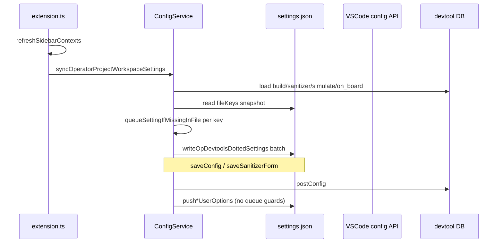
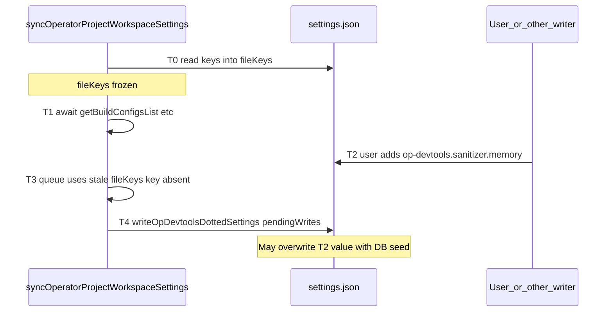

# Analysis: commit 5ee56b949 (op-devtools settings replay)

## What problem the commit tried to solve

The commit is a **port/replay** of settings handling from another line of work onto current `puer-master` (per message: *"Replay op-devtools settings handling on puer-master"*). Concretely it:

1. **Moves** `syncOperatorProjectWorkspaceSettings` and dotted-settings helpers out of [`plugin/src/extension.ts`](plugin/src/extension.ts) into [`plugin/src/service/config-service.ts`](plugin/src/service/config-service.ts).
2. **Changes persistence shape**: instead of `vscode.workspace.getConfiguration().update('op-devtools', nestedObject)` (nested JSON under one key), writes **flat dotted keys** (e.g. `op-devtools.environment.socVersion`) via direct file I/O in `ConfigService.writeOpDevtoolsDottedSettings`.
3. **Adds IDE portability**: [`plugin/src/helpers/ide-config-dir.ts`](plugin/src/helpers/ide-config-dir.ts) — `.vscode/settings.json` vs `.arts/settings.json` on CodeArts; `devtool_config.json` watcher path updated accordingly.
4. **Seeds** workspace `settings.json` from devtool DB (`build_configs`, sanitizer, simulate, on_board) when keys are missing so the VS Code Settings UI is populated after UI migration ([`docs/ui-migration.md`](docs/ui-migration.md) §4.3).
5. **Refactors** `pushSanitizer` / `pushOnBoard` / `pushSimulate` (after devtool save) to use the same dotted-file writer instead of nested `cfg.update`.



**Not in scope of this commit** (unchanged): runtime SOC/simulator resolution in [`plugin/src/domain/utils/ascend-util.ts`](plugin/src/domain/utils/ascend-util.ts) (`resolveAscendEnv` still treats workspace values as **explicit-only** via `getSocVersionWithWorkspaceOverride` / `getWorkspaceSimulatorType`).

---

## socVersion / simulatorType: regression vs prior behavior

### Before this commit (parent `HEAD^`)

| Path | `socVersion` | `simulatorType` |
|------|--------------|-----------------|
| `extension.ts` `syncOperatorProjectWorkspaceSettings` | **Not synced** | **Not synced** |
| `pushSimulateUserOptionsToWorkspaceSettings` | N/A | **Not mirrored** (only script, PMSampling, ResourceConflictRatio, parameters) |
| `pushOnBoard` / seed sync | No soc/simulator | No soc/simulator |

Parent `extension.ts` sync ended at `environment.environmentScript` only (confirmed via `git show HEAD^:plugin/src/extension.ts`).

### After this commit (new behavior)

| Path | `socVersion` | `simulatorType` |
|------|--------------|-----------------|
| `syncOperatorProjectWorkspaceSettings` | **Added** `queue('environment.socVersion', projectSocVersion)` | **Added** `queue('performanceTuning.simulation.simulatorType', ...)` |
| `pushSimulateUserOptionsToWorkspaceSettings` | N/A | **Added** `assignIfDefined(..., simulateOpts.simulatorType)` — **always overwrites file when DB value is defined** |

### Policy: no DB → VS Code for `socVersion` / `simulatorType`

These keys are **not** like sanitizer/on-board toggles (where seeding from devtool DB into `settings.json` helps the Settings UI after migration). For SOC and simulator:

- **Source of truth for commands**: `resolveAscendEnv` (workspace explicit → env → detection → defaults), plus DB `user_options` on saved simulate configs for **execution**, not for mirroring into VS Code.
- **VS Code settings**: only when the **user** sets them (Settings UI / manual edit). **`HEAD^` did not seed or push them**; commit `5ee56b949` reintroduced both paths by mistake.

**Explicit-user guards on seed are unnecessary** if that policy holds: `queueSettingIfMissingInFile` only matters for keys we **do** want to seed. Guards would be a weaker substitute for “still sometimes copy DB → settings,” which contradicts the decision. The fix is **delete the lines**, not wrap them:

- Remove `queue('environment.socVersion', ...)` and related `projectSocVersion` / `ascend910b` fallback from `syncOperatorProjectWorkspaceSettings`.
- Remove `queue('performanceTuning.simulation.simulatorType', ...)`.
- Remove `assignIfDefined(..., 'performanceTuning.simulation.simulatorType', ...)` from `pushSimulateUserOptionsToWorkspaceSettings`.

`queueSettingIfMissingInFile` remains appropriate for **other** keys (build scripts, sanitizer, on-board metrics, etc.).

### High-risk regressions (soc / simulator) — commit added DB→settings paths

1. **Seed** (`syncOperatorProjectWorkspaceSettings`) — new `queue` for both keys; guarded only if key missing in file / inspect, but still violates “no sync” on first open when keys absent; `socVersion` fallback can materialize `ascend910b` in the file.
2. **`pushSimulate`** — new unconditional mirror of `simulatorType` on every simulate save; **no** `queueSettingIfMissingInFile`; overwrites Settings UI.
3. **Runtime resolution unchanged (good)** — [`ascend-util.ts`](plugin/src/domain/utils/ascend-util.ts) does not write settings; regression is **persistence only**.

**Verdict**: Regression is **adding sync at all**, not missing guards on seed. **pushSimulate** is the worst path (always writes). Fix = **removal**, aligned with `HEAD^`.

**Still valid (opposite direction)**: `syncAscendEnvScriptFromWorkspaceSettings` mirrors **settings → `projects.json`** when the user edits `op-devtools.environment.*` — that is not DB→settings.

---

## Other bugs in the same commit

1. **A5 on-board settings in `settings.json` (not a correctness bug)** ([`config-service.ts` L262–269](plugin/src/service/config-service.ts))
   - Seed may write **both** `performanceTuning.onBoard.pcSampling` and `performanceTuning.onBoard.cacheHeatmap` on A5 (branch queues `pcSampling`, then an unconditional second `queue` for `cacheHeatmap`).
   - **Product intent (user clarification)**: Extra keys in VS Code settings on A5 are **acceptable**. What matters is that **runtime does not use** non-A5 metrics on A5 — not that the file stays minimal.
   - **Existing guard** (already in tree): [`operator-project-workspace-config.ts`](plugin/src/helpers/operator-project-workspace-config.ts) maps `cacheHeatmap` → `MemoryDetail` only when `!isA5Profiler`; `pcSampling` only when `isA5Profiler`. Same pattern in `pushOnBoardUserOptionsToWorkspaceSettings` (pcSampling vs cacheHeatmap branch).
   - **Residual note**: The duplicate `queue('cacheHeatmap')` on non-A5 is redundant (same value queued twice) — optional cleanup for clarity, **not** required for A5 behavior. **Review focus**: ensure no execution path reads `cacheHeatmap` / `MemoryDetail` on A5 without the `isAscendA5ProfilerCannSoc` gate (e.g. [`profiler-service.ts`](plugin/src/domain/services/profiler-service.ts), [`model.ts`](plugin/src/domain/models/model.ts)).

2. **`operatorMetrics` in seed batch**
   - Seed still queues `performanceTuning.onBoard.operatorMetrics` (parent extension did too).
   - Separate handler `onBoardOperatorMetricsSync` in [`extension.ts` L2210–2303](plugin/src/extension.ts) reacts to that key and propagates one boolean to **all** per-metric child keys via `writeOpDevtoolsDottedSettings` — can **flatten** per-metric toggles after seed or user edits. It does **not** check `isSyncingWorkspaceSettings`.

3. **Removed `normalizeDottedOpDevtoolsWorkspaceSettings` (mixed shapes in old workspaces)**

**What the old code did (wrong direction for today):** On `onDidChangeConfiguration`, if the user set a **dotted** workspace key (e.g. `op-devtools.sanitizer.memory` via Settings UI), it copied `inspection.workspaceValue` into a **nested** `"op-devtools": { ... }` blob and cleared the dotted workspace entry — because writes used `cfg.update('op-devtools', nestedObject)`.

**What the new code does:** All plugin writes use **dotted keys in `settings.json`** via `writeOpDevtoolsDottedSettings`. `readSettingsJsonFile` can **read** nested blobs by flattening them in memory:

```72:88:plugin/src/service/config-service.ts
    const nested = parsed['op-devtools'];
    if (nested && typeof nested === 'object' && !Array.isArray(nested)) {
      const { 'op-devtools': _removed, ...rest } = parsed;
      flattenNestedOpDevtools(nested as Record<string, unknown>, 'op-devtools', rest);
      return rest;
    }
```

…but the next `writeFile` only serializes the flattened map, so the **first** `writeOpDevtoolsDottedSettings` call drops the nested `"op-devtools"` key from disk. Until that happens, the file can contain **both** `"op-devtools": { ... }` and `"op-devtools.sanitizer.memory": ...`; VS Code’s `getConfiguration('op-devtools')` may not match what `readSettingsJsonFile` / seed logic see.

**Do not restore the old normalize** — it consolidates into nested, which fights the dotted-first model.

**Recommended fix (file migration, dotted-only on disk):**

| Step | Action |
|------|--------|
| A | Add `ConfigService.migrateWorkspaceSettingsFileToDottedKeys()` (or run inside first `writeOpDevtoolsDottedSettings`): `flat = readSettingsJsonFile(path)` (already merges nested → dotted), then `writeFile(JSON.stringify(flat))` with **no** top-level `"op-devtools"` object. |
| B | Call **once on activate** when a workspace folder exists (e.g. end of `refreshSidebarContexts` before seed, or start of `syncOperatorProjectWorkspaceSettings`), guarded by `if (parsed['op-devtools'] != null)` or `needsMigration(flat, raw)` to avoid rewriting every launch. |
| C | Optional safety net: on `onDidChangeConfiguration` when `e.affectsConfiguration('op-devtools')`, if `settings.json` still contains `"op-devtools"`, run the same migration (debounced). Set `isSyncingWorkspaceSettings` during migration to avoid env sync loops. |
| D | **Conflict rule** if both nested and dotted exist for the same logical key: prefer **existing dotted** keys in `rest` over nested flatten (today `flattenNestedOpDevtools` runs after `...rest` is taken from file — document or adjust so dotted file entries win over nested duplicates). |

**Tests:** Fixture `settings.json` with nested `"op-devtools"` only → after migrate, file has only `op-devtools.*` keys; fixture with both → dotted value wins; `getConfiguration` sees same effective values as before migrate.

---

## Data races and accidental reverts (Settings UI)

### 1. Read-modify-write without locking (`writeOpDevtoolsDottedSettings`)

```129:144:plugin/src/service/config-service.ts
    const current = readSettingsJsonFile(filePath);
    for (const [relativeKey, value] of Object.entries(updates)) { ... }
    await fs.promises.writeFile(filePath, ...);
```

Concurrent callers (seed sync, `pushSimulate`, `pushSanitizer`, `onBoardOperatorMetricsSync`, `ConfigHelper.set`, `common-controller`, `environment-script-guard`) can **interleave** read/write and **drop keys** (last writer wins).

### 2. TOCTOU on `fileKeys` during seed (time-of-check vs time-of-use)

**What we check (time of check):** At the start of `syncOperatorProjectWorkspaceSettings`, the plugin reads which keys already exist in `settings.json` and skips seeding those keys.

```147:152:plugin/src/service/config-service.ts
  private static getWorkspaceSettingsFileKeySet(workspaceRoot?: string): Set<string> {
    ...
    return new Set(Object.keys(readSettingsJsonFile(getIdeSettingsFilePath(root))));
  }
```

```175:178:plugin/src/service/config-service.ts
    if (fileKeys.has(toFullDottedKey(relativeKey))) {
      return;
    }
    pendingWrites[relativeKey] = value;
```

That set is captured **once** here, before any slow work:

```207:212:plugin/src/service/config-service.ts
      const cfg = vscode.workspace.getConfiguration('op-devtools');
      const fileKeys = ConfigService.getWorkspaceSettingsFileKeySet();
      const pendingWrites: OpDevtoolsDottedWrites = {};
      const queue = (key: string, value: unknown) => {
        ConfigService.queueSettingIfMissingInFile(pendingWrites, fileKeys, cfg, key, value);
      };
```

**What we use later (time of use):** After many `await`s (L187–195 load build configs, sanitizer, project SH, SOC, etc.), every `queue(...)` call still uses the **same** `fileKeys` from line 208. Nothing re-reads the file before deciding what goes into `pendingWrites`.

**What we write (later still):** One batch write merges `pendingWrites` into the file:

```309:310:plugin/src/service/config-service.ts
      if (Object.keys(pendingWrites).length > 0) {
        await ConfigService.writeOpDevtoolsDottedSettings(pendingWrites);
```

`writeOpDevtoolsDottedSettings` reads the file again (L129), but only to merge — it does **not** re-run “is this key already present / should we skip DB seed?”



**Concrete failure:** User opens Settings during project refresh and sets `sanitizer.memory` to `false`. That writes `op-devtools.sanitizer.memory` into `settings.json` at **T2**. Seed already took `fileKeys` at **T0** without that key, so `queue('sanitizer.memory', ...)` still queues the DB value at **T3**. **T4** writes the DB value and **reverts** the user’s edit.

`queueSettingIfMissingInFile` also checks `cfg.inspect` for “explicitly set” (L165–173), but a raw edit to `settings.json` may not update inspect immediately, and the **fileKeys** branch is the one affected by this gap.

**Why “re-snapshot fileKeys before write” helps:** Immediately before L309–310, call `getWorkspaceSettingsFileKeySet()` again and drop any `pendingWrites` entry whose full key is now in the file (or re-call `queueSettingIfMissingInFile` per key). That aligns the skip decision with the file state at write time.

**Why this is separate from §1 (RMW race):** §1 is two writers both doing read-merge-write and losing each other’s keys. §2 is one seed pass using an **outdated “which keys exist?”** snapshot across a long async gap.

### 3. `isSyncingWorkspaceSettings` is incomplete

- Flag is set only around `extension.ts` wrapper calling `configService.syncOperatorProjectWorkspaceSettings` ([L335–348](plugin/src/extension.ts)).
- **Not set** for: `push*` after save, `writeOpDevtoolsDottedSettings` from metrics sync, `ConfigHelper`, `environment-script-guard`.
- `onDidChangeConfiguration` for `op-devtools.environment.*` is suppressed during seed sync, but **`onBoardOperatorMetricsSync` is not** → can run during/after file writes from seed.

### 4. File write vs VS Code in-memory config

- Workspace-target updates go to **file**, not `cfg.update(Workspace)`.
- VS Code usually reloads from `settings.json`, but timing can produce brief inconsistency; `onDidChangeConfiguration` may fire with `isSyncingWorkspaceSettings === false` for push/metrics writes → downstream `syncAscendEnvScriptFromWorkspaceSettings` may run ([`project-service.ts` L208–240](plugin/src/service/project-service.ts)) and push workspace SOC/script into `projects.json` — generally desired for env changes, but can race with user editing env fields.

### 5. User revert scenarios (summary)

| Trigger | Can revert Settings UI? |
|---------|-------------------------|
| `refreshSidebarContexts` → seed sync | **Yes** for soc/simulator if those `queue` lines remain; other keys: TOCTOU / stale DB risk |
| Save simulate config in panel | **Yes** for `simulatorType` while `pushSimulate` mirrors it |
| Save sanitizer/on_board | Overwrites listed keys unconditionally (same pattern as before, now dotted file) |
| Toggle `operatorMetrics` | Can reset all metric children |
| Concurrent dotted writes | **Yes** (lost updates) |

---

## Recommended fixes (when implementing)

1. **Remove** `socVersion` / `simulatorType` from DB→settings paths (restore `HEAD^` policy). Do **not** add explicit-user guards on seed for these keys — omit them from the seed list entirely. Remove `simulatorType` from `pushSimulateUserOptionsToWorkspaceSettings`.

2. **Optional**: Remove redundant second `queue('performanceTuning.onBoard.cacheHeatmap')` in seed (cosmetic only; does not affect A5 if runtime gates hold).

2b. **Migrate legacy `settings.json`**: implement §3 fix (dotted-only file; see `migrate-nested-settings-json` todo).

3. **Harden `writeOpDevtoolsDottedSettings`**: per-workspace mutex, or re-read-merge-write in a loop; optional shared `isWritingOpDevtoolsSettings` flag for all writers.

4. **Extend sync suppression**: `onBoardOperatorMetricsSync` should ignore events while `isSyncingWorkspaceSettings` (or while any `ConfigService` batch write is in progress).

5. **Shrink TOCTOU (§2)**: Before L309–310, refresh `fileKeys` (or filter `pendingWrites`) so keys added to `settings.json` during the seed `await`s are not overwritten; see expanded §2 above.

6. **Tests** (none exist for `config-service` today): after removal, seed/push do not write `environment.socVersion` or `performanceTuning.simulation.simulatorType`; concurrent double-write on other keys; **A5 merge** ignores `cacheHeatmap` when A5 SOC.

---

## Key files

- [`plugin/src/service/config-service.ts`](plugin/src/service/config-service.ts) — seed, push, file writer
- [`plugin/src/extension.ts`](plugin/src/extension.ts) — `isSyncingWorkspaceSettings`, metrics sync, refresh → seed
- [`plugin/src/helpers/operator-project-workspace-config.ts`](plugin/src/helpers/operator-project-workspace-config.ts) — explicit vs `cfg.get` readers
- [`plugin/src/domain/utils/ascend-util.ts`](plugin/src/domain/utils/ascend-util.ts) — runtime resolution (unchanged; still correct for explicit-only)
- [`docs/ascend-env-spec.md`](docs/ascend-env-spec.md) — spec for explicit workspace SOC/simulator
