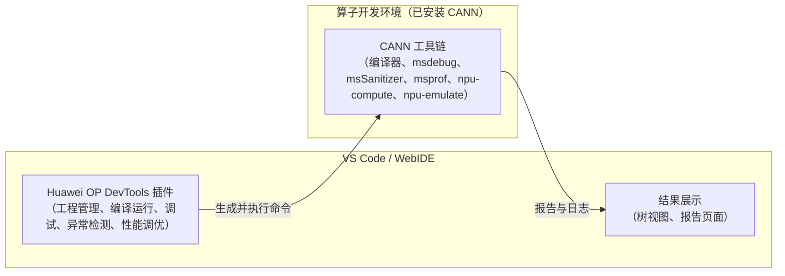

# Huawei OP DevTools

Huawei OP DevTools（华为算子一站式开发工具）是一款面向 Ascend C 算子开发的一站式 VS Code 插件，覆盖算子工程创建、代码开发、编译部署、运行调试、异常检测和性能分析的全流程，支持 CANNLab 云上开发环境和本地开发环境两种使用方式。

## 概述

### 功能定位

本仓库是Huawei OP DevTools插件的源码仓库。插件基于VS Code扩展机制实现，本身不携带算子编译与仿真运行时，而是负责工程管理和流程编排：根据用户选择的工程类型和操作，自动生成并执行CANN工具链命令，最后将执行结果以树视图和报告页面的形式呈现。

### 主要功能

| 功能 | 说明 |
|------|------|
| 算子工程管理 | 创建、打开标准自定义算子工程、算子直调工程、PyAsc 算子工程、Triton 算子工程等多种工程类型。 |
| 算子代码开发 | 提供 Ascend C 语法高亮、代码跳转等编辑能力。 |
| 编译部署与运行 | 一键完成算子编译、部署与运行。 |
| 算子调试 | 支持 CPU 孪生调试和 NPU 上板调试。 |
| 异常检测 | 集成 msSanitizer、npu-check 工具，检测算子的内存、竞争、同步等潜在问题。 |
| 性能调优 | 集成 msprof、npu-compute、npu-emulate 工具，完成上板和仿真性能数据采集，并提供可视化报告。 |

### 架构



## 目录结构说明

```text
.
├── plugin/              # 插件主工程：命令、服务、视图与算子工程模板
├── web/                 # 插件 Webview 前端（基于 Vue）
├── shared/              # 插件与 Webview 共享的代码与配置
├── profiling-report/    # 性能分析报告可视化组件
├── syntaxes/            # 语法高亮定义
├── docs/                # 功能设计与使用文档
├── assets/              # 文档图片资源
├── flavors/             # 多形态构建配置
├── scripts/             # 构建与发布脚本
└── testdata/            # 测试数据
```

## 快速入门

### 环境准备

支持以下两种环境，任选其一即可，详细步骤请参见《[使用操作文档](docs/user-guide.md)》：

- 云上环境（推荐）：在[CANNLab](https://gitcode.com/org/cann/cannlab/environment)创建并启动连接云上环境，即可直接使用插件。
- 本地环境：准备一台已安装 CANN 的 Linux 环境（物理机或容器均可），可通过 VS Code 的 Remote - SSH 插件从 Windows 本机连接远端环境，或使用 CANNLab 提供的 VS Code 本地连接方式直接接入。

### 开发流程

算子开发整体分为以下五步，详细操作请参阅《[使用操作文档](docs/user-guide.md)》：

1. 创建算子工程。
2. 开发算子：编写算子代码，完成编译和运行。
3. 调试算子：使用 CPU 孪生调试或 NPU 上板调试定位问题。
4. 异常检测：使用 msSanitizer 或 npu-check 检测算子的潜在问题。
5. 性能分析：采集性能数据，并通过可视化报告定位性能瓶颈。

## 相关资源

- [算子样例仓 ops-math](https://gitcode.com/cann/ops-math)
- [插件发布仓](https://gitcode.com/opdevtools/plugin_release/releases)
- [问题反馈](https://gitcode.com/opdevtools/plugin_release/issues)
- [npu-check 用户手册](https://gitcode.com/cann/asc-tools/blob/experimental/npu_tools/npu_check/npu_check.md)
- [npu-compute 使用文档](https://gitcode.com/cann/asc-tools/blob/experimental/docs/06_npu_compute.md)
- [性能分析报告功能说明](./profiling-report.md)
