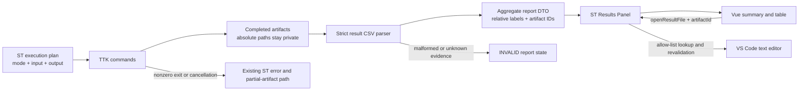
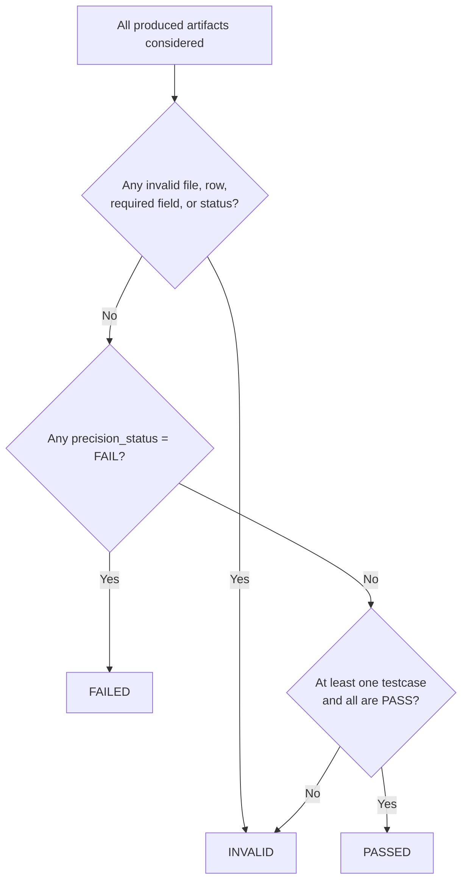

# Architecture Diagrams

## Data and trust flow

The extension-host boundary owns filesystem authority, parsing, outcome calculation, and artifact-ID resolution. The webview owns presentation and local filtering only.

## Overall outcome

