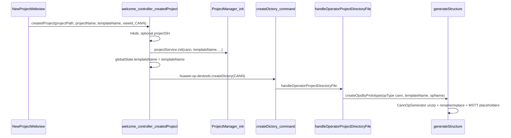

# New project generation — implementation specification

This document describes the **current** implementation of creating a new operator project from the **New Project** webview flow: UI parameters, extension entry points, persistence, template ZIP selection, and post-extract renaming / content substitution.

Related documents:

- [`OPERATOR_BEHAVIOR_SPECIFICATION.md`](./OPERATOR_BEHAVIOR_SPECIFICATION.md) — high-level operator types, actions, and template ZIP mapping.
- [`GENERATED_FILES_SPECIFICATION.md`](./GENERATED_FILES_SPECIFICATION.md) — `projects.json` / `configs.json` field shapes.

---

## 1. Terminology

| Term | Meaning |
|------|---------|
| **View ID** | Numeric `OperatorProjectViewId` from the New Project UI (`CANN` = 1, `STANDARD_CUSTOM` = 2, `PYASC` = 3, `TRITON` = 4). Defined in [`shared/project-type-view-id.ts`](../shared/project-type-view-id.ts). |
| **`project_type` (stored)** | String stored on the project record from `viewIdToProjectType` in [`plugin/src/domain/utils/project-utils.ts`](../plugin/src/domain/utils/project-utils.ts): `cann`, `ascend`, `pyasc`, `triton`. |
| **`op_type` (generator / configs)** | String passed into `generateStructure` and [`OpGeneratorFactory`](../plugin/src/domain/services/op-generator-factory.ts): `cann`, `ascend`, `pyasc`, `triton`. Resolved by the same `viewIdToProjectType` for New Project, except `STANDARD_CUSTOM` uses `op_type: 'ascend'` when `createOpsByPrototype` runs from [`webview-message-list.ts`](../plugin/src/class/webview-message-list.ts). |
| **`projectName` (UI)** | Operator project name from the form; becomes the **child directory name** under the chosen parent `projectPath` and is persisted as `project_name` when `ProjectManager.initProject` runs. |
| **`templateName` (API)** | Optional string sent from web to extension; stored briefly in `ExtensionContext.globalState` under key `templateName` for the follow-up command. |

---

## 2. Web UI inputs

### 2.1 API payload

[`CreatedProjectParams`](../shared/api-types/webview.d.ts):

- `projectPath` — parent directory for the new folder.
- `projectName` — folder name and (when init runs) registered operator project name.
- `projectSH` — optional env script executed with `chmod +x` then sourced (best-effort; failures are logged, not fatal).
- `createOperatorProjectDictoryFileType` — view ID (1–4).
- `templateName` — optional; resolved per section 2.2.

### 2.2 Template name resolution (web)

[`use-new-project-ssh.ts`](../web/src/views/panels/new-project/composables/use-new-project-ssh.ts) builds `templateName` via `resolveTemplateNameByProjectType()`:

| View ID | Condition | `templateName` sent |
|---------|-----------|------------------------|
| CANN (1) | User selected a CANN template | Mapped from UI key (see table below). |
| CANN (1) | No template selected | `undefined`. |
| TRITON (4) | Always | `'triton_vector_add'`. |
| PYASC (3) / STANDARD_CUSTOM (2) | — | `undefined` from this composable (not used for PYASC scaffold id; see §5.3). |

**CANN UI key → `templateName` string:**

| UI `selectedTemplate` | `templateName` |
|----------------------|----------------|
| `helloworld` | `hello_world` |
| `addn` | `addn_custom` |
| `torch_library_template` | `torch_library_template` |
| `triton_vector_add` | `triton_vector_add` (only relevant if wired for CANN; TRITON type forces its own default). |

---

## 3. Extension entry: `createdProject`

Implemented in [`welcome-controller.ts`](../plugin/src/controller/welcome-controller.ts) (`welcomeMethods.createdProject`).

### 3.1 Ordered steps (all types)

1. Persist `lastProjectPath` to `globalState`.
2. Create `path.join(projectPath, projectName)` if missing (`fs.mkdirSync`, `recursive: true`).
3. Optionally run `projectSH` via [`CommandExecutor`](../plugin/src/helpers/command-executor.ts).
4. Optional **collection bookkeeping** when `project_type === 'ascend'` (**STANDARD_CUSTOM** only): if the active workspace folder path contains `experimental` or `math`, update the root project’s `experimental_ops_list` / `ops_list` via `createProject`; otherwise show `welcome.cannotCreateHere`. This does **not** replace project registration below.
5. **Always** call **`projectService.init`** → [`ProjectManager.initProject`](../plugin/src/core/project/project-manager.ts) → **`createProject`** for **all** view IDs (including STANDARD_CUSTOM), with `project_name`, `project_path` = normalized `projectPath/projectName`, `template_name`, `project_type`.
6. `revealInExplorer` on the new folder.
7. Show `welcome.projectCreated`.
8. `ensureLaunchJsonExists(fullProjectPath)` for the new operator directory.
9. If `params.templateName` is set, store it in `globalState` as **`templateName`** (used by the follow-up command for CANN / PYASC / TRITON).
10. Run `huawei-op-devtools.createDictory` with `{ createOperatorProjectDirectoryFileType }` and progress — for **all** types including STANDARD_CUSTOM (invokes [`handleOperatorProjectDirectoryFile`](../plugin/src/class/webview-message-list.ts)).
11. On failure: warning `welcome.createDirOkCreateFilesError`.
12. Prompt user to open the folder in current or new window; `vscode.openFolder`.

### 3.2 Explicit operator name (`opName`)

[`CreateOpsByPrototypeParams`](../shared/api-types/ops.d.ts) includes optional **`opName`**. [`ProjectService.createOpsByPrototype`](../plugin/src/service/project-service.ts) passes it to [`generateStructure`](../plugin/src/domain/models/model.ts) as **`data.op_name`**, falling back to [`ProjectManager.getProjectName()`](../plugin/src/core/project/project-manager.ts) when omitted.

[`handleOperatorProjectDirectoryFile`](../plugin/src/class/webview-message-list.ts) passes **`opName: pm.getProjectName()`** for CANN, PYASC, TRITON, and STANDARD_CUSTOM so the form’s **`projectName`** is always the canonical **`op_name`** for scaffolding when New Project has just run `init`.

### 3.3 Removed behavior (historical)

Previously, STANDARD_CUSTOM took an early `return` after running `OpGeneratorFactory.getGenerator` **without** `op_type` (which resolved to the wrong plugin) and **without** `createDictory` / `generateStructure`. That path has been removed in favor of the unified flow in §3.1.

---

## 4. Command handler: `handleOperatorProjectDirectoryFile`

[`webview-message-list.ts`](../plugin/src/class/webview-message-list.ts).

### 4.1 Preconditions

- `normalizeViewIdToProjectType` maps view ID to feature-toggle key (`cann` | `standard-custom` | `pyasc` | `triton`); disabled types throw.
- Reads **`templateName`** from `globalState` (set in §3.3).

### 4.2 Per view ID

| View ID | Action |
|---------|--------|
| **CANN (1)** | `createOpsByPrototype({ opsPrototypeFile: '', opType: 'cann', templateName, opName: pm.getProjectName() })`. Clears `globalState.templateName` if set. |
| **PYASC (3)** | Same with `opType: 'pyasc'`, plus `opName`. |
| **TRITON (4)** | Same with `opType: 'triton'`, `templateName: templateName \|\| 'triton_vector_add'`, plus `opName`. |
| **STANDARD_CUSTOM (2)** | `createOps({})` then `createOpsByPrototype({ opsPrototypeFile: path, opType: 'ascend', opName: pm.getProjectName() })` **without** `templateName`. |

Each path ensures `ProjectManager.ensureProjectId()` then delegates to [`ProjectService.createOpsByPrototype`](../plugin/src/service/project-service.ts) → **`generateStructure`**.

---

## 5. Core generation: `generateStructure` and generators

### 5.1 Orchestration

[`generateStructure`](../plugin/src/domain/models/model.ts):

1. Load project by `data.project_id`.
2. Build params: `op_type`, `ops_prototype_file`, `op_name`, `template_name`, `op_path` (defaults to `project.project_path`), `skipExisting`, etc.
3. Optionally create `.vscode` / launch artifacts (`skipVscodeFiles`).
4. **`OpGeneratorFactory.getGenerator(params, project, extensionPath)`** → [`OperatorPluginRegistry.getProjectGenerator`](../plugin/src/domain/plugins/operator-plugin.registry.ts) → plugin’s `createProjectGenerator`.
5. **`opName = generator.parseMeta()`** — canonical operator name for the new `ops` record.
6. Unless `isSkipUnZip`: **`generator.executeGeneration()`** — unzip + rename + replace.
7. Upsert `ops` row and default **`configs.json`** entries (`build_op`, `build_example`, …) using plugin default paths/scripts.

### 5.2 Generator selection

| `op_type` | Class | ZIP path under extension `extensionPath` |
|-----------|--------|------------------------------------------|
| `ascend` | `AscendOpGenerator` | `out/templates/code_template/ascend_template/add_custom.zip` (fixed). |
| `cann` | `CannOpGenerator` | `out/templates/code_template/cann_template/${template_name}.zip`. |
| `pyasc` | `PyAscOpGenerator` | `out/templates/code_template/cann_template/pyasc_temple.zip` (fixed). |
| `triton` | `TritonOpGenerator` | `out/templates/code_template/triton_template/${template_name}.zip` (default `triton_vector_add`). |

Source templates are **unpacked directories** under [`plugin/templates/code_template/<group>/<templateName>/`](../plugin/templates/code_template/) in the repo. [`scripts/build-extension.ts`](../scripts/build-extension.ts) copies `plugin/templates/` to `out/templates/`, then **packs** each template directory into a **`<templateName>.zip`** next to it (and removes the unpacked copy under `out/` only), because the extension runtime still loads archives from `out/templates/code_template/.../*.zip` (see [`OpGeneratorFactory`](../plugin/src/domain/services/op-generator-factory.ts)).

### 5.3 `parseMeta()` — how `op_name` and `template_name` are set

| Generator | `op_name` | `template_name` |
|-----------|-----------|-----------------|
| **CannOpGenerator** | `params.op_name \|\| project.project_name \|\| basename(project.project_path)` | `params.template_name \|\| null \|\| 'hello_world'` |
| **PyAscOpGenerator** | Same as CANN | **Hardcoded** `'pyasc_temple'` (params template name does not change scaffold id). |
| **TritonOpGenerator** | Same as CANN | `params.template_name \|\| 'triton_vector_add'` (also defaulted in [`TritonPlugin.createProjectGenerator`](../plugin/src/domain/plugins/triton.plugin.ts)). |
| **AscendOpGenerator** | If `params.op_name` is set (trimmed non-empty): use it. Else if `ops_prototype_file` absent: `project.project_name \|\| basename(project.project_path)`. Else: JSON `op` field, else same fallback. | `params.template_name \|\| 'add_custom'` |

For **New Project**, `generateStructure` usually receives explicit **`data.op_name`** from [`createOpsByPrototype`](../plugin/src/service/project-service.ts); otherwise **`project.project_name`** matches the form’s **`projectName`** after `init`.

### 5.4 `executeGeneration()` — unzip

- Uses **AdmZip** to extract into `op_path` (absolute operator project directory).
- **`skipExisting`**: if true, extract each entry only if the target file does not exist (incremental / non-destructive). Used e.g. from [`folder-context-menu-service`](../plugin/src/service/folder-context-menu-service.ts) initialization, not the default New Project path (`skipExisting` defaults false).

### 5.5 Post-extract: rename and content substitution

Implemented on [`BaseOpGenerator`](../plugin/src/domain/services/op-generator-factory.ts): `_renameFiles`, `_replaceContent`, and **`_replaceMsttPlaceholders`**.

**Template-id gate (all concrete generators):**

```text
if (this.template_name && this.op_name) {
  this._renameFiles(this.template_name);
  this._replaceContent(this.template_name);
}
if (this.op_name) {
  this._replaceMsttPlaceholders();
}
```

Rename and template-id content replacement run whenever both **`template_name`** and **`op_name`** are set (including when they are **equal**, so idempotent replaces still normalize files). **`_replaceMsttPlaceholders`** runs whenever **`op_name`** is set, so templates can embed stable tokens such as `__MSTT_OP_NAME__` that are always rewritten to the user’s operator name.

#### 5.5.1 `_renameFiles(templateName)`

- Walks files under `op_path` (recursive for nested dirs).
- For any file whose **basename** contains `templateName`, renames by replacing **every** regex `/templateName/g` with `this.op_name`.
- If the computed new basename is unchanged, the file is **not** moved.
- With `skipExisting: true`, skips rename if the destination path already exists.

#### 5.5.2 `_replaceContent(templateName)`

Builds three replacement keys from `templateName`:

1. **`TEMPLATE_UPPER`** — `templateName.toUpperCase()` (entire string, e.g. `hello_world` → `HELLO_WORLD`).
2. **`TemplatePascal`** — each `_`-separated segment capitalized and concatenated (e.g. `hello_world` → `HelloWorld`, `add_custom` → `AddCustom`).
3. **`template_snake`** — `templateName` unchanged.

Replacement map:

| Key | Replacement value |
|-----|-------------------|
| `TEMPLATE_UPPER` | `op_name.toUpperCase()` |
| `TemplatePascal` | Pascal form of `op_name` (same segment rule) |
| `template_snake` | `op_name` |

Algorithm: read each text file under `op_path` (recursive); for each key present in file body, **`String.prototype.split(key).join(value)`** globally. Order follows object key insertion order: **upper, then Pascal, then snake**.

**`skipExisting` behavior:** only process files whose name **or** content contains at least one replacement key (otherwise skip), mirroring rename intent for partial updates.

**Caveats:**

- Replacement is **substring-based**; any occurrence of `TemplatePascal` inside a longer identifier is rewritten (e.g. names containing `AddCustom`).
- Strings that are **not** one of the three keys are never substituted unless they use the MSTT tokens below.

#### 5.5.3 `_replaceMsttPlaceholders()`

Reserved tokens (replaced **longest first** to avoid partial-token collisions):

| Token | Value |
|-------|--------|
| `__MSTT_OP_NAME_PASCAL__` | PascalCase from `op_name` snake segments |
| `__MSTT_OP_NAME_UPPER__` | `op_name.toUpperCase()` |
| `__MSTT_OP_NAME__` | `op_name` as-is |

Bundled **PYASC** and **TRITON** Python templates use these tokens where the **operator-facing symbol or message must follow `op_name`** but the fragment does **not** contain the template id string (so `_replaceContent` would not rewrite it). See **§5.5.4** for when each mechanism is appropriate.

#### 5.5.4 Design rationale: template-id substitution vs. `__MSTT_*` placeholders

**Two complementary mechanisms** run after unzip (§5.5): (1) **`_renameFiles` / `_replaceContent`** keyed off **`template_name`**, and (2) **`_replaceMsttPlaceholders`** keyed off reserved **`__MSTT_OP_NAME_*__`** tokens. They are not duplicates; each covers cases the other cannot.

**Template-id replacement (default for CANN / AscendC-style sources)**

Most **CANN** and **Ascend** archives are authored so the **operator identity in source matches the template id** (e.g. `hello_world` in [`hello_world.asc`](../plugin/templates/code_template/cann_template/hello_world/hello_world.asc): kernel `hello_world`, launch `hello_world<<<…>>>`). The same holds for templates such as **`addn_custom`**, **`torch_library`**, and **`add_custom`**: symbols and filenames embed `template_name` (or obvious compounds built from it). Then:

- **`_renameFiles`** turns `…/hello_world.asc` into `…/<op_name>.asc` when `op_name` differs from the template id.
- **`_replaceContent`** rewrites every occurrence of the three keys (§5.5.2) to the corresponding forms of **`op_name`**.

No **`__MSTT_*`** markers are **required** in those trees for the rename story to stay consistent: one coherent rule—“everything that should track the operator is expressed in terms of the template id, then rewritten to `op_name`.”

**`__MSTT_*` placeholders (Python samples where the template id is absent)**

Some **Python** scaffolds intentionally use a **driver or log label that does not include `template_name`** (historical copy-paste names, or a fixed helper layer). **`_replaceContent` only substitutes the three template-derived keys**; it will not change an unrelated identifier such as a mismatched `*_custom` entrypoint. For those spots, templates embed **`__MSTT_OP_NAME__`** (and optional Pascal / upper variants) so **`_replaceMsttPlaceholders`** always aligns the symbol or string with **`op_name`**.

**Why not unify all AscendC / `.asc` content on `__MSTT_*` only**

- **Redundancy**: For kernels and host glue that already spell the template id, template-id replacement already maps to `op_name`; adding parallel `__MSTT_*` tokens would duplicate the same intent.
- **Surface area**: Ascend / ACLNN / **TORCH_LIBRARY** paths include **framework-facing names** (`OP_TYPE_REGISTER`, `TORCH_LIBRARY`, `aclnn_*`, …) that are **not** arbitrary renames of the folder name; a wholesale switch to placeholders would increase churn and risk breaking contracts.
- **C++ / device code**: Identifiers beginning with **`__`** are reserved in ISO C++ in many contexts; relying on **`template_name` → `op_name`** in normal identifiers avoids leaning on reserved patterns in device source unless there is a targeted need.

**Summary**

| Situation | Preferred approach |
|-----------|---------------------|
| Symbol or path segment **contains** `template_name` (snake / Pascal / UPPER) | **`_renameFiles` + `_replaceContent`** |
| Symbol or user-visible string **must** track `op_name` but **does not** contain `template_name` | **`__MSTT_OP_NAME_*__` + `_replaceMsttPlaceholders`** |
| Fixed API or toolchain string | **Neither** automatic pass; keep stable or handle in a dedicated template variant |

---

## 6. End-to-end flows (New Project)

### 6.1 CANN



- **`op_type`**: `cann`.
- **ZIP**: `cann_template/{template_name}.zip`; default template name **`hello_world`** if web sent `undefined`.
- **Substitution**: §5.5 applies with `template_name` from params / default.

### 6.2 PYASC

- Same as CANN for **init** + **createDictory** + **`generateStructure`**, except **`op_type`: `pyasc`**.
- **ZIP**: always **`pyasc_temple.zip`**; internal `template_name` for substitution is always **`pyasc_temple`** regardless of `globalState.templateName`.

### 6.3 TRITON

- Same pattern; **`op_type`: `triton`**.
- **ZIP**: `triton_template/{template_name}.zip` with **`template_name`** default **`triton_vector_add`** if global state is empty.

### 6.4 STANDARD_CUSTOM (view ID 2)

- Same **init** + **`createDictory`** + **`generateStructure`** path as other types after `createdProject` (see §3.1).
- **`createDictory`** runs **`createOps`** then **`createOpsByPrototype`** with **`op_type: 'ascend'`** and explicit **`opName`** (§4.2).
- **ZIP**: **`add_custom.zip`** via **`AscendOpGenerator`**; **`op_name`** comes from `params.op_name` when provided, else prototype JSON `op`, else `project_name`.

---

## 7. `createDictory` handler detail (STANDARD_CUSTOM)

When `handleOperatorProjectDirectoryFile` runs for view ID **2**:

1. **`createOps`** — writes operator prototype JSON using **`projectName`** from [`ProjectService.createOps`](../plugin/src/service/project-service.ts) / `ProjectManager` (`params.projectName || info.name`).
2. **`createOpsByPrototype`** with **`op_type: 'ascend'`**, prototype file path, and **`opName: pm.getProjectName()`**.
3. **`AscendOpGenerator`**: **`params.op_name`** wins when set (trimmed); else JSON `op`; else `project_name` / basename.
4. Unzips **`add_custom.zip`**; applies §5.5 substitution rules.

---

## 8. Template inventory (bundled sources)

Under [`plugin/templates/code_template/`](../plugin/templates/code_template/):

| Folder / archive name | Used by | Notes |
|------------------------|---------|--------|
| `cann_template/hello_world` | CANN default / helloworld | |
| `cann_template/addn_custom` | CANN addn | |
| `cann_template/torch_library_template` | CANN torch library | |
| `cann_template/pyasc_temple` | PYASC | Fixed ZIP name. |
| `cann_template/torch_library` | Not default New Project CANN mapping | Alternate sample; generator uses `torch_library_template` from UI mapping. |
| `triton_template/triton_vector_add` | TRITON | |
| `ascend_template/add_custom` | Ascend / STANDARD_CUSTOM | |

---

## 9. Persistence summary

| Step | Storage |
|------|---------|
| `ProjectManager.initProject` | `projects.json` (or equivalent store) via **`createProject`**: `project_name`, `project_path`, `template_name`, `project_type`, optional `ascend_env_script`. |
| `generateStructure` after unzip | **`ops`** record: `op_name`, `op_type`, `op_path`, `template_name`, timestamps. |
| Same | **`configs.json`**: default `build_op`, `build_example`, sanitizer, simulate, on_board, etc., from [`OperatorPluginRegistry.getOpPlugin(record.op_type).getInitialConfigScripts`](../plugin/src/domain/plugins/operator-plugin.registry.ts). |

Regression check (optional CI / local): run **`node scripts/verify-template-entrypoints.cjs`** from the repo root; it walks unpacked PYASC and TRITON template **source directories** and asserts **`__MSTT_*`** placeholders can be fully resolved for a synthetic operator name.

---

- Directory creation failure → thrown; webview shows create project failed.
- `init` failure → thrown with `welcome.initOperatorProjectFailed`.
- `createDictory` / scaffold failure → warning; directory remains; user still prompted to open folder.
- Disabled project type (feature toggle) → error in `handleOperatorProjectDirectoryFile` before generation.

---

## 11. File reference index

| Concern | Primary file(s) |
|---------|------------------|
| Web payload + template resolution | [`web/src/views/panels/new-project/composables/use-new-project-ssh.ts`](../web/src/views/panels/new-project/composables/use-new-project-ssh.ts) |
| `createdProject` orchestration | [`plugin/src/controller/welcome-controller.ts`](../plugin/src/controller/welcome-controller.ts) |
| Post–`init` generation command | [`plugin/src/class/webview-message-list.ts`](../plugin/src/class/webview-message-list.ts) |
| Init + `createOpsByPrototype` | [`plugin/src/service/project-service.ts`](../plugin/src/service/project-service.ts) |
| `generateStructure` | [`plugin/src/domain/models/model.ts`](../plugin/src/domain/models/model.ts) |
| Generators, unzip, rename, replace | [`plugin/src/domain/services/op-generator-factory.ts`](../plugin/src/domain/services/op-generator-factory.ts) |
| Plugin → generator | [`plugin/src/domain/plugins/*.plugin.ts`](../plugin/src/domain/plugins/), [`operator-plugin.registry.ts`](../plugin/src/domain/plugins/operator-plugin.registry.ts) |
| View ID → `project_type` string | [`plugin/src/domain/utils/project-utils.ts`](../plugin/src/domain/utils/project-utils.ts) |
| Source templates | [`plugin/templates/code_template/`](../plugin/templates/code_template/) |

---

*This specification reflects the codebase as of the document’s authoring. When behavior changes, update this file and the cross-references in §0.*
