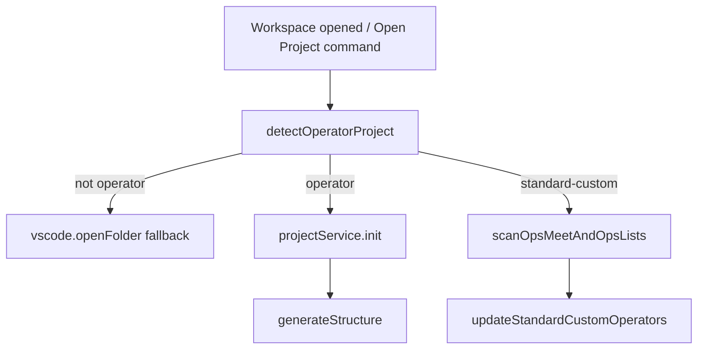
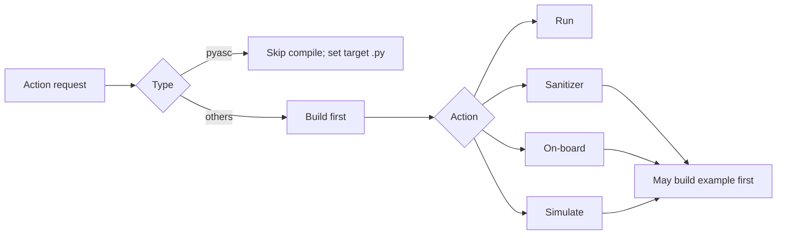

# Operator Plugin Behavior Specification (`plugin/src`)

## Scope and terminology

This document specifies current behavior implemented in `plugin/src` for operator project detection, registration, action execution, templates, and runtime/config dependencies.

The code uses two related type systems:

- **Detection types** (`OperatorProjectType`): `standard-custom`, `ascend-c`, `torch-library`, `pyasc`, `multi-project`.
- **Runtime strategy types** (`op_type`): `ascend`, `cann`, `pyasc` (used by command strategy and template generator).

## Operator types and project structures

### `standard-custom`
- Root contains `build.sh` with `--genop` (highest-priority rule).
- Typical structure: collection folders (`math`, `conv`, etc.), optional `experimental/<collection>`, and operator subfolders containing `CMakeLists.txt`.

### `ascend-c`
- `CMakeLists.txt` exists.
- `.asc` files exist (root or limited recursive search).
- No root `.py`.

### `torch-library`
- `CMakeLists.txt` exists.
- Root contains `.py` files.

### `pyasc`
- Root contains `.py` files.
- No `CMakeLists.txt`.

## Detection and collection in workspace

Behavior details:
- On activation with workspace, plugin calls `welcomeMethods.openProject(..., isFromSystem=true)`.
- `openProject` detects type, initializes project metadata (`projects.json`), runs `generateStructure`, and for `standard-custom` scans and stores:
  - `ops_meet`
  - `ops_list`
  - `experimental_ops_list`
- Collection scanning uses whitelist-based collection names and detects operators by `CMakeLists.txt`.

## Supported actions and configuration

### Config model
`generateStructure` creates default config records in `configs.json`:
- `build_op`
- `build_example`
- `sanitizer`
- `on_board`
- `simulate`

Action execution reads/updates these via `getConfig` / `postConfig`.

## Ascend/CANN environment and SOC resolution

The canonical, machine-checkable spec lives at **`docs/ascend-env-spec.md`**.
Everything below is a summary aimed at the operator-action flow.

### Single resolver — `resolveAscendEnv()`

All consumers (script placeholders, spawn env, profiler, build-service,
model defaults, workspace-settings sync) call
`plugin/src/domain/utils/ascend-util.ts::resolveAscendEnv({ isSimulator })`. It returns the resolved `socVersion`,
`npuArch`, and (for simulator runs) `simulatorType`, plus a `source` tag for
each value so debug logs can explain where every choice came from.

### Three channels (clearly separated, no longer conflated)

| Channel | Source | Plugin reads it from |
|---------|--------|----------------------|
| **VS Code setting** | `op-devtools.environment.socVersion`, `op-devtools.performanceTuning.simulation.simulatorType` (explicit user / workspace / workspace-folder scope only) | `getSocVersionWithWorkspaceOverride` / `getWorkspaceSimulatorType` (`cfg.inspect`) |
| **`projects.json` `soc_version`** | Env config UI (`saveProjectEnv`), `syncAscendEnvScriptFromWorkspaceSettings` | Display / APIs only — **not** read by `resolveAscendEnv` |
| **Global env snapshot** | OS-level `SOC_VERSION` / `SIMULATOR_TYPE` / `NPU_ARCH` captured once at extension activation | `getGlobalEnvSnapshot()` |

There is also a fourth, lazy channel: host autodetection via `asys info` then
`npu-smi info`, cached for the extension lifetime.

### Precedence rules (canonical)

- **`simulatorType`** (only when `isSimulator`): workspace setting →
  global-env snapshot → default-from-SOC.
- **`socVersion`**:
  - if `isSimulator` AND the simulator type came from the workspace setting →
    derived from that simulator type (so SOC / sim cannot disagree);
  - otherwise: workspace setting → global-env snapshot →
    `asys` / `npu-smi` detection → `DEFAULT_FALLBACK_CANN_SOC` (empty string when
    unset). A5 / Atlas A5 details: **`docs/ascend-a5-support.md`**.
- **`npuArch`**: always `getNpuArchForCannSoc(socVersion)`.

### Lifecycle

- **At activation**: the plugin only logs the frozen global env snapshot.
  It does **not** source `ASCEND_ENV_SCRIPT`, does **not** mutate
  `process.env.{SOC_VERSION, NPU_ARCH, SIMULATOR_TYPE}`, and does **not** run
  host detection eagerly.
- **Per operator command**: the strategy prepends
  `. ${project.ascend_env_script} && …` to the command when set; that is the
  only place the plugin sources an env script.
- **Per spawn**: `executeOperatorCommand` calls `getOperatorSpawnEnv` and
  passes `{ env }` to `CommandExecutor.execute`. The child shell sees
  authoritative values regardless of host `process.env`.

### Command assembly (build / simulate / …)

1. `getBuildOpCommand` / `getSimulateCommand` / … → `getBaseContext` →
   `getProjectById` + config from `configs.json`.
2. Strategy (`ascend-strategy`, `cann-strategy`, …) →
   `replaceOperatorScriptPlaceholders(script)` (resolution from `resolveAscendEnvForOperatorCommand` at execute time):
   - `{soc_version}` → `resolveAscendEnv(...).socVersion`
   - `{simulator_type}` → `resolveAscendEnv(...).simulatorType`
3. `executeOperatorCommand` (`operator-command-executor.ts`) →
   `getOperatorSpawnEnv` merged into `CommandExecutor.execute(..., { env })`:
   - **non-sim**: `SOC_VERSION=<slug>`, `NPU_ARCH` from slug.
   - **simulator class**: `SIMULATOR_TYPE=<simDir>`, `NPU_ARCH` from slug,
     `SOC_VERSION=<slug>` (or `<derived-from-sim>` per the rule above).
4. Simulate **example** build (standard-custom): op_type-aware
   `compileOption` — cann: `--simulator <simDir>`; ascend:
   `--simulator <simDir> --soc=<slug>` (both from one `resolveAscendEnv`
   call so they cannot drift).

**Templates** (`plugin/templates/code_template/`) use the env → cache pattern
for all platform-specific values (`SIMULATOR_TYPE`, `SOC_VERSION`,
`NPU_ARCH`, and `SUPPORT_COMPUTE_UNIT` / `SUPPORT_TILING_DIR` in the ascend
add_custom template), so the plugin can target new chip generations by
injecting env values without editing the generated user project.

### `ASCEND_ENV_SCRIPT` vs `op-devtools.environment.environmentScript`

- **`ASCEND_ENV_SCRIPT`** — OS env at extension host start; recorded in the
  global env snapshot for diagnostic purposes. The plugin no longer sources
  this file.
- **`op-devtools.environment.environmentScript`** — workspace setting →
  `getEnvironmentScriptPathFromWorkspace` → can sync to `projects.json` →
  per-command prefix `. ${project.ascend_env_script}`. This is the only env
  script the plugin sources, and only at command time.

### Action capability by type

| Type | Build | Run | Debug | Sanitizer | On-board/Simulate | Mark/Unmark |
|---|---|---|---|---|---|---|
| `standard-custom` | Yes | Yes | Yes | Yes (needs `--bisheng_flags`) | Blocked in context menu | Yes |
| `ascend-c` | Strategy exists, menu actions blocked | Blocked in folder menu | Blocked | Blocked | Blocked | Blocked |
| `torch-library` | Strategy/init exists, menu actions blocked | Blocked in folder menu | Blocked | Blocked | Blocked | Blocked |
| `pyasc` | Build/build_example unsupported in strategy | Yes | Yes | Unsupported in strategy | Yes | Blocked |

Notes:
- `pyasc` run/debug/profile paths require/select a `.py` target and rewrite `build_op.target_file`.
- Debug flows compile first with script-field overrides (`npu_debug_script` / `cpu_debug_script`), then launch debug configuration.

## Templates per operator type and rationale

Template mapping:
- `op_type=ascend` -> `ascend_template/add_custom.zip`
- `op_type=cann` -> `cann_template/<template>.zip` (default `hello_world`)
- `op_type=pyasc` -> `cann_template/pyasc_temple.zip`

Detection/init mapping:
- `ascend-c` -> template `hello_world`
- `torch-library` -> template `torch_library_template`
- `pyasc` -> template `pyasc_temple`
- `standard-custom` -> usually skip unzip, initialize configs only

Rationale in current code:
- Existing user projects should not be overwritten (`skipExisting`, skip unzip paths).
- Templates are used as minimal bootstrapping for generated projects.

## How users add new operators

- **Inside standard-custom**: create operator under valid collection; metadata updates into root project’s `ops_list` / `experimental_ops_list`.
- **Inside pyasc**: add/select `.py` files and use run/debug/profile flows.

## Why separate Open Operator command exists

`Open Operator Project` performs operator-specific bootstrap that plain `Open Folder` does not:
- type detection
- project registration
- config generation (`build_*`, `sanitizer`, profiling configs)
- `.vscode/devtool_config.json` and launch setup
- standard-custom collection/operator scanning persistence

Without this, plugin state/config may be incomplete.

## Dependencies between actions and caching strategy

Persisted state (cache-like):
- `projects.json`: project metadata, operator lists, compile flags
- `ops.json`: operator records
- `configs.json`: action configuration records

Incremental behavior:
- `skipExisting` avoids clobbering existing files on generation.
- Compiled status is preserved on rescans and updated after successful builds.
- No content-hash artifact cache is implemented; build avoidance is mostly script/toolchain-level plus persisted metadata.

## Additional behavior questions covered

- `multi-project` is present in enum but not a first-class runtime action pipeline.
- There is a mapping asymmetry between detection types and `op_type` conversion in some paths (`viewIdToProjectType` vs other init code).
- Context menu intentionally blocks some action/type combinations even when config scaffolding exists.
- Platform assumptions exist in command execution paths (e.g., shell/bash usage).

## Key source files

- `plugin/src/domain/services/operator-project-detector.ts`
- `plugin/src/service/workspace-detector-service.ts`
- `plugin/src/controller/welcome-controller.ts`
- `plugin/src/extension.ts`
- `plugin/src/service/folder-context-menu-service.ts`
- `plugin/src/domain/models/model.ts`
- `plugin/src/domain/services/op-generator-factory.ts`
- `plugin/src/service/build-service.ts`
- `plugin/src/service/sanitizer-service.ts`
- `plugin/src/controller/task-controller.ts`
- `plugin/src/domain/services/command-strategy/*.ts`
- `plugin/src/domain/models/project-model.ts`
- `plugin/src/domain/utils/project-utils.ts`
- `plugin/src/helpers/operator-project-workspace-config.ts` (`getAscendEnvScriptWithWorkspaceOverride`, `getEnvironmentScriptPathFromWorkspace`)
