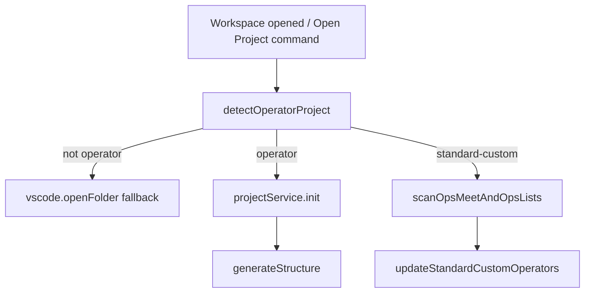
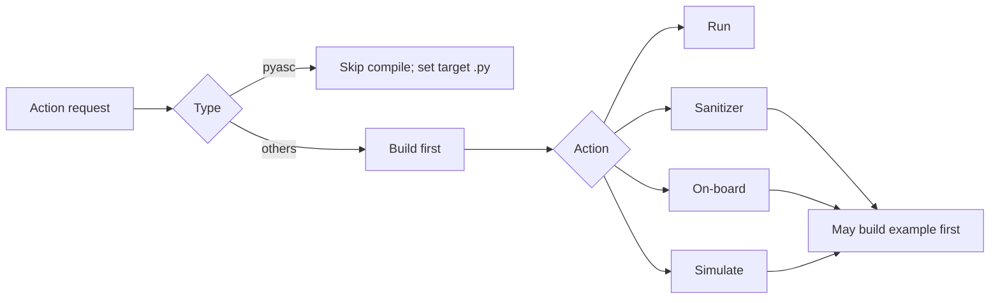

# Operator Plugin Behavior Specification (`plugin/src`)

## Scope and terminology

This document specifies current behavior implemented in `plugin/src` for operator project detection, registration, action execution, templates, and runtime/config dependencies.

The code uses two related type systems:

- **Detection types** (`OperatorProjectType`): `standard-custom`, `ascend-c`, `torch-library`, `pyasc`, `multi-project`.
- **Runtime strategy types** (`op_type`): `ascend`, `cann`, `pyasc` (used by command strategy and template generator).

## Operator types and project structures

### `standard-custom`
- Root contains `build.sh` with `--genop` (highest-priority rule).
- Typical structure: collection folders (`math`, `conv`, etc.), optional `experimental/<collection>`, and operator subfolders containing `CMakeLists.txt`.

### `ascend-c`
- `CMakeLists.txt` exists.
- `.asc` files exist (root or limited recursive search).
- No root `.py`.

### `torch-library`
- `CMakeLists.txt` exists.
- Root contains `.py` files.

### `pyasc`
- Root contains `.py` files.
- No `CMakeLists.txt`.

## Detection and collection in workspace

Behavior details:
- On activation with workspace, plugin calls `welcomeMethods.openProject(..., isFromSystem=true)`.
- `openProject` detects type, initializes project metadata (`projects.json`), runs `generateStructure`, and for `standard-custom` scans and stores:
  - `ops_meet`
  - `ops_list`
  - `experimental_ops_list`
- Collection scanning uses whitelist-based collection names and detects operators by `CMakeLists.txt`.

## Supported actions and configuration

### Config model
`generateStructure` creates default config records in `configs.json`:
- `build_op`
- `build_example`
- `sanitizer`
- `on_board`
- `simulate`

Action execution reads/updates these via `getConfig` / `postConfig`.

### Action capability by type

| Type | Build | Run | Debug | Sanitizer | On-board/Simulate | Mark/Unmark |
|---|---|---|---|---|---|---|
| `standard-custom` | Yes | Yes | Yes | Yes (needs `--bisheng_flags`) | Blocked in context menu | Yes |
| `ascend-c` | Strategy exists, menu actions blocked | Blocked in folder menu | Blocked | Blocked | Blocked | Blocked |
| `torch-library` | Strategy/init exists, menu actions blocked | Blocked in folder menu | Blocked | Blocked | Blocked | Blocked |
| `pyasc` | Build/build_example unsupported in strategy | Yes | Yes | Unsupported in strategy | Yes | Blocked |

Notes:
- `pyasc` run/debug/profile paths require/select a `.py` target and rewrite `build_op.target_file`.
- Debug flows compile first with script-field overrides (`npu_debug_script` / `cpu_debug_script`), then launch debug configuration.

## Templates per operator type and rationale

Template mapping:
- `op_type=ascend` -> `ascend_template/add_custom.zip`
- `op_type=cann` -> `cann_template/<template>.zip` (default `hello_world`)
- `op_type=pyasc` -> `cann_template/pyasc_temple.zip`

Detection/init mapping:
- `ascend-c` -> template `hello_world`
- `torch-library` -> template `torch_library_template`
- `pyasc` -> template `pyasc_temple`
- `standard-custom` -> usually skip unzip, initialize configs only

Rationale in current code:
- Existing user projects should not be overwritten (`skipExisting`, skip unzip paths).
- Templates are used as minimal bootstrapping for generated projects.

## How users add new operators

- **Inside standard-custom**: create operator under valid collection; metadata updates into root project’s `ops_list` / `experimental_ops_list`.
- **Inside pyasc**: add/select `.py` files and use run/debug/profile flows.

## Why separate Open Operator command exists

`Open Operator Project` performs operator-specific bootstrap that plain `Open Folder` does not:
- type detection
- project registration
- config generation (`build_*`, `sanitizer`, profiling configs)
- `.vscode/devtool_config.json` and launch setup
- standard-custom collection/operator scanning persistence

Without this, plugin state/config may be incomplete.

## Dependencies between actions and caching strategy

Persisted state (cache-like):
- `projects.json`: project metadata, operator lists, compile flags
- `ops.json`: operator records
- `configs.json`: action configuration records

Incremental behavior:
- `skipExisting` avoids clobbering existing files on generation.
- Compiled status is preserved on rescans and updated after successful builds.
- No content-hash artifact cache is implemented; build avoidance is mostly script/toolchain-level plus persisted metadata.

## Additional behavior questions covered

- `multi-project` is present in enum but not a first-class runtime action pipeline.
- There is a mapping asymmetry between detection types and `op_type` conversion in some paths (`viewIdToProjectType` vs other init code).
- Context menu intentionally blocks some action/type combinations even when config scaffolding exists.
- Platform assumptions exist in command execution paths (e.g., shell/bash usage).

## Key source files

- `plugin/src/domain/services/operator-project-detector.ts`
- `plugin/src/service/workspace-detector-service.ts`
- `plugin/src/controller/welcome-controller.ts`
- `plugin/src/extension.ts`
- `plugin/src/service/folder-context-menu-service.ts`
- `plugin/src/domain/models/model.ts`
- `plugin/src/domain/services/op-generator-factory.ts`
- `plugin/src/service/build-service.ts`
- `plugin/src/service/sanitizer-service.ts`
- `plugin/src/controller/task-controller.ts`
- `plugin/src/domain/services/command-strategy/*.ts`
- `plugin/src/domain/models/project-model.ts`
- `plugin/src/domain/utils/project-utils.ts`
