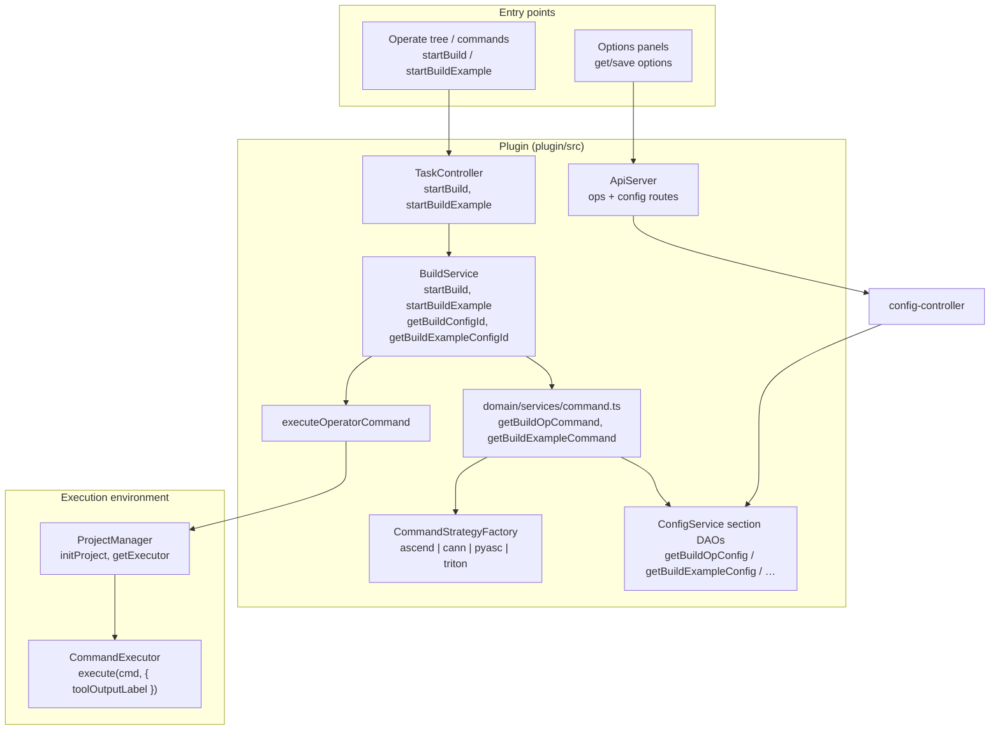
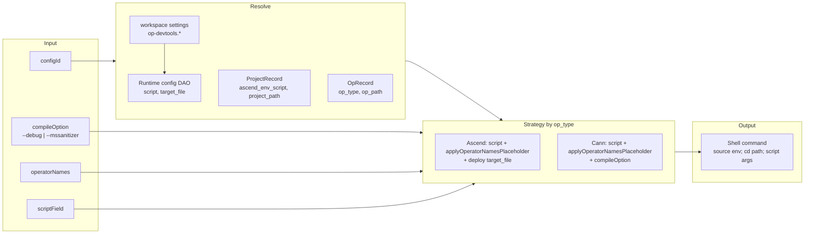
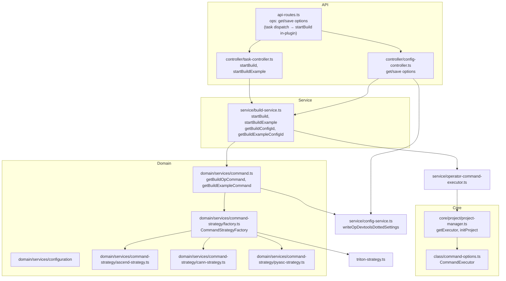

# Build Tools Integration Architecture

This document describes how **operator compilation** (编译算子 / 编译示例) is integrated in the Huawei OP DevTools VS Code extension: entry points, config model, command generation, and execution.

**Related:** [`workspace-settings.md`](./workspace-settings.md) (compile scripts, deploy target), [`ascend-env-spec.md`](./ascend-env-spec.md) (spawn env), [`operator-treeview.md`](./operator-treeview.md) (Actions tree — build is **not** queued), [`run-integration.md`](./run-integration.md), [`debug-integration.md`](./debug-integration.md).

---

## Overview

The plugin does **not** ship a compiler. It:

- **Orchestrates** compilation using synthesized config rows (`build_op`, `build_example`). At command time, script fields and options come from workspace **`op-devtools.*`** via the per-section typed DAO factories on `ConfigService` (`getBuildOpConfig()`, `getBuildExampleConfig()`, …), resolved through `resolveSectionBaseContext` (see [Runtime config](#runtime-config-for-command-generation)); DB-only fields (`fileMapList`, …) come from `.vscode/cache.json` (`fileMapLists`), and the profiler `build_example.target_file` is the `exampleBuildConfig.targetFile` setting.
- **Builds** shell command strings with **command strategies** keyed by `operator.op_type` (`ascend`, `cann`, `pyasc`, `triton`).
- **Runs** commands through **`executeOperatorCommand`** (`operator-command-executor.ts`): one `resolveAscendEnvForOperatorCommand` pass, placeholder substitution, `export … &&` injection, then `ProjectManager.getExecutor().execute(..., { toolOutputLabel })` (same executor stack as run / sanitizer / simulate).
- **Exposes** compile via VS Code commands → `taskMethods.startBuild` / `startBuildExample` (Actions tree **Build** row, folder menus, debug pre-build). Simulate / on-board / sanitizer options panels read and persist through workspace settings (`op-devtools.*`) and the workspace cache — no config-row RPC.

Compilation is performed by the project script or toolchain named in the generated command.

**Extension host vs shell CANN environment** — At activation the extension only **logs** a frozen global env snapshot; it does not source env scripts or mutate `process.env`. Strategies prepend **`. ${project.ascend_env_script} && …`** when set; `executeOperatorCommand` embeds `export SOC_VERSION=… && …` per command. Contract: [`ascend-env-spec.md`](./ascend-env-spec.md); A5: [`ascend-a5-support.md`](./ascend-a5-support.md).

---

## Protocols

```mermaid
flowchart LR
  subgraph Plugin["This plugin"]
    Webview[Options webviews\nsimulator / on-board]
    OpsAPI[ops API\nget/save options]
    Commands[VS Code commands\nbuild / build example]
    TaskCtrl[Task controller]
    BuildSvc[BuildService]
    DomainCmd[domain/services/command\ngetBuildOpCommand\ngetBuildExampleCommand]
    Strategy[Command strategy\nascend / cann / pyasc / triton]
  end

  subgraph VSCode["VS Code"]
    Notifications[Notifications\nshowMessage]
  end

  subgraph Env["Execution environment"]
    Executor[ProjectManager.getExecutor()]
    Shell[Shell / script]
  end

  Webview -->|"request"| OpsAPI
  Commands --> TaskCtrl --> BuildSvc
  BuildSvc --> DomainCmd --> Strategy
  DomainCmd --> Strategy
  BuildSvc --> ExecOp["executeOperatorCommand\nascend env + placeholders"]
  ExecOp --> Executor
  Executor --> Shell
  BuildSvc --> Notifications
```

| Layer | Protocol | Role |
|-------|----------|------|
| **Webview → Plugin** | Custom request/response over ApiServer | Simulator / on-board panels call `ops/getSimulateOptions` / `ops/saveSimulateOptions` / `ops/getOnBoardOptions` / `ops/saveOnBoardOptions` (settings.json only). Compile / build-example are **not** exposed on `ops`; use VS Code commands → `taskMethods.startBuild` / `startBuildExample`. |
| **Plugin → VS Code** | VS Code Extension API | Show success/error messages; project/workspace context. |
| **Plugin → Environment** | Shell command (stdio) | `executeOperatorCommand` resolves ascend env, substitutes placeholders, embeds `export … &&` prefixes in the command string, then `CommandExecutor.execute` with a per-label output channel (`Op Dev Tools: compile` / `run` / `simulate` / `sanitizer` / `onboard` / `st test` / `ut test` / `dump tensor` / `cpu debug` / `npu debug`). **Every command of an action's chain writes to the action's channel** — simulate's internal compile pre-step goes to `simulate`, CPU/NPU debug pre-builds and example builds go to `cpu debug`/`npu debug`, the sidebar Run on a multi-operator/standard-custom project routes its build-example step to `run`; `compile` receives output only from the compile action itself (standalone build-example runs included). CPU/NPU debug chains run as ordinary operator actions (their compile is one command of the chain — they do not surface on the compile/run gate nodes in the tree). Channels are persistent per label: a new run **appends** to the channel instead of clearing it (GC-73); `{ clear: true }` is the explicit reset. Ascend vars are not passed via `options.env`. |

---

## High-Level Architecture



---

## Build Flow

### Operator build (编译算子)

```mermaid
sequenceDiagram
  participant User
  participant Cmd as VS Code command
  participant Task as TaskController
  participant Build as BuildService
  participant Domain as domain/command
  participant Strategy as Command strategy
  participant PM as ProjectManager
  participant ExecOp as executeOperatorCommand
  participant Exec as CommandExecutor

  User->>Cmd: Build (sidebar / command)
  Cmd->>Task: startBuild(params)
  Task->>Task: guardSupportedProjectType (registry)
  Task->>PM: initProject()
  Task->>Build: startBuild(params)
  Build->>Build: guardSupportedProjectTypeForCurrentProject
  Build->>Build: resolve configId (params or getBuildConfigId)
  alt no configId
    Build->>User: showErrorMessage(no build config)
    return
  end

  Build->>Domain: getBuildOpCommand(...)
  Domain->>Domain: resolveSectionBaseContext → section DAO
  Domain->>Strategy: buildOpCommand(...)
  Strategy-->>Build: buildCommand

  Build->>ExecOp: execute(buildCommand, spawnContext)
  ExecOp->>ExecOp: resolveAscendEnv + placeholders + export prefixes
  ExecOp->>Exec: execute(runnableCommand, { toolOutputLabel })
  Exec-->>Build: { code, output }

  alt code !== 0
    Build->>User: compile failed
  else code === 0
    Build->>User: compile success
    Build->>Build: notifyBuildSucceededForSidebar (standard-custom compile flags)
  end

  Task->>PM: clearExecutor()
```

### Example build (编译示例)

Flow is similar: `startBuildExample` → `getBuildExampleConfigId()` → `getBuildExampleCommand` → `executeOperatorCommand`. No `notifyBuildSucceededForSidebar`. PyAsc **throws** on `buildExampleCommand`; ascend/cann/triton implement it (triton uses Python example script).

---

## Config and Command Build

### Config types

| Type | Use | Resolved by |
|------|-----|-------------|
| **build_op** | Operator (kernel) compile | `getBuildConfigId()` — `startBuild`, sanitizer/simulate/on-board pre-build, debug pre-build |
| **build_example** | Example / test binary compile | `getBuildExampleConfigId()` — `startBuildExample`, profiling pre-steps |

**Storage:** config rows are synthesized from workspace `op-devtools.*` settings plus `.vscode/cache.json` (`fileMapLists`); default script strings come from `OperatorPluginRegistry.getOpPlugin(op_type).getInitialConfigScripts()` and are seeded into settings by `ensureOpDevtoolsSettingsSeeded`. UI list: the actions tree derives operator rows from the workspace-cache scan state (`cache.folders[].opsList`).

### Runtime config for command generation

`resolveSectionBaseContext(projectPath, operatorNames, configFactory)` in `domain/services/command.ts` resolves the per-section typed DAO factories on `ConfigService` (`getBuildOpConfig()` / `getBuildExampleConfig()` / `getUtTestConfig()` / `getSimulateConfig(projectPath)` / `getOnBoardConfig(projectPath)` / `getSanitizerConfig(projectPath, op)`). Each DAO:

1. Reads its own dotted `op-devtools.*` settings directly (no section-key dispatch).
2. Folds in the cache-only metadata (`.vscode/cache.json`: `fileMapLists[configType]` → `fileMapList`, sanitizer `sanitizerPythonTarget[op]` → `target_file`).

| Field at runtime | Source |
|------------------|--------|
| `build_op.script`, debug scripts, flow compile scripts | `op-devtools.compileAndDeploy.buildConfig.*` ([`workspace-settings.md`](./workspace-settings.md)) |
| `build_op.target_file` (deploy / run package) | `compileAndDeploy.buildConfig.deployCommandOrRunCommand` |
| `build_example.script`, `execution_mode` | `exampleBuildConfig.*` |
| `build_example.target_file` (msprof / profiler binary) | `compileAndDeploy.exampleBuildConfig.targetFile` setting, falling back to `OperatorPluginRegistry.getDefaultPaths` |
| Sanitizer / simulate / on_board options | Matching `op-devtools.*` keys |

### `{operatorNames}` and `--ops` (compile scripts)

Ascend standard-custom defaults (see `AscendPlugin.getInitialConfigScripts()` → seeded into workspace `op-devtools.*` settings) include `--ops={operatorNames}` in compile-related script fields (`compileCommand`, `cpuDebugCompileCommand`, `npuDebugCompileCommand`, `utTestCompileCommand`, `onBoardCompileCommand`, `simulationCompileCommand`, `sanitizerCompileCommand`).

At command time, **`applyOperatorNamesPlaceholder()`** in `plugin/src/domain/utils/operator-script-placeholders.ts` (used by ascend and cann `buildOpCommand` / `buildUtTestCommand`):

| Selection | Behavior |
|-----------|----------|
| Operators selected | `{operatorNames}` → comma-separated names (e.g. `--ops=add,sub`) |
| None selected | Token `--ops={operatorNames}` is **removed** (not left as `--ops=`) |
| Scripts without a literal `--ops` flag | `--ops=<names>` appended for ascend standard-custom compile lines only (`--vendor_name=custom`, `--pkg`, UT `--soc … -u` styles) |

PyAsc/Triton scripts are `python3 ./<op>.py` without `--ops`; cann plain `bash build.sh` flows are unchanged. Example run still uses positional operator args via `buildExampleCommand`, not `--ops` in settings.

### Command generation

- **Select strategy:** `CommandStrategyFactory.getStrategy(operator?.op_type)` → `ascend` | `cann` | `pyasc` | `triton` (default **`cann`** if unknown).
- **Build context:** `strategy.buildCommandContext(baseContext)` → `sourceCannCmd` (`. ${project.ascend_env_script} &&` when set), `cdCmd`, etc.
- **build_op:** `strategy.buildOpCommand({ …, scriptField })` uses the DAO field selected by `scriptField` — `config.script` (default), `config.cpuDebugScript`, or `config.npuDebugScript` — after `applyOperatorNamesPlaceholder()` (see below); ascend adds deploy via `getExecutableCommand(config.target_file)`; cann/triton append `compileOption` / `advance_cmd` as applicable.
- **build_example:** `strategy.buildExampleCommand` — ascend/cann shell; triton/pyasc per strategy (pyasc example path throws on kernel build, not on all example paths — see strategy files).



### Strategy behavior (compilation)

| Strategy | buildOpCommand | buildExampleCommand |
|----------|----------------|---------------------|
| **ascend** | `config[scriptField]` → `applyOperatorNamesPlaceholder` → `Command` + optional `compileOption` / `advance_cmd`; build_op adds `getExecutableCommand(config.target_file)` deploy. `--ops` comes from the settings script or the placeholder fallback, not `Command.addOptions`. | Uses `config.script`, args: op (or operatorNames), execution_mode, pkg_mode; optional compileOption. |
| **cann** | Same placeholder helper on `config[scriptField]`; no `--ops` appended for plain `bash build.sh` scripts. `compileOption`, `advance_cmd`. No separate deploy step. | Implements example build (script + args). |
| **pyasc** | **Not supported** (throws). PyAsc projects run Python; no kernel build in this sense. | **Not supported** (throws). |
| **triton** | Python `build_op` / `build_example` via configured script (`TritonCommandStrategy`). | Same as build_op path for examples. |

---

## Triton debug pre-build scripts

For `op_type=triton`, `TritonPlugin.getInitialConfigScripts()` seeds `npu_debug_script` with a compile-oriented command (and a plain `cpu_debug_script` entry for config schema only — Triton does not support CPU debug):

```bash
TRITON_DISABLE_CACHE=1 TRITON_DISABLE_LINE_INFO=false LLVM_EXTRACT_DI_LOCAL_VARIABLES=1 python3 ./<op>.py
```

NPU debug (`task-controller.runDebug`) calls `BuildService.startBuild` with `scriptField: 'npu_debug_script'` before launching `msdebug-triton-npu`. See [`debug-integration.md`](./debug-integration.md).

---

## Data Format (API)

### startBuild params (StartBuildParams)

| Field | Type | Description |
|-------|------|-------------|
| `configId` | string | Optional. Build config ID (build_op). If omitted, plugin uses default for current project. |
| `compileOption` | string | Optional. e.g. `--debug`, `--mssanitizer` for debug or sanitizer build. |
| `operatorNames` | string | Optional. Comma-separated operator names (e.g. for standard custom op). |
| `operatorType` | string | Optional. Hint for which kind of operator to build. |
| `projectId` | string \| number | Optional. Project ID; if set, ProjectManager is updated so build runs in that project context. |
| `scriptField` | string | Optional. Which config field to use as script: `script`, `cpu_debug_script`, `npu_debug_script`. |

### startBuildExample params (StartBuildExampleParams)

| Field | Type | Description |
|-------|------|-------------|
| `configId` | string | Optional. Example build config ID (build_example). |
| `compileOption` | string | Optional. |
| `operatorNames` | string | Optional. Comma-separated. |
| `operatorType` | string | Optional. |
| `projectId` | string \| number | Optional. Project ID. |

---

## Component Map (plugin/src)



| File | Role |
|------|------|
| `controller/task-controller.ts` | `startBuild` / `startBuildExample`: `ensurePostActivateBootstrapReady`, `initProject`, registry guard, BuildService, `clearExecutor` in `finally`. |
| `service/build-service.ts` | `guardSupportedProjectTypeForCurrentProject`; `getBuildOpCommand` / `getBuildExampleCommand`; **`executeOperatorCommand`**; toasts; `notifyBuildSucceededForSidebar`; standard-custom `.run` deploy helper for simulate/on-board. |
| `service/operator-command-executor.ts` | `executeOperatorCommand`, `buildOperatorSpawnContext`. |
| `service/config-service.ts` | section DAO factories: `getBuildOpConfig` / `getBuildExampleConfig` / `getUtTestConfig` / `getSimulateConfig` / `getOnBoardConfig` / `getSanitizerConfig`. |
| `domain/services/command.ts` | `getBuildOpCommand`, `getBuildExampleCommand` via `resolveSectionBaseContext` → section DAO. |
| `domain/services/command-strategy/factory.ts` | `CommandStrategyFactory.getStrategy(opType)` → ascend, cann, pyasc, or triton. |
| `domain/utils/operator-script-placeholders.ts` | `applyOperatorNamesPlaceholder`, `replaceOperatorScriptPlaceholders` (`{soc_version}`, `{simulator_type}`, `{operatorNames}`). |
| `domain/plugins/ascend.plugin.ts` | Default compile scripts with `--ops={operatorNames}` in `base` (+ `utTestScript`). |
| `domain/services/command-strategy/ascend-strategy.ts` | Ascend: buildOpCommand (placeholder + deploy), buildUtTestCommand, buildExampleCommand (script + op, mode, pkg_mode). |
| `domain/services/command-strategy/cann-strategy.ts` | Cann: buildOpCommand / buildUtTestCommand via `applyOperatorNamesPlaceholder`. |
| `domain/services/command-strategy/pyasc-strategy.ts` | PyAsc: buildOpCommand and buildExampleCommand throw (not supported). |
| `domain/services/command-strategy/triton-strategy.ts` | Triton: Python `build_op` / `build_example` via configured script (`python3 ./<op>.py`); UT test throws; Actions tree shows sanitizer, simulate, and on-board per `TritonPlugin.buildBehavior` (`supportsSanitizer` / `supportsSimulate` / `supportsOnBoard` all `true`), while CPU/NPU debug rows stay hidden. |
| `core/project/project-manager.ts` | `initProject()`, `getExecutor()` (CommandExecutor), `clearExecutor()`. |
| `api-routes.ts` | `ops`: `getSimulateOptions` / `saveSimulateOptions` / `getOnBoardOptions` / `saveOnBoardOptions` / `getSanitizerOptions` / `saveSanitizerOptions` only. Build/run via in-plugin `taskMethods` (commands / Operate tree), not `ops` RPC. |

---

## DumpTensor Behavior Note

- `BuildService.startDumpTensor` runs `build_op`, then either **build example** (standard custom) or **run** (other project types).
- Example build and run commands are prefixed with `ASCEND_GLOBAL_LOG_LEVEL=1` and `ASCEND_DUMP_PATH` pointing at `dump_tensor_temp_data` under the IDE config dir (same env for both branches).
- On CPU hosts where local NPU hardware is unavailable, only the DumpTensor data-producing **build example** / **run** command is wrapped with `remote_tool.sh exec`; `build_op` still runs locally. The remote pull directory defaults to the workspace `.vscode/dump_tensor_temp_data` path, while explicit `remoteOnBoardPullDirs` settings take precedence.
- After a successful example build or run, `show_kernel_debug_data` post-processes temp dump files into `DumpTensor`, then the native **Dump tensor results** tree is refreshed and the newly produced report is revealed (`finalizeDumpTensorFlow` → `refreshDumpTensorResults({ focusIfNew: true })` → `huawei-op-devtools.flashDumpTensorData` → `OperateTreeProvider.refreshDumpTensorReports`). No panel or webview is opened.
- **Import .bin** uses the same `show_kernel_debug_data` step, then refreshes the Dump tensor results tree and reveals the imported report.

See [`dump-tensor.md`](./dump-tensor.md) for the results tree UI and commands.

---

## Summary

- **Entry:** Actions tree **Build** / VS Code commands → `taskMethods` → `BuildService` (not operator action queue). Folder context and debug paths call the same `startBuild` with different `scriptField` / `compileOption`.
- **Config:** synthesized rows from workspace `op-devtools.*` settings + `.vscode/cache.json` at runtime (per-section DAO factories); deploy target from `deployCommandOrRunCommand`; profiler binary path from `exampleBuildConfig.targetFile` (falls back to `OperatorPluginRegistry.getDefaultPaths`).
- **Command build:** `CommandStrategyFactory` by `op_type`; pyasc **throws** on kernel `buildOpCommand`; triton uses Python scripts when enabled (`operatorSupport.triton`).
- **Execution:** `executeOperatorCommand` — ascend env resolution, `{soc_version}` / `{simulator_type}` substitution, `export … &&` injection per [`ascend-env-spec.md`](./ascend-env-spec.md).
- **Protocols:** `ops` = simulate/on-board/sanitizer settings only; compile is in-plugin via `taskMethods`, not webview RPC.
