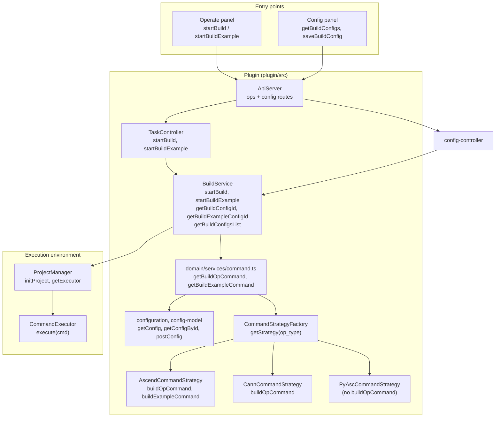
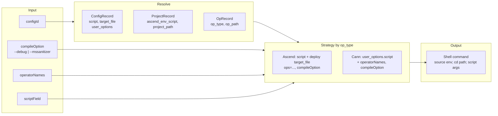
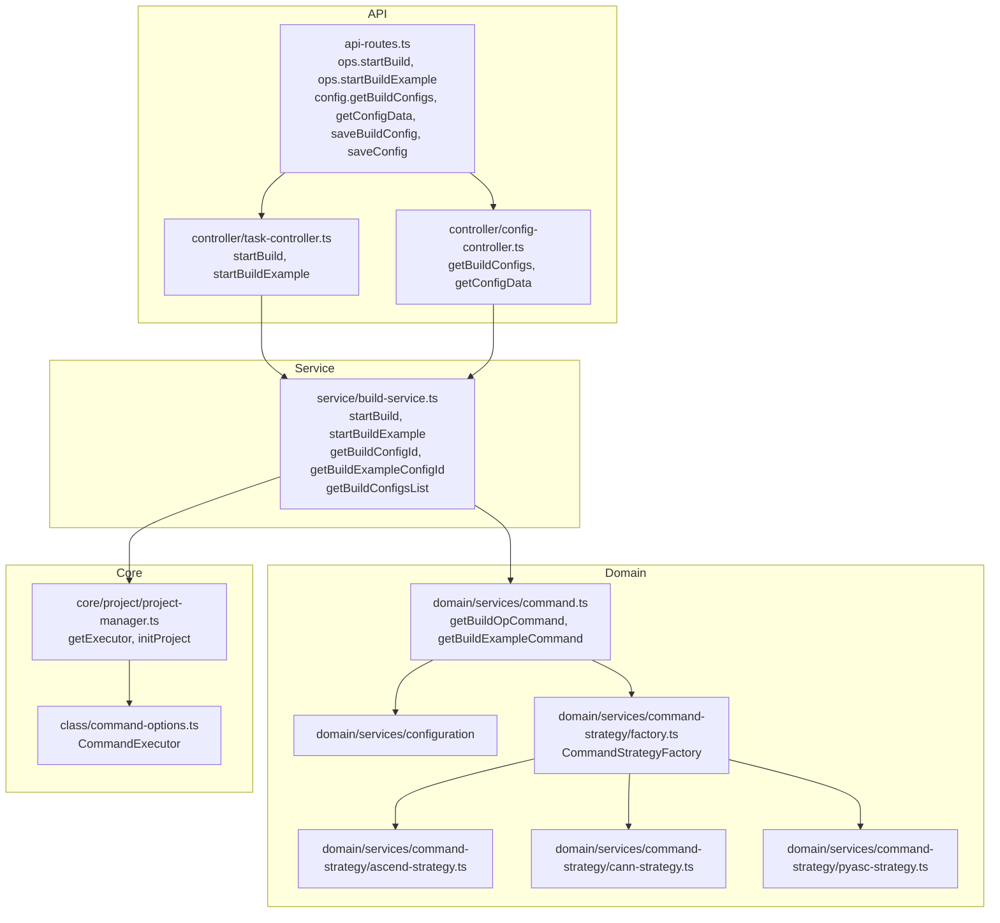

# Build Tools Integration Architecture

This document describes how **operator compilation** (编译算子 / 编译示例) is integrated in the Huawei OP DevTools VS Code extension: protocols, config model, command generation, and the full architecture from entry points to the execution environment.

---

## Overview

The plugin does **not** ship a compiler. It:

- **Orchestrates** compilation using **build configs** (`build_op` for operator build, `build_example` for example build) stored per project. Each config holds a script (e.g. build script path or command template) and user_options; the actual command is generated by a **command strategy** keyed by operator type (`ascend`, `cann`, `pyasc`).
- **Runs** the generated command in the workspace via **ProjectManager.getExecutor()** (a `CommandExecutor` that runs shell commands). The executor is the same one used for run, simulate, on-board, and sanitizer; only the command string and options differ.
- **Exposes** build and build-example triggers, config CRUD, and project/operator resolution through the **ops** and **config** API namespaces so the Operate panel and config views can start builds and list configs.

The actual compilation is performed by the **script or tool** invoked by the generated command (e.g. a project-specific build script or CANN/Ascend toolchain); the plugin provides config, strategy-based command generation, and execution.

---

## Protocols

```mermaid
flowchart LR
  subgraph Plugin["This plugin"]
    Webview[Operate / Config panels]
    OpsAPI[ops API\nstartBuild, startBuildExample]
    ConfigAPI[config API\ngetBuildConfigs, getConfigData\nsaveBuildConfig, saveConfig]
    TaskCtrl[Task controller]
    BuildSvc[BuildService]
    DomainCmd[domain/services/command\ngetBuildOpCommand\ngetBuildExampleCommand]
    Strategy[Command strategy\nascend / cann / pyasc]
  end

  subgraph VSCode["VS Code"]
    Notifications[Notifications\nshowMessage]
  end

  subgraph Env["Execution environment"]
    Executor[ProjectManager.getExecutor()]
    Shell[Shell / script]
  end

  Webview -->|"request"| OpsAPI
  Webview -->|"request"| ConfigAPI
  OpsAPI --> TaskCtrl --> BuildSvc
  BuildSvc --> DomainCmd --> Strategy
  DomainCmd --> Strategy
  BuildSvc --> Executor
  Executor --> Shell
  BuildSvc --> Notifications
```

| Layer | Protocol | Role |
|-------|----------|------|
| **Webview → Plugin** | Custom request/response over ApiServer | Operate calls `ops/startBuild`, `ops/startBuildExample`; config views call `ops/getBuildConfigs`, `ops/getConfigData`, `ops/saveBuildConfig`, `ops/saveConfig` (or equivalent under config namespace). |
| **Plugin → VS Code** | VS Code Extension API | Show success/error messages; project/workspace context. |
| **Plugin → Environment** | Shell command (stdio) | Executor runs the generated command string (source env, `cd`, script + args) in the workspace; exit code and output are reported back. |

---

## High-Level Architecture



---

## Build Flow

### Operator build (编译算子)

```mermaid
sequenceDiagram
  participant User
  participant Webview as Operate panel
  participant Api as ApiServer (ops)
  participant Task as TaskController
  participant Build as BuildService
  participant Domain as domain/command
  participant Strategy as Command strategy
  participant PM as ProjectManager
  participant Exec as CommandExecutor

  User->>Webview: 编译算子 (startBuild)
  Webview->>Api: ops/startBuild(params)
  Api->>Task: startBuild(params)

  Task->>PM: initProject()
  Task->>Task: currentTaskType = 'build'
  Task->>Build: startBuild(params)

  Build->>Build: resolve configId (params or getBuildConfigId)
  alt no configId
    Build->>User: showErrorMessage(未找到编译配置)
    return
  end

  Build->>Domain: getBuildOpCommand(configId, compileOption, operatorNames, scriptField)
  Domain->>Domain: getBaseContext(configId) → config, project, operator
  Domain->>Strategy: CommandStrategyFactory.getStrategy(operator.op_type)
  Domain->>Strategy: buildCommandContext(baseContext)
  Domain->>Strategy: buildOpCommand(params)
  Strategy-->>Domain: command string
  Domain-->>Build: buildCommand

  Build->>Exec: execute(buildCommand, [], [], {}, true)
  Exec-->>Build: { code, output }

  alt code !== 0
    Build->>User: showErrorMessage(编译算子失败)
  else code === 0
    Build->>User: showInformationMessage(编译算子成功)
    Build->>Build: tryMarkOperatorsAsCompiled(configId, operatorNames)
  end

  Task->>PM: clearExecutor()
```

### Example build (编译示例)

Flow is similar: entry is `startBuildExample`; config comes from `getBuildExampleConfigId()` (config type `build_example`); command from `getBuildExampleCommand(configId, compileOption, operatorNames)`. No `tryMarkOperatorsAsCompiled`. PyAsc strategy does **not** implement `buildExampleCommand` (throws); ascend/cann do.

---

## Config and Command Build

### Config types

| Type | Use | Fetched by |
|------|-----|-------------|
| **build_op** | Operator (kernel) compilation | `getBuildConfigId()`, used by startBuild and by sanitizer/simulate/on-board as pre-step |
| **build_example** | Example / test binary compilation | `getBuildExampleConfigId()`, used by startBuildExample and by sanitizer/simulate/on-board when building the runnable target |

Configs are stored per project (e.g. in backend/DB or project metadata); `getConfig(projectId, config_type)` and `postConfig(config_type, configs)` are used to read and write. Build config list for the UI is returned by `getBuildConfigsList()` (aggregates build_op, build_example, simulate, on_board).

### Command generation

- **Resolve config and project:** `getBaseContext(configId)` returns `{ config, project, operator }` from `getConfigById(configId)` and project/operator lookup.
- **Select strategy:** `CommandStrategyFactory.getStrategy(operator?.op_type)` → `ascend` | `cann` | `pyasc` (default `cann` if unknown).
- **Build context:** `strategy.buildCommandContext(baseContext)` produces `sourceCannCmd` (e.g. `. ${project.ascend_env_script}`), `cdCmd`, `cdBuildCmd` (e.g. `mkdir -p .../build && cd .../build`).
- **Build command string:**
  - **build_op:** `strategy.buildOpCommand({ config, operator, sourceCannCmd, cdCmd, compileOption, advance_cmd, operatorNames, scriptField })`. The strategy uses `config.user_options[scriptField]` (default `script`) as the executable/script and `config.target_file` for deploy/run step; adds `--ops operatorNames` (ascend) or argument (cann) when present; appends `compileOption` (e.g. `--debug`, `--mssanitizer`) and `advance_cmd` if provided.
  - **build_example:** `strategy.buildExampleCommand({ ... })` with similar context; ascend uses `config.script`, mode, `pkg_mode`, and optional `operatorNames`/compileOption.



### Strategy behavior (compilation)

| Strategy | buildOpCommand | buildExampleCommand |
|----------|----------------|---------------------|
| **ascend** | Uses `user_options[scriptField]` (default `script`) as command; adds `--ops operatorNames`; then `getExecutableCommand(config.target_file)` for deploy. Combined: `sourceCannCmd`, `cdCmd`, script + args, deploy. | Uses `config.script`, args: op (or operatorNames), execution_mode, pkg_mode; optional compileOption. |
| **cann** | Uses `user_options[scriptField]` as script; adds operatorNames as argument, custom_options, compileOption, advance_cmd. No separate deploy step in command. | Implements example build (script + args). |
| **pyasc** | **Not supported** (throws). PyAsc projects run Python; no kernel build in this sense. | **Not supported** (throws). |

---

## Data Format (API)

### startBuild params (StartBuildParams)

| Field | Type | Description |
|-------|------|-------------|
| `configId` | string | Optional. Build config ID (build_op). If omitted, plugin uses default for current project. |
| `compileOption` | string | Optional. e.g. `--debug`, `--mssanitizer` for debug or sanitizer build. |
| `operatorNames` | string | Optional. Comma-separated operator names (e.g. for standard custom op). |
| `operatorType` | string | Optional. Hint for which kind of operator to build. |
| `projectId` | string \| number | Optional. Project ID; if set, ProjectManager is updated so build runs in that project context. |
| `scriptField` | string | Optional. Which config field to use as script: `script`, `cpu_debug_script`, `npu_debug_script`. |

### startBuildExample params (StartBuildExampleParams)

| Field | Type | Description |
|-------|------|-------------|
| `configId` | string | Optional. Example build config ID (build_example). |
| `compileOption` | string | Optional. |
| `operatorNames` | string | Optional. Comma-separated. |
| `operatorType` | string | Optional. |
| `projectId` | string \| number | Optional. Project ID. |

---

## Component Map (plugin/src)



| File | Role |
|------|------|
| `controller/task-controller.ts` | Entry for `startBuild`, `startBuildExample`; sets ProjectManager executor ref and task type; calls BuildService; clears executor in finally. |
| `service/build-service.ts` | Resolves configId/projectId; calls `getBuildOpCommand` / `getBuildExampleCommand`; runs executor; shows messages; `tryMarkOperatorsAsCompiled` for standard custom op. |
| `domain/services/command.ts` | `getBuildOpCommand`, `getBuildExampleCommand`: getBaseContext, get strategy, buildContext, then strategy.buildOpCommand / buildExampleCommand. |
| `domain/services/command-strategy/factory.ts` | `CommandStrategyFactory.getStrategy(opType)` → ascend, cann, or pyasc. |
| `domain/services/command-strategy/ascend-strategy.ts` | Ascend: buildOpCommand (script + ops + deploy target_file), buildExampleCommand (script + op, mode, pkg_mode). |
| `domain/services/command-strategy/cann-strategy.ts` | Cann: buildOpCommand (script + operatorNames, custom_options, compileOption). |
| `domain/services/command-strategy/pyasc-strategy.ts` | PyAsc: buildOpCommand and buildExampleCommand throw (not supported). |
| `core/project/project-manager.ts` | `initProject()`, `getExecutor()` (CommandExecutor), `clearExecutor()`. |
| `api-routes.ts` | `ops.startBuild`, `ops.startBuildExample` (v1 or v2 by feature flag); config methods via config controller. |

---

## V2 Build Path

When feature flag `USE_V2_BUILD` (or `USE_V2_BUILD_EXAMPLE`) is enabled, `ops.startBuild` / `ops.startBuildExample` are handled by `taskMethodsV2` → **BuildControllerV2** and the v2 **BuildApplicationService**. The flow is conceptually the same: resolve config, generate command (via domain/orchestrator in v2), run via executor, show result. The v2 layer uses a result type and application/orchestrator services; the command generation still relies on the same strategy and config model.

---

## DumpTensor Behavior Note

- `BuildService.startDumpTensor` opens the DumpTensor panel (`openDumpTensorPanel`) after successful execution in both flow branches:
  - standard-custom path (build example command branch)
  - non-standard-custom path (run command branch)
- This keeps DumpTensor panel visibility consistent regardless of project/custom-type branching.

---

## Summary

- **Protocols:** Webview ↔ plugin via `ops` (startBuild, startBuildExample) and config APIs; plugin runs the generated shell command via ProjectManager.getExecutor(); no separate “build protocol” — execution is generic shell.
- **Config:** `build_op` and `build_example` configs per project; script (or script field), target_file, user_options; configId resolved from params or default for current project.
- **Command build:** Strategy selected by operator `op_type` (ascend, cann, pyasc); ascend/cann produce operator and example build commands; pyasc does not support compilation commands.
- **Architecture:** Entry points (Operate + config) → task controller → BuildService → getBuildOpCommand / getBuildExampleCommand → CommandStrategyFactory and strategies → CommandExecutor. This repo provides orchestration and command generation; the actual compilation is done by the script/tool invoked in the generated command.
