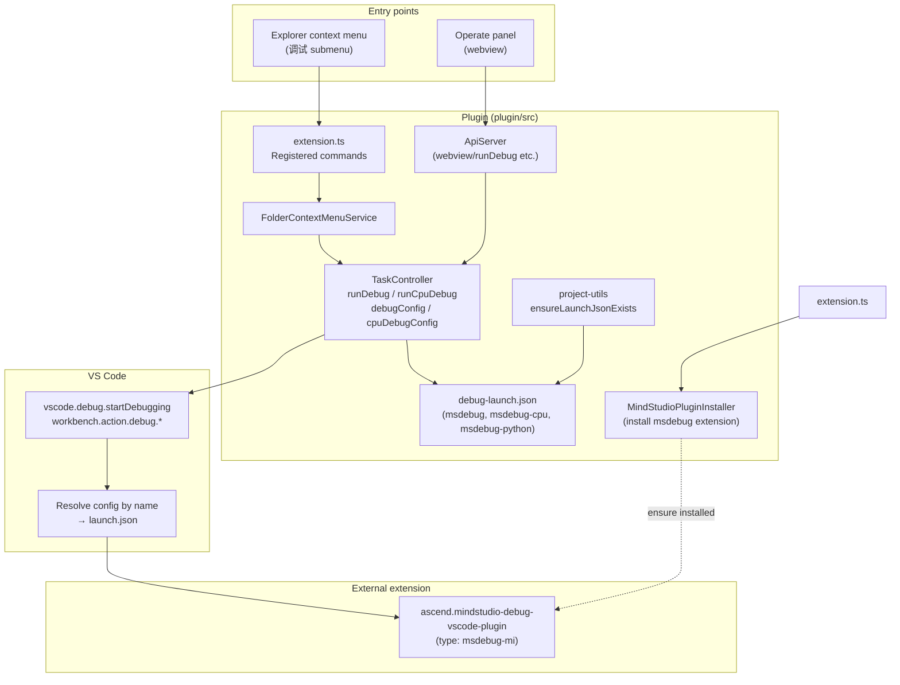
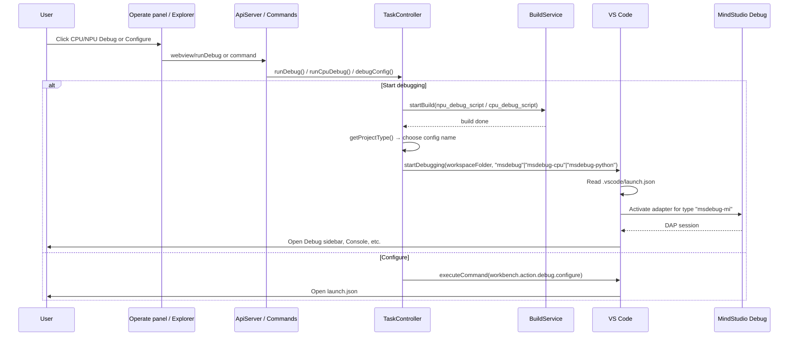
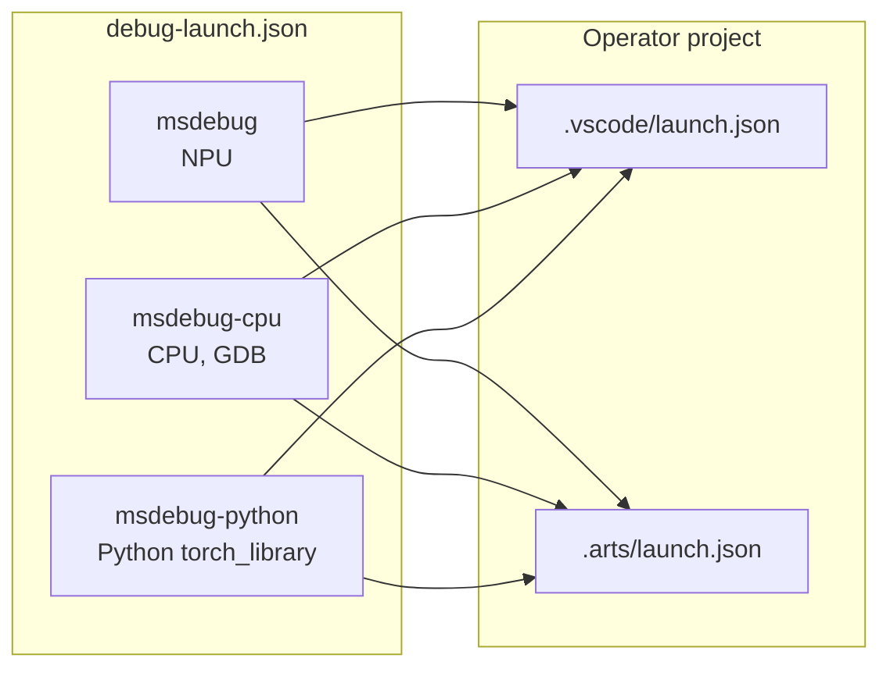
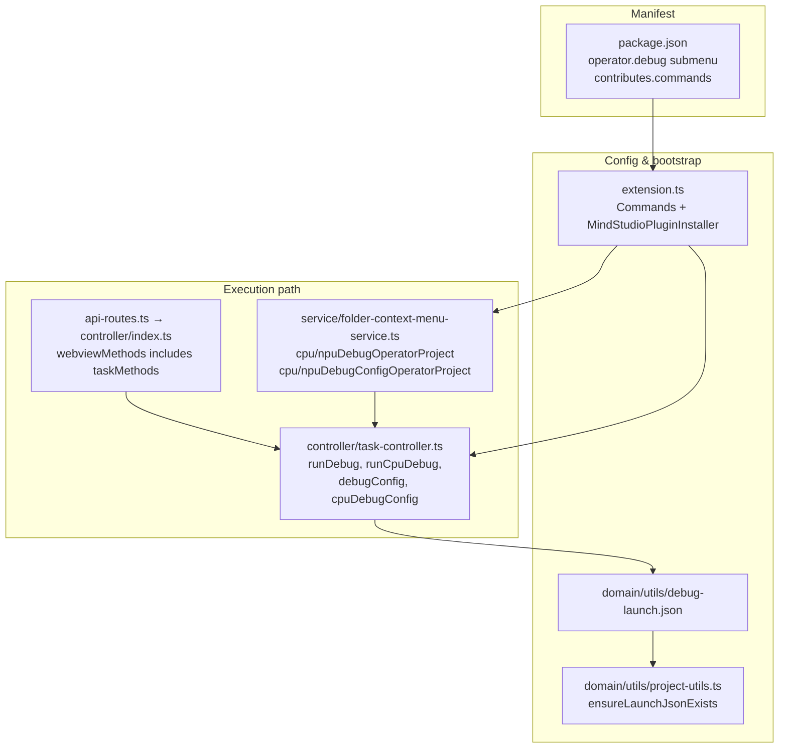

# Debug Integration Architecture

This document describes how debugging is integrated in the Huawei OP DevTools VS Code extension: protocols, VS Code debug UI usage, and the full architecture from entry points to the MindStudio Debug extension.

---

## Overview

The plugin does **not** implement a debug adapter. It:

- Ensures the **MindStudio Debug** extension (`ascend.mindstudio-debug-vscode-plugin`) is installed.
- Injects **launch configurations** (`msdebug`, `msdebug-cpu`, `msdebug-python`) into operator projects.
- **Starts** debug sessions by name via the VS Code Debug API and opens the standard debug UI (Configure, REPL).

The actual debug engine uses the **Debug Adapter Protocol (DAP)** and is implemented by the MindStudio Debug extension.

---

## Protocols

```mermaid
flowchart LR
  subgraph Plugin["This plugin"]
    Webview[Operate panel]
    TaskCtrl[Task controller]
    Webview -->|"postMessage / request"| TaskCtrl
  end

  subgraph VSCode["VS Code"]
    DebugAPI[vscode.debug API]
    DebugUI[Debug UI / RUN AND DEBUG]
  end

  subgraph External["MindStudio Debug extension"]
    DAPAdapter[Debug Adapter]
  end

  subgraph Target["Debug target"]
    GDB[GDB / Python / NPU]
  end

  TaskCtrl -->|startDebugging(name)| DebugAPI
  DebugAPI --> DebugUI
  DebugAPI -->|"resolve type msdebug-mi"| DAPAdapter
  DAPAdapter <-->|DAP JSON-RPC| DebugUI
  DAPAdapter -->|stdio/socket| GDB
```

| Layer | Protocol | Role |
|-------|----------|------|
| **Webview → Plugin** | Custom request/response over webview messaging | Operate panel calls `webview/runDebug`, `webview/runCpuDebug`, etc. |
| **Plugin → VS Code** | VS Code Extension API (`vscode.debug`, `vscode.commands`) | Start session by config name; open Configure / REPL |
| **VS Code ↔ Debug Adapter** | **Debug Adapter Protocol (DAP)** | JSON-RPC over stdio/socket; implemented by MindStudio Debug extension |
| **Debug Adapter → Target** | Tool-specific (GDB MI, Python, NPU) | MindStudio adapter talks to GDB / Python / NPU debuggee |

---

## High-Level Architecture



---

## Debug Session Start Flow



---

## Launch Configurations

Configurations are defined in `plugin/src/domain/utils/debug-launch.json` and copied into each operator project’s `.vscode/launch.json` (and `.arts/launch.json`) by `ensureLaunchJsonExists()`.



| Name | Type | Use case |
|------|------|----------|
| **msdebug** | `msdebug-mi` | NPU debug; target: `build/${workspaceFolderBasename}` |
| **msdebug-cpu** | `msdebug-mi` | CPU debug; `msdebugMiPath`: `/usr/bin/gdb` |
| **msdebug-python** | `msdebug-mi` | Python (e.g. `torch_library_template`); target: `/usr/local/bin/python`, args: `run.py` |

Config selection in code:

- **NPU:** `ascend` + `torch_library_template` → `msdebug-python`, else `msdebug`.
- **CPU:** same project/template check → `msdebug-python` or `msdebug-cpu`.

---

## Component Map (plugin/src)



| File | Role |
|------|------|
| `domain/utils/debug-launch.json` | Template for the three `msdebug-mi` launch configs |
| `domain/utils/project-utils.ts` | Writes template to `.vscode/launch.json` and `.arts/launch.json` for new projects |
| `controller/task-controller.ts` | Build + `startDebugging(name)` or `workbench.action.debug.configure` |
| `service/folder-context-menu-service.ts` | Explorer menu handlers that call task controller methods |
| `api-routes.ts` / `controller/index.ts` | Expose `webview/runDebug`, `webview/runCpuDebug`, etc. via `taskMethods` |
| `extension.ts` | Registers debug commands; runs MindStudioPluginInstaller on activate |
| `class/mind-studio-plugin-installer.ts` | Ensures `ascend.mindstudio-debug-vscode-plugin` is installed |
| `constants.ts` | Command IDs for the four debug-related commands |
| Root `package.json` | `contributes`: `operator.debug` submenu, commands, configuration (`op-devtools.debugMode`) |

---

## VS Code Debug UI Integration

The plugin does not add custom debug views. It uses the built-in RUN AND DEBUG experience:

1. **Starting a session**  
   `vscode.debug.startDebugging(workspaceFolder, debugConfigName)` causes VS Code to:
   - Resolve the named config from `launch.json`
   - Activate the extension that contributes the debug type (`msdebug-mi`)
   - Run that extension’s Debug Adapter and open the default Debug sidebar, Debug Console, Variables, Call Stack, etc.

2. **Configuring**  
   `workbench.action.debug.configure` opens the standard `launch.json` editor.

3. **REPL**  
   `workbench.debug.action.toggleRepl` toggles the Debug Console.

So all “debug windows” are VS Code’s native debug UI; the plugin only triggers them.

---

## Summary

- **Protocols:** DAP (VS Code ↔ MindStudio Debug adapter), Extension API (plugin ↔ VS Code), webview messaging (Operate panel ↔ plugin).
- **VS Code debug UI:** Standard RUN AND DEBUG views; the plugin starts sessions and opens Configure/REPL via the Debug API and built-in commands.
- **Architecture:** Entry points (Explorer menu + webview API) → plugin task controller → `startDebugging` / configure → VS Code → MindStudio Debug extension (DAP) → debuggee. This repo provides launch configs and orchestration; the debug engine and DAP live in the MindStudio Debug extension.
