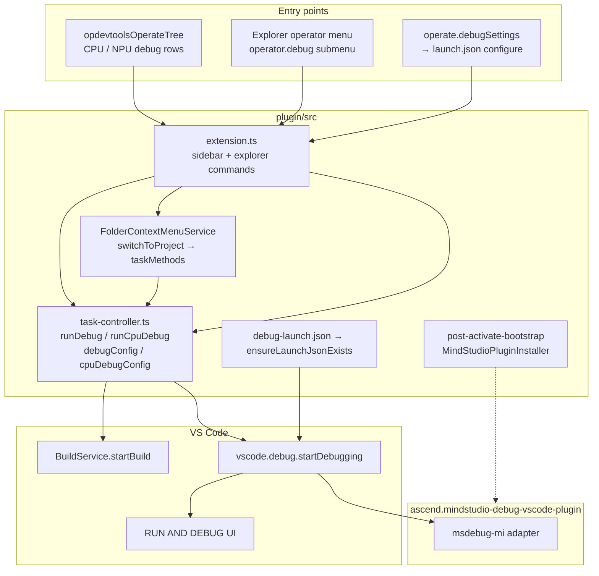

# Debug integration (current state)

How debugging works in the Huawei OP DevTools VS Code extension: entry points, build-then-launch flow, launch configs, and delegation to the **MindStudio Debug** extension (`ascend.mindstudio-debug-vscode-plugin`).

Sidebar Actions tree behavior (visibility, multi-operator rules, gear icon): [`operator-treeview.md`](operator-treeview.md).

---

## Overview

This extension does **not** implement a Debug Adapter. It:

1. Ensures **MindStudio Debug** is installed (bundled VSIX, post-activate bootstrap).
2. Seeds **`launch.json`** in the workspace IDE config directory when a new operator project is created.
3. Runs a **debug-oriented build** (`cpu_debug_script` / `npu_debug_script`), then starts a named launch configuration via `vscode.debug.startDebugging`.

The adapter type is **`msdebug-mi`** (DAP implemented by MindStudio Debug).

---

## Architecture



| Layer | Mechanism |
|-------|-----------|
| UI → plugin | VS Code commands; `taskMethods.*` in-process (not `ops` RPC) |
| Plugin → VS Code | `vscode.debug.startDebugging`, `workbench.action.debug.configure`, `workbench.debug.action.toggleRepl` |
| VS Code ↔ adapter | **DAP** (MindStudio Debug) |

---

## Entry points

### Actions tree (`opdevtoolsOperateTree`)

Registered in `extension.ts`; rows built in `operate-tree-provider.ts`.

| Row | Command | Task method | Notes |
|-----|---------|-------------|--------|
| **CPU Debug** | `huawei-op-devtools.sidebar.cpuDebug` | `runCpuDebug` | Hidden for `projectType === 'ascend'` and `cann` + `torch_library_template`; also hidden when plugin `buildBehavior.supportsCpuDebug` is false (**Triton**) |
| **NPU Debug** | `huawei-op-devtools.sidebar.npuDebug` | `runDebug` | Shown only if registry supports NPU debug **and** `op-devtools.debugMode` is true (`ConfigHelper.isDebugModeEnabled`); hidden for **Triton** (`supportsNpuDebug: false`) |
| **Debug** group gear | `huawei-op-devtools.operate.debugSettings` | `debugConfig` | Opens configure UI; `skipFlowExecutionUi` (no spinner) |

Both debug runs use `operateTreeProvider.runFlowAction(...)` for row loading/stop UI. They are **not** enqueued in `OperatorActionQueueManager` (unlike sanitizer/simulation/on-board).

Multi-operator selection (`selectedOperatorIds.length > 1`) blocks debug commands with an information message.

### Explorer context menu

`FolderContextMenuService` switches workspace to the operator folder, then calls the same `taskMethods` as the tree.

| Command | Handler | In `operator.debug` submenu? |
|---------|---------|------------------------------|
| `huawei-op-devtools.operatorProjectCpuDebug` | `cpuDebugOperatorProject` → `runCpuDebug` | **Yes** |
| `huawei-op-devtools.operatorProjectCpuDebugConfig` | `cpuDebugConfigOperatorProject` → `cpuDebugConfig` | **Yes** |
| `huawei-op-devtools.operatorProjectNpuDebug` | `npuDebugOperatorProject` → `runDebug` | **No** (command exists; not listed under `operator.debug` in `package.json`) |
| `huawei-op-devtools.operatorProjectNpuDebugConfig` | `npuDebugConfigOperatorProject` → `debugConfig` | **No** |

Ascend-like operator folders (`<<<>>>`) are rejected for debug menu actions.

### APIs

| API | Debug support |
|-----|----------------|
| **`ops`** (`api-routes.ts`) | None for start/configure debug |
| **`webview`** (`controller/index.ts` → `webviewMethods`) | No debug methods |
| **`taskMethods`** | Used only from extension commands / folder menu (in-process) |

---

## Session start flow

```mermaid
sequenceDiagram
  participant User
  participant Cmd as extension command
  participant Task as task-controller
  participant Build as BuildService
  participant VSCode as VS Code
  participant MS as MindStudio Debug

  User->>Cmd: CPU or NPU debug
  Cmd->>Task: runCpuDebug / runDebug
  Note over Task: ensurePostActivateBootstrapReady
  Task->>Task: guardSupportedProjectTypeOrNotify
  Task->>Task: ProjectManager.initProject
  opt pyasc / triton
    Task->>Task: require active .py; update deploy target
  end
  alt NPU
    Task->>Build: startBuild(npu_debug_script, operatorNames, compileOption)
  else CPU
    Task->>Build: startBuild(cpu_debug_script, operatorNames, compileOption)
  end
  Task->>VSCode: workbench.debug.action.toggleRepl
  Task->>Task: pick msdebug / msdebug-cpu / msdebug-python
  Task->>VSCode: startDebugging(workspaceFolder, name)
  VSCode->>MS: resolve msdebug-mi from launch.json
  MS-->>User: DAP session, debug UI
```

**Configure-only** (`debugConfig`, `cpuDebugConfig`): `workbench.action.debug.configure` + info toast (`task.launchJsonOpened`). No build, no `startDebugging`.

---

## Launch configurations

Template: `plugin/src/domain/utils/debug-launch.json`.

Written once per new project by `ensureLaunchJsonExists()` in `project-utils.ts` (from `welcome-controller` / project model):

- Path: **`<ideConfigDir>/launch.json`** where `ideConfigDir` is `.vscode` (VS Code) or `.arts` (CodeArts) — see `helpers/ide-config-dir.ts`.
- **Not** duplicated to both directories; one file per workspace IDE flavor.
- `environmentScripts` in the written file point at **`<ideConfigDir>/.env`** (template’s `.arts/.env` is overridden in `buildDebugLaunchConfig()`).

| Config name | `type` | Used when |
|-------------|--------|-----------|
| **msdebug** | `msdebug-mi` | NPU debug; target `build/${workspaceFolderBasename}` |
| **msdebug-cpu** | `msdebug-mi` | CPU debug; `msdebugMiPath`: `/usr/bin/gdb` |
| **msdebug-python** | `msdebug-mi` | `projectType === 'ascend'` **and** `projectTemplateName === 'torch_library_template'` (CPU and NPU paths) |

Selection in `task-controller.ts`:

- NPU: `msdebug-python` vs `msdebug`
- CPU: `msdebug-python` vs `msdebug-cpu`

If no workspace folder: falls back to `workbench.action.debug.start`.

Debug pre-build scripts come from workspace settings ([`workspace-settings.md`](./workspace-settings.md#compile--deploy-op-devtoolscompileanddeploy) — `cpuDebugCompileCommand` / `npuDebugCompileCommand`).

---

## MindStudio Debug extension install

Not run synchronously in `activate()`. Deferred in `helpers/post-activate-bootstrap.ts`:

- Plugin ID: `ascend.mindstudio-debug-vscode-plugin`
- Bundled VSIX: `out/plugin/mindstudio-debug-vscode-plugin/MindStudio-Debug-VSCode-Plugin-1.0.8.vsix`
- `MindStudioPluginInstaller.installIfNeeded()` (skip if already active)

`runDebug` / `runCpuDebug` await `ensurePostActivateBootstrapReady()` so install/auto-open can finish first.

---

## VS Code debug UI

No custom debug views in this extension. The plugin triggers:

1. **Session** — `vscode.debug.startDebugging` → standard Debug sidebar, variables, call stack, breakpoints.
2. **Configure** — `workbench.action.debug.configure`.
3. **REPL** — `workbench.debug.action.toggleRepl` before starting CPU/NPU debug.

---

## Settings

Debug-related workspace keys (`debugMode`, CPU/NPU debug compile commands): [`workspace-settings.md`](./workspace-settings.md).

---

## Key files

| File | Role |
|------|------|
| `controller/task-controller.ts` | `runDebug`, `runCpuDebug`, `debugConfig`, `cpuDebugConfig` |
| `extension.ts` | Sidebar debug commands; explorer command registration |
| `service/folder-context-menu-service.ts` | Explorer → project switch → task methods |
| `class/operate-tree-provider.ts` | Debug group visibility and commands |
| `domain/utils/debug-launch.json` | Launch config template |
| `domain/utils/project-utils.ts` | `ensureLaunchJsonExists` |
| `helpers/post-activate-bootstrap.ts` | MindStudio Debug VSIX install |
| `class/mind-studio-plugin-installer.ts` | Install logic (VS Code / remote / CodeArts) |
| `helpers/ConfigHelper.ts` | `debugMode` read |
| `constants.ts` | `COMMAND_SIDEBAR_*_DEBUG`, `COMMAND_OPERATOR_PROJECT_*_DEBUG` |
| `package.json` | `operator.debug` submenu, `op-devtools.debugMode`, compile debug script settings |

---

## Summary

- **DAP** via MindStudio Debug (`msdebug-mi`); this extension orchestrates build + `startDebugging`.
- **Entry:** Actions tree (primary), Explorer **CPU** debug submenu; NPU explorer commands registered but not in that submenu.
- **No** `ops` / webview RPC for debug; **no** operator action queue.
- **`launch.json`** lives under `.vscode` or `.arts` (one per IDE), seeded on new project creation.
