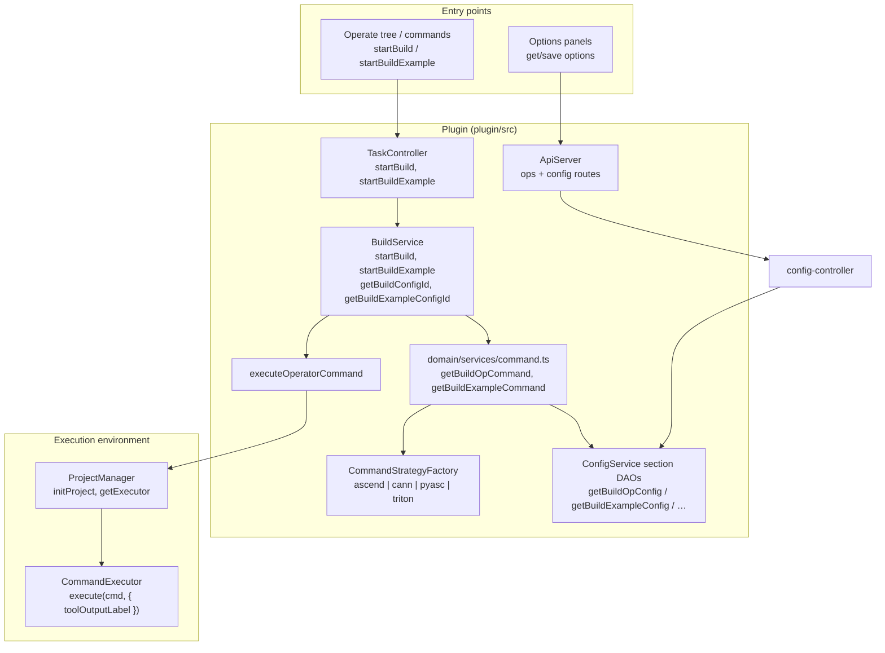
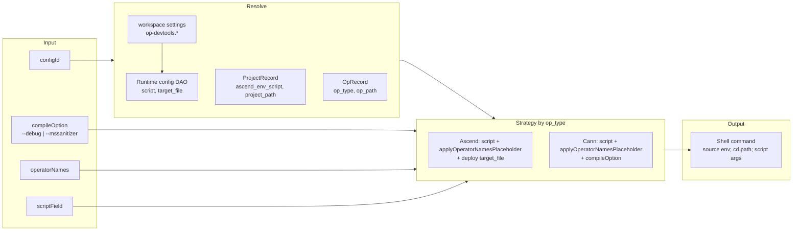
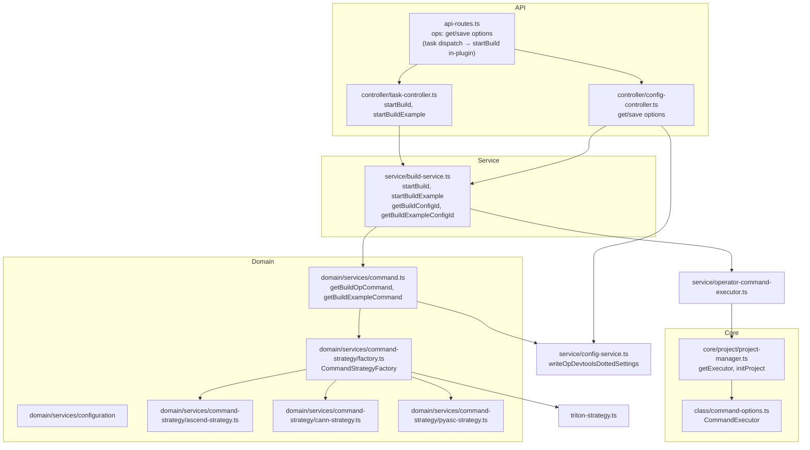

# 构建工具集成架构

本文档介绍 Ascend C Toolkits VS Code 扩展中**算子编译**（编译算子 / 编译示例）的集成方式：入口、配置模型、命令生成与执行。

**相关文档：** [`workspace-settings-zh.md`](./workspace-settings-zh.md)（编译脚本、部署目标）、[`ascend-env-spec-zh.md`](./ascend-env-spec-zh.md)（spawn 环境）、[`operator-treeview-zh.md`](./operator-treeview-zh.md)（Actions 树——构建**不**走排队执行）、[`run-integration-zh.md`](./run-integration-zh.md)、[`debug-integration-zh.md`](./debug-integration-zh.md)。

---

## 概述

插件本身**不**附带编译器，它的职责是：

- **编排**编译过程，使用合成出来的配置行（`build_op`、`build_example`）。生成命令时，脚本字段和选项来自工作区的 **`op-devtools.*`** 设置，通过 `ConfigService` 上按分区的类型化 DAO 工厂（`getBuildOpConfig()`、`getBuildExampleConfig()` 等）读取，并经由 `resolveSectionBaseContext` 解析（见[命令生成时的运行时配置](#命令生成时的运行时配置)）；仅存于数据库的字段（`fileMapList` 等）来自 `.vscode/cache.json`（`fileMapLists`），而性能分析器的 `build_example.target_file` 即 `exampleBuildConfig.targetFile` 设置项。
- 使用按 `operator.op_type`（`ascend`、`cann`、`pyasc`、`triton`）选出的**命令策略**来**拼接** shell 命令字符串。
- 通过 **`executeOperatorCommand`**（`operator-command-executor.ts`）**执行**命令：先做一次 `resolveAscendEnvForOperatorCommand` 解析，再进行占位符替换和 `export … &&` 注入，最后调用 `ProjectManager.getExecutor().execute(..., { toolOutputLabel })`（与 run / sanitizer / simulate 共用同一套执行器栈）。
- 通过 VS Code 命令 → `taskMethods.startBuild` / `startBuildExample` **暴露**编译入口（Actions 树的 **Build** 行、文件夹菜单、调试前预编译）。仿真 / 上板 / sanitizer 选项面板通过工作区设置（`op-devtools.*`）和工作区缓存读写配置——不走配置行 RPC。

实际的编译工作由生成命令中指定的项目脚本或工具链完成。

**扩展宿主与 shell CANN 环境的区别** —— 扩展激活时仅**记录**一份冻结的全局环境快照；它不会 source 环境脚本，也不会修改 `process.env`。当设置了 `project.ascend_env_script` 时，各策略会在命令前加上 **`. ${project.ascend_env_script} && …`**；`executeOperatorCommand` 会在每条命令中嵌入 `export SOC_VERSION=… && …`。相关约定见 [`ascend-env-spec-zh.md`](./ascend-env-spec-zh.md)；Ascend950PR&950DT 系列见 [`ascend-a5-support-zh.md`](./ascend-a5-support-zh.md)。

---

## 协议

```mermaid
flowchart LR
  subgraph Plugin["This plugin"]
    Webview[Options webviews\nsimulator / on-board]
    OpsAPI[ops API\nget/save options]
    Commands[VS Code commands\nbuild / build example]
    TaskCtrl[Task controller]
    BuildSvc[BuildService]
    DomainCmd[domain/services/command\ngetBuildOpCommand\ngetBuildExampleCommand]
    Strategy[Command strategy\nascend / cann / pyasc / triton]
  end

  subgraph VSCode["VS Code"]
    Notifications[Notifications\nshowMessage]
  end

  subgraph Env["Execution environment"]
    Executor[ProjectManager.getExecutor()]
    Shell[Shell / script]
  end

  Webview -->|"request"| OpsAPI
  Commands --> TaskCtrl --> BuildSvc
  BuildSvc --> DomainCmd --> Strategy
  DomainCmd --> Strategy
  BuildSvc --> ExecOp["executeOperatorCommand\nascend env + placeholders"]
  ExecOp --> Executor
  Executor --> Shell
  BuildSvc --> Notifications
```

| 层 | 协议 | 作用 |
|----|------|------|
| **Webview → 插件** | 基于 ApiServer 的自定义请求/响应 | 仿真 / 上板面板调用 `ops/getSimulateOptions` / `ops/saveSimulateOptions` / `ops/getOnBoardOptions` / `ops/saveOnBoardOptions`（仅 settings.json）。编译 / 编译示例**不**暴露在 `ops` 上；请使用 VS Code 命令 → `taskMethods.startBuild` / `startBuildExample`。 |
| **插件 → VS Code** | VS Code Extension API | 显示成功/失败消息；项目/工作区上下文。 |
| **插件 → 执行环境** | Shell 命令（stdio） | `executeOperatorCommand` 解析 ascend 环境、替换占位符、在命令字符串中嵌入 `export … &&` 前缀，然后由 `CommandExecutor.execute` 执行，输出到按标签划分的输出通道（`Op Dev Tools: compile` / `run` / `simulate` / `sanitizer` / `onboard` / `st test` / `ut test` / `dump tensor` / `cpu debug` / `npu debug`）。**一个动作链中的每条命令都写入该动作自己的通道**——仿真内部的编译前置步骤写入 `simulate` 通道，CPU/NPU 调试的预编译和示例构建写入 `cpu debug`/`npu debug`，侧边栏在多算子/标准自定义项目上执行 Run 时，其编译示例步骤归入 `run` 通道；`compile` 通道只接收编译动作自身的输出（包括单独运行的编译示例）。CPU/NPU 调试链作为普通算子动作运行（其编译只是链中的一条命令——不会出现在树上的 compile/run 门控节点上）。通道按标签持久化：新的运行**追加**到通道中而不是清空它（GC-73）；`{ clear: true }` 是显式重置方式。Ascend 相关变量不通过 `options.env` 传递。 |

---

## 高层架构



---

## 构建流程

### 算子构建（编译算子）

```mermaid
sequenceDiagram
  participant User
  participant Cmd as VS Code command
  participant Task as TaskController
  participant Build as BuildService
  participant Domain as domain/command
  participant Strategy as Command strategy
  participant PM as ProjectManager
  participant ExecOp as executeOperatorCommand
  participant Exec as CommandExecutor

  User->>Cmd: Build (sidebar / command)
  Cmd->>Task: startBuild(params)
  Task->>Task: guardSupportedProjectType (registry)
  Task->>PM: initProject()
  Task->>Build: startBuild(params)
  Build->>Build: guardSupportedProjectTypeForCurrentProject
  Build->>Build: resolve configId (params or getBuildConfigId)
  alt no configId
    Build->>User: showErrorMessage(no build config)
    return
  end

  Build->>Domain: getBuildOpCommand(...)
  Domain->>Domain: resolveSectionBaseContext → section DAO
  Domain->>Strategy: buildOpCommand(...)
  Strategy-->>Build: buildCommand

  Build->>ExecOp: execute(buildCommand, spawnContext)
  ExecOp->>ExecOp: resolveAscendEnv + placeholders + export prefixes
  ExecOp->>Exec: execute(runnableCommand, { toolOutputLabel })
  Exec-->>Build: { code, output }

  alt code !== 0
    Build->>User: compile failed
  else code === 0
    Build->>User: compile success
    Build->>Build: notifyBuildSucceededForSidebar (standard-custom compile flags)
  end

  Task->>PM: clearExecutor()
```

### 示例构建（编译示例）

流程类似：`startBuildExample` → `getBuildExampleConfigId()` → `getBuildExampleCommand` → `executeOperatorCommand`。没有 `notifyBuildSucceededForSidebar`。PyAsc 在 `buildExampleCommand` 上会**抛异常**；ascend/cann/triton 实现了它（triton 使用 Python 示例脚本）。

---

## 配置与命令构建

### 配置类型

| 类型 | 用途 | 解析者 |
|------|------|--------|
| **build_op** | 算子（kernel）编译 | `getBuildConfigId()` —— `startBuild`、sanitizer/仿真/上板预编译、调试预编译 |
| **build_example** | 示例 / 测试二进制编译 | `getBuildExampleConfigId()` —— `startBuildExample`、性能分析前置步骤 |

**存储：** 配置行在运行时由工作区 `op-devtools.*` 设置加上 `.vscode/cache.json`（`fileMapLists`）合成；默认脚本字符串来自 `OperatorPluginRegistry.getOpPlugin(op_type).getInitialConfigScripts()`，并由 `ensureOpDevtoolsSettingsSeeded` 写入设置。UI 列表：Actions 树根据工作区缓存扫描状态（`cache.folders[].opsList`）推导算子行。

### 命令生成时的运行时配置

`domain/services/command.ts` 中的 `resolveSectionBaseContext(projectPath, operatorNames, configFactory)` 会解析 `ConfigService` 上按分区的类型化 DAO 工厂（`getBuildOpConfig()` / `getBuildExampleConfig()` / `getUtTestConfig()` / `getSimulateConfig(projectPath)` / `getOnBoardConfig(projectPath)` / `getSanitizerConfig(projectPath, op)`）。每个 DAO：

1. 直接读取自己对应的点分 `op-devtools.*` 设置（不做分区键分发）。
2. 合入仅存于缓存的元数据（`.vscode/cache.json`：`fileMapLists[configType]` → `fileMapList`，sanitizer 的 `sanitizerPythonTarget[op]` → `target_file`）。

| 运行时字段 | 来源 |
|-----------|------|
| `build_op.script`、调试脚本、流程编译脚本 | `op-devtools.compileAndDeploy.buildConfig.*`（见 [`workspace-settings-zh.md`](./workspace-settings-zh.md)） |
| `build_op.target_file`（部署 / 运行包） | `compileAndDeploy.buildConfig.deployCommandOrRunCommand` |
| `build_example.script`、`execution_mode` | `exampleBuildConfig.*` |
| `build_example.target_file`（msprof / 性能分析器二进制） | `compileAndDeploy.exampleBuildConfig.targetFile` 设置项，回退到 `OperatorPluginRegistry.getDefaultPaths` |
| Sanitizer / 仿真 / 上板选项 | 对应的 `op-devtools.*` 键 |

### `{operatorNames}` 与 `--ops`（编译脚本）

Ascend 标准自定义默认脚本（见 `AscendPlugin.getInitialConfigScripts()` → 写入工作区 `op-devtools.*` 设置）在编译相关脚本字段（`compileCommand`、`cpuDebugCompileCommand`、`npuDebugCompileCommand`、`utTestCompileCommand`、`onBoardCompileCommand`、`simulationCompileCommand`、`sanitizerCompileCommand`）中包含 `--ops={operatorNames}`。

生成命令时，由 `plugin/src/domain/utils/operator-script-placeholders.ts` 中的 **`applyOperatorNamesPlaceholder()`** 处理（ascend 和 cann 的 `buildOpCommand` / `buildUtTestCommand` 使用）：

| 选择情况 | 行为 |
|----------|------|
| 选中了算子 | `{operatorNames}` → 逗号分隔的名称（例如 `--ops=add,sub`） |
| 未选择任何算子 | `--ops={operatorNames}` 整个 token 被**移除**（不会留下 `--ops=`） |
| 脚本中没有字面量 `--ops` 标志 | 仅对 ascend 标准自定义编译行追加 `--ops=<names>`（`--vendor_name=custom`、`--pkg`、UT `--soc … -u` 等形式） |

PyAsc/Triton 脚本是 `python3 ./<op>.py`，不带 `--ops`；cann 的纯 `bash build.sh` 流程保持不变。示例运行仍通过 `buildExampleCommand` 使用位置参数传递算子，而不是设置中的 `--ops`。

### 命令生成

- **选择策略：** `CommandStrategyFactory.getStrategy(operator?.op_type)` → `ascend` | `cann` | `pyasc` | `triton`（未知类型默认 **`cann`**）。
- **构建上下文：** `strategy.buildCommandContext(baseContext)` → `sourceCannCmd`（设置了 `project.ascend_env_script` 时为 `. ${project.ascend_env_script} &&`）、`cdCmd` 等。
- **build_op：** `strategy.buildOpCommand({ …, scriptField })` 使用由 `scriptField` 选定的 DAO 字段——`config.script`（默认）、`config.cpuDebugScript` 或 `config.npuDebugScript`——在 `applyOperatorNamesPlaceholder()` 处理之后使用（见下文）；ascend 通过 `getExecutableCommand(config.target_file)` 追加部署命令；cann/triton 视情况追加 `compileOption` / `advance_cmd`。
- **build_example：** `strategy.buildExampleCommand` —— ascend/cann 为 shell 方式；triton/pyasc 按各自策略处理（pyasc 的示例路径仅在 kernel 构建时抛异常，并非所有示例路径都抛——见各策略文件）。



### 各策略行为（编译）

| 策略 | buildOpCommand | buildExampleCommand |
|------|----------------|---------------------|
| **ascend** | `config[scriptField]` → `applyOperatorNamesPlaceholder` → `Command` + 可选的 `compileOption` / `advance_cmd`；build_op 额外追加 `getExecutableCommand(config.target_file)` 部署命令。`--ops` 来自设置脚本或占位符回退逻辑，而不是 `Command.addOptions`。 | 使用 `config.script`，参数：op（或 operatorNames）、execution_mode、pkg_mode；可选 compileOption。 |
| **cann** | 在 `config[scriptField]` 上使用相同的占位符辅助函数；纯 `bash build.sh` 脚本不追加 `--ops`。支持 `compileOption`、`advance_cmd`。没有单独的部署步骤。 | 实现了示例构建（脚本 + 参数）。 |
| **pyasc** | **不支持**（抛异常）。PyAsc 项目运行的是 Python；不存在这种意义上的 kernel 构建。 | **不支持**（抛异常）。 |
| **triton** | 通过配置的脚本执行 Python 版 `build_op` / `build_example`（`TritonCommandStrategy`）。 | 示例与 build_op 路径相同。 |

---

## Triton 调试预编译脚本

对于 `op_type=triton`，`TritonPlugin.getInitialConfigScripts()` 会为 `npu_debug_script` 写入一条面向编译的命令（`cpu_debug_script` 仅为配置 schema 保留一个普通条目——Triton 不支持 CPU 调试）：

```bash
TRITON_DISABLE_CACHE=1 TRITON_DISABLE_LINE_INFO=false LLVM_EXTRACT_DI_LOCAL_VARIABLES=1 python3 ./<op>.py
```

NPU 调试（`task-controller.runDebug`）在启动 `msdebug-triton-npu` 之前，会以 `scriptField: 'npu_debug_script'` 调用 `BuildService.startBuild`。见 [`debug-integration-zh.md`](./debug-integration-zh.md)。

---

## 数据格式（API）

### startBuild 参数（StartBuildParams）

| 字段 | 类型 | 说明 |
|------|------|------|
| `configId` | string | 可选。构建配置 ID（build_op）。省略时插件使用当前项目的默认配置。 |
| `compileOption` | string | 可选。例如 `--debug`、`--mssanitizer`，用于调试构建或 sanitizer 构建。 |
| `operatorNames` | string | 可选。逗号分隔的算子名（例如用于标准自定义算子）。 |
| `operatorType` | string | 可选。提示要构建哪类算子。 |
| `projectId` | string \| number | 可选。项目 ID；设置后会更新 ProjectManager，使构建在该项目上下文中运行。 |
| `scriptField` | string | 可选。使用哪个配置字段作为脚本：`script`、`cpu_debug_script`、`npu_debug_script`。 |

### startBuildExample 参数（StartBuildExampleParams）

| 字段 | 类型 | 说明 |
|------|------|------|
| `configId` | string | 可选。示例构建配置 ID（build_example）。 |
| `compileOption` | string | 可选。 |
| `operatorNames` | string | 可选。逗号分隔。 |
| `operatorType` | string | 可选。 |
| `projectId` | string \| number | 可选。项目 ID。 |

---

## 组件地图（plugin/src）



| 文件 | 作用 |
|------|------|
| `controller/task-controller.ts` | `startBuild` / `startBuildExample`：`ensurePostActivateBootstrapReady`、`initProject`、注册表守卫、BuildService，以及在 `finally` 中调用 `clearExecutor`。 |
| `service/build-service.ts` | `guardSupportedProjectTypeForCurrentProject`；`getBuildOpCommand` / `getBuildExampleCommand`；**`executeOperatorCommand`**；toast 提示；`notifyBuildSucceededForSidebar`；标准自定义 `.run` 部署辅助（供仿真/上板使用）。 |
| `service/operator-command-executor.ts` | `executeOperatorCommand`、`buildOperatorSpawnContext`。 |
| `service/config-service.ts` | 分区 DAO 工厂：`getBuildOpConfig` / `getBuildExampleConfig` / `getUtTestConfig` / `getSimulateConfig` / `getOnBoardConfig` / `getSanitizerConfig`。 |
| `domain/services/command.ts` | 通过 `resolveSectionBaseContext` → 分区 DAO 实现 `getBuildOpCommand`、`getBuildExampleCommand`。 |
| `domain/services/command-strategy/factory.ts` | `CommandStrategyFactory.getStrategy(opType)` → ascend、cann、pyasc 或 triton。 |
| `domain/utils/operator-script-placeholders.ts` | `applyOperatorNamesPlaceholder`、`replaceOperatorScriptPlaceholders`（`{soc_version}`、`{simulator_type}`、`{operatorNames}`）。 |
| `domain/plugins/ascend.plugin.ts` | 默认编译脚本，在 `base`（以及 `utTestScript`）中包含 `--ops={operatorNames}`。 |
| `domain/services/command-strategy/ascend-strategy.ts` | Ascend：buildOpCommand（占位符 + 部署）、buildUtTestCommand、buildExampleCommand（脚本 + op、mode、pkg_mode）。 |
| `domain/services/command-strategy/cann-strategy.ts` | Cann：通过 `applyOperatorNamesPlaceholder` 实现 buildOpCommand / buildUtTestCommand。 |
| `domain/services/command-strategy/pyasc-strategy.ts` | PyAsc：buildOpCommand 和 buildExampleCommand 抛异常（不支持）。 |
| `domain/services/command-strategy/triton-strategy.ts` | Triton：通过配置的脚本（`python3 ./<op>.py`）执行 Python 版 `build_op` / `build_example`；UT test 抛异常；Actions 树按 `TritonPlugin.buildBehavior` 显示 sanitizer、仿真和上板（`supportsSanitizer` / `supportsSimulate` / `supportsOnBoard` 均为 `true`），而 CPU/NPU 调试行保持隐藏。 |
| `core/project/project-manager.ts` | `initProject()`、`getExecutor()`（CommandExecutor）、`clearExecutor()`。 |
| `api-routes.ts` | `ops`：仅 `getSimulateOptions` / `saveSimulateOptions` / `getOnBoardOptions` / `saveOnBoardOptions` / `getSanitizerOptions` / `saveSanitizerOptions`。构建/运行通过插件内的 `taskMethods`（命令 / Operate 树）进行，不走 `ops` RPC。 |

---

## DumpTensor 行为说明

- `BuildService.startDumpTensor` 先运行 `build_op`，然后根据项目类型执行**编译示例**（标准自定义）或**运行**（其他项目类型）。
- 示例构建和运行命令会加上 `ASCEND_GLOBAL_LOG_LEVEL=1` 前缀，并将 `ASCEND_DUMP_PATH` 指向 IDE 配置目录下的 `dump_tensor_temp_data`（两个分支使用相同环境）。
- 在没有本地 NPU 硬件的 CPU 主机上，只有产生 DumpTensor 数据的**编译示例** / **运行**命令会被 `remote_tool.sh exec` 包裹；`build_op` 仍在本地运行。远端拉取目录默认为工作区 `.vscode/dump_tensor_temp_data` 路径，显式配置的 `remoteOnBoardPullDirs` 设置优先级更高。
- 示例构建或运行成功后，`show_kernel_debug_data` 会把临时 dump 文件后处理为 `DumpTensor`，然后刷新原生 **Dump tensor results** 树并定位显示新生成的报告（`finalizeDumpTensorFlow` → `refreshDumpTensorResults({ focusIfNew: true })` → `huawei-op-devtools.flashDumpTensorData` → `OperateTreeProvider.refreshDumpTensorReports`）。不会打开任何面板或 webview。
- **Import .bin** 使用相同的 `show_kernel_debug_data` 步骤，然后刷新 Dump tensor results 树并定位显示导入的报告。

结果树的 UI 与命令详见 [`dump-tensor-zh.md`](./dump-tensor-zh.md)。

---

## 小结

- **入口：** Actions 树 **Build** / VS Code 命令 → `taskMethods` → `BuildService`（不走算子动作队列）。文件夹上下文和调试路径调用同一个 `startBuild`，只是 `scriptField` / `compileOption` 不同。
- **配置：** 运行时由工作区 `op-devtools.*` 设置 + `.vscode/cache.json` 合成配置行（按分区的 DAO 工厂）；部署目标来自 `deployCommandOrRunCommand`；性能分析器二进制路径来自 `exampleBuildConfig.targetFile`（回退到 `OperatorPluginRegistry.getDefaultPaths`）。
- **命令构建：** 由 `CommandStrategyFactory` 按 `op_type` 选择；pyasc 在 kernel `buildOpCommand` 上**抛异常**；triton 在启用时使用 Python 脚本（`operatorSupport.triton`）。
- **执行：** `executeOperatorCommand` —— ascend 环境解析、`{soc_version}` / `{simulator_type}` 替换、按 [`ascend-env-spec-zh.md`](./ascend-env-spec-zh.md) 进行 `export … &&` 注入。
- **协议：** `ops` 仅用于仿真/上板/sanitizer 设置；编译是插件内通过 `taskMethods` 完成的，不走 webview RPC。
