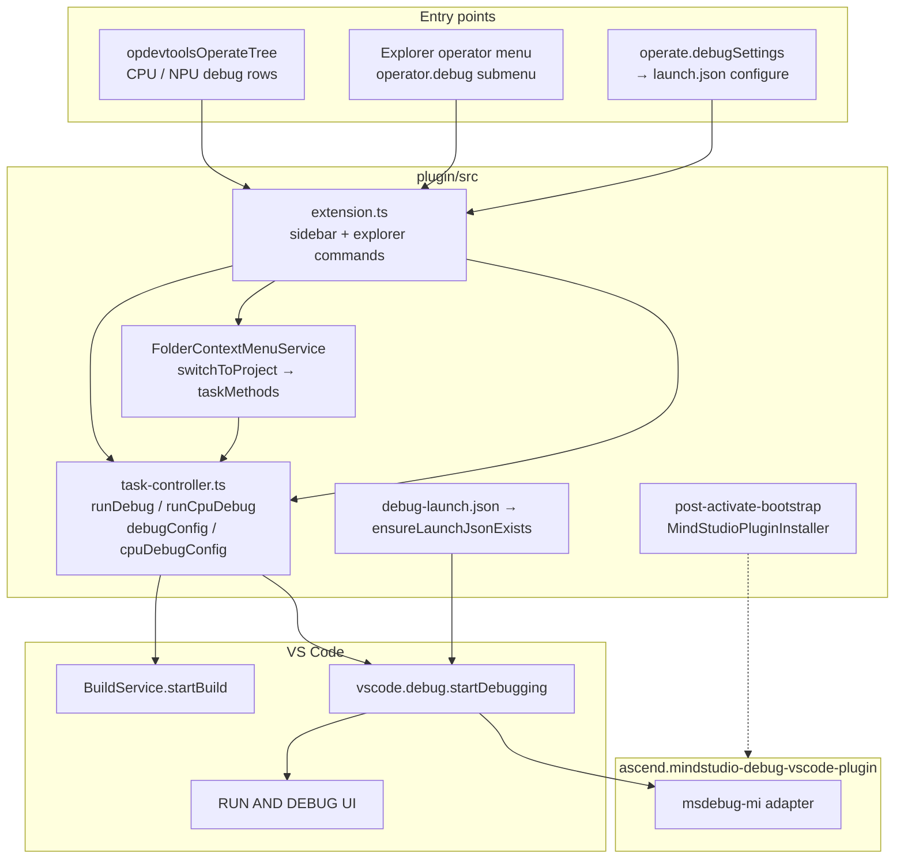

# 调试集成（现状）

Ascend C Toolkits VS Code 扩展中的调试工作方式：入口、先构建再启动的流程、启动配置，以及对 **MindStudio Debug** 扩展（`ascend.mindstudio-debug-vscode-plugin`）的委托。

侧边栏 Actions 树行为（可见性、多算子规则、齿轮图标）：[`operator-treeview.md`](operator-treeview-zh.md)。

---

## 概述

本扩展**不**实现 Debug Adapter。它做的是：

1. 确保 **MindStudio Debug** 已安装（内置 VSIX，激活后引导）。
2. 在新建算子项目时，向工作区 IDE 配置目录写入 **`launch.json`** 种子文件。
3. 运行一次**面向调试的构建**（`cpu_debug_script` / `npu_debug_script`），然后通过 `vscode.debug.startDebugging` 启动一个命名的启动配置。

适配器类型为 **`msdebug-mi`**（DAP 由 MindStudio Debug 实现）。

---

## 架构



| 层 | 机制 |
|-------|-----------|
| UI → 插件 | VS Code 命令；进程内的 `taskMethods.*`（非 `ops` RPC） |
| 插件 → VS Code | `vscode.debug.startDebugging`、`workbench.action.debug.configure`、`workbench.debug.action.toggleRepl` |
| VS Code ↔ 适配器 | **DAP**（MindStudio Debug） |

---

## 入口

### Actions 树（`opdevtoolsOperateTree`）

在 `extension.ts` 中注册；行在 `operate-tree-provider.ts` 中构建。

| 行 | 命令 | 任务方法 | 说明 |
|-----|---------|-------------|--------|
| **CPU Debug** | `huawei-op-devtools.sidebar.cpuDebug` | `runCpuDebug` | 当 `projectType === 'ascend'` 以及 `cann` + `torch_library_template` 时隐藏；当插件 `buildBehavior.supportsCpuDebug` 为 false 时隐藏 |
| **NPU Debug** | `huawei-op-devtools.sidebar.npuDebug` | `runDebug` | 仅当注册表支持 NPU 调试**且** `op-devtools.debugMode` 为 true（通过 `SettingsLoader` 读取）时显示；要求当前算子插件支持 `supportsNpuDebug`（当 `op-devtools.operatorSupport.triton=true` 时为 **Triton**） |
| **Debug** 组齿轮 | `huawei-op-devtools.operate.debugSettings` | `debugConfig` | 打开配置 UI；`skipFlowExecutionUi`（无加载动画） |

两次调试运行都使用 `operateTreeProvider.runFlowAction(...)` 实现行加载/停止 UI。它们**不会**进入 `OperatorActionQueueManager` 排队（与 sanitizer/仿真/上板不同）。

多算子选择（`selectedOperatorIds.length > 1`）会阻止调试命令并弹出提示信息。

### 资源管理器上下文菜单

`FolderContextMenuService` 先将工作区切换到算子文件夹，然后调用与树相同的 `taskMethods`。

| 命令 | 处理器 | 在 `operator.debug` 子菜单中？ |
|---------|---------|------------------------------|
| `huawei-op-devtools.operatorProjectCpuDebug` | `cpuDebugOperatorProject` → `runCpuDebug` | **是** |
| `huawei-op-devtools.operatorProjectCpuDebugConfig` | `cpuDebugConfigOperatorProject` → `cpuDebugConfig` | **是** |
| `huawei-op-devtools.operatorProjectNpuDebug` | `npuDebugOperatorProject` → `runDebug` | **否**（命令存在；未在 `package.json` 的 `operator.debug` 中列出） |
| `huawei-op-devtools.operatorProjectNpuDebugConfig` | `npuDebugConfigOperatorProject` → `debugConfig` | **否** |

Ascend 风格的算子文件夹（`<<<>>>`）会被调试菜单动作拒绝。

### API

| API | 调试支持 |
|-----|----------------|
| **`ops`**（`api-routes.ts`） | 不支持启动/配置调试 |
| **`webview`**（`controller/index.ts` → `webviewMethods`） | 无调试方法 |
| **`taskMethods`** | 仅从扩展命令 / 文件夹菜单调用（进程内） |

---

## 会话启动流程

```mermaid
sequenceDiagram
  participant User
  participant Cmd as extension command
  participant Task as task-controller
  participant Build as BuildService
  participant VSCode as VS Code
  participant MS as MindStudio Debug

  User->>Cmd: CPU or NPU debug
  Cmd->>Task: runCpuDebug / runDebug
  Note over Task: ensurePostActivateBootstrapReady
  Task->>Task: guardSupportedProjectTypeOrNotify
  Task->>Task: ProjectManager.initProject
  opt pyasc / triton
    Task->>Task: require active .py; update deploy target
  end
  alt NPU
    Task->>Build: startBuild(npu_debug_script, operatorNames, compileOption)
  else CPU
    Task->>Build: startBuild(cpu_debug_script, operatorNames, compileOption)
  end
  Task->>VSCode: workbench.debug.action.toggleRepl
  Task->>Task: pick msdebug / msdebug-cpu / msdebug-python
  Task->>VSCode: startDebugging(workspaceFolder, name)
  VSCode->>MS: resolve msdebug-mi from launch.json
  MS-->>User: DAP session, debug UI
```

**仅配置**（`debugConfig`、`cpuDebugConfig`）：`workbench.action.debug.configure` + 信息提示（`task.launchJsonOpened`）。不构建，不调用 `startDebugging`。

---

## 启动配置

模板：`plugin/src/domain/utils/debug-launch.json`。

由 `project-utils.ts` 中的 `ensureLaunchJsonExists()` 为每个新项目写入一次（来自 `welcome-controller` / 项目模型）：

- 路径：**`<ideConfigDir>/launch.json`**，其中 `ideConfigDir` 为 `.vscode`（VS Code）或 `.arts`（CodeArts）——见 `helpers/ide-config-dir.ts`。
- **不会**同时复制到两个目录；每个工作区 IDE 风味只有一个文件。
- 写入文件中的 `environmentScripts` 指向 **`<ideConfigDir>/.env`**（模板中的 `.arts/.env` 会在 `buildDebugLaunchConfig()` 中被覆盖）。

| 配置名 | `type` | 使用场景 |
|-------------|--------|-----------|
| **msdebug** | `msdebug-mi` | NPU 调试；目标 `build/${workspaceFolderBasename}` |
| **msdebug-cpu** | `msdebug-mi` | CPU 调试；`msdebugMiPath`：`/usr/bin/gdb` |
| **msdebug-python** | `msdebug-mi` | `projectType === 'cann'` **且** `projectTemplateName === 'torch_library_template'`（CPU 和 NPU 路径） |
| **msdebug-triton-npu** | `msdebug-mi` | Triton NPU 调试（`projectType === 'triton'`）；唯一支持的 Triton 调试路径 |

在 `task-controller.ts` 中通过 `resolveDebugLaunchConfigName()`（`domain/utils/debug-config-resolver.ts`）选择：

- NPU：`msdebug-triton-npu`（triton）/ `msdebug-python`（torch library）/ `msdebug`（默认）
- CPU：`msdebug-python`（torch library）/ `msdebug-cpu`（默认）；Triton 没有 CPU 调试（`supportsCpuDebug: false`）

基于 Python 的配置在启动前由 `updateMsdebugPythonTarget()`（`domain/utils/debug-python-target.ts`）修补：解释器、当前活动的 `.py` 脚本、算子 `cwd`，以及（Triton NPU）当在 `~/.triton/cache` 下找到已编译内核（`*.npubin`、`kernel.o` 或 `kernel_reloc.o`）时设置 `LAUNCH_KERNEL_PATH`。

如果没有工作区文件夹：回退到 `workbench.action.debug.start`。

调试预构建脚本来自工作区设置（[`workspace-settings.md`](./workspace-settings-zh.md#compile--deploy-op-devtoolscompileanddeploy) —— `cpuDebugCompileCommand` / `npuDebugCompileCommand`）。

---

## MindStudio Debug 扩展安装

不在 `activate()` 中同步运行。在 `helpers/post-activate-bootstrap.ts` 中延迟执行：

- 插件 ID：`ascend.mindstudio-debug-vscode-plugin`
- 内置 VSIX：`out/plugin/mindstudio-debug-vscode-plugin/MindStudio-Debug-VSCode-Plugin-1.0.10.vsix`
- `MindStudioPluginInstaller.installIfNeeded()`（已激活则跳过）

`runDebug` / `runCpuDebug` 会等待 `ensurePostActivateBootstrapReady()`，以便安装/自动打开先完成。

---

## VS Code 调试 UI

本扩展没有自定义调试视图。插件触发的是：

1. **会话** —— `vscode.debug.startDebugging` → 标准调试侧边栏、变量、调用栈、断点。
2. **配置** —— `workbench.action.debug.configure`。
3. **REPL** —— 在启动 CPU/NPU 调试前调用 `workbench.debug.action.toggleRepl`。

---

## 设置

调试相关的工作区键（`debugMode`、CPU/NPU 调试编译命令）：[`workspace-settings.md`](./workspace-settings-zh.md)。

---

## 关键文件

| 文件 | 作用 |
|------|------|
| `controller/task-controller.ts` | `runDebug`、`runCpuDebug`、`debugConfig`、`cpuDebugConfig` |
| `extension.ts` | 侧边栏调试命令；资源管理器命令注册 |
| `service/folder-context-menu-service.ts` | 资源管理器 → 项目切换 → 任务方法 |
| `class/operate-tree-provider.ts` | 调试组可见性与命令 |
| `domain/utils/debug-config-resolver.ts` | 启动配置名选择 |
| `domain/utils/debug-python-target.ts` | Python/Triton `launch.json` 修补 |
| `domain/utils/triton-kernel-path.ts` | 为 `LAUNCH_KERNEL_PATH` 进行的旁车文件 + 启发式内核产物发现（`*.npubin`、`kernel.o`） |
| `domain/utils/msdebug-ide-settings.ts` | 为内核断点写入 `files.associations`（`*.cce`/`*.asc` -> `cpp`）种子，同时保留已有的工作区关联 |
| `domain/plugins/triton.plugin.ts` | Triton 调试标志与调试编译脚本 |
| `domain/services/command-strategy/triton-strategy.ts` | `probeTritonPythonDependencies()` 预检 |
| `domain/utils/project-utils.ts` | `ensureLaunchJsonExists` |
| `helpers/post-activate-bootstrap.ts` | MindStudio Debug VSIX 安装 |
| `class/mind-studio-plugin-installer.ts` | 安装逻辑（VS Code / 远程 / CodeArts） |
| `service/settings-loader.ts` | `debugMode` 读取 |
| `constants.ts` | `COMMAND_SIDEBAR_*_DEBUG`、`COMMAND_OPERATOR_PROJECT_*_DEBUG` |
| `package.json` | `operator.debug` 子菜单、`op-devtools.debugMode`、调试编译脚本设置 |

---

## Triton msdebug 流程

要求 `op-devtools.operatorSupport.triton=true`、MindStudio Debug VSIX、主机上的 CANN/msdebug，以及 NPU 行需要 NPU 调试模式（`op-devtools.debugMode=true`）。

1. **预检** —— `probeTritonPythonDependencies()` 验证解析出的解释器中可以导入 `torch` 和 `triton`。
2. **活动脚本** —— 选定聚焦的或唯一的 `.py` 算子文件（与 PyAsc 相同）；写入部署目标。
3. **调试预构建** —— 使用 Triton 调试环境变量（`TRITON_DISABLE_CACHE=1`、`TRITON_DISABLE_LINE_INFO=false`、`LLVM_EXTRACT_DI_LOCAL_VARIABLES=1`）运行 `npu_debug_script`。
4. **修补 launch.json** —— `msdebug-triton-npu`：python `target`、`./<script>.py` `targetArgs`、算子目录 `cwd`；从 `<ide>/.triton_launch_kernel_path`（由调试预构建写入）或 `~/.triton/cache` 下最新的匹配内核产物（当已知活动脚本时优先 `<operator>.npubin`，否则在 `*.npubin` / `kernel.o` / `kernel_reloc.o` 中取全局最新）添加 `LAUNCH_KERNEL_PATH`。
5. **启动** —— `vscode.debug.startDebugging` → 通用 `msdebug-mi` 适配器（无 Triton 专属 DAP）。

断点针对生成的内核源码（如 Triton 缓存中的 `.cce`）和 Ascend 内核源码（`.asc`）。当这些 glob 尚未配置时，OP DevTools 会在工作区 `<ide>/settings.json` 中为 `*.cce`/`*.asc` -> `cpp` 写入 `files.associations` 种子。

**CLI ↔ 插件映射：** [msdebug-plugin-connection.md](msdebug-plugin-connection-zh.md)  
**NPU E2E 清单：** [msdebug-triton-e2e.md](msdebug-triton-e2e-zh.md)（包含 `scripts/triton-msdebug-cli-baseline.sh`）

### 手动 E2E 验证（NPU 硬件）

完整的 CLI 基线与 IDE 一致性清单见 [msdebug-triton-e2e.md](msdebug-triton-e2e-zh.md)。摘要：

1. 创建/打开一个 Triton 项目（`triton_vector_add` 模板），启用 `operatorSupport.triton` 和 `debugMode`。
2. NPU Debug —— 确认 `msdebug-triton-npu` 启动 python，`LAUNCH_KERNEL_PATH` 指向刚编译的内核（`*.npubin` 或 `kernel.o`），内核断点命中（与 msdebug PyTorch OpPlugin 基础用例对比）。
3. 多内核工作区 —— 验证旁车文件 `<ide>/.triton_launch_kernel_path`，或在 launch.json 中手动设置 `LAUNCH_KERNEL_PATH`。

已存在 `<ide>/devtool_config.json` 的既有项目不会自动获得新的 Triton 配置；请手动添加 `msdebug-triton-npu` 或重新生成 IDE 配置种子。

---

## 总结

- **DAP** 由 MindStudio Debug（`msdebug-mi`）提供；本扩展负责编排构建 + `startDebugging`。
- **入口：** Actions 树（主要）、资源管理器 **CPU** 调试子菜单；NPU 资源管理器命令已注册但不在该子菜单中。
- 调试**没有** `ops` / webview RPC；**没有**算子动作队列。
- **`launch.json`** 位于 `.vscode` 或 `.arts` 下（每种 IDE 一个），在新建项目时写入种子。
