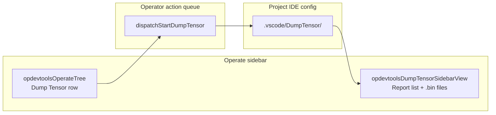
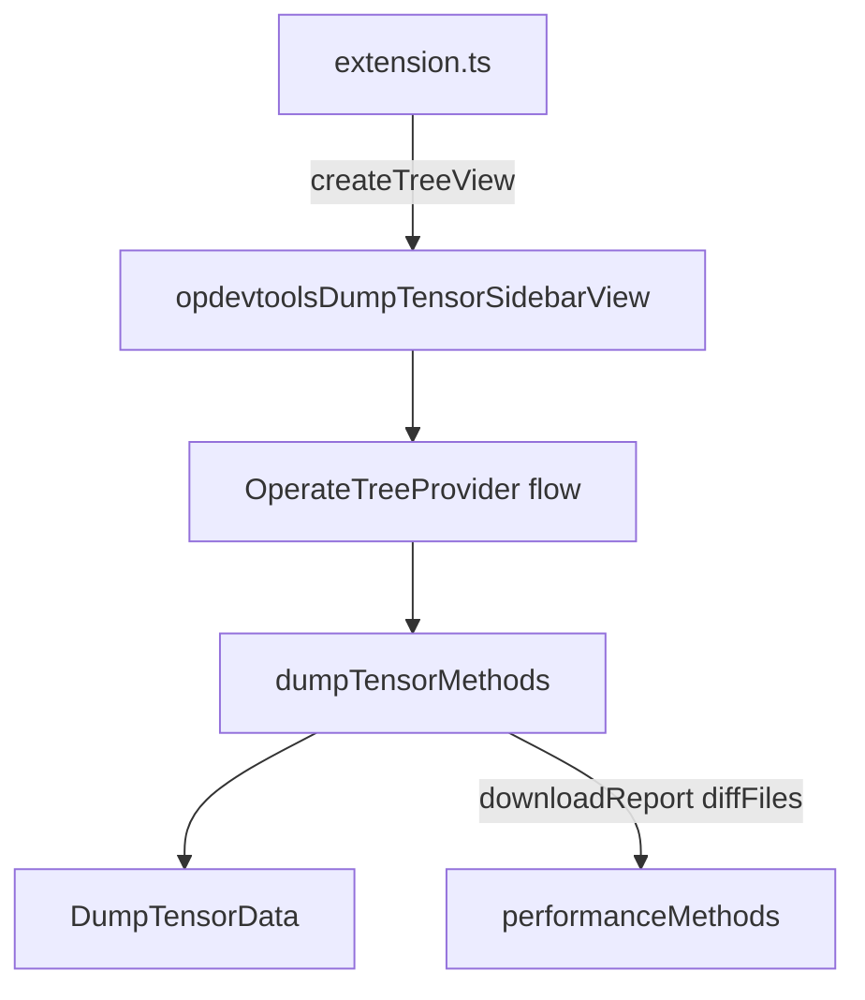

# Dump tensor —— 架构

本文档说明 **DumpTensor** 在 Ascend C Toolkits 中**当前的实现方式**：从 Actions 树排队执行、`.bin` 导入、输出到 IDE 配置目录下，以及用于浏览和对比结果的**原生 VS Code 树视图**。

关于构建/运行编排（`startDumpTensor`、`show_kernel_debug_data`），见 [`build-integration.md`](./build-integration-zh.md) § DumpTensor Behavior Note。关于与 sanitizer/性能分析共享的侧边栏树模式，见 [`operator-treeview.md`](./operator-treeview-zh.md)。关于共享的下载/差异对比辅助函数，见 [`performance.md`](./performance-zh.md)。

---

## 概述

| 层 | 职责 |
|-------|----------------|
| **CLI / 工具链** | `build_op`、带 `ASCEND_DUMP_PATH` 的示例构建或运行、`show_kernel_debug_data` |
| **插件** | 排队 dump-tensor 运行、导入 `.bin`、扫描输出、原生 TreeView UI |
| **存储** | `<project>/<ideDir>/DumpTensor/<report-key>/`（叶子为 `.bin`；配套 `.txt` 用于差异对比/打开） |
| **结果 UI** | 原生树 **`opdevtoolsDumpTensorSidebarView`**（报告 → 文件夹 → `.bin` 文件） |
| **对比** | 选择两个 `.bin` 文件 → 对配套 `.txt` 文件执行 `vscode.diff` |

**没有** dump tensor 侧边栏 webview（原先的 `dump-tensor-data` 面板视图及其 `open-dump-tensor-panel-view` 命令已移除），也**没有** `webview/getDumpTensorData` / `ops/importDumpTensorBinFile` / `performance/diffFiles` RPC。

视图 ID 通过 `shared/flavor/generated.ts` 中的 `DUMP_TENSOR_SIDEBAR_VIEW_ID` 实现风味安全（如 `opdevtoolsDumpTensorSidebarView`）。

---

## 工作台布局

- **`opdevtoolsOperateTree`**：**Dump Tensor** 行（`nodeId === 'dumpTensor'`）会**排队**一次 dump-tensor 运行。点击本身不会打开或聚焦结果树。
- **`opdevtoolsDumpTensorSidebarView`**：独立视图（`%view.dumpTensorResultsTree.name%`），与 sanitizer/性能分析结果树位于同一个 `mindstudio-opssuite-vscode-plugin` 容器中，由 `opDevtools.showOperateTree` 门控。报告行只存在于此处。

---

## 数据模型

### 磁盘上

- 根目录：`joinIdeConfigRelative('DumpTensor')` → 通常是 `<project>/.vscode/DumpTensor/`（CodeArts IDE 中为 `.arts`）。
- 每个**报告**是一个子目录（键 = 文件夹名；标题 = 文件夹名，时间戳取自目录 `ctime`）。
- 树的叶子**只有 `.bin` 文件**（支持嵌套文件夹；空文件夹会被裁剪）。打开或对比使用配套的 **`.txt`** 文件（`file.bin` → `file.txt`）。

### 内存中（`OperateTreeProvider.state.dumpTensor`）

| 字段 | 用途 |
|-------|---------|
| `reports` | 从 `DumpTensorData` 加载的执行记录 |
| `sortOrder` | 按时间戳 `asc` / `desc`（内存内重排，不重新扫描） |
| `markedOnly` | 过滤为仅已标记的报告 |
| `selectedReportKey` | 展开/定位目标 |
| `compareMode` | 双文件对比 UI 已激活 |
| `compareSelectedFilePaths` | 最多两个 `.bin` 路径（标签显示 `(1/2)`、`(2/2)`） |

标记持久化：`DumpTensorData` 中的 `PermanentStorage` 键 `marked_dump_tensor_records`（与性能分析标记同一模式）。

---

## 架构

一个 `OperateTreeProvider` 实例（`kind: 'flow'`）拥有 dump tensor 状态、节点构建器和 `onDidChangeDumpTensorTreeData` —— 这是一族独立于流程树和性能分析结果树的变更事件，因此 dump tensor 刷新不会重绘其他视图。`extension.ts` 注册一个轻量适配器 `TreeDataProvider`，把根节点委托给 `getDumpTensorResultsPanelNodes()`，把 `dumpTensorReportItem` / `dumpTensorFolder` 的子节点委托给共享的 `getChildren()`。

| 部分 | 路径 |
|-------|------|
| 数据扫描 + 标记 | `plugin/src/service/dump-tensor-service.ts` |
| 控制器 | `plugin/src/controller/dump-tensor-controller.ts` |
| 树状态 + 节点 | `plugin/src/class/operate-tree-provider.ts` |
| 命令接线 | `plugin/src/extension.ts` |
| 命令参数解码 | `plugin/src/helpers/report-command-key.ts` |
| Zip 下载辅助 | `plugin/src/service/file-service.ts`（`saveFileToLocal`），经由 `performance-data-controller.ts` |
| 构建 / 导入 | `plugin/src/service/build-service.ts` |
| 清单 | `package.json` → `views`、`menus` |

`dumpTensorMethods` 把 `downloadReport` 和 `diffFiles` 委托给 `performance-data-controller.ts` 中的 `performanceMethods`（进程内）。

---

## 入口

### 1. Actions 树 —— 排队执行

| 动作 | 树节点 | 队列类型 | 执行器 |
|--------|-----------|------------|--------|
| Dump tensor | `dumpTensor` | `dumpTensor` | `dispatchStartDumpTensor` → `taskMethods.startDumpTensor` → `BuildService.startDumpTensor` |

命令：`huawei-op-devtools.sidebar.dumpTensor`。与 sanitizer/仿真/上板相同的排队规则（见 [`operator-treeview.md`](./operator-treeview-zh.md) § Operator action queue）。多算子选择会禁用该行（仅限单算子）。

成功后，`BuildService.finalizeDumpTensorFlow` 调用 `refreshDumpTensorResults({ focusIfNew: true })` → `huawei-op-devtools.flashDumpTensorData` → `operateTreeProvider.refreshDumpTensorReports`。

### 2. 导入 `.bin` 文件

| 入口 | 命令 |
|-------|---------|
| dump tensor 视图标题栏 `+` | `huawei-op-devtools.importDumpTensorBinFile` |
| 资源管理器上下文（`.bin`） | 同一命令 |

流程：资源管理器 URI 或文件选择器 → `taskMethods.importDumpTensorBinFile` → `buildService.importDumpTensorBinFile` → `show_kernel_debug_data` → 带 `{ focusIfNew: true }` 的 `flashDumpTensorData`。

导入在 `extension.ts` 中注册为 `huawei-op-devtools.importDumpTensorBinFile`；不带 URI 调用时会打开 `.bin` 文件选择器。

### 3. 激活后引导

自动打开工作区项目时，`post-activate-bootstrap.ts` 会与 sanitizer 和性能分析一起调用 `refreshDumpTensorReports()`。

---

## 树结构

| `nodeId` | 子节点 | 说明 |
|----------|----------|-------|
| `dumpTensorReportItem` | 文件夹 / `.bin` 文件 | 已标记/未标记的 `contextValue`；稳定 `id`：`dump-tensor-report:<encoded-key>` |
| `dumpTensorFolder` | 嵌套文件夹 / 文件 | `id`：`dump-tensor-folder:<reportKey>:<encoded-segments>` |
| `dumpTensorFile` | —— | UI 中仅 `.bin`；`contextValue` 为 `dumpTensorFile.bin` |

没有可见报告时，树显示一行无内联动作的占位行（`web.dump.noData`）。

**打开文件**（`sidebar.dumpTensor.file.open`）：在对比模式下切换选择；否则通过 `vscode.open` 打开配套 `.txt`（`.txt` 缺失时弹出错误提示）。

**复制路径**（`sidebar.dumpTensor.report.copyPath`）：把报告的 `dirPath` 复制到剪贴板（不含目录内容）。

**下载**（`sidebar.dumpTensor.report.download`）：通过 `downloadReport` 将报告目录打包为 zip。

**标记 / 取消标记**（`sidebar.dumpTensor.report.mark` / `.unmark`）：乐观翻转行状态，通过 `DumpTensorData` 持久化；持久化失败时回滚并弹出错误提示（`web.dump.markFailed`）。

---

## 对比工作流

进入对比模式有两种方式：

1. **标题栏** `sidebar.dumpTensor.compare` → 空选择，在树中点选两个文件（点击行）。
2. **上下文菜单** 在 `.bin` 行上 `sidebar.dumpTensor.file.compareWith` → `beginDumpTensorCompareWithFile(path)` 把该文件预选为 `(1/2)`。

上下文键 `opDevtools.dumpTensorComparing` 切换标题栏按钮（compare / start / cancel）。

| 步骤 | 命令 | 效果 |
|------|---------|--------|
| 开始对比 | `sidebar.dumpTensor.compare` 或 `file.compareWith` | `compareMode = true` |
| 选择文件 | 点击 `.bin` 行或第二个对比动作 | `compareSelectedFilePaths` 中最多 2 个路径 |
| 运行差异对比 | `sidebar.dumpTensor.compare.start` | 对 `.txt` 配套文件执行 `diffFiles`；退出对比模式 |
| 取消 | `sidebar.dumpTensor.compare.cancel` | 清空选择和对比模式 |

**Compare with… 之后的预期路径：** 对文件 A 执行 Compare with → 在树中点击文件 B → **Compare start**。

连续两次使用 **Compare with…** 会把选择重置为只有第二个文件（不会自动 diff）。

少于两个所选文件就开始时给出警告（`web.dump.selectTwoFiles`）；选择第三个文件时给出警告（`web.dump.maxSelectCount`）。

---

## 命令与菜单

主要接线在 `package.json` 中：

| 位置 | 示例 |
|----------|----------|
| `view/title` | 导入 `+`、compare / start / cancel、按时间排序、标记过滤 |
| `view/item/context` | 复制路径、下载、标记/取消标记（`inline@3`–`5`）、打开文件（`navigation@1`）、compare with（`navigation@2`，仅 `.bin`） |
| `explorer/context` | 导入 `.bin` |

所有 `sidebar.dumpTensor.*` 命令都在 `extension.ts` 中注册，并调用 `operateTreeProvider` / `dumpTensorMethods` 上的方法。

---

## 刷新触发器

| 事件 | 效果 |
|-------|--------|
| Dump-tensor 排队运行完成 | `finalizeDumpTensorFlow` → `refreshDumpTensorReports({ focusIfNew: true })` |
| 导入 `.bin` 成功 | 带 `focusIfNew` 的 `flashDumpTensorData` |
| 激活后引导 | 初始 `refreshDumpTensorReports()` |
| 工作区 / 项目切换 | `refreshState` 携带 dump tensor 切片继续（仅当 devtool 配置消失时重置），并触发结果树变更事件 |
| 用户排序 / 过滤 / 标记 | 修改状态 + `onDidChangeDumpTensorTreeData` |

当恰好出现一个新键（或首次加载且只有一个报告）时，`focusIfNew` 会定位到最新报告。首次加载已有**多个**报告时不自动定位（与性能分析规则相同）。

`revealDumpTensorReport` 聚焦 `DUMP_TENSOR_SIDEBAR_VIEW_ID` 并展开报告节点。

**失败与并发：** 意外的扫描错误会保留上一次有效的清单（不会被清空），较早的重叠刷新无法覆盖最新请求的快照。排序/过滤/标记仅在内存中——没有自动监听器或轮询，也没有 `postMessage` 刷新。

---

## 关键文件

| 领域 | 文件 |
|------|------|
| 树模型 | `plugin/src/class/operate-tree-provider.ts` |
| 视图 + 命令 | `plugin/src/extension.ts` |
| 数据服务 | `plugin/src/service/dump-tensor-service.ts` |
| 控制器 | `plugin/src/controller/dump-tensor-controller.ts` |
| 构建 / 导入 | `plugin/src/service/build-service.ts` |
| 测试 | `plugin/src/__tests__/unit/operate-tree-dump-tensor.spec.ts`、`dump-tensor-service.spec.ts`、`dump-tensor-controller.spec.ts` |

---

## 相关文档

| 主题 | 文档 |
|-------|----------|
| Actions 树 + 算子队列 | [`operator-treeview.md`](./operator-treeview-zh.md) |
| 构建 / `show_kernel_debug_data` | [`build-integration.md`](./build-integration-zh.md) |
| 共享下载/差异对比辅助 | [`performance.md`](./performance-zh.md) |
