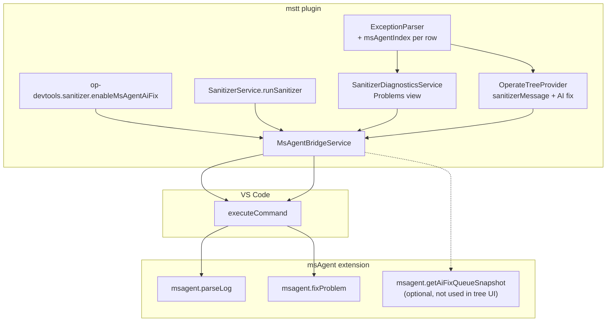

# msAgent 集成（mstt）

本文档描述 **Ascend C Toolkits**（`mstt`）如何与独立的 **msAgent** VS Code 扩展集成，用于 sanitizer（异常检测）工作流。mstt 不随附 msAgent，也不自行实现 AI 修复或日志解析——它桥接 VS Code 命令，并保持**检测项顺序**与 msAgent 的 `fixProblem(index)` 契约一致。

完整的 sanitizer 运行、结果树和 Problems 视图见 [`sanitizer.md`](./sanitizer.md)。

---

## 本仓库中的范围

| 范围内 | 范围外 |
|---------------|--------------|
| 运行后/打开报告时将 sanitizer **`.log`** 加载到 msAgent | `fixWithPayload`、mstt 内部的自定义 msAgent UI |
| 在 **`opdevtoolsSanitizerResultsTree`** 的检测项行上执行 **AI 修复** | Operate 树、调试、性能分析、Quick Fix |
| 功能开关 + 存在性检测 | 对应用市场 msAgent id 的 `extensionDependencies` |
| mstt `ExceptionParser` 与 msAgent 日志解析器之间的**索引一致性** | 修改 msAgent LLM / 通知 UX |

本代码库中**没有** `msSanitizer` ApiServer 命名空间，**没有** sanitizer 侧边栏 webview，也**没有** `ms-sanitizer-panel-view.ts`。

msAgent 桥接基于命令（`executeCommand`），不属于扩展的 webview↔plugin RPC 面——`api-routes.ts` 当前暴露 **37 个端点**（webview 9 / common 10 / ops 17 / performance 1），均与 msAgent 无关。扩展版本：**1.4.6**。

---

## 架构

**两个解析器，同一个日志文件：** mstt 为 **Problems** 和树行解析同一个绝对日志路径（`ExceptionParser`）。msAgent 在 `parseLog` 运行时再次解析。**AI 修复**使用的是 msAgent 在*其*诊断列表中的索引——mstt 在构建树消息时必须赋予相同的**从 0 开始的顺序**（`msAgentIndex`）。

---

## 启用集成

总开关：**`sanitizer.enableMsAgentAiFix`**（默认 `false`）——见 [`workspace-settings-zh.md`](./workspace-settings-zh.md#sanitizer-op-devtoolssanitizer)。代码中通过 `MsAgentBridgeService` 内的 `SettingsLoader.isMsAgentAiFixEnabled()` 读取。

### 集成何时"可用"

`msAgentBridgeService.isMsAgentIntegrationAvailable()` 仅在以下条件成立时返回 true：

1. 功能开关**开启**，并且
2. 满足以下任一：
   - 某个已安装扩展在其 `package.json` 中**同时贡献了** `msagent.parseLog` 和 `msagent.fixProblem` 两个命令（扫描 `vscode.extensions.all`——**不固定 publisher/id**），或
   - `vscode.commands.getCommands(true)` 列出了这些命令 id（运行时注册）。

若为 false，mstt 隐藏 AI 修复 UI 并跳过自动 `parseLog`。

激活时，`extension.ts` 根据该检查设置上下文 **`opDevtools.sanitizerAiFixAvailable`**（用于 `package.json` 菜单的 `when` 子句）。

msAgent **未**列入 `extensionDependencies`；在应用市场打包方案确定前，用户需单独安装 msAgent VSIX。

---

## 桥接 API（`MsAgentBridgeService`）

**文件：** `plugin/src/service/ms-agent-bridge.service.ts`  
**导出：** `msAgentBridgeService` 单例。

| 方法 | msAgent 命令 / 来源 | 使用方 |
|--------|--------------------------|---------|
| `isMsAgentIntegrationAvailable()` | （仅检测） | `extension.ts`、AI 修复前 |
| `tryLoadLogWithIntegration(absoluteLogPath)` | `msagent.parseLog(uri, { suppressMessage: true })` | `SanitizerService` 运行成功后；用户选择报告时 `SanitizerDiagnosticsService.loadSanitizerPanelData` |
| `loadMsAgentLog(path, options?)` | `msagent.parseLog` | 直接调用（调用方调用时总是尝试） |
| `fixMsAgentProblem(index, options?)` | `msagent.fixProblem(index, options?)` | `sidebar.sanitizer.message.aiFix` 命令 |
| `getAiFixQueueSnapshot()` | `__msAgentGetAiFixQueueSnapshot` 全局对象，或 `msagent.getAiFixQueueSnapshot`，或 `msagent.getAiFixQueueStates` | **已在桥接层实现；当前未接入树 UI** |
| `getAiFixQueueStates()` | 经由 snapshot | 同上 |

传给 msAgent 的所有日志路径都使用 **`vscode.Uri.file(absoluteLogPath)`**（绝对 `fsPath`）。

`fixMsAgentProblem` 返回形态：`{ status: 'completed' | 'failed' | 'unknown' | 'integration_unavailable' }`（也接受 msAgent 返回的布尔值/对象结果）。

---

## 用户可见的流程

### 1. sanitizer 运行后自动加载日志

1. `SanitizerService.runSanitizer` 成功。  
2. `getLatestSanitizerLogAbsPath(workspaceRoot)` 在 `<workspaceRoot>/<ideConfig>/mindstudio_sanitizer_log` 下选取最新的 `mssanitizer_*.log` / `npu-check_*.log`。  
3. `sanitizerDiagnosticsService.publishFromLogFile(logAbs, workspaceRoot)`。  
4. 若集成可用，`msAgentBridgeService.tryLoadLogWithIntegration(logAbs)`。  
5. `flashMsSanitizerRunData` 刷新结果树。

### 2. 在结果树中打开报告

1. 用户选择报告 → `OperateTreeProvider.selectSanitizerReport`。  
2. `sanitizerDiagnosticsService.loadSanitizerPanelData({ path, title, timestamp })`：  
   - `ExceptionParser.parseAll` → 行带 **`msAgentIndex`** = 按解析顺序的 `0..n-1`。  
   - 更新 **Problems**（`publishFromLogFile`）。  
   - `tryLoadLogWithIntegration(params.path)`。

### 3. 对单个检测项执行 AI 修复

**UI：** 当 `contextValue` 为 `opdevtools.sanitizerMessage.aiFix` 时，`sanitizerMessage` 行上的内联动作（仅当 `msAgentIndex` 为非负整数时）。

**命令：** `huawei-op-devtools.sidebar.sanitizer.message.aiFix`  
**触发条件（when）：** `view == opdevtoolsSanitizerResultsTree && opDevtools.sanitizerAiFixAvailable && viewItem =~ /opdevtools\.sanitizerMessage\.aiFix/`

**处理器（`extension.ts`）：**

1. `operateTreeProvider.getSanitizerMessageAiFixIndex(arg)` 从以下来源解析索引：
   - 树节点上的 `messageRef.msAgentIndex`，或  
   - 字符串形式的 `sanitizer-msg:...` id → `selectedMessages[globalIndex].msAgentIndex`。  
2. `msAgentBridgeService.fixMsAgentProblem(aiFixIndex)`。

此后的进度、LLM 和修复 UX 均由 msAgent 负责；mstt 不包装也不替换它。

### 4. 跳转到源码（独立于 msAgent）

`huawei-op-devtools.sidebar.sanitizer.message.jump.<hash>`（每条消息行一个命令，hash 取自消息 id）使用 `performanceDataMethods.jumpToFile`——无需 msAgent 即可工作。

---

## 索引契约

| 规则 | 细节 |
|------|--------|
| **索引类型** | 从 0 开始的整数 |
| **含义** | 在已加载日志的 msAgent 诊断列表中的位置（与 msAgent `logParser` 输出顺序相同） |
| **mstt 赋值** | `loadSanitizerPanelData` 中的 `parser.parseAll(content).map((r, msAgentIndex) => ({ ...r, msAgentIndex }))` |
| **用户动作** | `fixProblem(msAgentIndex)` |

**风险：** 如果 mstt 与 msAgent 的解析器在数量或顺序上出现分歧，AI 修复会指向错误的检测项。缓解措施：

- 集成测试：`plugin/src/__tests__/integration/sanitizer-exception-parser-msagent-parity.spec.ts`  
- 在同级仓库 **`../ms-agent/test/fixtures`** 的共享夹具上比对指纹（行号、文件基名、错误类型）。  
- 当 `ms-agent` 未与 `mstt` 相邻检出时**跳过**。

---

## mstt 不调用的能力

| msAgent 接口 | 在 mstt 中的状态 |
|-----------------|----------------|
| `msagent.parseLog` | 使用（自动 + 打开报告时） |
| `msagent.fixProblem` | 使用（AI 修复命令） |
| `msagent.getAiFixQueueSnapshot` / `getAiFixQueueStates` | 仅桥接层；无 UI 消费方 |
| `fixWithPayload` | 未使用 |
| 安装 / 应用市场提示 | 未实现（缺失时隐藏控件） |

---

## 配置小结

见 [`workspace-settings-zh.md`](./workspace-settings-zh.md#sanitizer-op-devtoolssanitizer)（`sanitizer.enableMsAgentAiFix`，默认 `false`）。

---

## 关键源文件

| 领域 | 路径 |
|------|------|
| 桥接 | `plugin/src/service/ms-agent-bridge.service.ts` |
| 运行后自动加载 | `plugin/src/service/sanitizer-service.ts` |
| 打开报告时解析 + 索引 | `plugin/src/service/sanitizer-diagnostics.service.ts` |
| 日志解析器 | `plugin/src/class/exception-parser.ts` |
| 树 + `getSanitizerMessageAiFixIndex` | `plugin/src/class/operate-tree-provider.ts` |
| 命令 + 上下文 | `plugin/src/extension.ts`、`plugin/src/constants.ts` |
| 最新日志路径 | `plugin/src/helpers/sanitizer-log-path.ts` |
| 源码路径解析 | `plugin/src/helpers/sanitizer-source-path.ts` |
| 一致性测试 | `plugin/src/__tests__/integration/sanitizer-exception-parser-msagent-parity.spec.ts` |
| 设置 schema | `package.json`、`package.nls*.json` |

---

## 相关文档

| 文档 | 用途 |
|----------|---------|
| [`sanitizer.md`](./sanitizer.md) | Sanitizer 运行、结果树、Problems、日志 |
| msAgent 仓库 `MSTT_INTEGRATION_ARCHITECTURE.md` | 跨扩展的产品决策（同级检出；不内置于 mstt） |
