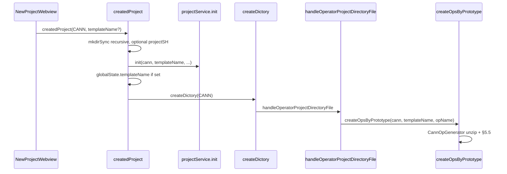

# 新建项目生成 — 实现规范

**New Project** webview 如何创建算子项目：UI 参数、`createdProject`、`createDictory` → `handleOperatorProjectDirectoryFile`、`createOpsByPrototype` → `OpGeneratorFactory`、模板 ZIP，以及解压后的重命名。

**相关文档：** [`operator-behavior-specification-zh.md`](./operator-behavior-specification-zh.md)（类型与动作）、[`workspace-settings-zh.md`](./workspace-settings-zh.md)（脚手架之后的运行时 `op-devtools.*` 设置）、[`generated-files-specification-zh.md`](./generated-files-specification-zh.md)（持久化产物）。

---

## 1. 术语

| 术语 | 含义 |
|------|---------|
| **View ID** | [`shared/project-type-view-id.ts`](../shared/project-type-view-id.ts) 中的 `OperatorProjectViewId`：`CANN` = 1，`STANDARD_CUSTOM` = 2，`PYASC` = 3，`TRITON` = 4。 |
| **`project_type`（存储值）** | 项目记录上的字符串，来自 [`viewIdToProjectType`](../plugin/src/domain/utils/project-utils.ts)：`cann`、`ascend`、`pyasc`、`triton`。**STANDARD_CUSTOM (2) 存储为 `ascend`**，而不是 `standard-custom`。 |
| **`op_type`（生成器）** | 传给 `createOpsByPrototype` / [`OpGeneratorFactory`](../plugin/src/domain/services/op-generator-factory.ts) 的值：`cann`、`ascend`、`pyasc`、`triton`。New Project 在初始化时使用 `viewIdToProjectType`，但 STANDARD_CUSTOM 脚手架在 `handleOperatorProjectDirectoryFile` 中使用 **`opType: 'ascend'`**。 |
| **功能开关键** | 仅在 [`handleOperatorProjectDirectoryFile`](../plugin/src/class/webview-message-list.ts) 中通过 `normalizeViewIdToProjectType` 使用：`cann`、`standard-custom`、`pyasc`、`triton`。当前实现中只有 **Triton** 受开关控制（`op-devtools.operatorSupport.triton`）。 |
| **`projectName`（UI）** | 表单字段 → 子文件夹名称；初始化后，当 `opName` 被透传时成为 `project_name` / 规范的 `op_name`。 |
| **`templateName`（API）** | 来自 webview 的可选字符串；在 `createdProject` 中设置时存入 `ExtensionContext.globalState` 的 `templateName` 键，由 `createDictory` 处理器读取。 |

---

## 2. Web UI

**面板：** [`web/src/views/panels/new-project/`](../web/src/views/panels/new-project/)（`app.vue` → `new-project.vue` + [`use-new-project.ts`](../web/src/views/panels/new-project/composables/use-new-project.ts)）。

### 2.1 项目类型列表

默认展示的类型：**CANN**、**PYASC**、**TRITON**（`new-project.vue` 中的 `items_type`）。

| 条件 | UI 变化 |
|-----------|-----------|
| `getProjectTypeSupportEnabled(TRITON)` 为 `false` | 移除 Triton 卡片；如有需要，选择回退到 CANN。 |
| 打开的工作区 `getProjectType()` 返回 standard-custom 上下文（来自已存项目记录的 `projectType === 'ascend'`，或检测到的 `projectType === 'standard-custom'`） | 列表**只显示 STANDARD_CUSTOM**（Ascend standard-custom）；选择被强制为 view ID 2。 |

API：`common/getProjectTypeSupportEnabled` → [`common-controller.ts`](../plugin/src/controller/common-controller.ts) → `isOperatorSupportEnabled('triton')`。

### 2.2 表单载荷

[`CreatedProjectParams`](../shared/api-types/webview.d.ts)：

| 字段 | 作用 |
|-------|------|
| `projectPath` | 新文件夹的父目录。 |
| `projectName` | 新文件夹名称及注册的项目名。 |
| `projectSH` | 可选的环境脚本（在 `createdProject` 中 `chmod +x` + source；作为 `ascendEnvScript` 传给初始化）。 |
| `createOperatorProjectDictoryFileType` | View ID（1–4）。 |
| `templateName` | 可选；见 §2.3。 |

composable 中的默认值：`projectPath` 为 `/home/developer`，`projectSH` 为 `/etc/profile`，`projectName` 自动生成。

### 2.3 模板名解析（web 端）

`use-new-project.ts` 中的 `resolveTemplateNameByProjectType()`：

| View ID | 发送的 `templateName` |
|---------|------------------------|
| **CANN (1)** | 来自所选 CANN 模板单选项，未选择时为 `undefined`。 |
| **PYASC (3)** | `undefined`（脚手架 id 在生成器中固定）。 |
| **STANDARD_CUSTOM (2)** | `undefined`（原型 + `add_custom.zip`）。 |
| **TRITON (4)** | 始终为 `'triton_vector_add'`。 |

**CANN UI 单选项**（仅在 CANN 卡片上）：`helloworld`、`addn`、`torch_library_template` — 不含 `triton_vector_add`。

**UI 键 → `templateName` 字符串**（`getTemplateName`）：

| UI `selectedTemplate` | `templateName` |
|----------------------|----------------|
| `helloworld` | `hello_world` |
| `addn` | `addn_custom` |
| `torch_library_template` | `torch_library_template` |
| `triton_vector_add` | `triton_vector_add`（用于 TRITON view ID，而非 CANN 单选项） |

---

## 3. 扩展入口：`createdProject`

[`welcome-controller.ts`](../plugin/src/controller/welcome-controller.ts) → `welcomeMethods.createdProject`（以 `createdProject` 暴露给 webview）。

### 3.1 有序步骤（所有 view ID 通用）

1. 等待激活后待处理的引导完成，使自动工作区初始化不会与项目创建发生竞态。
3. 从 `.vscode/cache.json` 解析当前工作区根（`getProjectByPath` → `cache.folders[rootKey]`），仅在子算子分类时回退到文件系统检测。
4. 对于当前工作区内的 STANDARD_CUSTOM 子项，解析根集合记录。若缺失，调用 `WorkspaceDetectorService.detectAndRegisterWorkspace`，然后再次读取存储。该服务会在扫描 `ops_meet`、`ops_list` 和 `experimental_ops_list` 之前创建一条存储类型为 `ascend` 的规范化根记录。若恢复后仍无父记录，创建中止并报 `welcome.initOperatorProjectFailed`。
5. 对于已解析的 STANDARD_CUSTOM 子项，先尝试工作区 `build.sh --genop` 命令，若命令未产出目录则再创建子目录。
6. 可选的 `projectSH`：通过 `CommandExecutor` 执行 `chmod +x` + 执行（失败仅记日志）。
7. 对于 STANDARD_CUSTOM 子项，使用规范化路径标识，将其一次性追加到 `cache.folders[rootKey]` 扫描状态中根记录的常规或实验算子列表。该子项绝不会被注册为独立项目。其他项目类型使用 `projectService.init` → `ProjectManager` 上下文 + `op-devtools.projectType` 工作区设置，作为新的独立根。
8. 为 **PYASC** / **TRITON**（`python3 ./<projectName>.py`）和 `torch_library_template`（`python ../run.py`）预置 `cache.sanitizerPythonTarget`（通过 `sanitizerTargetKeyForOp` 以规范算子名为键），使新建项目即刻能解析出基础 sanitizer Python 目标。
9. 对新文件夹执行 `revealInExplorer`（尽力而为），显示 `welcome.projectCreated`，并运行 `ensureLaunchJsonExists(fullProjectPath)`。
10. 若设置了 `params.templateName`，将其存入 `globalState.templateName` 供 `createDictory` 使用。
11. 调用 `huawei-op-devtools.createDictory`；对原地生成的 STANDARD_CUSTOM 子项传入 `subOperatorContext`（集合根路径、算子名、子项输出路径、`skipFileGeneration`）；其他流程只传 `createOperatorProjectDirectoryFileType`。
12. 脚手架失败时显示 `welcome.createDirOkCreateFilesError` 并保留目录。
13. 原地生成的子项停留在当前集合窗口。独立项目在 `vscode.openFolder` 前会提示选择当前窗口还是新窗口。

### 3.2 规范 `op_name`

[`CreateOpsByPrototypeParams`](../shared/api-types/ops.d.ts) 的可选参数 **`opName`**。[`ProjectService.createOpsByPrototype`](../plugin/src/service/project-service.ts) 将 `op_name` 传入生成器（取去空白后的 `opName` || 当前项目基础名）。

`handleOperatorProjectDirectoryFile` 传入 **`opName`**（当前项目基础名，或 STANDARD_CUSTOM 子项的子算子名），因此表单中的 **`projectName`** 即脚手架的 **`op_name`**。

---

## 4. 命令处理器：`handleOperatorProjectDirectoryFile`

[`webview-message-list.ts`](../plugin/src/class/webview-message-list.ts)，由命令 [`COMMAND_CREATE_DIRECTORY`](../plugin/src/constants.ts)（`huawei-op-devtools.createDictory`）调用。

### 4.1 前置条件

- `normalizeViewIdToProjectType(viewId)` → `cann` | `standard-custom` | `pyasc` | `triton`。
- `isRequestedProjectTypeEnabled`：只有 **`triton`** 可被禁用（`extension.unsupportedProjectTypeDisabled`）。
- 读取 **`globalState.templateName`**（仅当 web 端发送了 `templateName` 时，在 §3.1 步骤 10 设置）。

### 4.2 按 view ID 处理

| View ID | 动作 |
|---------|--------|
| **CANN (1)** | `createOpsByPrototype({ opsPrototypeFile: '', opType: 'cann', templateName, opName })`。若已设置则清除 `globalState.templateName`。关闭活动编辑器。 |
| **PYASC (3)** | 同上，`opType: 'pyasc'`。来自全局状态的 `templateName` 通常未设置。 |
| **TRITON (4)** | 同上，`opType: 'triton'`，`templateName: templateName \|\| 'triton_vector_add'`，`opName`。 |
| **STANDARD_CUSTOM (2)** | `createOps({})` → 原型 JSON 路径；然后 `createOpsByPrototype({ opsPrototypeFile: path, opType: 'ascend', opName })`，**不**带 `templateName`。 |

成功时：进度 100%，`webview.opFileCreated`。失败时：错误提示并重新抛出。

每条路径 → `ProjectService.createOpsByPrototype`（[`plugin/src/service/project-service.ts`](../plugin/src/service/project-service.ts)）→ **`OpGeneratorFactory.getGenerator`**（[`plugin/src/domain/services/op-generator-factory.ts`](../plugin/src/domain/services/op-generator-factory.ts)）→ `OperatorPluginRegistry.getProjectGenerator`。

原型生成成功后：`ConfigService.ensureOpDevtoolsSettingsSeeded()` — 基于插件的 `getInitialConfigScripts` + `getDefaultPaths` 构建的 `op-devtools.*` 按键级「不存在才创建」的预置；`settings.json` 中已有的键被丢弃，其余写入（不存在「一键跳过全部」的门控）。

---

## 5. 核心生成：`createOpsByPrototype` 与生成器

### 5.1 编排

[`ProjectService.createOpsByPrototype`](../plugin/src/service/project-service.ts)：

1. 解析 `opName`（`params.opName` 去空白，否则取当前项目基础名）和 `opPath`（显式的 `params.opPath`，否则子算子为 `<projectPath>/<opName>`，否则为项目路径本身）。
2. 构建生成器参数（`op_type`、`ops_prototype_file`、`op_name`、`template_name`、`op_path`），调用 **`OpGeneratorFactory.getGenerator`** → [`OperatorPluginRegistry.getProjectGenerator`](../plugin/src/domain/plugins/operator-plugin.registry.ts)。
3. **`generator.parseMeta()`** — 解析 `op_name` 与 `template_name` 的回退值（生成前必须执行，Cann 生成器的模板文件重命名依赖它）。
4. 除非 `skipFileGeneration`（调用方已通过 `build.sh --genop` 完成脚手架）：**`generator.executeGeneration()`**（解压 + 重命名 + 替换）。
5. `ensureLaunchJsonExists(op_path)`（`.vscode` / `.arts` 引导）。
6. `ConfigService.ensureOpDevtoolsSettingsSeeded(projectPath, …, opType, opPath, templateName)` — 从 `OperatorPluginRegistry.getOpPlugin(op_type).getInitialConfigScripts` / `getDefaultPaths` 对 `op-devtools.*` 做按键级「不存在才创建」的预置。

New Project 总是生成结构（`skipFileGeneration` 未设置）。

### 5.2 生成器选择与 ZIP 路径

| `op_type` | 类 | 运行时 ZIP（`extensionPath`） |
|-----------|--------|----------------------------------|
| `ascend` | `AscendOpGenerator` | `out/templates/code_template/ascend_template/add_custom.zip`（固定）。 |
| `cann` | `CannOpGenerator` | `out/templates/code_template/cann_template/${template_name}.zip`。 |
| `pyasc` | `PyAscOpGenerator` | `out/templates/code_template/cann_template/pyasc_template.zip`（固定）。 |
| `triton` | `TritonOpGenerator` | `out/templates/code_template/triton_template/${template_name}.zip`（默认 `triton_vector_add`）。 |

模板源位于 [`plugin/templates/code_template/`](../plugin/templates/code_template/)。[`scripts/build-extension.ts`](../scripts/build-extension.ts) 将模板复制到 `out/templates/` 并将每个目录打包为 `*.zip` 供运行时使用。

[`TritonPlugin.createProjectGenerator`](../plugin/src/domain/plugins/triton.plugin.ts) 在构造 `TritonOpGenerator` 前将 `params.template_name` 默认设为 `triton_vector_add`。

### 5.3 `parseMeta()` — `op_name` 与 `template_name`

| 生成器 | `op_name` | `template_name` |
|-----------|-----------|-----------------|
| **CannOpGenerator** | `params.op_name` \|\| `project.project_name` \|\| basename(`project_path`) | `params.template_name` \|\| `'hello_world'` |
| **PyAscOpGenerator** | 同 CANN | **始终**为 `'pyasc_template'`（忽略 web 端的 `templateName`）。 |
| **TritonOpGenerator** | 同 CANN | `params.template_name` \|\| `'triton_vector_add'` |
| **AscendOpGenerator** | 若设置了 `params.op_name` 则取其去空白值；否则若无原型文件 → `project_name` / 基础名；否则取 JSON 原型的 `op` 字段 | `params.template_name` \|\| `'add_custom'` |

### 5.4 `executeGeneration()` — 解压

- **AdmZip** 解压到 `op_path`（算子项目绝对目录）。
- **`skipExisting`**：逐条目跳过已存在的目标（文件夹菜单初始化场景；非默认的 New Project 流程）。

### 5.5 解压后：重命名与内容替换

[`BaseOpGenerator`](../plugin/src/domain/services/op-generator-factory.ts)：`_renameFiles`、`_replaceContent`、`_replaceMsttPlaceholders`。

```text
if (template_name && op_name) {
  _renameFiles(template_name);
  _replaceContent(template_name);
}
if (op_name) {
  _replaceMsttPlaceholders();
}
```

#### `_renameFiles(templateName)`

将基础名包含 `templateName` 的文件重命名（正则全局替换 → `op_name`）。目标冲突时遵循 `skipExisting`。

#### `_replaceContent(templateName)`

替换键：`TEMPLATE_UPPER`、各段落的 PascalCase、`template_snake` → `op_name` 的对应形式。在文本文件中做子串替换；启用 `skipExisting` 时，仅处理文件名或内容匹配某个键的文件。

#### `_replaceMsttPlaceholders()`

| 占位符 | 取值 |
|-------|--------|
| `__MSTT_OP_NAME_PASCAL__` | 由 `op_name` 派生的 PascalCase |
| `__MSTT_OP_NAME_UPPER__` | 大写蛇形 |
| `__MSTT_OP_NAME__` | `op_name` |
| `__MSTT_SUPPORT_COMPUTE_UNIT__` | 来自 `resolveAclnnCmakeDefaultsForGeneration()` 的 ACLNN 计算单元（仅 **Ascend / STANDARD_CUSTOM**） |
| `__MSTT_SUPPORT_TILING_DIR__` | 与计算单元配对的 ACLNN tiling 目录（仅 **Ascend / STANDARD_CUSTOM**） |

用于 **PYASC** / **TRITON** Python 模板：其中符号必须跟随 `op_name`，但不内嵌模板 id。**Ascend** `add_custom` 也在 `CMakeLists.txt` 中使用 `__MSTT_SUPPORT_*__`（由 `AscendPlugin.patchGeneratedProject()` → `ascend-util.ts` 中的 `patchAclnnCmakeSupportVars()` 修补，在生成器的 `executeGeneration` 解压后调用）。CANN/Ascend 的 `.asc` 目录树通常只依赖模板 id 替换。

#### 设计小结

| 场景 | 机制 |
|-----------|-----------|
| 路径/符号包含 `template_name` | `_renameFiles` + `_replaceContent` |
| 文本中需跟随 `op_name` 但不含模板 id | `__MSTT_*` + `_replaceMsttPlaceholders` |
| 固定的工具链/API 字符串 | 不做自动改写 |

---

## 6. 端到端流程（New Project）

### 6.1 CANN



- 默认 ZIP 模板：若省略 `templateName` 则为 **`hello_world`**。
- `torch_library_template` 在 `createdProject`（§3.1 步骤 8）中将 sanitizer Python 目标（`cache.sanitizerPythonTarget`，以算子名为键）预置为 `python ../run.py`，使 build/run/sanitizer 的默认值无需活动文件同步即可解析。

### 6.2 PYASC

- 编排相同；**`op_type`: `pyasc`**。
- ZIP：**`pyasc_template.zip`**；替换 id 为 **`pyasc_template`**。

### 6.3 TRITON

- **`op_type`: `triton`**；要求 **`op-devtools.operatorSupport.triton`**。
- ZIP：**`triton_template/triton_vector_add.zip`**（全局状态为空时的默认值）。

### 6.4 STANDARD_CUSTOM（view ID 2）

- **存储的 `project_type`：** `ascend`。
- 已检测到但尚未写入 `.vscode/cache.json`（`folders[rootKey]`）的工作区，会在扫描其算子列表或创建子算子之前，由 `WorkspaceDetectorService.detectAndRegisterWorkspace` 幂等地注册。已有的根标识与元数据会被复用。
- **`createOps`** 写出原型 JSON；**`createOpsByPrototype`** 使用 **`op_type: 'ascend'`**，不带 `templateName`。
- 原地子项生成会收到已注册的集合根路径（`subOperatorContext.parentProjectPath`），且绝不创建独立的子项记录。
- ZIP：通过 `AscendOpGenerator` 使用 **`add_custom.zip`**。

---

## 7. 模板清单（源树）

位于 [`plugin/templates/code_template/`](../plugin/templates/code_template/) 下：

| 目录 / 归档 | 使用方 |
|---------------------|---------|
| `cann_template/hello_world` | CANN 默认 |
| `cann_template/addn_custom` | CANN addn |
| `cann_template/torch_library_template` | CANN torch library |
| `cann_template/pyasc_template` | PYASC |
| `triton_template/triton_vector_add` | TRITON |
| `ascend_template/add_custom` | Ascend / STANDARD_CUSTOM |

---

## 8. 持久化小结

| 步骤 | 存储位置 |
|------|---------|
| `init`（`projectService.init`） | 工作区设置 `op-devtools.projectType` + `op-devtools.environment.environmentScript`（`ascend_env_script`）；`ProjectManager` 以路径为键的上下文。 |
| 检测到的 STANDARD_CUSTOM 工作区注册 | `.vscode/cache.json` 中一条规范化的根记录（`folders[rootKey]`，`project_type: ascend`）；重复与并发注册会复用它。 |
| STANDARD_CUSTOM 子项创建 | 缓存中的根 `opsList` / `experimentalOpsList` 扫描状态（`folders[rootKey]`，以规范化子路径为键，`isCompiled: false`）；无独立子项目记录。 |
| PYASC / TRITON / torch-library 创建 | `cache.sanitizerPythonTarget[opName]` — `python3 ./<projectName>.py` / `python ../run.py`。 |
| `createOpsByPrototype` | 算子标识在运行时从缓存扫描状态解析（`resolveOpRecord`）；不写入单独的 `ops` 行。 |
| 同上 | **`ensureOpDevtoolsSettingsSeeded`** → 点分形式的 `op-devtools.*`（来自插件 `getInitialConfigScripts` + `getDefaultPaths` 的 build_op / build_example / ut_test / sanitizer / simulate / on_board 脚本）写入工作区 `settings.json`，按键级「不存在才创建」（[`workspace-settings-zh.md`](./workspace-settings-zh.md)）。 |

运行时命令字段从工作区设置读取；扫描状态、`sanitizerPythonTarget` 和 `selectedOperatorPaths` 保留在 `.vscode/cache.json` 中。

**回归验证（可选）：** `node scripts/verify-template-entrypoints.cjs` — PYASC/TRITON 的 `__MSTT_*` 占位符解析。

---

## 9. 错误与边界情况

| 失败 | 行为 |
|---------|----------|
| mkdir 失败 | 抛出；`welcome.createProjectDirFailed`。 |
| `init` 失败 | 抛出；`welcome.initOperatorProjectFailed`。 |
| 注册恢复后检测到的 STANDARD_CUSTOM 根仍缺失 | 在脚手架拿到父 ID 之前抛出；`welcome.initOperatorProjectFailed`。 |
| Triton 被禁用 | 生成之前在处理器中报错。 |
| `createDictory` / 脚手架失败 | 警告；保留文件夹；用户仍可打开文件夹。 |
| `createOps` 返回空路径（STANDARD_CUSTOM） | `webview.createPrototypeFailedEmptyPath`。 |

---

## 10. 文件参考索引

| 关注点 | 主要文件 |
|---------|------------------|
| Web 载荷 + 模板 | [`use-new-project.ts`](../web/src/views/panels/new-project/composables/use-new-project.ts)、[`new-project.vue`](../web/src/views/panels/new-project/components/new-project.vue) |
| `createdProject` | [`welcome-controller.ts`](../plugin/src/controller/welcome-controller.ts) |
| `createDictory` / 脚手架 | [`webview-message-list.ts`](../plugin/src/class/webview-message-list.ts) |
| 初始化 + 原型 | [`project-service.ts`](../plugin/src/service/project-service.ts)、[`project-manager.ts`](../plugin/src/core/project/project-manager.ts) |
| 生成器编排 | [`project-service.ts`](../plugin/src/service/project-service.ts) `createOpsByPrototype` |
| 生成器 | [`op-generator-factory.ts`](../plugin/src/domain/services/op-generator-factory.ts) |
| 插件 | [`domain/plugins/*.plugin.ts`](../plugin/src/domain/plugins/) |
| View ID → 存储的 `project_type` | [`project-utils.ts`](../plugin/src/domain/utils/project-utils.ts) `viewIdToProjectType` |
| Triton 功能开关 | [`feature-toggle.ts`](../plugin/src/helpers/feature-toggle.ts)、[`common-controller.ts`](../plugin/src/controller/common-controller.ts) |
| 模板源 | [`plugin/templates/code_template/`](../plugin/templates/code_template/) |

---

*反映截至 2026-06 的 `plugin/src` 与 `web/src/views/panels/new-project` 现状。*
