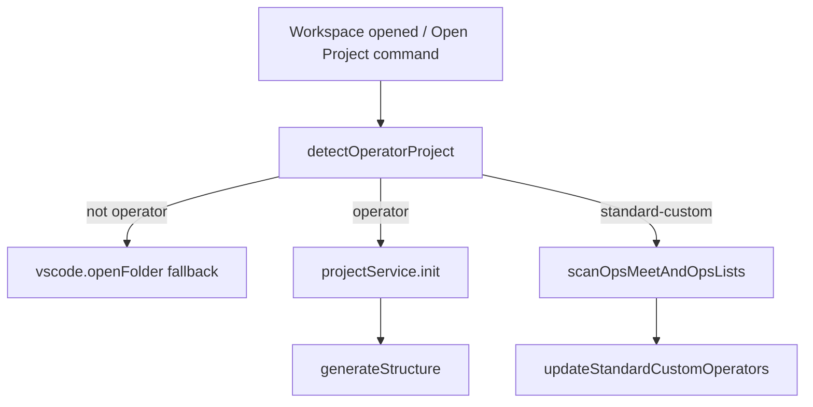
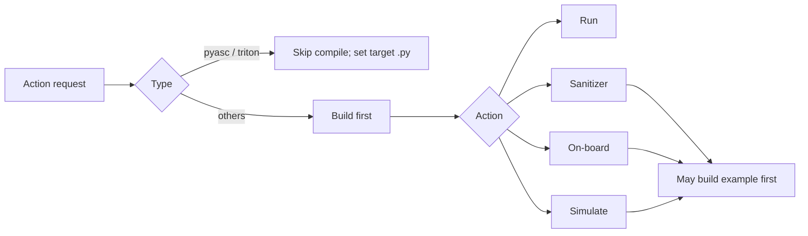

# 算子插件行为规范（`plugin/src`）

## 范围与术语

本文档规定 `plugin/src` 中当前实现的行为，涵盖算子项目检测、注册、动作执行、模板以及运行时/配置依赖。

代码中使用两套相关的类型体系：

- **检测类型**（`OperatorProjectType`）：`standard-custom`、`ascend-c`、`torch-library`、`pyasc`、`triton`、`multi-project`。
- **运行时策略类型**（`op_type`）：`ascend`、`cann`、`pyasc`、`triton`（由命令策略和模板生成器使用）。Triton 仅在启用 `op-devtools.operatorSupport.triton` 时注册。

## 算子类型与项目结构

### `standard-custom`
- 根目录包含带 `--genop` 的 `build.sh`（最高优先级规则）。
- 典型结构：集合目录（`math`、`conv` 等）、可选的 `experimental/<collection>`，以及包含 `CMakeLists.txt` 的算子子目录。

### `ascend-c`
- 存在 `CMakeLists.txt`。
- 存在 `.asc` 文件（根目录或有限深度递归搜索）。
- 根目录无 `.py` 文件。

### `torch-library`
- 存在 `CMakeLists.txt`。
- 根目录包含 `.py` 文件。

### `pyasc`
- 根目录包含 `.py` 文件。
- 无 `CMakeLists.txt`。

### `triton`
- 根目录包含 `.py` 文件，无 `CMakeLists.txt`。
- 启发式检测：源码中的 Triton Python 标记（`import triton`、`@triton.jit` 等）——见 `TritonPlugin.detectProject` / `detection-utils.ts`。
- 默认模板：`triton_vector_add`（`TritonOpGenerator`）。

## 工作区中的检测与收集

行为细节：
- 带工作区激活时，插件调用 `welcomeMethods.openProject(..., isFromSystem=true)`。
- `openProject` 检测类型，将 `op-devtools.projectType` 写入工作区设置并将元数据写入 `.vscode/cache.json`，植入默认脚本（`ensureOpDevtoolsSettingsSeeded`），运行 `generateStructure`；对于 `standard-custom` 还会扫描并存储：
  - `ops_meet`
  - `ops_list`
  - `experimental_ops_list`
- 集合扫描使用基于白名单的集合名，并通过 `CMakeLists.txt` 检测算子。

## 支持的动作与配置

### 配置模型

**权威参考：** [`workspace-settings-zh.md`](./workspace-settings-zh.md)（配置键、合并规则）。

配置行是按命令**合成**的：`ConfigService` 上按分区的类型化 DAO 工厂（`getBuildOpConfig()` / `getBuildExampleConfig()` / `getUtTestConfig()` / `getSimulateConfig(projectPath)` / `getOnBoardConfig(projectPath)` / `getSanitizerConfig(projectPath, op)`）直接读取工作区 `op-devtools.*` 设置，并并入 `.vscode/cache.json` 中仅存于 DB 的字段（`fileMapLists[configType]` → `fileMapList`，`sanitizerPythonTarget[op]` → `target_file`）。默认脚本字符串来自 `OperatorPluginRegistry.getOpPlugin(op_type).getInitialConfigScripts()`，由 `ensureOpDevtoolsSettingsSeeded` 植入设置（ascend 编译脚本包含 `--ops={operatorNames}`；见 [`build-integration-zh.md`](./build-integration-zh.md#operatornames-and---ops-compile-scripts)）。

**命令执行时**（仅工作区运行时）：

| 来源 | 内容 |
|--------|--------|
| 工作区 `settings.json`（`op-devtools.*`） | 编译/部署脚本、sanitizer 选项、仿真/上板选项、环境脚本路径、SOC/仿真器覆盖 |
| `.vscode/cache.json` | `project.{selectedOperatorPaths, compiledOpPaths}`、按目录的 `opsMeet` / `opsList` / `experimentalOpsList`、**仅存于 DB** 的字段（`fileMapList`、…）、sanitizer Python 目标 |
| `exampleBuildConfig.targetFile` | Profiler/msprof 二进制路径（工作区设置；回退为 `OperatorPluginRegistry.getDefaultPaths`） |

命令的运行时配置对象来自 `ConfigService` 上按分区的类型化 DAO 工厂（`getBuildOpConfig()` / `getBuildExampleConfig()` / `getUtTestConfig()` / `getSimulateConfig(projectPath)` / `getOnBoardConfig(projectPath)` / `getSanitizerConfig(projectPath, op)`），每个工厂直接读取各自的点分设置。写入设置只能使用 **`ConfigService.writeOpDevtoolsDottedSettings`**。

## Ascend/CANN 环境与 SOC 解析

**权威规范：** [`ascend-env-spec-zh.md`](./ascend-env-spec-zh.md)（优先级、spawn 环境、占位符、日志）。**Ascend950PR&950DT 系列：** [`ascend-a5-support-zh.md`](./ascend-a5-support-zh.md)。**工作区配置键：** [`workspace-settings-zh.md`](./workspace-settings-zh.md#environment-op-devtoolsenvironment)。

算子命令使用 `resolveAscendEnvForOperatorCommand` → `executeOperatorCommand`（[`build-integration-zh.md`](./build-integration-zh.md)）。当工作区设置了 `environment.environmentScript` 时，策略可以在命令前拼接 `. ${project.ascend_env_script} &&`（记录中的 `ascend_env_script` 即为该设置，通过 `getConfiguredEnvironmentScriptPath` 读取）。

### 按类型划分的动作能力

| 类型 | 编译 | 运行 | 调试 | Sanitizer | 上板/仿真 | 标记/取消标记 |
|---|---|---|---|---|---|---|
| `standard-custom` | 支持 | 支持 | 支持 | 支持（需要 `--bisheng_flags`） | 在上下文菜单中屏蔽 | 支持 |
| `ascend-c` | 策略存在，菜单动作被屏蔽 | 在目录菜单中屏蔽 | 屏蔽 | 屏蔽 | 屏蔽 | 屏蔽 |
| `torch-library` | 策略/初始化存在，菜单动作被屏蔽 | 在目录菜单中屏蔽 | 屏蔽 | 屏蔽 | 屏蔽 | 屏蔽 |
| `pyasc` | 策略中不支持 build/build_example | 支持 | 支持 | 策略中不支持 | 支持 | 屏蔽 |
| `triton` | 通过 `build_op` / `build_example` 执行 Python 脚本（而非 CANN `build.sh`） | 支持 | 仅 NPU（`msdebug-triton-npu`；需要 `debugMode` 和 `supportsNpuDebug`） | 支持（`supportsSanitizer: true`） | 支持（`supportsSimulate` / `supportsOnBoard: true`） | 屏蔽 |

说明：
- `pyasc` 和 `triton` 的运行路径要求/选择一个 `.py` 目标，并在需要时改写部署目标（通过 `ConfigService.writeBuildOpDeployTarget` 改写 `compileAndDeploy.buildConfig.deployCommandOrRunCommand`）。
- `triton` 使用 `TritonCommandStrategy`（与 PyAsc 共享 Python 算子的 shell 组装逻辑）；在 sanitizer、性能分析和 NPU 调试运行前通过 `probeTritonPythonDependencies()` 探测 `torch` + `triton` 导入；调试预编译使用 Triton 编译环境变量，然后启动 `msdebug-triton-npu`。

## 各算子类型的模板及其理由

模板映射：
- `op_type=ascend` -> `ascend_template/add_custom.zip`
- `op_type=cann` -> `cann_template/<template>.zip`（默认 `hello_world`）
- `op_type=pyasc` -> `cann_template/pyasc_temple.zip`
- `op_type=triton` -> `triton_template/triton_vector_add.zip`（默认模板名）

检测/初始化映射：
- `ascend-c` -> 模板 `hello_world`
- `torch-library` -> 模板 `torch_library_template`
- `pyasc` -> 模板 `pyasc_temple`
- `triton` -> 模板 `triton_vector_add`
- `standard-custom` -> 通常跳过解压，仅初始化配置

当前代码中的理由：
- 不应覆盖已有用户项目（`skipExisting`、跳过解压路径）。
- 模板仅作为生成项目的最小引导脚手架。

## 用户如何新增算子

- **在 standard-custom 内**：在合法集合下创建算子；元数据更新到根项目的 `ops_list` / `experimental_ops_list`。
- **在 pyasc / triton 内**：添加/选择 `.py` 文件并使用运行流程（pyasc 支持调试/性能分析；triton 支持运行、sanitizer、仿真/上板性能分析，以及在启用 Triton 插件时支持 NPU msdebug（`supportsCpuDebug: false`））。

## 为什么存在独立的 Open Operator 命令

`Open Operator Project` 执行普通 `Open Folder` 不具备的算子专属引导：
- 类型检测
- 项目注册
- 配置生成（`build_*`、`sanitizer`、性能分析配置）
- `.vscode/devtool_config.json` 与启动配置
- standard-custom 集合/算子扫描持久化

缺少这一步，插件状态/配置可能不完整。

## 动作之间的依赖与缓存策略

持久化状态（工作区）：
- `.vscode/cache.json`：项目元数据（`project.{selectedOperatorPaths, compiledOpPaths}`）、按目录的算子列表（`folders[rootKey].{opsMeet, opsList, experimentalOpsList}`）、`fileMapLists`
- 工作区 `settings.json`（`op-devtools.*`）：脚本、选项、项目类型、环境脚本

增量行为：
- `skipExisting` 避免生成时覆盖已有文件。
- 编译状态在重新扫描时保留，并在编译成功后更新。
- 未实现基于内容哈希的产物缓存；编译规避主要依赖脚本/工具链层面加持久化元数据。

## 其他已覆盖的行为问题

- `multi-project` 存在于枚举中，但不是一等公民的运行时动作流水线。
- 某些路径中检测类型与 `op_type` 的转换存在映射不对称（`viewIdToProjectType` 与其他初始化代码）。
- 即使配置脚手架存在，上下文菜单仍有意屏蔽某些动作/类型组合。
- 命令执行路径存在平台假设（例如 shell/bash 的使用）。

## 关键源文件

- `plugin/src/domain/plugins/` —— 注册表（[`operator-plugin-registry-zh.md`](./operator-plugin-registry-zh.md)）
- `plugin/src/domain/services/operator-project-detector.ts`
- `plugin/src/service/workspace-detector-service.ts`
- `plugin/src/controller/welcome-controller.ts`
- `plugin/src/extension.ts`
- `plugin/src/service/folder-context-menu-service.ts`
- `plugin/src/domain/models/model.ts`
- `plugin/src/domain/services/op-generator-factory.ts`
- `plugin/src/service/build-service.ts`
- `plugin/src/service/sanitizer-service.ts`
- `plugin/src/controller/task-controller.ts`
- `plugin/src/domain/services/command-strategy/*.ts`
- `plugin/src/domain/models/project-model.ts`
- `plugin/src/domain/utils/project-utils.ts`
- `plugin/src/helpers/operator-project-workspace-config.ts`（`getAscendEnvScriptWithWorkspaceOverride`、`getEnvironmentScriptPathFromWorkspace`）
