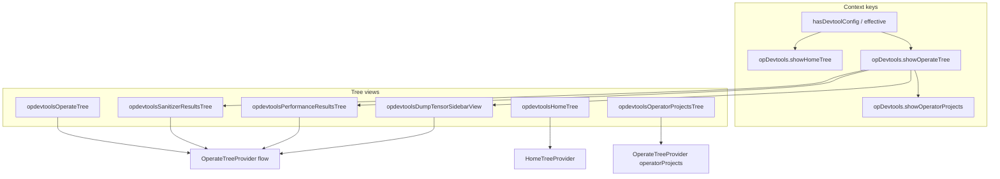

# 算子侧边栏——原生树视图（现状）

本文档是插件**活动栏侧边栏树**（Home、Actions、Operators、Sanitizer results、Performance results、Dump tensor results）的权威描述。各功能的运行/数据流文档见 [`sanitizer.md`](sanitizer.md)、[`performance-zh.md`](performance-zh.md) 和 [`dump-tensor-zh.md`](dump-tensor-zh.md)；构建/运行/调试入口见 [`build-integration-zh.md`](build-integration-zh.md)、[`run-integration-zh.md`](run-integration-zh.md)、[`debug-integration-zh.md`](debug-integration-zh.md)。

所有侧边栏数据都渲染在原生 VS Code `TreeView` 中；运行时没有任何 webview 侧边栏参与。

---

## 概述

扩展在 `mindstudio-opssuite-vscode-plugin` 容器（活动栏）中使用**原生 VS Code `TreeView`**。所有 operate/sanitizer/performance 树数据和节点渲染都集中在一个类 `OperateTreeProvider` 中，它注册为两**种**（`flow` | `operatorProjects`），另有一些轻量适配 provider 服务于结果面板。

---

## 视图 ID 与可见性

| 视图 ID | UI 名称（英文） | `when` / 规则 |
|---------|----------------|---------------|
| `opdevtoolsHomeTree` | Home | `opDevtools.showHomeTree` |
| `opdevtoolsOperateTree` | Actions（算子操作） | `opDevtools.showOperateTree` |
| `opdevtoolsOperatorProjectsTree` | Operators | `opDevtools.showOperatorProjects` |
| `opdevtoolsSanitizerResultsTree` | Sanitizer results | `opDevtools.showOperateTree` |
| `opdevtoolsPerformanceResultsTree` | Performance results | `opDevtools.showOperateTree` |
| `opdevtoolsDumpTensorSidebarView` | Dump tensor results | `opDevtools.showOperateTree` |

### 上下文切换（`extension.ts` → `refreshSidebarContexts`）

在工作区变化、项目打开/创建、`devtool_config.json` 监听器事件时刷新，并通过 `requestSidebarContextsRefresh()` 合并刷新请求。

1. `hasDevtoolConfig` —— 工作区中存在可用的 `devtool_config.json`（通过 `configService.checkDevtoolConfig()`）。
2. `projectType` —— 来自 `homeMethods.getProjectType()`；必须被 `OperatorPluginRegistry.isProjectTypeSupported` 支持。
3. **有效配置** = `hasDevtoolConfig && projectTypeSupported`。

| 上下文键 | 取值 |
|----------|------|
| `hasDevtoolConfig` | 有效配置（见上） |
| `opDevtools.showHomeTree` | `!effective` |
| `opDevtools.showOperateTree` | `effective` |
| `opDevtools.showOperatorSearch` | `effective && (hasMultipleOperators \|\| isStandardCustom)` |
| `opDevtools.showOperatorProjects` | `effective && hasMultipleOperators && isStandardCustom` |

其他上下文会从树状态更新（sanitizer 分组方式、仅显示已标记过滤、算子选择、动作队列「全部停止」可见性、msAgent AI 修复可用性）。

**Home 树：** `HomeTreeProvider` 故意**不返回任何子节点**；`package.json` 的 `viewsWelcome` 条目负责渲染介绍链接和命令链接（新建/打开项目、帮助、欢迎页）。

---

## 核心实现

| 部分 | 路径 / 作用 |
|------|-------------|
| Flow + 共享状态 | `plugin/src/class/operate-tree-provider.ts`（`kind: 'flow'`） |
| 算子列表树 | 同一个类（`kind: 'operatorProjects'`） |
| Home 空状态 | `plugin/src/class/home-tree-provider.ts` |
| 注册 | `plugin/src/extension.ts`（`createTreeView`、命令接线） |
| 可见性 / 项目元数据 | `refreshState()` → `homeMethods`、`OperatorPluginRegistry` |
| 来自 webview 的 flow 动作 | `OperateTreeProvider.runFlowActionFromWebview*`（已注册的 flow 实例） |
| 排队执行的类构建动作 | `plugin/src/helpers/operator-action-queue.ts` + `task-method-dispatch.ts` |
| 激活后的数据加载 | `plugin/src/helpers/post-activate-bootstrap.ts` —— `refreshSanitizerReports`、`refreshPerformanceReports`、`refreshDumpTensorReports`，聚焦 `opdevtoolsOperateTree` |

`OperateTreeProvider` 持有内存中的侧边栏状态：项目类型/模板、算子列表/选择、sanitizer 报告列表 + 选择/分组、性能报告列表 + 选择、dump tensor 报告列表 + 比对/选择状态。sanitizer/performance/dump-tensor **结果树**通过委托的 `getChildren` / `getSanitizerResultsPanelNodes` / `getPerformanceResultsPanelNodes` / `getDumpTensorResultsPanelNodes` 复用同一个 provider。

图标：扩展 `tree-icons/svg/` 目录下的主题化 SVG 资源（`getAssetIcon`），在 `onDidChangeActiveColorTheme` 时刷新。

---

## Actions 树（`opdevtoolsOperateTree`）

当 `hasDevtoolConfig` 成立且项目类型受支持时，根节点在 `getFlowRootNodes()` 中构建。能力来自 `OperatorPluginRegistry.getBuildBehaviorByProjectType(projectType)`。

| 节点（`nodeId`） | 典型命令 | 说明 |
|------------------|----------|------|
| `build` | `huawei-op-devtools.sidebar.build` | 若构建行为不要求构建则隐藏 |
| `run` | `huawei-op-devtools.sidebar.run` | 始终显示；选中多个算子时显示禁用图标 |
| `debug`（组） | — | 折叠；子节点为 CPU/NPU |
| `cpuDebug` | `huawei-op-devtools.sidebar.cpuDebug` | 对 `ascend` 隐藏；对 `cann` + `torch_library_template` 隐藏 |
| `npuDebug` | `huawei-op-devtools.sidebar.npuDebug` | 要求 `debugModeEnabled` 且注册表支持 |
| `sanitizer` | `huawei-op-devtools.sidebar.sanitizer` | 齿轮 → 过滤后的工作区设置（[`workspace-settings-zh.md`](workspace-settings-zh.md#opening-settings)） |
| `power`（组） | — | 性能调优父节点 |
| `onboard` | `huawei-op-devtools.sidebar.onboard` | 齿轮 → 上板设置 / 快捷面板（见 [`workspace-settings-zh.md`](workspace-settings-zh.md#opening-settings)） |
| `simulation` | `huawei-op-devtools.sidebar.simulation` | 齿轮 → 仿真设置 / 快捷面板（见 [`workspace-settings-zh.md`](workspace-settings-zh.md#opening-settings)） |
| `utTest` | `huawei-op-devtools.sidebar.utTest` | 标准自定义 + 具备构建能力的项目 |
| `dumpTensor` | `huawei-op-devtools.sidebar.dumpTensor` | 将一次 dump-tensor 运行入队；结果出现在 `opdevtoolsDumpTensorSidebarView`（运行完成时定位显示最新报告） |

**可见性规则（当前实现）：**

- 不支持的 `projectType` → flow 树为空。
- **标准自定义**项目，若其 `build.sh --help` 不暴露 `--genop`（`supportsSanitizerAndTuning` 为 false）→ 隐藏 Debug 组和 Performance tuning 组。
- **多算子选择**（`selectedOperatorIds.length > 1`）→ run/debug/sanitizer/onboard/simulation/ut/dump 行显示禁用图标并移除点击命令（tooltip 提示仅支持单算子）；**Debug** 和 **Performance tuning** 分区标题同步显示禁用图标。
- **扩展宿主无 NPU**（`opDevtools.npuHardwareAvailable === false`）→ 仅支持 NPU 的行（`run`、`npuDebug`、`sanitizer`、`onboard`、`dumpTensor`）显示禁用图标、移除点击命令，并显示 tooltip `web.operate.npuHardwareRequired`。支持 CPU 的行（`build`、`cpuDebug`、`simulation`、`utTest`）以及内联齿轮/设置命令保持可用。硬件在激活后每个会话探测一次：先 `asys info -r=status`，再 `npu-smi info`（[`npu-hardware-probe.ts`](../plugin/src/domain/utils/npu-hardware-probe.ts)）：只要任一命令有响应（包括设备忙等驱动错误），NPU 即为**可用**；仅当两个命令都不存在或无任何输出时才判定**不可用**。探测完成前上下文默认为 `true`（乐观策略）。见 [plugin_release #50](https://gitcode.com/opdevtools/plugin_release/issues/50)。
- **UT test：** UT 支持 CPU，在本地运行配置的 UT 命令。它不探测 NPU 硬件，也不调用 `remote_tool.sh`。
- sanitizer / 上板 / 仿真 / 构建行由 `OperatorPluginRegistry` 的构建行为标志（`supportsSanitizer`、`supportsOnBoard`、`supportsSimulate` 等）门控。**Triton**（`project_type` / `op_type` 为 `triton`，且 `op-devtools.operatorSupport.triton` 开启时）按 `TritonPlugin.buildBehavior` 显示 sanitizer、仿真和上板；CPU debug 保持隐藏；NPU debug 行遵循 `supportsNpuDebug` 和 `debugMode`。运行仍要求一个激活的 `.py` 文件（与 PyAsc 相同的模式）。

**项目配置**不是树节点；标题栏命令 `huawei-op-devtools.sidebar.projectConfig` 打开扩展设置（[`workspace-settings-zh.md`](workspace-settings-zh.md#opening-settings)）。

**执行 UI：** `runFlowAction()` 会在活动行上显示旋转图标（`executingFlowNodeId`），当 `opdevtools.flowRunning` 上下文匹配时显示内联**停止**按钮，并通过 `setQueuedFlowStates` 反映**算子动作队列**（见下文）的状态。环境脚本守卫在动作执行前运行，除非被跳过（例如仅打开设置的齿轮动作使用 `skipFlowExecutionUi`）。

**不排队：** `build`、`run`、`cpuDebug`、`npuDebug` —— 它们直接调用 `taskMethods`（不经过 `OperatorActionQueueManager`）。

---

## 算子动作队列

长时间运行的 flow 动作共享一个**内存中、严格串行**的按作用域划分的队列。实现在 `plugin/src/helpers/operator-action-queue.ts`；入队/停止/状态 API 在 `plugin/src/helpers/task-method-dispatch.ts`。

### 可排队的动作类型

| `QueueableActionType` | Actions 树 `nodeId` | 典型执行者 |
|----------------------|---------------------|-----------|
| `sanitizer` | `sanitizer` | `dispatchRunSanitizer` → `taskMethods.runSanitizer` |
| `onboard` | `onboard` | `dispatchStartOnBoard` → `taskMethods.startOnBoard` |
| `simulation` | `simulation` | `dispatchStartSimulate` → `taskMethods.startSimulate` |
| `utTest` | `utTest` | `dispatchStartUtTest` |
| `dumpTensor` | `dumpTensor` | `dispatchStartDumpTensor` |
| `stTest` | `stTest` | `dispatchStTestFromWebview` → `taskMethods.startStTest` |
| `cpuDebug` | `cpuDebug` | `taskMethods.runCpuDebug` |
| `npuDebug` | `npuDebug` | `taskMethods.runDebug` |

从 Actions 树或快捷选项 webview 进入：`dispatchEnqueueNativeOperatorAction`（树）或 `dispatchSimulator` / `dispatchOnBoard` / `dispatchSanitizer`（webview 包装，内部同样调用入队）。

### 作用域与隔离

队列键 = **`{projectScope}::{selectedOperatorIds}`**（`getOperatorQueueScopeKey()`）：

- **项目：** 来自 `getProjectByPath` 的 `id:<projectId>`，否则为规范化后的工作区路径。
- **算子：** 来自 `homeMethods.getSelectedOperatorIds()` 的排序后逗号分隔 ID，未选择时为 `default`。

切换工作区或所选算子会使用**不同的**队列；队列之间从不合并。**每个可排队动作——包括 st test——都在这同一个按项目划分的队列中**（st test 此前使用独立的全局队列；后来统一为与 dump tensor 及同组其他动作串行执行）。

### 规则

- **FIFO：** 条目逐个运行；只有当前执行者结束（成功或失败）后，下一个 `queued` 条目才开始。
- **每个队列同一类型只有一个活动项：** 如果相同 `actionType` 已存在于 `queued`、`running` 或 `cancel_failed` 中，入队会被拒绝（弹出带原因的警告提示）。
- **失败：** 执行者被拒绝后仍会移除该条目；继续处理下一个排队条目（不自动重试）。
- **持久化：** 仅存于内存；扩展重载/窗口重启会清空所有作用域（不恢复）。

### 条目状态（队列管理器内）

| 状态 | 含义 |
|------|------|
| `queued` | 等待轮到自己 |
| `running` | 执行者进行中（在完成前 `isProcessAlive` 为 true） |
| `cancel_failed` | 已请求停止，但 **10 秒**超时（`stopTimeoutMs`）后进程仍存活 |

已完成的条目会从列表中**移除**（队列 UI 中没有长期存在的 `success` / `failed` / `cancelled` 行）。

### 停止

| 目标 | 行为 |
|------|------|
| `queued` | 立即移除；永远不会运行 |
| `running` / `cancel_failed`（进程存活） | 通过队列管理器调用 `taskMethods.stopTask()`；10 秒计时器可能将其置为 `cancel_failed`；`isProcessAlive` 期间队列不会启动下一条 |
| **全部停止**（`huawei-op-devtools.sidebar.stopAllOperatorActions`） | 清空所有 `queued` 条目；对存活的执行者请求停止；当 `opDevtools.operatorActionQueueStopAllVisible` 时显示标题栏按钮（当前作用域内 ≥2 个条目） |
| **按行停止**（`huawei-op-devtools.sidebar.stopFlowTask`） | 当该行映射到可排队类型时调用 `dispatchStopOperatorAction({ actionType })`；否则调用 `dispatchStopTask()` + `clearFlowExecutionState()` |

### Actions 树 UI 同步

`extension.ts` → `syncNativeQueueState()`（激活时及每 **1 秒**一次）：

1. `dispatchGetOperatorActionQueueStatus()` → 当前作用域的条目。
2. `operateTreeProvider.setQueuedFlowStates()` —— 按 `nodeId` 设置：`queued` | `running` | `cancel_failed`。
3. `setContext('opDevtools.operatorActionQueueStopAllVisible', items.length >= 2)`。

树渲染（`OperateTreeProvider`）：

- `queued` → flow 行上显示沙漏主题 SVG。
- `running` / `cancel_failed` / 活动的 `runFlowAction` → `loading~spin`。
- 可取消的行获得 `opdevtools.flowRunning` 上下文（在条目上下文菜单中内联显示停止）。

`getActions()` 为每个队列中条目暴露 `displayStatus: 'currently executed'`（API 字段；树在标签上使用图标而非该字符串）。

### 运行后钩子

上板和仿真的入队路径可以传入 `onFinished`（例如 `refreshPerformanceReports({ focusIfNew: true })`），在执行者完成后调用。

---

## Operators 树（`opdevtoolsOperatorProjectsTree`）

第二个 `OperateTreeProvider` 实例（`operatorProjects`）。仅当 `opDevtools.showOperatorProjects` 时可见。

- 算子行来自集合根的**缓存扫描状态**——`cache.folders[rootKey].opsList` / `.experimentalOpsList`（每个条目包含：`name`、`path`、`isCompiled`；实验性算子带 **ex** 标记渲染），通过 `homeMethods.checkMultipleOperators()` 暴露，并支持通过 `searchKeyword` 搜索/过滤（标题栏搜索命令）。
- 选择以**路径**形式持久化在 `cache.project.selectedOperatorPaths`（`homeMethods.setSelectedOperators` → `createProject` 将 id 重新键控为路径；`getSelectedOperatorIds` 按规范化路径将其解析回扫描条目）。
- 默认行为：标准自定义项目中，每个工作区会话选择**按名称排序的第一个**算子一次——在算子列表真正可知后的第一次刷新时应用（`OperateTreeProvider.refreshState` 中的 `hasAppliedDefaultSelection`），因此扫描状态到达较晚时仍会触发默认选择。
- 标题栏：全选、清除选择、清除搜索。
- 条目上下文：切换算子 → `setSelectedOperators` → 由扫描状态支撑的路径选择。每一行携带自己的命令 id `huawei-op-devtools.sidebar.toggleOperator.<hash>`（hash = 规范化算子项目路径 SHA-256 的前 16 个十六进制字符）：`OperateTreeProvider.registerOperatorToggleCommands` 为每个渲染行注册一个这样的命令，并在算子离开列表时释放它。行标识必须放在命令 id 中——携带 `arguments` 的 `TreeItem.command` 会被 VS Code 转换成按树节点缓存的合成 `<command> /NN` id，每次刷新都会将其丢弃，导致进行中的点击失败并提示 "command not found"。

Flow 树读取 `selectedOperatorIds` 以应用多算子禁用规则，并通过 `homeMethods.getSelectedOperators()` 分发构建/运行。

---

## Sanitizer 结果树（`opdevtoolsSanitizerResultsTree`）

`extension.ts` 中的适配 `TreeDataProvider` —— 根节点来自 `getSanitizerResultsPanelNodes()`，`sanitizerReportItem` / `sanitizerClass` 的子节点通过共享的 `getChildren` 提供。

- 报告由 `refreshSanitizerReports()` → `runDataService.getSanitizerRunData()` 加载（仅 flow 实例）。
- 层级：报告 → 可选分组（`class` | `severity` | `type` | `file`）→ 消息。
- 标题栏：添加报告、按时间排序、隐藏/显示重复项、仅显示已标记过滤、分组方式切换。
- 内联：标记/取消标记报告、复制路径、打开分组文件，以及当 `opDevtools.sanitizerAiFixAvailable` 时在消息行上提供 **AI 修复**。

详见 [`sanitizer.md`](sanitizer.md)、[`msagent-zh.md`](msagent-zh.md)。

---

## Performance 结果树（`opdevtoolsPerformanceResultsTree`）

适配器带有独立的 `onDidChangePerformanceTreeData`，因此 flow 树刷新不会总是重绘此视图。

- `refreshPerformanceReports()` → `performanceMethods.getRunData` / 执行记录；在内存中排序（`sortOrder` 升/降序）。
- 选择驱动运行数据预览和 Insight 打开路径（`extension.ts` 中的 `onDidChangeSelection`）。
- 标题栏：可视化命令、按时间排序、仅显示已标记过滤。
- 树结构：报告 → 报告输出下的文件夹/文件（`performanceFolder`、`performanceFile`）。

详见 [`performance-zh.md`](performance-zh.md)。

---

## Dump tensor 结果树（`opdevtoolsDumpTensorSidebarView`）

`extension.ts` 中的适配 `TreeDataProvider`，带有独立的 `onDidChangeDumpTensorTreeData`（与 performance 相同的模式）：根节点来自 `getDumpTensorResultsPanelNodes()`，`dumpTensorReportItem` / `dumpTensorFolder` 的子节点通过共享的 `getChildren` 提供。

- `refreshDumpTensorReports()` → `dumpTensorMethods.getDumpTensorData`；在 dump-tensor 流程和 `.bin` 导入后运行（`huawei-op-devtools.flashDumpTensorData`），在内存中排序（`sortOrder` 升/降序，默认 `desc`），排序/过滤时不重新扫描。
- 空状态：单个占位符行（`web.dump.noData`），无内联动作。

| 节点（`nodeId`） | `contextValue` | 说明 |
|------------------|----------------|------|
| `dumpTensorReportItem` | `dumpTensorReportItem.marked` / `.unmarked` | 报告行；稳定 `id` 为 `dump-tensor-report:<encoded-key>`；已标记行渲染 `flag-filled` 产品图标 |
| `dumpTensorFolder` | `dumpTensorFolder` | 报告下的嵌套文件夹；`id` 为 `dump-tensor-folder:<reportKey>:<encoded-segments>` |
| `dumpTensorFile` | `dumpTensorFile.bin` | `.bin` 叶子节点；点击打开配套的 `.txt`，或在比对模式开启时切换比对选择 |

- 标题栏：导入 `.bin`、比对 / 开始 / 取消、按时间排序、仅显示已标记过滤。
- 报告行内联：复制路径、下载（zip）、标记/取消标记。文件叶子：打开配套 `.txt`、**Compare with…**。

状态（`OperateSidebarState.dumpTensor`）：

| 字段 | 用途 |
|------|------|
| `reports` | 从 `DumpTensorData` 加载的执行记录 |
| `sortOrder` | 按时间戳 `asc` / `desc`（内存中重排） |
| `markedOnly` | 过滤为已标记报告（`opDevtools.dumpTensorMarkedOnly`） |
| `selectedReportKey` | 展开/定位目标 |
| `compareMode` | 双文件比对进行中（`opDevtools.dumpTensorComparing`） |
| `compareSelectedFilePaths` | 最多两个 `.bin` 路径；标签显示 `(1/2)`、`(2/2)` |

存储：报告是 `<project>/.vscode/DumpTensor/<report-key>/` 的子目录；叶子是 `.bin` 文件，打开/比对使用配套的 `.txt` 文件。标记持久化在 `PermanentStorage` 的 `marked_dump_tensor_records` 下。

详见 [`dump-tensor-zh.md`](dump-tensor-zh.md)。

---

## 命令与菜单

主要接线在 `package.json` 中：

- **`view/title`** —— 各树的导航（项目配置、新建项目、队列全部停止、sanitizer/performance/dump-tensor 工具栏、算子搜索/选择）。
- **`view/item/context`** —— 内联齿轮（debug/sanitizer/onboard/simulation 设置）、停止正在运行的 flow 任务、sanitizer/performance/dump-tensor 报告动作、dump-tensor 文件打开/比对。

侧边栏命令在 `extension.ts` 中注册，先调用 `operateTreeProvider.runFlowAction(...)`，再调用 `dispatchStartBuild`、`taskMethods` 等。

Webview **快捷选项**面板（仿真/上板/sanitizer）仅将 `ops` 用于配置加载/保存；**立即开始**使用 `OperateTreeProvider.runFlowActionFromWebview`，因此同样的加载/停止行行为同样适用。

---

## 数据刷新触发时机（典型）

| 事件 | 效果 |
|------|------|
| `refreshSidebarContexts()` | 项目类型、可见性上下文、两个 provider 实例的 `refreshState` |
| 构建/sanitizer/performance/dump-tensor 完成 | `refreshSanitizerReports`、`refreshPerformanceReports`、`refreshDumpTensorReports`、算子上的编译标志 |
| 用户命令 | 排序/过滤/分组修改状态 + `fire` 树变更 |
| 激活后引导 | 自动打开工作区项目、首次 sanitizer/performance/dump-tensor 扫描 |

---

## 相关文档索引

| 主题 | 文档 |
|------|------|
| Sanitizer 运行 + 结果 UX | [`sanitizer.md`](sanitizer.md) |
| 对检测项的 msAgent AI 修复 | [`msagent-zh.md`](msagent-zh.md) |
| 性能分析运行 + 结果 + Insight | [`performance-zh.md`](performance-zh.md) |
| Dump tensor 运行 + 结果 + 比对 | [`dump-tensor-zh.md`](dump-tensor-zh.md) |
| 工作区 `op-devtools.*` 设置 | [`workspace-settings-zh.md`](workspace-settings-zh.md)、`package.json` |

---

## 关键文件（快速索引）

| 领域 | 文件 |
|------|------|
| 树模型 + UI | `plugin/src/class/operate-tree-provider.ts` |
| Home 欢迎页 | `plugin/src/class/home-tree-provider.ts` |
| 视图 + 命令 | `plugin/src/extension.ts` |
| 视图贡献点 | `package.json` → `views`、`viewsWelcome`、`menus` |
| 动作队列 | `plugin/src/helpers/operator-action-queue.ts` |
| 插件能力 | `plugin/src/domain/plugins/operator-plugin.registry.ts` |
