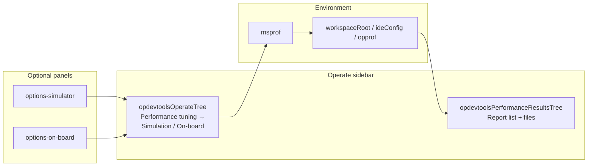
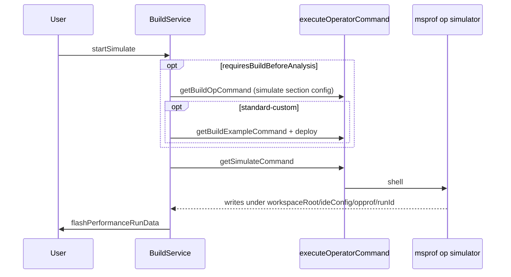

# 性能分析——架构

本文档介绍 Ascend C Toolkits 中**仿真**与**上板**性能分析（`msprof` CLI）的**当前实现**：构建/部署前置步骤、性能分析器命令生成、`opprof` 下的输出，以及用于浏览结果的**原生 VS Code 树**。扩展负责编排工具链；**msprof** 在算子环境中运行。

CANN/Ascend spawn 环境（`SOC_VERSION`、`NPU_ARCH`；仿真类运行使用仿真器目录作为 spawn `SOC_VERSION`）以及生成时的 ACLNN cmake 默认值，见 [`ascend-env-spec-zh.md`](./ascend-env-spec-zh.md)。Ascend950PR&950DT 系列上板指标矩阵见 [`ascend-a5-support-zh.md`](./ascend-a5-support-zh.md)。`op-devtools.performanceTuning.*` 键及其映射见 [`workspace-settings-zh.md`](./workspace-settings-zh.md)。

---

## 概述

| 层 | 职责 |
|----|------|
| **CLI** | `msprof op simulator`（仿真）或 `msprof op`（上板） |
| **插件** | 可选的预编译 / 示例构建 / 部署（取决于项目类型）、命令组装、shell 执行 |
| **配置** | 工作区设置（[`workspace-settings-zh.md`](./workspace-settings-zh.md) § 性能调优）；`.vscode/cache.json`（`fileMapLists`）用于外部报告路径 |
| **结果 UI** | 原生树 **`opdevtoolsPerformanceResultsTree`**（报告 → 文件夹/文件叶子） |
| **查看器** | CSV 编辑器、Insight 查看器（`bin`/`json`）、profiling-report 查看器（`rep`/`ncrep`/`npu-rep`）、通过 API 可选使用 `vscode.diff` |

当前**没有**性能调优侧边栏 webview（`performancePanelView` / `performance-run-data` 面板），也**没有** `open-performance-panel-view` 命令。

---

## 工作台布局

- **`opdevtoolsOperateTree`**：当项目支持性能分析时，**Performance tuning** 组（`nodeId === 'power'`）暴露 **Simulation analysis**（`simulation`）和 **On-board analysis**（`onboard`）。齿轮图标打开工作区设置或快捷选项 webview。
- **`opdevtoolsPerformanceResultsTree`**：独立视图（`%view.performanceResultsTree.name%`）。**报告行只出现在这里**，不在 `power` 节点下。
- **`opdevtoolsDumpTensorSidebarView`**：dump tensor 报告的独立原生树；它复用 `dumpTensorMethods`，其中 `downloadReport` 委托给 performance 辅助方法，比对委托给 `performanceMethods.diffFiles`（对两个配套 `.txt` 文件调用 `vscode.diff`）。它不是性能分析结果浏览器。见 [`dump-tensor-zh.md`](./dump-tensor-zh.md)。

---

## 入口

### 1. Operate flow 树

| 动作 | 树节点 | 队列类型 | 执行者 |
|------|--------|----------|--------|
| 仿真 | `simulation` | `simulation` | `taskMethods.startSimulate` → `BuildService.startSimulate` |
| 上板 | `onboard` | `onboard` | `taskMethods.startOnBoard` → `BuildService.startOnBoard` |

分发：`task-method-dispatch.ts` 中的 `dispatchSimulator` / `dispatchOnBoard` → `dispatchEnqueueNativeOperatorAction`（串行算子队列；见 [`operator-treeview-zh.md`](./operator-treeview-zh.md) § 算子动作队列）。

**快捷选项：** 除非 `simulation.showQuickOptions` / `onBoard.showQuickOptions` 为 `false`，否则树会先打开选项 webview（默认值与行为见 [`workspace-settings-zh.md`](./workspace-settings-zh.md#performance-tuning-op-devtoolsperformancetuning)）。

命令：`huawei-op-devtools.sidebar.simulation`、`huawei-op-devtools.sidebar.onboard`（以及 operate 树的内联动作）。运行前，**PyAsc** 项目在不使用快捷面板时会调用 `homeMethods.validatePyascForAnalysis()`。

排队运行结束后，`extension.ts` 除了 `BuildService` 调用 `flashPerformanceRunData` 之外，还可能调用 `refreshPerformanceReports({ focusIfNew: true })`。

### 2. 选项 webview

| 面板 | 路径 | `ops` API |
|------|------|-----------|
| 仿真 | `web/src/views/panels/options-simulator/` | `getSimulateOptions` / `saveSimulateOptions`、`startSimulate` |
| 上板 | `web/src/views/panels/options-on-board/` | `getOnBoardOptions` / `saveOnBoardOptions`、`startOnBoard` |

确认时，webview 调用 `startSimulate` / `startOnBoard`，然后关闭编辑器。设置通过 `ConfigService.writeOpDevtoolsDottedSettings` 持久化到工作区 `op-devtools.*`。

### 3. 资源管理器：添加可视化

| 命令 | 添加到哪个配置类型的 `fileMapList` |
|------|-----------------------------------|
| `huawei-op-devtools.reportVisualizationSimulation` | `simulate` |
| `huawei-op-devtools.reportVisualizationOnBoard` | `on_board` |
| `huawei-op-devtools.reportVisualizationPerformance` | `on_board`（文件夹选择器或资源管理器文件夹） |

实现：`FolderContextMenuService.addReportToFileMapList(uri, configType)`。

---

## 仿真运行流水线

**服务：** `BuildService.startSimulate`（`plugin/src/service/build-service.ts`）。

值得注意的行为：

- 使用 **`OperatorPluginRegistry.getOpPlugin(project.project_type).buildBehavior`** 做活动文件检查（PyAsc：必须有激活的 `.py`；更新部署目标）以及决定是否先运行构建/示例/部署。
- **仿真分区配置**（`resolveSimulateBaseContext(projectPath, operatorNames)` → `ConfigService.getSimulateConfig(projectPath)`）在 `requiresBuildBeforeAnalysis` 时驱动预编译（基于该基础上下文调用 `getBuildOpCommand`）。
- **标准自定义：** 示例构建之后执行 `deployStandardCustomRunPackage`。
- 成功时：`build.simulationSuccess` + `huawei-op-devtools.flashPerformanceRunData`，参数为 `{ focusIfNew: true }`。
- 失败时：抛异常（仿真路径），以便算子队列能够暴露错误。

---

## 上板运行流水线

**服务：** `BuildService.startOnBoard`。

结构与仿真相同，但：

- 预编译在 `requiresBuildBeforeAnalysis` 时使用**上板分区配置**（`resolveOnBoardBaseContext(projectPath, operatorNames)` → `ConfigService.getOnBoardConfig(projectPath)`）。
- 命令：`getOnBoardCommand` → `ProfilerFactory.getStrategy('onboard')`，`onboardCannSoc` 来自 `resolveAscendEnv({ isSimulator: false })`。
- PyAsc 活动文件检查失败时**提前返回**（不抛异常）——与仿真不对称。
- 成功时：`build.onBoardSuccess` + `flashPerformanceRunData({ focusIfNew: true })`。

---

## 命令生成

### 门面函数

| 函数 | 文件 | 策略方法 |
|------|------|----------|
| `getSimulateCommand(configId, exampleConfigId, operatorNames?)` | `domain/services/command.ts` | `buildSimulateCommand` |
| `getOnBoardCommand(configId, exampleConfigId, operatorNames?)` | 同上 | `buildOnBoardCommand` |

`CommandStrategyFactory.getStrategy(op_type)` 选择 ascend / cann / pyasc / triton 实现。命令通过 `joinCommands` 与 CANN 环境 source + `cd` 到构建目录拼接在一起。

**Python 算子（PyAsc / Triton）：** 性能分析器命令用 `msprof op [simulator] …` 包裹部署目标（`python3 ./<file>.py`）——没有编译步骤。Triton 在仿真/上板前运行 `probeTritonPythonDependencies()`；性能分析目标来自 `build_op.target_file`（当用户选择激活的 `.py` 文件时更新）。

### msprof 组装（`domain/services/profiler-service.ts`）

| 模式 | 类 | CLI 形态 |
|------|----|----------|
| 仿真 | `SimulatorStrategy` | `msprof op simulator --soc-version=<SIMULATOR_DIR> --output=<workspaceRoot>/<ideConfig>/opprof --aic-metrics=...` |
| 上板 | `OnBoardStrategy` | `msprof op --output=<workspaceRoot>/<ideConfig>/opprof --aic-metrics=...` |

**仿真指标**（从仿真分区 DAO `ConfigService.getSimulateConfig(projectPath)` 读取——策略将 `config.resourceConflictRatio` / `config.memoryThroughputWaveform` 传入 `getSimulationAicMetrics`；工作区键见 [`workspace-settings-zh.md`](./workspace-settings-zh.md#performance-tuning-op-devtoolsperformancetuning)）：

| 工作区设置 | CLI 指标 | 门控 |
|-----------|----------|------|
| （必需的基础指标） | `PipeUtilization` | 始终发出 |
| `simulation.resourceConflictRatio` | `ResourceConflictRatio` | 仅当 SOC 在白名单中 |
| `simulation.memoryThroughputWaveform` | `PMSampling` | 仅当 SOC 在白名单中 |

**SOC 门控（GC-22 / plugin_release #32）：** 仿真器（CANN msopprof）会按 `--soc-version` 选择的平台校验 `--aic-metrics`，只接受一组很窄且因平台而异的指标；未知指标会以 `[ERROR] Unexpected argument … maybe in wrong soc platform` 报错（这在 Atlas A3 系列 / `ascend910_93` 上出过问题）。可选指标仅当解析出的 CANN SOC slug 在 `SIMULATOR_OPTIONAL_METRIC_SOCS`（[`shared/msprof-simulator-metrics.ts`](../shared/msprof-simulator-metrics.ts)）中时才发出。**Ascend950PR&950DT 系列（`ascend950`）：** `ResourceConflictRatio` 和 `PMSampling` 在 §8 CLI 验证后已加入白名单——见 **[`simulator-options-spec-zh.md`](./simulator-options-spec-zh.md)**。其他 SOC 在验证前仍只使用 `PipeUtilization`。msprof **互斥规则：** `ResourceConflictRatio`（在白名单内且启用时）替代 `PipeUtilization`；`PMSampling` 可以追加。

**`--soc-version`：** 必须是**仿真器目录**（`resolveAscendEnv({ isSimulator: true }).simulatorType`），例如 `Ascend910B3` / `Ascend910C` / `Ascend950PR_9589`——而不是 CANN slug。完整约定（默认值、优先级、验证方式、与 `{soc_version}` / spawn 环境的对比）见 **[`ascend-env-spec-zh.md` §8.1](./ascend-env-spec-zh.md#81-msprof-op-simulator---soc-version-canonical)**。

**上板指标**取决于 SOC：`isAscendA5ProfilerCannSoc(cannSoc)` 在 Ascend950PR&950DT 系列与 Atlas A3 系列风格的基础集合之间做选择；工作区复选框会合入上板分区 DAO（`ConfigService.getOnBoardConfig(projectPath)`）；工作区键见 [`workspace-settings-zh.md`](./workspace-settings-zh.md#performance-tuning-op-devtoolsperformancetuning)。Ascend950PR&950DT 系列矩阵见 [`ascend-a5-support-zh.md`](./ascend-a5-support-zh.md)。

**性能分析目标二进制：** `strategy.getProfilerTargetFile` —— **ascend** 策略读取 **`exampleBuildConfig.targetFile`**（工作区设置；回退到 `OperatorPluginRegistry.getDefaultPaths`）；**cann** / **pyasc** / **triton** 策略读取 `build_op` 部署键（`deployCommandOrRunCommand`，回退 `targetOpFile`）——见 [`workspace-settings-zh.md`](./workspace-settings-zh.md#what-is-not-in-workspace-settings)。可选的 `operatorNames` 会为标准自定义改写 `test_aclnn_*` 路径段（取第一个选中的名称）。

**输出目录：** 工作区根——`joinIdeConfigRelative('opprof')` 与第一个工作区文件夹拼接（回退：`operator.op_path`），即 **`<workspaceRoot>/<ideDir>/opprof`**。每个算子的运行都写入这里；每次运行创建一个子目录（`<runId>`），扫描只读取这唯一的根（绝不扫描各算子自己的目录树）。

**输出通道：** 上板运行写入自己的 `Op Dev Tools: onboard` 通道（`toolOutputLabel: 'onboard'`）；仿真运行使用 `simulate` 通道。**动作链中的每条命令都写入该动作的通道**——仿真/上板内部的编译/示例前置步骤进入 `simulate`/`onboard`，绝不进入 `compile`。两个通道都跨运行追加（GC-73）——通道约定见 [`build-integration-zh.md`](./build-integration-zh.md)。

---

## 配置

性能分析键、编译脚本和运行时合并：**[`workspace-settings-zh.md`](./workspace-settings-zh.md)**（§ 性能调优、§ 编译与部署、§ 运行时模型）。

### `.vscode/cache.json`（本功能）

| 字段 | 作用 |
|------|------|
| `fileMapLists.simulate` | 通过「添加可视化」加入的外部报告路径（仿真） |
| `fileMapLists.on_board` | 上板可视化的外部报告路径（文件夹选择器 / 资源管理器文件夹） |

分区配置由 DAO 工厂按运行合成（基于工作区设置 + 缓存的 `getSimulateConfig(projectPath)` / `getOnBoardConfig(projectPath)`）——除了上述工作区设置和 `cache.json` 字段外，磁盘上不存任何东西。

### 选项面板（webview）

仿真 / 上板选项面板通过工作区设置（`op-devtools.*`，经由 `getSimulateOptions` / `saveSimulateOptions` / `getOnBoardOptions` / `saveOnBoardOptions`）和工作区缓存（`fileMapLists`）读写状态；没有配置 RPC。

性能分析运行**不**从结果树启动；只能从 operate flow 树 / 选项面板 / 资源管理器钩子启动。

### 性能数据控制器（宿主）

`performance-data-controller.ts` 暴露 `performanceMethods`，由 `OperateTreeProvider`（performance 和 dump tensor 树）**进程内**使用。没有注册 `performance/*` HTTP API 组：

| 方法 | 使用者 |
|------|--------|
| `getRunData` | Performance 树刷新（经由 `runDataService`） |
| `toggleRecordMark` | 标记/取消标记报告 |
| `copyReport` | 拼接报告目录下所有文件内容 → 剪贴板 |
| `downloadReport` | 打包报告目录为 zip（performance / dump tensor 树） |
| `diffFiles` | `vscode.diff` —— dump tensor 树比对（配套 `.txt` 文件） |

**没有**任何 webview 面板为性能分析结果树调用 `getRunData`。

---

## 发现报告（`PerformanceRunData`）

**实现：** `plugin/src/core/performance/performance-run-data.ts`  
**桥接：** `RunDataService.getPerformanceRunData` → `performanceMethods.getRunData` → `OperateTreeProvider.refreshPerformanceReports`。

1. **`opprof` 子目录**  
   扫描唯一的工作区根文件夹 **`<workspaceRoot>/<ideConfig>/opprof/`**（与项目路径拼接）。每个**子目录**（`<runId>`）= 一份报告（`key` = 文件夹名，`timestamp` = ctime，`children` = 扫描到的文件）。

2. **`fileMapList`**  
   来自所有 `simulate` 和 `on_board` 配置：磁盘上仍存在的 `{ filePath, reportTime }` 条目。键：`simulate_<path>` 或 `onboard_<path>`。目录会扫描子节点；单个文件的 `children` 为空。

3. **标记**  
   `PermanentStorage` 键 `marked_performance_records` → 每条记录上的 `marked`。

4. **UI 中排序**  
   `queryExecutionRecords` 返回扫描顺序；**`OperateTreeProvider`** 在内存中对 `state.performance.reports` 排序（`sortOrder` 升/降序）。标题栏排序切换**不会**重新扫描磁盘。

### 报告下的文件树

`scanSubFiles` 只包含 **`csv`**、**`bin`**、**`json`**、**`rep`**、**`ncrep`**、**`npu-rep`**（小写）。空目录分支会被剪除。树节点：`performanceFolder`、`performanceFile`。

---

## 结果树行为

**注册：** `extension.ts` —— 适配 `TreeDataProvider`，委托给 `operateTreeProvider.getPerformanceResultsPanelNodes()`，以及为 `performanceReportItem` / `performanceFolder` 委托 `getChildren`。

**状态：** `OperateSidebarState.performance` —— `reports`、`sortOrder`（默认 `desc`）、`markedOnly`、`selectedReportKey`。

**根行：** 真实报告或单个空占位符（`web.perf.noData`），无内联动作。

**选择：** `performanceResultsTreeView` 上的 `onDidChangeSelection` → `selectPerformanceReport` / 上下文键 `opDevtools.performanceReportSelected`、`opDevtools.performanceSelectedReportMarked`。

**定位：** `refreshPerformanceReports({ focusIfNew: true })` 可以聚焦并展开最新报告（`revealPerformanceReport`）。

### 标题栏与行内动作

| 位置 | 动作 |
|------|------|
| `view/title` | 添加可视化、按时间排序、仅显示已标记过滤、刷新结果 |
| 报告行内联 | 复制（文件**内容**）、下载（zip）、标记/取消标记 |
| 文件叶子 | 打开——每个文件行一个命令，`sidebar.performance.file.open.<文件路径 + 类型的 hash>` |

### 打开文件行为

| 扩展名 | 处理器 |
|--------|--------|
| `csv` | `viewService.openCsvFile` |
| `bin`、`json` | `viewService.openInsight` → Insight 数据查看器面板（`INSIGHT_HOME_PATH` / `.arts/.env`） |
| `rep`、`ncrep`、`npu-rep` | `viewService.openProfilingReport` → profiling-report 面板（见 [`profiling-report-integration-zh.md`](./profiling-report-integration-zh.md)） |

已知 Insight 查看器问题（与插件 msprof 编排无关）见 [`user-issues/profiling-and-insight.md`](../docs/user-issues/profiling-and-insight.md)。

### 刷新

- **命令：** `huawei-op-devtools.flashPerformanceRunData`
- **文件系统对账：** 每次手动刷新都用一份完整的文件系统/配置快照替换可见清单。磁盘上已删除的报告、受支持的子文件和嵌套文件夹会从树中消失；存活的条目保持可见。如果所选报告消失了，与选择相关的上下文会被清除。
- **失败与并发：** 确认已删除的路径会被省略，不影响无关报告。意外扫描错误会保留上一次有效清单，较早的重叠刷新不能覆盖最新请求的快照。
- **持久化：** 对账不会修改 `fileMapList`、已存报告映射或标记元数据。没有自动监听器或轮询。
- **实现：** 仅 `operateTreeProvider.refreshPerformanceReports(args)` —— **没有** `postMessage` / iframe 刷新。

---

## 命令参考（performance 结果树）

| 命令 id | 作用 |
|---------|------|
| `huawei-op-devtools.sidebar.performance.report.select` | 更新选择上下文 |
| `huawei-op-devtools.sidebar.performance.report.copyPath` | 复制拼接后的报告文件内容 |
| `huawei-op-devtools.sidebar.performance.report.download` | zip 下载 |
| `huawei-op-devtools.sidebar.performance.report.mark` / `.unmark` | 切换标记 |
| `huawei-op-devtools.sidebar.performance.report.sortTime` | 切换时间戳排序（内存中） |
| `huawei-op-devtools.sidebar.performance.report.filterMarked` / `.showAll` | 仅显示已标记过滤 |
| `huawei-op-devtools.sidebar.performance.file.open.<hash>` | 打开 csv / bin / json / rep / ncrep / npu-rep。基础命令为 `view/item/context` 菜单条目注册；每个文件行携带一个变体，其 hash 由 `filePath` + `fileType` 派生，由 provider 注册 |
| `huawei-op-devtools.flashPerformanceRunData` | 重新扫描磁盘 + 配置列表 |
| `huawei-op-devtools.reportVisualizationPerformance` | 将文件夹添加到 on_board `fileMapList` |

---

## 关键源文件

| 领域 | 路径 |
|------|------|
| 仿真 / 上板编排 | `plugin/src/service/build-service.ts` |
| 任务入口 | `plugin/src/controller/task-controller.ts` |
| 队列 / ops 分发 | `plugin/src/helpers/task-method-dispatch.ts` |
| 命令门面 | `plugin/src/domain/services/command.ts` |
| msprof 策略 | `plugin/src/domain/services/profiler-service.ts` |
| 按算子类型的包装 | `plugin/src/domain/services/command-strategy/*-strategy.ts` |
| 设置合并 | `plugin/src/service/config-service.ts` |
| 磁盘扫描 | `plugin/src/core/performance/performance-run-data.ts` |
| 树 UI + 状态 | `plugin/src/class/operate-tree-provider.ts` |
| 剪贴板 / zip / diff | `plugin/src/controller/performance-data-controller.ts` |
| CSV / Insight | `plugin/src/service/view-service.ts`、`plugin/src/class/insight-data-viewer-panel.ts` |
| profiling-report | `plugin/src/class/profiling-report-panel.ts`、`web/src/views/panels/profiling-report/` |
| 注册 | `plugin/src/extension.ts`、`package.json` |
| 选项 webview | `web/src/views/panels/options-simulator/`、`options-on-board/` |
| Ascend950PR&950DT 系列指标矩阵 | `shared/msprof-onboard-env.ts`、`ascend-util.ts` |

---

## 相关文档

| 文档 | 用途 |
|------|------|
| [`build-integration-zh.md`](./build-integration-zh.md) | 共享构建 / 执行器 / `executeOperatorCommand` |
| [`ascend-env-spec-zh.md`](./ascend-env-spec-zh.md) | 编译 + msprof 的 spawn 环境 |
| [`ascend-a5-support-zh.md`](./ascend-a5-support-zh.md) | Ascend950PR&950DT 系列上板指标与默认值 |
| [`workspace-settings-zh.md`](./workspace-settings-zh.md) | 所有 `op-devtools.*` 键及运行时合并 |
| [`sanitizer.md`](./sanitizer.md) | sanitizer 结果的同类原生树模式 |
| [`dump-tensor-zh.md`](./dump-tensor-zh.md) | Dump tensor 结果树——复用 `downloadReport` / `diffFiles` |
