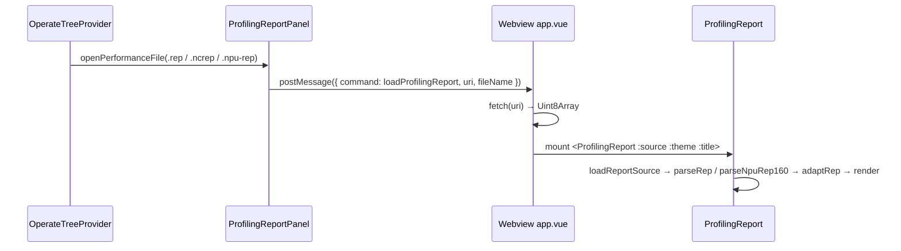
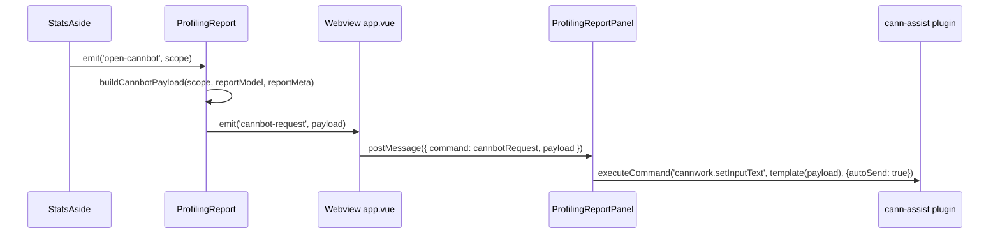

# 性能分析报告集成

介绍 **`@huawei/profiling-report`** Vue 库如何作为新的 `.rep` / `.ncrep` / `.npu-rep` 查看器面板集成进 Ascend C Toolkits，与已有的 CSV 编辑器和 MindStudio Insight 查看器并存。本文档记录的是**当前实现**的接线方式；该库的消费方契约位于 profiling-report 仓库（`docs/usage/USAGE.md`）。

## 查看器边界

| 文件类型 | 查看器 |
|-----------|--------|
| `.csv` | `CsvEditorProvider`（自定义文本编辑器） |
| `.bin`、`.json` | MindStudio Insight（`InsightDataViewerPanel` + `profiler_server`） |
| `.rep`、`.ncrep`、`.npu-rep` | **profiling-report** 面板（本文档） |

profiling-report 库绝不会注入到 Insight iframe 中——Insight 仍是一个封闭的第三方外壳。

## 子模块链接

`profiling-report` 是仓库根目录下的一个 git 子模块，跟踪 `IdeFrontend/profiling-report` 的 `master` 分支：

```text
mstt/
  profiling-report/          # git submodule (IdeFrontend/profiling-report)
  web/                       # Vue 3 webviews
  plugin/                    # VS Code extension host
  shared/                    # shared types/constants/i18n
```

该库没有声明任何 npm 依赖。`web` 工作区在构建时直接编译子模块的 `src/`。

## Web 工作区接线

### 构建时别名

[`web/vite.config.ts`](../../web/vite.config.ts) 将包名映射到子模块源码：

```ts
alias: {
  '@': path.resolve(__dirname, './src'),
  '@web': path.resolve(__dirname, './src'),
  '@shared': path.resolve(__dirname, '../shared'),
  '@huawei/profiling-report': path.resolve(__dirname, '../profiling-report/src'),
},
```

### 类型检查路径

[`web/tsconfig.json`](../../web/tsconfig.json) 将同一包名映射到子模块**构建产物**的声明文件，使 `vue-tsc` 能解析完整的 prop/emit 类型：

```json
"paths": {
  "@/*": ["./src/*"],
  "@web/*": ["./src/*"],
  "@shared/*": ["../shared/*"],
  "@huawei/profiling-report": ["../profiling-report/dist/index.d.ts"]
}
```

> 运行时构建只需要 Vite 别名（编译源码）。类型检查需要 `profiling-report/dist/index.d.ts`，这是一个被 gitignore 的构建产物——需先构建子模块：`cd profiling-report && npm install && npm run build`。这与现有 `shared` 包的做法一致，`shared` 同样必须先构建，web 类型检查才能通过。

## Webview 面板

位于 [`web/src/views/panels/profiling-report/`](../../web/src/views/panels/profiling-report/)：

| 文件 | 作用 |
|------|------|
| `profiling-report.html` | Vite 多入口 HTML（由 `scanDir` 自动发现） |
| `main.ts` | i18next 初始化 + Vue 应用引导 |
| `app.vue` | 挂载 `<ProfilingReport :source :theme :title>`；通过 webview URI 获取文件；加载/错误状态 |
| `composables/useProfilingReportTheme.ts` | 将 MSTT `updateTheme` 桥接到 `data-theme` |

外壳为宿主元素设置 `height: 100vh`（`ProfilingReport` 组件根节点使用 `height: 100%`）。

## 扩展侧面板

[`plugin/src/class/profiling-report-panel.ts`](../../plugin/src/class/profiling-report-panel.ts) —— `ProfilingReportPanel`，遵循 `StTestResultsPanel` 的生命周期：

- `createOrShow(context, filePath)` —— 按文件单例（复用已打开的面板并重新加载）。将文件所在目录注册到 `localResourceRoots`，使 webview 可以 `fetch` 它。只有在 `initializeHtml()` 成功后才插入 `openedFiles`（HTML 转换失败会销毁面板）。
- `initializeHtml()` —— `HtmlTransformer.transformDistHtml` + `registerWebviewThemeBridge`。
- `loadFile(filePath)` —— 发送文件的 `asWebviewUri`（不走 base64 中转），并附带 `filePath`（绝对路径）和 `collectedAt`（文件 mtime，ISO 格式）作为 CANNWork 载荷的元数据；失败时也会向 webview 发送 `loadProfilingReportFailed`。
- `cannbotRequest` 处理 —— 当 webview 发送 `{ command: 'cannbotRequest', payload }` 时，面板将载荷字段填入多行模板（首行为内置提示词 `buildInPrompt`，可通过隐藏设置 `cannbotPromptOverride` 替换），并通过 `vscode.commands.executeCommand('cannwork.setInputText', inputText, {autoSend: true})` 转发给 CANNWork 插件；成功/失败会通过信息/错误消息提示。
- `dispose()` —— 清理主题/消息/销毁等 disposable，并从 `openedFiles` 中移除自身。

## 数据流

`.rep` / `.ncrep` / `.npu-rep` 归档以**本地资源 URI** 的形式暴露给 webview；webview `fetch` 字节流，由库在客户端解包容器。



- 扩展宿主**不会**把整个归档读入一条 JSON 消息；大报告保留在磁盘上，通过 webview 资源协议传输。
- `parseRep` 按偏移/长度切分 `cann-rep` 容器内嵌文件（不解压）；`parseNpuRep160` 解析产品 `.npu-rep` 的 160 字节布局；`adaptRep` 将其映射为 `SwimlaneModel` + `ReportViewModel`。

### CANNWork分析（CANNWork 请求）

在报告分析侧栏（summary / compute / memory 范围）中点击 CANNWork 图标，会在库内组装一个只读快照载荷（`buildCannbotPayload`：视图模型分区 + `reportMeta` + 固定提示词），并转发给 CANNWork 插件：



- `reportMeta`（report_name / report_path / collected_at）来自 `loadProfilingReport` 消息字段（`fileName` / `filePath` / `collectedAt`），因此载荷不会重新解析 `.rep`。
- 载荷数据复用已解析的视图模型——不重新解析 CSV（子模块契约：`specs/core/cannbot-payload.spec.md`）。

## 主题支持

面板注册标准 MSTT 主题桥（`registerWebviewThemeBridge`），主题变化时推送 `{ command: 'updateTheme', isDark }`。`useProfilingReportTheme` 将其转换为 `theme` ref（`'dark'` / `'light'`），作为组件的 `theme` prop 传入，驱动 `.pr-root` 上的 `data-theme`。组件在挂载时也会主动请求当前主题（`{ command: 'getTheme' }`，由 `handleThemeRequest` 处理）。

## 文件发现

[`plugin/src/core/performance/performance-run-data.ts`](../../plugin/src/core/performance/performance-run-data.ts) —— `scanSubFiles` 现在将 `rep`、`ncrep` 和 `npu-rep` 纳入可接受的扩展名列表（与 `csv`、`bin`、`json` 并列）。

## 打开分发

1. [`plugin/src/class/operate-tree-provider.ts`](../../plugin/src/class/operate-tree-provider.ts) —— `openPerformanceFile` 将 `rep`/`ncrep`/`npu-rep` 路由到 `viewService.openProfilingReport`。
2. [`plugin/src/service/view-service.ts`](../../plugin/src/service/view-service.ts) —— `openProfilingReport` → `ViewOpener.openProfilingReport`。
3. [`plugin/src/core/view/view-opener.ts`](../../plugin/src/core/view/view-opener.ts) —— `openProfilingReport(uri)` → `ProfilingReportPanel.createOrShow(context, filePath)`。

常量：[`plugin/src/constants.ts`](../../plugin/src/constants.ts) 中的 `VIEW_PROFILING_REPORT` 和 `PROFILING_REPORT_PANEL_TYPE`。

## 上下文菜单

`huawei-op-devtools.openProfilingReport` 命令通过 `editor/title` 工具栏按钮和 `explorer/context` 右键菜单呈现在报告文件上。两个 `when` 子句都以 `resourceExtname == '.rep' || '.ncrep' || '.npu-rep'` 为条件（见 [`package.json`](../../package.json)）。工具栏入口还要求 `activeCustomEditorId != 'opdevtoolsNpuRepViewer'`，因此当报告以文本形式打开（包括"Open With… Text Editor"）时会出现，而当 `.npu-rep` 自定义编辑器已在显示报告时不出现。在资源管理器中右键 `.npu-rep` 文件会提供 **Open Profiling Report** 项。

## 国际化（i18n）

在 [`shared/i18n/en.ts`](../../shared/i18n/en.ts) 和 [`shared/i18n/zh-cn.ts`](../../shared/i18n/zh-cn.ts) 中新增 `profilingReport.*` 键：面板标题、加载/空/获取失败的 webview 文案、文件未找到、加载失败、空路径。

宿主外壳文案通过 HTML `lang` 注入跟随 `vscode.env.language`（`ProfilingReportPanel` → `main.ts` 中的 i18next）。库自身的界面元素（工具栏、侧栏、详情、工具提示）是独立的：在 `app.vue` 中将解析出的同一语言映射到 `<ProfilingReport>` 的 `:locale`。该库接受 `en*` / `zh*` 前缀，省略 `locale` 时默认为 `zh-CN`。

## 关键源文件

| 领域 | 路径 |
|------|------|
| Webview 外壳 | `web/src/views/panels/profiling-report/` |
| 扩展面板 | `plugin/src/class/profiling-report-panel.ts` |
| Vite 别名 | `web/vite.config.ts` |
| 类型检查路径 | `web/tsconfig.json` |
| 文件发现 | `plugin/src/core/performance/performance-run-data.ts` |
| 打开分发 | `plugin/src/class/operate-tree-provider.ts`、`plugin/src/service/view-service.ts`、`plugin/src/core/view/view-opener.ts` |
| 常量 | `plugin/src/constants.ts` |
| i18n | `shared/i18n/en.ts`、`shared/i18n/zh-cn.ts` |

## 相关文档

| 文档 | 用途 |
|----------|---------|
| [`performance-zh.md`](./performance-zh.md) | msprof 流水线 + 结果树（已针对 `.rep`/`.ncrep`/`.npu-rep` 更新） |
| `profiling-report/docs/usage/USAGE.md`（子模块） | 库消费方契约 |
| `profiling-report/docs/architecture/MSTT_INTEGRATION.md`（子模块） | 设计层集成 |
