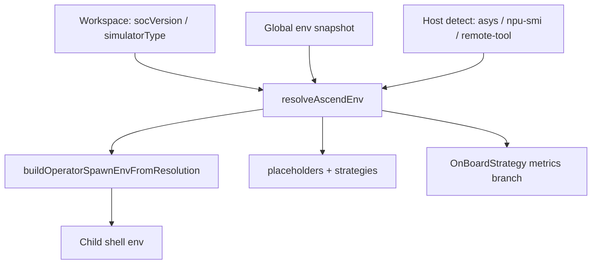

# Atlas A2 / Atlas A3 / Ascend950PR&950DT 系列环境支持——当前实现

本文档说明**插件当前如何处理 Atlas A2 系列、Atlas A3 系列和 Ascend950PR&950DT 系列目标**：统一的解析器、共享的 spawn 契约，以及行为出现分歧的位置。

**权威契约（全平台通用）：**

- [`ascend-env-spec.md`](./ascend-env-spec-zh.md) — 优先级、spawn 环境、占位符、日志  
- [`ascend-a5-support.md`](./ascend-a5-support-zh.md) — Ascend950PR&950DT 系列验证清单与运维注意事项  
- [`workspace-settings.md`](./workspace-settings-zh.md) — `environment.socVersion`、`performanceTuning.simulation.simulatorType`、上板 UI 键

**代码：** [`plugin/src/domain/utils/ascend-util.ts`](../plugin/src/domain/utils/ascend-util.ts)、[`shared/cann-env-constants.ts`](../shared/cann-env-constants.ts)、[`shared/msprof-onboard-env.ts`](../shared/msprof-onboard-env.ts)、[`shared/cann-aclnn-build-defaults.ts`](../shared/cann-aclnn-build-defaults.ts)。

产品中**不存在按系列划分的独立产品模式**。插件解析出一个 **CANN SOC 标识**（`socVersion`），并从该标识（加上工作区覆盖项）推导出仿真器目录、`NPU_ARCH`、ACLNN cmake 输入以及上板性能分析指标。

**本仓库术语**（产品系列遵循 [`ascend-env-spec.md`](./ascend-env-spec-zh.md) §1）：

| 用户 / 硬件标签 | 产品系列 | 主要 CANN 标识 | `isAscendA5ProfilerCannSoc` |
|----------------------|--------|-------------------|-----------------------------|
| Atlas A2 系列 — Ascend 910B、910B3、910A、310P | **Atlas A2 系列** | `ascend910b`（以及 `ascend910`、`ascend310p`） | `false` |
| Atlas A3 系列 — Ascend 910_93xx | **Atlas A3 系列** | `ascend910_93` | `false` |
| Ascend950PR&950DT 系列 — Ascend 950 | **Ascend950PR&950DT 系列** | `ascend950` | **仅**对归一化后的 `ascend950` 为 `true` |

---

## 共享流水线（所有产品系列一致）

所有系列使用相同的入口：

1. **`resolveAscendEnv({ isSimulator })`** — 选定 `socVersion`、`simulatorType`（仅仿真）、`npuArch` 和 `source.*`（[`ascend-env-spec.md`](./ascend-env-spec-zh.md) §7）。
2. **`resolveAscendEnvForOperatorCommand(ctx)`** — 每个算子命令（构建、运行、仿真、上板、sanitizer 等）执行一次解析。
3. **`buildOperatorSpawnEnvFromResolution`** — 仅用于子进程 spawn 环境；扩展宿主**不会**把 `SOC_VERSION` / `NPU_ARCH` 写回 `process.env`。
4. **`operator-script-placeholders`** — `{soc_version}` 始终是 **CANN 标识**；`{simulator_type}` 是 `tools/simulator/` 下的仿真器**目录名**。
5. **模板** — 当缓存未设置/为空时，CANN cmake 读取 `$ENV{SOC_VERSION}`、`$ENV{NPU_ARCH}`（build.sh 会转发 `-DCMAKE_ASC_ARCHITECTURES=${NPU_ARCH}`）；Ascend `add_custom` 在生成时固化 `SUPPORT_*`（见 `plugin/templates/code_template/`）。

**解析输入：** 工作区 `environment.socVersion` 和 `performanceTuning.simulation.simulatorType`（仅显式设置时）、操作系统环境快照（`SOC_VERSION`、`SIMULATOR_TYPE`、`NPU_ARCH`）以及主机检测——见 [`ascend-env-spec.md`](./ascend-env-spec-zh.md) §7。解析器从不查询项目记录。

**激活：** `global-env-snapshot.ts` 在加载时冻结一次宿主 `process.env`；插件从不把 `set_env.sh` source 进扩展宿主。

---

## Atlas A2 / Atlas A3 与 Ascend950PR&950DT —— 详细差异

本节是产品与支持层面的**权威划分**。代码树中的其他部分都是共享基础设施，只是**常量值**或**性能分析/UI 分支**不同。

### 1. 规范字符串

| 概念 | Atlas A2 系列（典型 910B） | Atlas A3 系列（典型 910_93） | Ascend950PR&950DT 系列（典型 950） | 常量 |
|---------|-------------------------|---------------------------|------------------------|-----------|
| CANN SOC 标识（非仿真运行时的 `SOC_VERSION`；`{soc_version}`） | `ascend910b` | `ascend910_93` | `ascend950` | `CANN_SOC_ASCEND_910B`、`CANN_SOC_ASCEND_910_93`、`CANN_SOC_ASCEND_950` |
| 默认仿真器目录（`tools/simulator/<dir>/lib`） | `Ascend910B3` | `Ascend910_9362` | `Ascend950PR_9589` | `SIMULATOR_ASCEND_910B3`、`SIMULATOR_ASCEND_910C`、`SIMULATOR_ASCEND_950PR_9589` |
| AscendC `--npu-arch`（`NPU_ARCH`） | `dav-2201` | `dav-2201` | `dav-3510` | `NPU_ARCH_DAV_2201`、`NPU_ARCH_DAV_3510` |
| ACLNN `SUPPORT_COMPUTE_UNIT`（生成 → ascend 标准自定义 cmake） | `ascend910_95` | `ascend910_95` | `ascend950` | `cann-aclnn-build-defaults.ts` |
| ACLNN `SUPPORT_TILING_DIR` | `arch22` | `arch22` | `arch35` | 同上 |

**不要混淆：** `SOC_VERSION=ascend950`（打包 / `build.sh --soc=`）与 `SUPPORT_COMPUTE_UNIT=ascend950`（op_host 中 ACLNN 的 `SocVersion`）与 `NPU_ARCH=dav-3510`（AscendC）。在 Ascend950PR&950DT 系列上，spawn 环境设置 `SOC_VERSION` + `NPU_ARCH`；`SUPPORT_*` 在算子创建时固化进 cmake。

### 2. 主机检测（芯片规则）

每个扩展会话最多执行一次检测（`asys info -r=status`，然后 `npu-smi info`，然后远程工具系列映射），对归一化后的探测文本进行匹配：先匹配精确芯片规则，再按有序前缀匹配（`Ascend950` → `Ascend910_` → `Ascend910A` → `Ascend910B`）。

| 探测文本示例（非穷举） | 解析出的标识 | 产品系列 |
|--------------------------------------|---------------|--------|
| `Ascend901A/B`、`Ascend910ProA/ProB`、`Ascend910PremiumA`（精确匹配） | `ascend910b`（+ `npuArch=dav-1001`） | Atlas A2 系列 |
| `Ascend910A…`、`Ascend910B…`，如 `Ascend910B3` | `ascend910b` | Atlas A2 系列 |
| `Ascend910_…`，如 `Ascend910_9362`、`Ascend 910_9362 V1` | `ascend910_93` | Atlas A3 系列 |
| `Ascend950…`，如 `Ascend950PR_9589`、`Ascend 950PR_9589` | `ascend950` | Ascend950PR&950DT 系列 |

非 `Ascend*` 标签（例如仅有 Atlas 标签而无芯片名的主机）不匹配——请显式设置 **`environment.socVersion`**。异构多 NPU 主机也需要显式设置工作区 SOC 或仿真器。

### 3. 各命令的 spawn 环境

| 变量 | Atlas A2 系列行为 | Atlas A3 系列行为 | Ascend950PR&950DT 系列行为 |
|----------|-------------------|-------------------|-------------------|
| **`SOC_VERSION`**（非仿真） | CANN 标识，如 `ascend910b` | `ascend910_93` | `ascend950` |
| **`SOC_VERSION`**（仿真类运行） | 仿真器**目录**名，如 `Ascend910B3`（cmake 链接 `tools/simulator/${SOC_VERSION}/lib`） | `Ascend910_9362` | 当 SOC/仿真器解析为 950 时为 `Ascend950PR_9589` |
| **`NPU_ARCH`** | `dav-2201`（精确匹配到 901/Pro/Premium 芯片时为 `dav-1001`） | `dav-2201` | `dav-3510` |
| **`SUPPORT_COMPUTE_UNIT`** | `ascend910_95` | `ascend910_95` | `ascend950` |
| **`SUPPORT_TILING_DIR`** | `arch22` | `arch22` | `arch35` |

`NPU_ARCH` 优先级：工作区 `environment.npuArch`（显式）→ `NPU_ARCH` 环境快照 → 由解析出的 SOC 推导（[`ascend-env-spec.md`](./ascend-env-spec-zh.md) §6）。分支函数：`isAscendA5ProfilerCannSoc(normalizeCannSoc(slug))` —— **仅**精确匹配标识 `ascend950`。

**由仿真器驱动的 SOC：** 如果用户显式设置了工作区 `performanceTuning.simulation.simulatorType`（如 `Ascend950PR_9589`），`simulatorTypeToCannSoc` 会为该次运行推导出 CANN 标识（如 `ascend950`）及其 `NPU_ARCH`，使 SOC 与仿真器不会不一致（[`ascend-env-spec.md`](./ascend-env-spec-zh.md) §4.4、§7）。

### 4. 上板性能分析器（`msprof op` aic-metrics）

在 `profiler-service.ts` → `OnBoardStrategy.getOnBoardMetrics` 中控制，使用命令策略中来自 `resolveAscendEnv({ isSimulator: false })` 的 `onboardCannSoc`。

| 方面 | Atlas A2 / Atlas A3 系列（`ascend910b`、`ascend910_93` 等） | Ascend950PR&950DT 系列（仅 `ascend950`） |
|--------|------------------------------------------------|------------------------------|
| 基础指标集包含**缓存 / 内存详情** | 是 —— `MemoryDetail` | 否 —— `MemoryDetail` 不在基础列表中 |
| 基础指标集包含 **PC 采样** | 否 —— `PCSampling` 不在基础列表中 | 是 —— `PCSampling` 在基础列表中 |
| 何时启用「默认采集所有算子」（`Default` 指标包） | 启用 `Roofline` **或** `MemoryDetail` 时 | 启用 `Roofline` **或** `PCSampling` 时 |
| 共享基础指标 | `Occupancy`、`Roofline`、`Source`、`KernelScale` | 相同 |

**工作区 → 运行时配置**（上板 DAO `ConfigService.getOnBoardConfig(projectPath)`）：

| 工作区键 | 生效条件 | 上板指标 |
|---------------|--------------|-----------------|
| `performanceTuning.onBoard.cacheHeatmap` | **非** Ascend950PR&950DT 系列（`!isAscendA5ProfilerCannSoc`） | `MemoryDetail` |
| `performanceTuning.onBoard.pcSampling` | 仅 Ascend950PR&950DT 系列 | `PCSampling` |

该门控在**读取时**根据生效 SOC（`resolveEffectiveCannSoc()`）应用；为另一代产品存储的设置会被忽略。**新算子默认值**（`config-service.ts` 中的项目创建种子）：当生效 SOC 为 `ascend950` 时，`MemoryDetail: false`、`PCSampling: true`；Atlas A2 / Atlas A3 系列则相反。

**UI：** 上板选项 webview 按系列显示缓存热图与 PC 采样的提示文案（`web/src/views/panels/options-on-board/`）；i18n 位于 `shared/i18n` / `package.nls*.json`。

#### 4.1 仿真性能分析器（`msprof op simulator`）

**所有系列规则相同：** `--soc-version` 始终是来自 `resolveAscendEnv({ isSimulator: true }).simulatorType` 的**仿真器目录**，绝不是 CANN 标识。完整契约：[`ascend-env-spec.md`](./ascend-env-spec-zh.md) §8.1。

| 产品系列 | 典型 `--soc-version` | 典型 CANN 标识（不用于 `--soc-version`） |
|--------|-------------------------|---------------------------------------------|
| Atlas A2 系列（910B） | `Ascend910B3` | `ascend910b` |
| Atlas A3 系列（`910_93`） | `Ascend910_9362` | `ascend910_93` |
| Ascend950PR&950DT 系列（950） | `Ascend950PR_9589` | `ascend950` |

**指标：** `SimulatorStrategy` / `getSimulationAicMetrics(...)` —— **按 SOC 门控**（GC-22 / plugin_release #32）：可选指标在 `SIMULATOR_OPTIONAL_METRIC_SOCS` 中以白名单列出。**Ascend950PR&950DT 系列（`ascend950`）：** `ResourceConflictRatio` 和 `PMSampling` 已通过 §8 CLI 确认——见 [`simulator-options-spec.md`](./simulator-options-spec-zh.md)。Atlas A3 系列（`ascend910_93`）会拒绝 `ResourceConflictRatio`。互斥规则与 PMSampling 追加规则：[`performance.md`](./performance-zh.md)。

### 5. 标准自定义 `.run` 部署

`command-utils.ts` 中的 `getExecutableCommand(..., { execute: true })` 构建 `.run` 包的安装命令：先 `chmod +x`，然后**在运行时探测安装程序自身的 `--help` 输出**，仅当安装程序声明支持时才追加 ` --force`。该检查是按安装程序而非按 SOC 进行的——不存在基于系列的门控。部署路径对所有产品系列相同；标准自定义在 `build_example` 之后的部署通过 `command.ts` 中的 `getStandardCustomDeployCommand` 使用同一个辅助函数。

### 6. 上板配置持久化

上板选项保存在工作区设置中（`performanceTuning.onBoard.*`）；`pcSampling` 与 `cacheHeatmap` 通过 `ConfigService.getOnBoardConfig` 读取，并由 `isAscendA5ProfilerCannSoc(resolveEffectiveCannSoc())` 按 SOC 门控。如果设置是为不同硬件写入的，请手动更新 `performanceTuning.onBoard.*` / `performanceTuning.simulation.*` / `environment.socVersion`（[`ascend-a5-support.md`](./ascend-a5-support-zh.md) §2.3）。

### 7. 有意保持一致的部分

| 领域 | 说明 |
|------|--------|
| 解析器优先级 | 规则相同；只有输出不同（[`ascend-env-spec.md`](./ascend-env-spec-zh.md)） |
| 占位符机制 | 所有算子插件中的 `{soc_version}`、`{simulator_type}` |
| 仿真性能分析器 | `SimulatorStrategy` 为 `msprof op simulator --soc-version` 使用解析出的**仿真器目录**（所有系列）；规范：[`ascend-env-spec.md`](./ascend-env-spec-zh.md) §8.1 |
| PyAsc / Triton | Python 入口；无按系列的 cmake 拆分；性能分析器仍调用 `resolveAscendEnv` 获取传入策略的 SOC |
| CANN 模板 `build.sh` / cmake | 由环境驱动（`$ENV{SOC_VERSION}` / `$ENV{NPU_ARCH}`）；当前模板中没有硬编码的系列字面量 |
| 全部解析失败时的回退 | `DEFAULT_FALLBACK_CANN_SOC` = `''`（为空——不会静默默认到 `ascend910b`） |

### 8. 速查矩阵

| 关注点 | Atlas A2 系列 | Atlas A3 系列 | Ascend950PR&950DT 系列 |
|---------|----------|----------|----------|
| 性能分析器 SOC 门控 | 除 `ascend950` 外任意标识 | 除 `ascend950` 外任意标识 | 仅 `ascend950` |
| 仿真 `msprof --soc-version` | `Ascend910B3`（仿真器目录） | `Ascend910_9362`（仿真器目录） | `Ascend950PR_9589`（仿真器目录） |
| SOC 映射的默认仿真器目录 | `Ascend910B3` | `Ascend910_9362` | `Ascend950PR_9589` |
| NPU 架构 | `dav-2201`（精确匹配 Pro/Premium/901 芯片时为 `dav-1001`） | `dav-2201` | `dav-3510` |
| ACLNN spawn 配对 | `ascend910_95` + `arch22` | `ascend910_95` + `arch22` | `ascend950` + `arch35` |
| 上板「内存」UX | 缓存热图 → `MemoryDetail` | 缓存热图 → `MemoryDetail` | PC 采样 → `PCSampling` |
| `.run` 部署 `--force` | 从安装程序 `--help` 探测 | 相同 | 相同 |

---

## 解析流程（所有系列）

---

## 主要代码位置

| 领域 | 路径 |
|------|------|
| SOC 规则、NPU 架构、spawn 环境、SUPPORT_* | `plugin/src/domain/utils/ascend-util.ts` |
| Ascend950PR&950DT 系列性能分析器 SOC 检查 | `shared/msprof-onboard-env.ts` |
| 共享标识 / 仿真器目录 | `shared/cann-env-constants.ts` |
| ACLNN 计算单元 / tiling | `shared/cann-aclnn-build-defaults.ts` |
| 上板指标矩阵 | `plugin/src/domain/services/profiler-service.ts` |
| 传入性能分析器的上板 SOC | `command-strategy/ascend-strategy.ts`、`cann-strategy.ts`、`python-operator-strategy-shared.ts` |
| 上板配置 DAO + 新算子默认值 | `plugin/src/service/config-service.ts` |
| `.run` 部署命令 | `plugin/src/domain/utils/command-utils.ts` |
| 测试 | `plugin/src/__tests__/unit/operator-spawn-env.spec.ts`、`operator-project-workspace-config-a5.spec.ts`、`command-utils.spec.ts`、`profiler-simulator-resolution.spec.ts` |

---

*最近与 `plugin/src` 和 `shared` 对齐（2026-08）。请在目标硬件上对照已安装的工具包验证 CANN 仿真器目录名和 SOC 标识。*
