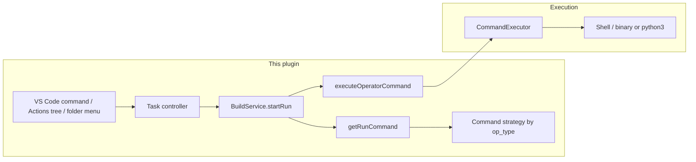
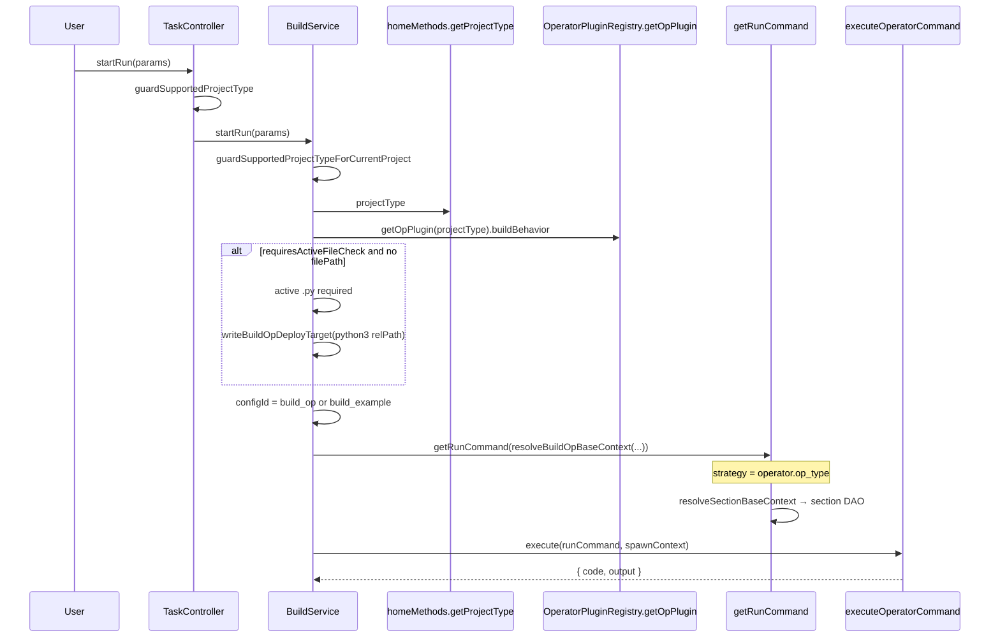

# 运行集成架构

**算子运行**（运行算子）的集成方式：入口、配置选择、命令生成与执行 — 覆盖所有支持的**项目类型**与 **`op_type`**。

**相关文档：** [`build-integration-zh.md`](./build-integration-zh.md)（共享策略、`executeOperatorCommand`）、[`workspace-settings-zh.md`](./workspace-settings-zh.md)（`deployCommandOrRunCommand`）、[`operator-treeview-zh.md`](./operator-treeview-zh.md)（Run 行 — **不**排队）、[`operator-plugin-registry-zh.md`](./operator-plugin-registry-zh.md)（注册表维度）、[`new-project-generation-specification-zh.md`](./new-project-generation-specification-zh.md)（存储的 `project_type` 与 `op_type`）。

---

## 概述

插件**不**自带运行时。它：

- 通过 **`getRunCommand(configId)`** → 命令策略（`getRunTargetFile`、`buildRunCommand`）**构建**运行命令。
- 在 `BuildService.startRun` 中根据 **`OperatorPluginRegistry.getOpPlugin(projectType).buildBehavior`** **选择配置行**（其中 `projectType` 来自 `homeMethods.getProjectType()` — 工作区 `op-devtools.projectType` 或实时检测）。
- 根据算子行的 **`op_type`**（`getRunCommand` 内部的 `CommandStrategyFactory.getStrategy(operator?.op_type)`）**选择 shell 策略**。
- 通过 **`executeOperatorCommand`** 以 `outputLabel: 'run'` **执行**（ascend 环境 + 占位符 + 每次运行的输出通道）。
- 通过 VS Code 命令 → `taskMethods.startRun` **暴露**运行入口（Actions 树 **Run**、PyAsc 的文件夹上下文菜单）。**不**走 `ops` RPC。

**两个维度（不要混淆）：**

| 维度 | 示例 | 在运行中用于 |
|------|----------|-----------------|
| **`project_type`** | `ascend`、`cann`、`pyasc`、`triton`，或检测字符串 `standard-custom`、`ascend-c`、`torch-library` | `build_op` 与 `build_example` 配置 id、活动 `.py` 门控、不支持项目守卫 |
| **`op_type`**（算子记录上） | `ascend`、`cann`、`pyasc`、`triton` | `cdCmd` / `cdBuildCmd`、`getRunTargetFile`、`buildRunCommand` |

经过 **New Project** 或 **Open Project** 初始化后，存储的 `project_type` 通常与某个 **`op_type`** 字符串一致（`cann`、`ascend`、`pyasc`、`triton`）。仅检测到的工作区仍可能报告 `standard-custom`、`ascend-c` 或 `torch-library` — 见[注册表解析](#注册表解析startrun-与侧边栏)。

---

## 协议

| 层 | 职责 |
|-------|------|
| **入口** | `huawei-op-devtools.sidebar.run` → `taskMethods.startRun`；PyAsc 文件夹 **Run** → `folder-context-menu-service`，然后 `startRun({ filePath })` |
| **插件 → shell** | `executeOperatorCommand` → `ProjectManager.getExecutor().execute(runnableCommand, …, { toolOutputLabel: 'run' })` — Ascend 变量以 `export … &&` 形式内嵌在 `runnableCommand` 中，而非 `options.env` |

---

## 运行流程

---

## 项目类型与运行行为

### 汇总表

| 项目上下文 | 初始化后的 `project_type`（[`viewIdToProjectType`](../plugin/src/domain/utils/project-utils.ts)） | 算子上典型的 `op_type` | `startRun` 配置行 | 命令策略 | 运行目标（`getRunTargetFile`） | `buildRunCommand` 中的工作目录 |
|-----------------|--------------------------------------------------------------------------------------------------|-------------------------------|----------------------|------------------|-------------------------------|----------------------------------------|
| **CANN**（New Project 视图 1） | `cann` | `cann` | `build_example` | **cann** | 工作区 `compileAndDeploy.buildConfig.deployCommandOrRunCommand` | `sourceCannCmd` + **`cdBuildCmd`** + `getExecutableCommand(target)` |
| **Standard custom**（视图 2；检测 `standard-custom`） | `ascend` | `cann`（扫描到的集合算子）/ `ascend`（插件创建） | `build_example` | **cann** / **ascend** | 同一个工作区部署键 | `sourceCannCmd` + **`cdBuildCmd`**（cann）或 **`cdCmd`**（ascend）+ `getExecutableCommand(target)` |
| **Ascend C**（检测 `ascend-c`） | `cann` | `cann`（初始化使用 `viewIdToProjectType`） | `build_example` | **cann** | 工作区部署键 | `cdBuildCmd` + 可执行文件 |
| **Torch library**（检测 `torch-library`） | `cann` | `cann` | `build_example` | **cann** | 工作区部署键 | `cdBuildCmd` + 可执行文件 |
| **PyAsc** | `pyasc` | `pyasc` | **`build_op`** | **pyasc** | 工作区部署（`python3 …`），经 `getPythonRunTargetFile` | `sourceCannCmd` + **`cdCmd`** + 规范化 python 命令（无 chmod） |
| **Triton**（`op-devtools.operatorSupport.triton`） | `triton` | `triton` | **`build_op`** | **triton** | 同 PyAsc（工作区部署） | 同 PyAsc |

**编译产物运行（CANN / Ascend / Ascend C / Torch / Standard custom）：** 用户将 **`deployCommandOrRunCommand`** 设置为构建出的二进制或 `.run` 包（通常在**编译示例**之后更新）。`startRun` 传入 **`build_example`** 配置 id，但**可执行文件路径**仍通过 `getRunTargetFile` 来自 **`build_op`** 工作区键 — 而非 `exampleBuildConfig.targetFile` — 设置为空时回退到算子插件默认的 `targetOpFile`（standard-custom / ascend-c 项目为 `build_out/*.run`）。`exampleBuildConfig.targetFile` 供给 **ascend** profiler / msprof 流程（[`workspace-settings-zh.md`](./workspace-settings-zh.md)）；cann profiler 流程读取同一个部署键（见[策略运行组装](#策略运行组装)）。

**Python 运行（PyAsc / Triton）：** 部署目标是同一个工作区键中的 `python3 <path>`；由于 `requiresBuildBeforeAnalysis: false`，`startRun` 使用 **`build_op`** 配置 id。

### 分类型说明

#### CANN（`project_type` / `op_type` = `cann`）

- 插件：`CannPlugin` → `requiresBuildBeforeAnalysis: true`，无活动文件检查。
- 示例构建后运行：将 **`deployCommandOrRunCommand`** 设置为可运行产物（或依赖为 standard-custom `.run` 流程刷新它的构建后辅助 — 见 `command.ts` 中的 `getStandardCustomDeployCommand`）。
- 策略 **`cdBuildCmd`**：`mkdir -p  <op>/build && cd <op>/build` — `-p` 后有两个空格，与源码完全一致 —（算子运行路径来自算子记录的 `op_path`）。

#### Standard custom（存储为 `ascend`；按算子 `op_type` 为 `cann` 或 `ascend`）

- 扫描集合中的算子行携带 **`op_type: cann`**（cann 命令形式 — 从 `cdBuildCmd` 运行，无 ascend 部署尾巴）；插件创建的行携带 **`ascend`**（从 `cdCmd` 运行，带部署尾巴）。`startRun` 遵循算子记录的 `op_type`。
- `.run` 部署包通过 `RUN_FILE=$(find build_out/*.run)` 加 `chmod +x` 和 `--force` 探测执行（`getExecutableCommand`）；运行验证在 `mkdir -p <op>/build && cd <op>/build` 下以 `RUN_FILE` 片段运行（cann 形式）。
- 多算子选择：选中多个算子时 Actions **Run** 被禁用（[`operator-treeview-zh.md`](./operator-treeview-zh.md)）。
- 集合算子共享一个项目；运行使用当前配置行所配置的示例 / 部署目标。

#### Ascend C 与 Torch library

- **检测**类型：`ascend-c`、`torch-library`（[`operator-behavior-specification-zh.md`](./operator-behavior-specification-zh.md)）。
- **Open Project 初始化之后：** `project_type` 存储为 **`cann`**（`viewIdToProjectType`），因此 `startRun` 使用 **CannPlugin** 行为与 **`build_example`**。
- 这些打开方式下由 `generateStructure` 创建的算子使用 **`op_type: cann`**，除非之后被标记为算子 / 模板修改。
- Torch library 可能在初始化时设置 `template_name` / `torch_library_template`；运行管线仍是 CANN 策略 + `build_example`。

#### PyAsc（`pyasc`）

- `requiresActiveFileCheck: true`，`activeFileExtension: '.py'`。
- 没有 `params.filePath` 时：活动编辑器必须是 `.py`；插件通过 `writeBuildOpDeployTarget` 写入 **`python3 <相对工作区根的路径>`**。
- **文件夹菜单（PyAsc 根）：** 先相对算子 `op_path` 更新部署目标，然后 `startRun({ filePath: basename })` 仅为**跳过**活动编辑器检查（命令组装不读取 `filePath`）。
- `buildOpCommand` / `buildExampleCommand` **抛错** — 运行是主要的「执行」路径。
- 特殊错误：缺少 `runtime_camodel` → `build.runFailedPyascRuntime`。

#### Triton（`triton`）

- 与 PyAsc 相同的 Python 运行模型（`build_op`、工作区部署、活动 `.py` 门控）。
- 仅在 **`op-devtools.operatorSupport.triton`** 为 true 时注册。
- `buildBehavior`：插件标志中无 sanitizer / 仿真 / 上板（Actions 树隐藏这些能力）。
- 生成器中的默认部署通常是 `python3 ./<op_name>.py`；用户可在设置中覆盖。

#### 不支持 / 已禁用

- **`guardSupportedProjectTypeForCurrentProject`：** `OperatorPluginRegistry.isProjectTypeSupported(detectedType)` — 未知或空的 `project_type` → 错误提示，运行中止。
- **`multi-project`：** 保留的检测标签；不是常规的单算子运行目标。
- 项目类型不支持或选中多个算子时，Actions **Run** 隐藏或禁用（树规则）。

---

## 注册表解析（`startRun` 与侧边栏）

| API | 使用方 | 解析方式 |
|-----|---------|------------|
| **`getOpPlugin(projectType)`** | **`BuildService.startRun`** | 把 `projectType` 当作 **`op_type`** 键；未知字符串回退到 **`cann`** 插件 |
| **`getBuildBehaviorByProjectType(projectType)`** | **Actions 树**（`OperateTreeProvider`） | 先匹配 **`projectTypeMappings`**（`standard-custom` → CannPlugin，`ascend-c` / `torch-library` → AscendPlugin 等） |

**实际影响：**

- 已注册的 **standard-custom** 项目存储 **`ascend`** → `startRun` 与侧边栏一致（Ascend 插件，`build_example`）。
- **未注册**工作区检测到 **`ascend-c`** 或 **`torch-library`**：侧边栏可能显示 **Ascend** 能力，而 **`startRun`** 在 `projectService.init` 通过 `viewIdToProjectType` 存入 `cann` 之前仍使用 **cann** 回退。
- 记录预期行为时优先采用 **`getProjectTypePlugin` / `getBuildBehaviorByProjectType`** 语义；当前实现中 `startRun` 仍使用 **`getOpPlugin`**。

命令生成始终遵循 **`operator.op_type`** 而非 `project_type`，因此存储的项目类型与算子行之间的不一致只体现在配置 id / UI 门控上，而不体现在 shell 策略类上。

---

## 配置选择与运行时合并

| `buildBehavior.requiresBuildBeforeAnalysis` | 配置行 | 省略时的默认 `configId` |
|---------------------------------------------|------------|--------------------------------|
| `false`（PyAsc、Triton） | `build_op` | `getBuildConfigId()` |
| `true`（Cann、Ascend、默认值） | `build_example` | `getBuildExampleConfigId()` |

运行时合并：`ConfigService` 上的分区类型化 DAO 工厂（`getBuildOpConfig()` / `getBuildExampleConfig()` / `getUtTestConfig()` / `getSimulateConfig(projectPath)` / `getOnBoardConfig(projectPath)` / `getSanitizerConfig(projectPath, op)`），经 `resolveSectionBaseContext` 解析 — 每个 DAO 读取自己的点分 `op-devtools.*` 设置并并入仅缓存字段（[`workspace-settings-zh.md`](./workspace-settings-zh.md)）。

对于 **`build_op`**，`getBuildOpConfig().targetFile` 来自 **`compileAndDeploy.buildConfig.deployCommandOrRunCommand`**。对于 **`build_example`**，`targetFile` 从 `exampleBuildConfig.targetFile` 读取（未设置时为 null）；策略无论如何都通过 **`getRunTargetFile`** → 工作区键读取部署目标。

### 策略运行组装

| 策略 | `getRunTargetFile` | `buildRunCommand` |
|----------|-------------------|-------------------|
| **ascend** | `readBuildOpDeployTargetFromWorkspace()`（回退：插件默认 `targetOpFile` → `build_out/*.run`） | `sourceCannCmd`、**`cdCmd`**、`getExecutableCommand(target, { execute: true, mode: 'run' })` |
| **cann** | 同一个工作区部署键（回退：默认 `targetOpFile` — standard-custom / ascend-c 项目为 `build_out/*.run`） | `sourceCannCmd`、**`cdBuildCmd`**（`mkdir -p  <op>/build && cd <op>/build`）、`getExecutableCommand(target, { execute: true })` |
| **pyasc** / **triton** | `getPythonRunTargetFile` → 工作区部署 | `sourceCannCmd`、**`cdCmd`**、`normalizePythonCommandInterpreter(target)`（解释器来自工作区 / venv / `python.defaultInterpreterPath`） |

Profiler / msprof / sanitizer 的**二进制**路径来自策略各自的 `getProfilerTargetFile`：**ascend** 读取 `exampleBuildConfig.targetFile`（回退 `OperatorPluginRegistry.getDefaultPaths`.targetExampleFile → `build/test_aclnn_<op>`）；**cann** 读取部署工作区键（回退 `.targetOpFile` — standard-custom / ascend-c 项目为 `build_out/*.run`）。

---

## `startRun` 参数（`StartRunParams`）

| 字段 | 说明 |
|-------|-------------|
| `configId` | 可选；否则插件根据插件 **`buildBehavior`** 选择 `build_op` 或 `build_example` |
| `filePath` | 可选；**仅**跳过 `requiresActiveFileCheck`（PyAsc 文件夹菜单）。它本身不选择脚本 — 文件夹菜单会先写入部署目标 |

---

## 组件地图

| 文件 | 职责 |
|------|------|
| `controller/task-controller.ts` | `startRun`、`initProject`、注册表守卫、`clearExecutor` |
| `service/build-service.ts` | `startRun`、`writeBuildOpDeployTarget`、`getRunCommand`、`executeOperatorCommand` |
| `service/folder-context-menu-service.ts` | PyAsc 文件夹运行 → 部署目标 + `startRun({ filePath })` |
| `service/operator-command-executor.ts` | 环境 + 执行 |
| `service/config-service.ts` | 分区 DAO 工厂、部署目标写入 |
| `domain/services/command.ts` | `getRunCommand` |
| `controller/home-controller.ts` | `getProjectType` |
| `domain/plugins/*.plugin.ts` | `buildBehavior`、`projectTypeMappings` |
| `domain/services/command-strategy/*.ts` | 按 `op_type` 的运行命令形态 |

---

## 小结

- **入口：** Actions **Run** / 命令面板 / PyAsc 文件夹菜单 → `taskMethods.startRun`（非动作队列）。
- **配置行：** 来自 **`getOpPlugin(projectType).buildBehavior`**；**shell 策略：** 来自 **`operator.op_type`**。
- **运行目标：** 运行时所有策略都用工作区 **`deployCommandOrRunCommand`**；`exampleBuildConfig.targetFile` 用于 profiler 相关流程。
- **执行：** `getRunCommand` → **`executeOperatorCommand`**（与构建同一套栈）。

---

## 故障排查

### `qemu: uncaught target signal 11 (Segmentation fault)`

通常是**架构不匹配**（x86_64 主机运行 aarch64 构建的二进制）。请在匹配的硬件上运行，或在相同环境中重新构建。

### PyAsc：`cannot find -lruntime_camodel`

将 **`environment.environmentScript`** 设置为你的 CANN `set_env.sh`（[`workspace-settings-zh.md`](./workspace-settings-zh.md)），而不仅是 `/etc/profile`。确保运行环境中安装了 CANN 运行时库。

### 运行无反应 / 「unsupported project type」

通过 **Open Project** 检查工作区 **`op-devtools.projectType`** 设置与实时检测。Triton 需要 **`op-devtools.operatorSupport.triton`**。空或未知的 `project_type` 会无法通过 `isProjectTypeSupported`。

### 二进制或 `python3` 路径错误

更新工作区设置中的 **`compileAndDeploy.buildConfig.deployCommandOrRunCommand`**。PyAsc 侧边栏运行时，确保活动编辑器是 **`.py`**，或对某个 `.py` 文件使用文件夹菜单（菜单会在 `startRun` 之前更新部署目标）。
