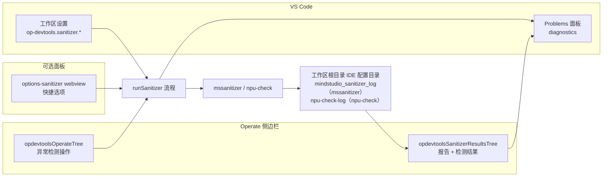
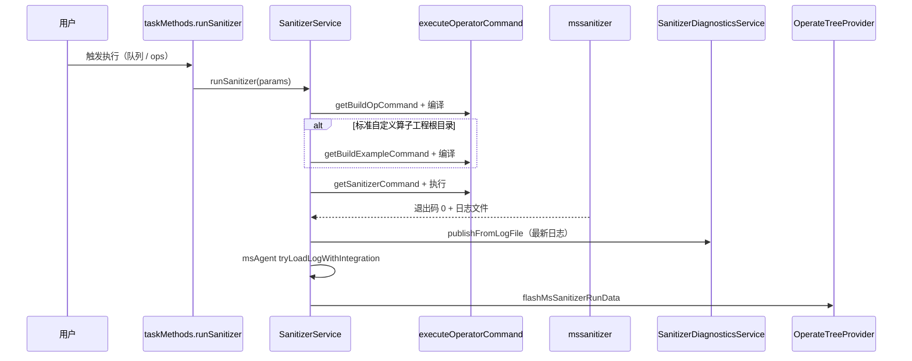

# 异常检测（Sanitizer）架构说明

本文档介绍 **MindStudio Sanitizer**（`mssanitizer` 命令行工具）在Ascend C Toolkits插件中的集成方式（以当前代码的实际实现为准）。插件负责编排构建步骤、执行命令行工具、发现日志文件，并在 **VS Code树视图**和 **Problems（问题）** 面板中展示检测结果，本身**不内嵌**检测引擎。

关于CANN/Ascend的spawn环境（`SOC_VERSION`、`NPU_ARCH`、环境变量脚本加载），参见 [`ascend-env-spec.md`](./ascend-env-spec.md)。关于工作区文件产物（异常检测日志目录），参见 [`generated-files-specification.md`](./generated-files-specification.md)。关于 `op-devtools.sanitizer.*` 配置项及其如何合并为运行时配置，参见 [`workspace-settings.md`](./workspace-settings.md)。

---

## 总体结构

| 分层 | 职责 |
|------|------|
| **CLI** | `mssanitizer`（外部二进制）执行memcheck / race / init检测 |
| **插件** | 前置编译、可选的example编译、命令拼装、Shell执行、日志路径设置 |
| **配置** | 工作区设置（[`workspace-settings.md`](./workspace-settings.md) § Sanitizer）；`.vscode/cache.json` 中的 `fileMapLists.sanitizer` 与 `sanitizerPythonTarget` |
| **结果UI** | 树视图 `opdevtoolsSanitizerResultsTree`（报告列表 → 分组后的检测结果） |
| **Problems** | `SanitizerDiagnosticsService` → `DiagnosticCollection` `op-devtools-sanitizer` |
| **msAgent（可选）** | 参见 [`msagent.md`](./msagent.md) —— 启用后的 `parseLog` / `fixProblem` 桥接 |

异常检测没有侧边栏webview，也不存在 `msSanitizer` ApiServer命名空间。

---

## 工作台布局

- **`opdevtoolsOperateTree`**：操作树中的 **Sanitizer（异常检测）** 主入口（与编译/运行/调试位于同一棵树）。检测行上的齿轮图标会打开按 `op-devtools.sanitizer` 过滤后的工作区设置（而非选项webview）。
- **`opdevtoolsSanitizerResultsTree`**：Operate容器中的独立视图（`%view.sanitizerResultsTree.name%`）。根节点为**报告**（日志文件），展开报告后显示**分组后的检测结果**（按class / severity / type / file分组，用户可选）。

---

## 入口

### 1. 操作树（默认执行路径）

1. 用户在 `opdevtoolsOperateTree` 上执行 **Sanitizer**。
2. 如果 [`sanitizer.showQuickOptions`](./workspace-settings.md#sanitizer-op-devtoolssanitizer) 不为 `false`，先打开 **`options-sanitizer`** webview（`huawei-op-devtools.sanitizerOptions`）；否则通过 `operateTreeProvider.runFlowAction('sanitizer', …)` 直接执行 → **算子操作队列** → `taskMethods.runSanitizer`。
3. 队列：`task-method-dispatch.ts` 中的 `dispatchEnqueueNativeOperatorAction('sanitizer', …)`（算子串行队列，参见 [`operator-treeview.md`](./operator-treeview.md) § Operator action queue）。

### 2. 选项webview（`web/src/views/panels/options-sanitizer/`）

- 通过 **`ops`** API加载/保存表单：`getSanitizerOptions`、`saveSanitizerOptions`、`runSanitizer`（见 `plugin/src/api-routes.ts` → `configMethods`）。
- 点击确认后执行 `runSanitizer({ operatorNames })` 并关闭编辑器；**不使用**独立的 `msSanitizer` API。
- 可以勾选**“不再显示”** → 写入 `sanitizer.showQuickOptions = false`（参见 [`workspace-settings.md`](./workspace-settings.md#sanitizer-op-devtoolssanitizer)）。

### 3. 结果树命令

注册于 `plugin/src/extension.ts`（前缀 `huawei-op-devtools.sidebar.sanitizer.*`），包括：

| 命令 | 作用 |
|---------|------|
| `sidebar.sanitizer.report.select` | 选中报告 → 解析日志 → 填充检测结果子节点 |
| `sidebar.sanitizer.report.add` | 选择外部 `.log` 文件 → `addSanitizerReportFromPath` |
| `sidebar.sanitizer.report.copyPath` | 复制日志路径到剪贴板 |
| `sidebar.sanitizer.report.toggleMark` / `mark` / `unmark` | `RunDataService.toggleSanitizerMark` |
| `sidebar.sanitizer.report.sortTime` | 报告列表按时间升/降序切换（仅在内存中生效） |
| `sidebar.sanitizer.report.filterMarked` / `showAll` | 仅看标记 / 显示全部 |
| `sidebar.sanitizer.results.groupBy*` | 检测结果分组：class、severity、type、file |
| `sidebar.sanitizer.results.hideDuplicates` / `showDuplicates` | 树中检测去重 |
| `sidebar.sanitizer.message.jump.<hash>` | 跳转到源码位置（`performanceDataMethods.jumpToFile`）。基础命令注册在 `extension.ts` 中供菜单项使用；每行检测结果携带一个变体命令，其hash由消息id派生，由 `OperateTreeProvider` 注册 |
| `sidebar.sanitizer.message.aiFix` | 可用时调用 `msAgentBridgeService.fixMsAgentProblem(index)` |
| `sidebar.sanitizer.results.openGroupFile` | 打开file分组节点对应的文件 |

上下文键（示例）：`opDevtools.sanitizerMarkedOnly`、`opDevtools.sanitizerDuplicatesHidden`、`opDevtools.sanitizerResultsGroupBy`、`opDevtools.sanitizerAiFixAvailable`。

### 4. 执行后的刷新

- 命令：`huawei-op-devtools.flashMsSanitizerRunData`
- 实现：`operateTreeProvider.refreshSanitizerReports(revealLatest)` —— **不使用** webview `postMessage`。
- 由 `SanitizerService.runSanitizer` 在成功后调用，`post-activate-bootstrap` 在自动打开工程后也会调用。

---

## 执行流程（`SanitizerService.runSanitizer`）

实现位于 `plugin/src/service/sanitizer-service.ts`。入口：`taskMethods.runSanitizer` → `ProjectManager.initProject()` + `task-controller.ts` 中的executor生命周期。

详细步骤：

1. **解析**异常检测配置 —— `resolveSanitizerBaseContext(projectPath, operatorNames)` → `ConfigService.getSanitizerConfig(projectPath, op)`（仅缓存的 `fileMapLists.sanitizer` 来自 `.vscode/cache.json`）。
2. **编译算子** —— 通过 `executeOperatorCommand` 执行 `getBuildOpCommand(resolveBuildOpBaseContext(projectPath, operatorNames), …)`（spawn环境来自 [`operator-command-executor`](../../plugin/src/service/operator-command-executor.ts) / `resolveAscendEnv`）。
3. **仅标准自定义算子工程** —— 如果工作区根目录识别为 `OperatorProjectType.STANDARD_CUSTOM`，还会**编译example**（`getBuildExampleCommand`）。
4. **`notifyBuildSucceededForSidebar`** —— 适用时更新操作树的编译状态。
5. **确保日志目录存在** —— `joinIdeConfigPath(workspaceRoot, getSanitizerLogDirName(tool))` → `mindstudio_sanitizer_log`（mssanitizer）或 `npu-check-log`（npu-check）（参见[日志文件](#日志文件)）。
6. **执行检测** —— `getSanitizerCommand(sanitizerConfigId, exampleConfigId, operatorNames)`，随后 `executeOperatorCommand`。
7. **成功后**：
   - 通知 `sanitizer.detectionSuccess`
   - 通过 `getLatestSanitizerLogAbsPath` 获取最新的 `mssanitizer_*.log` / `npu-check_*.log`
   - `sanitizerDiagnosticsService.publishFromLogFile`
   - `msAgentBridgeService.tryLoadLogWithIntegration`（如启用）
   - `flashMsSanitizerRunData`（刷新结果树；当前未选中报告时可自动选中最新报告）

**PyAsc：** `PyAscCommandStrategy.buildSanitizerCommand` 会抛出异常 —— pyasc工程不支持异常检测（当工程类型不支持时，操作树应隐藏该功能，参见 `OperatorPluginRegistry` / 流程可见性）。

---

## 命令生成

- **门面：** `plugin/src/domain/services/command.ts` 中的 `getSanitizerCommand`。
- **策略：** `CommandStrategyFactory.getStrategy(operator.op_type)` → ascend / cann / triton上的 `buildSanitizerCommand`（pyasc不支持）。
- **目标二进制：** `strategy.getProfilerTargetFile` —— **ascend** 策略读取 `exampleBuildConfig.targetFile`（工作区设置，回退到 `OperatorPluginRegistry.getDefaultPaths`）；**cann** / **pyasc** / **triton** 读取 `build_op` 的deploy键（[`workspace-settings.md`](./workspace-settings.md#what-is-not-in-workspace-settings)）；可选的 `operatorNames` 会为标准自定义算子重写 `test_aclnn_*` 片段。
- **cann策略**（`cann-strategy.ts`）：拼装 `mssanitizer` 命令，包含 `tool`（`memcheck` / `racecheck` / `initcheck`）、memcheck选项（`leak-check` / `check-unused-memory`）、`log-level`、`max-debuglog-size`、`block-id`、位于 `<workspaceRoot>/<ideConfig>/mindstudio_sanitizer_log/mssanitizer_<ts>.log` 的 `--log-file`，前面加CANN环境加载 + `cdBuildCmd`（`mkdir -p <op>/build && cd <op>/build`）。
- **ascend策略**（`ascend-strategy.ts`）：选项集合相同，`--log-file` 位于同一工作区根目录 `<workspaceRoot>/<ideConfig>/mindstudio_sanitizer_log/mssanitizer_<ts>.log`（读取方只在该目录查找；仅当未知工作区目录时才使用 `operator.op_path`），前面加CANN环境加载 + cd到算子路径（`cdCmd`）。
- **npu-check 命令**（同策略经 `addSanitizerToolOptions`）：`--tool` 取值来自 npu-check 专属工具键——`npumemcheck` / `synccheck` / `npuracecheck` / `npuinitcheck` 映射为 `memcheck` / `synccheck` / `racecheck` / `initcheck`（mssanitizer 的 `memcheck` / `racecheck` / `initcheck` 字段不会泄漏进 npu-check 运行）；`--log-file` 位于 `<workspaceRoot>/<ideConfig>/npu-check-log/npu-check_<ts>.log`。

异常检测行的运行时配置：sanitizer配置DAO `ConfigService.getSanitizerConfig(projectPath, op)` —— 配置键及其映射见 [`workspace-settings.md`](./workspace-settings.md#sanitizer-op-devtoolssanitizer)。仅缓存的字段（如 **`fileMapLists.sanitizer`** 与 **`sanitizerPythonTarget`**）保存在 `.vscode/cache.json` 中。

---

## 配置

Sanitizer与编译相关的配置项：**[`workspace-settings.md`](./workspace-settings.md)**（§ Sanitizer、§ Compile & deploy）。

### `.vscode/cache.json`

- **`sanitizerPythonTarget`** —— 按算子名记录Python目标（pyasc / triton：工程创建时写入 `python3 ./<op>.py`；torch_library：`python ../run.py`）；合并进异常检测配置作为目标文件。
- **`fileMapLists.sanitizer`** —— 额外报告文件的 `{ filePath, reportTime }` 条目（在 `RunDataService.getSanitizerRunData` 中合并）。

### `ops` API（仅webview）

| 方法 | 处理器 |
|--------|---------|
| `ops/getSanitizerOptions` | `configMethods.getSanitizerOptions`（点号形式的 `sanitizer.*` 设置） |
| `ops/saveSanitizerOptions` | `configMethods.saveSanitizerOptions` → `ConfigService.writeOpDevtoolsDottedSettings` |
| `ops/runSanitizer` | `dispatchSanitizer` → 进入队列的 `taskMethods.runSanitizer` |

Sanitizer的编译/运行**不**通过 `ops` 暴露，而是走任务控制器 / 操作树。

---

## 日志文件

| 项目 | 位置 |
|------|----------|
| 目录 | `<workspaceRoot>/<ideConfigDir>/mindstudio_sanitizer_log/` —— cann、ascend、triton策略均写入**工作区根目录**；仅当未知工作区目录时，ascend策略才回退到 `operator.op_path`。`ideConfigDir` 为 `.vscode` 或 `.arts`（`getIdeConfigDirName()`） |
| 新执行 | `mssanitizer_<timestamp>.log`（mssanitizer）/ `npu-check_<timestamp>.log`（npu-check）；报告列表标题即文件名 |
| 执行后的最新日志 | `getLatestSanitizerLogAbsPath(workspaceRoot)` —— 按mtime取最新 |

**报告列表来源**（`RunDataService.getSanitizerRunData`）：

1. `mindstudio_sanitizer_log` 目录下所有 `mssanitizer_<ts>.log` / `npu-check_<ts>.log` 文件（标记保存在 `PermanentStorage` 键 `msSanitizer_marks` 中）。
2. sanitizer缓存 **`fileMapLists.sanitizer`** 中已有的路径（id为 `sanitizer_<filePath>`）。
3. 通过结果树**手动添加**的报告，保存在 `OperateSidebarState.sanitizer.manualReports` 中。

标记持久化在扩展全局存储中（`msSanitizer_marks`），不写入日志文件。

---

## 结果树行为（`OperateTreeProvider`）

状态保存在**操作树** provider实例的 `OperateSidebarState.sanitizer` 上（`reports`、`selectedReportPath`、`selectedMessages`、`sortOrder`、`markedOnly`、`resultsGroupBy`、`hideDuplicates`、`manualReports`）。

**选中报告**（`selectSanitizerReport`）：

1. `sanitizerDiagnosticsService.loadSanitizerPanelData({ path, title, timestamp })`
2. `ExceptionParser.parseAll` → `selectedMessages`（每行携带 `msAgentIndex`，用于AI修复排序）
3. 同一次调用会更新 **Problems** 面板，并在集成开启时触发msAgent `parseLog`
4. 树子节点：分组（`sanitizerClass`）→ 消息（`sanitizerMessage`），带tooltip；当 `opDevtools.sanitizerAiFixAvailable` 时提供内联AI修复

**分组方式：** `class`（error与warning）、`severity`、`type`（问题文案 / i18n标签）、`file`（按路径分组）。**隐藏重复项**基于每个报告缓存的去重键。

**复制报告**仅复制**文件路径**（与性能分析报告复制全部内容不同）。

---

## Problems面板

- **集合：** `op-devtools-sanitizer`（`sanitizer-diagnostics.service.ts`）。
- **更新时机：** 执行成功后（`publishFromLogFile`）以及用户在树中选中报告时（`loadSanitizerPanelData` 同样会发布）。
- **映射：** `ExceptionParser` + `resolveSanitizerSourceFsPath` → 每个源码行一个 `vscode.Diagnostic`；严重级别取自检测结果中的 `type`；`source: 'sanitizer'`。

---

## msAgent（可选）

异常检测与独立的 **msAgent** 插件集成：自动 `parseLog`、检测结果行上的 **AI修复**、`msAgentIndex` 排序。详细说明见 **[`msagent.md`](./msagent.md)**。

---

## 关键源码文件

| 模块 | 路径 |
|------|------|
| 执行编排 | `plugin/src/service/sanitizer-service.ts` |
| 任务入口 | `plugin/src/controller/task-controller.ts`（`runSanitizer`） |
| 队列 / ops派发 | `plugin/src/helpers/task-method-dispatch.ts` |
| 命令拼装 | `plugin/src/domain/services/command.ts`、`command-strategy/*-strategy.ts` |
| 配置 / 设置合并 | `plugin/src/service/config-service.ts` |
| 报告列表 | `plugin/src/service/run-data-service.ts` |
| 树UI | `plugin/src/class/operate-tree-provider.ts` |
| 诊断 | `plugin/src/service/sanitizer-diagnostics.service.ts` |
| 日志解析 | `plugin/src/class/exception-parser.ts` |
| 注册 | `plugin/src/extension.ts`、`package.json`（`opdevtoolsSanitizerResultsTree` 与命令） |
| 选项webview | `web/src/views/panels/options-sanitizer/app.vue`、`web/src/apis/ops.ts` |

---

## 相关文档

| 文档 | 用途 |
|----------|---------|
| [`msagent.md`](./msagent.md) | msAgent桥接、AI修复、索引对应关系 |
| [`build-integration.md`](./build-integration.md) | 共享的编译 / 执行模型（异常检测的前置编译） |
| [`ascend-env-spec.md`](./ascend-env-spec.md) | 编译与异常检测命令的spawn环境 |
| [`workspace-settings.md`](./workspace-settings.md) | 全部 `op-devtools.*` 配置项与运行时合并 |
| [`generated-files-specification.md`](./generated-files-specification.md) | 日志目录生命周期 |
| [`performance.md`](./performance.md) | 仿真 / 上板性能分析与结果树 |
