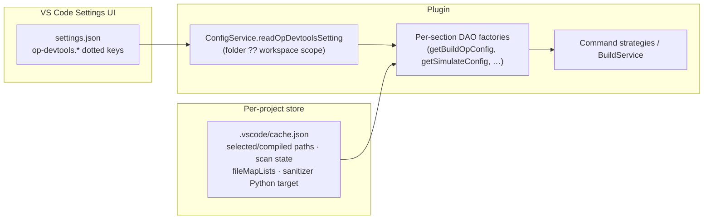

# 工作区设置（`op-devtools.*`）

算子项目在 VS Code 工作区设置中的权威配置参考。

**相关文档：** [`operator-treeview-zh.md`](./operator-treeview-zh.md)（侧边栏齿轮 → 过滤后的设置）、[`sanitizer.md`](./sanitizer.md)、[`performance-zh.md`](./performance-zh.md)、[`ascend-env-spec-zh.md`](./ascend-env-spec-zh.md)（SOC / spawn 环境）。

---

## 这些设置控制什么

工作区设置驱动：

- 构建、运行和调试的**编译脚本**（`build_op`、`build_example`、各流程专用脚本字段）
- `build_op` 的**部署 / 运行目标**（`deployCommandOrRunCommand`）
- Sanitizer 检测选项与编译脚本
- 仿真与上板性能分析选项及分析前编译脚本
- ST 测试的已选模式及按模式排序的 TTK 参数标记
- 环境脚本路径与可选的 SOC 覆盖
- 可选的 **Triton** 算子支持（扩展注册）

当对应的 `showQuickOptions` 设置为 `true`（默认）时，快捷选项 webview（`options-sanitizer`、`options-simulator`、`options-on-board`）保持可用。设为 `false` 则直接从 Actions 树运行，仅使用工作区中的值。ST 总是打开其运行配置面板，因为每次运行都需要确认模式可用性与有序参数。

---

## 运行时模型

| 关注点 | 实现 |
|---------|----------------|
| Schema + 标签 | `package.json`（`contributes.configuration` — 57 个 `op-devtools.*` 属性）、`package.nls.json`、`package.nls.zh-cn.json`、`package.nls.en.json` |
| 读取 / 合并 | [`plugin/src/service/config-service.ts`](../plugin/src/service/config-service.ts) — 分区 DAO 工厂 `getBuildOpConfig`、`getBuildExampleConfig`、`getUtTestConfig`、`getSimulateConfig`、`getOnBoardConfig`、`getSanitizerConfig`，通过 [`plugin/src/domain/services/command.ts`](../plugin/src/domain/services/command.ts) 中的 `resolveSectionBaseContext` 解析 |
| 环境 / 仿真器辅助 | [`plugin/src/helpers/operator-project-workspace-config.ts`](../plugin/src/helpers/operator-project-workspace-config.ts) |
| 构建 / 运行 / 性能分析 | [`plugin/src/service/build-service.ts`](../plugin/src/service/build-service.ts) |
| 项目环境脚本 | [`plugin/src/service/project-service.ts`](../plugin/src/service/project-service.ts) — `syncAscendEnvScriptFromWorkspaceSettings` |
| 写入 `settings.json` | `ConfigService.writeOpDevtoolsDottedSettings`（批量点分键；容忍 JSONC 的读取；无法解析的文件绝不覆盖；原子化临时文件 + 重命名；按路径串行队列；内容差异守卫） |
| `cache.json` | [`plugin/src/helpers/workspace-cache.ts`](../plugin/src/helpers/workspace-cache.ts) — `readWorkspaceCache` / `updateWorkspaceCache` |
| 变更监听 | [`plugin/src/helpers/main-config-watch.ts`](../plugin/src/helpers/main-config-watch.ts) — 单一的 `onDidChangeConfiguration` 处理器 |

### 读取设置

所有读取都经过 `getConfiguredValue()`（[`operator-project-workspace-config.ts`](../plugin/src/helpers/operator-project-workspace-config.ts)）：只有当键在工作区作用域中被显式设置时才会使用 — **工作区文件夹作用域优先于工作区作用域**（`workspaceFolderValue ?? workspaceValue`）；用户/全局作用域被忽略，`null` 视为未设置。值为空白或全空格的脚本键会被忽略（`readNonEmptyOpDevtoolsSetting`）。

### 写入设置

`ConfigService.writeOpDevtoolsDottedSettings` 是 `settings.json` 中 `op-devtools.*` 的唯一写入方：

- **容忍 JSONC 的读取** — 手工编辑的设置文件中 BOM、`//` 注释和尾逗号都是合法的；
- 所有解析尝试均失败的文件**绝不会被覆盖**（从 `{}` 重建会静默破坏用户的其他键；恢复方式是手动修复该文件）；
- **原子写入** — 新内容先写入同级临时文件，再重命名覆盖目标；
- **按路径串行队列** — 并发写入方不会交错出「最后写入者获胜」的状态；
- **内容差异守卫** — 字节完全相同的写入是无操作，可打破 `写入 → 事件 → 写入` 循环；
- 文件中存在的嵌套 `"op-devtools": { … }` 对象在写入时会被扁平化为点分键（已有的点分键优先）。

`.vscode/cache.json` 只通过 `updateWorkspaceCache` 写入（原子化读取-修改-写入，按缓存文件串行）。读取绝不会创建该文件；写入方总是会创建 — 缺失的缓存会被创建，而不会被跳过。损坏或无法解析的 `cache.json` 在读取时会被重命名为 `cache.json.bak`，下一个写入方从全新对象开始。

### 变更监听

单一的 `onDidChangeConfiguration` 处理器（[`main-config-watch.ts`](../plugin/src/helpers/main-config-watch.ts)）响应 `op-devtools.*` 变更：

- 切换 `performanceTuning.onBoard.operatorMetrics` 会写入其子指标键；
- 修改 `operatorSupport.triton` 会提示 **Reload Window**；
- `environment.*` / `operatorSupport` 变更会重新同步 Ascend 环境脚本并刷新侧边栏树视图；
- 任何 `op-devtools.*` 变更都会执行 `writeOpDevtoolsDottedSettings({})` 以规范化点分布局。

### 项目识别

满足以下**至少一个**标记的路径被视为算子项目：

1. 显式的 `op-devtools.projectType` 工作区设置，
2. `.vscode/cache.json` 中 `folders[<normalized-root>]` 下的扫描状态，
3. 项目 IDE 配置目录中的 `devtool_config.json` 标记。

项目类型优先取自设置中的可识别值，否则来自同步的结构化重新检测（`getProjectByPath`，[`project-model.ts`](../plugin/src/domain/models/project-model.ts)）。

### 命令时刻的生效配置

运行时配置是**按需合成**的，而非存储的：`ConfigService` 上每个流程的分区 DAO 工厂直接从以下来源按需构建类型化配置对象：

1. **工作区设置** — 仅该分区的点分 `op-devtools.*` 键。
2. **`.vscode/cache.json`** — 仅数据库字段：`fileMapLists[configType]` → `fileMapList`（simulate / on_board / sanitizer），以及 sanitizer 的 `sanitizerPythonTarget[op]` → `target_file`。
3. **部署/运行目标**（运行时的 `build_op.target_file`）来自 `compileAndDeploy.buildConfig.deployCommandOrRunCommand`（当用户选择某个活动 `.py` 时也可通过 `ConfigService.writeBuildOpDeployTarget` 写入）。
4. **Profiler / msprof 二进制路径**（上板/仿真的 `build_example.target_file`）来自 `compileAndDeploy.exampleBuildConfig.targetFile`，回退到 `OperatorPluginRegistry.getDefaultPaths` — 而不是 `deployCommandOrRunCommand`。

各流程的编译键（`compileCommand`、`sanitizerCompileCommand`、`onBoardCompileCommand`、`simulationCompileCommand`、`utTestCompileCommand` 等）与对应的 `config_type` **一一对应**；sanitizer/simulation/on-board 键**不会**回退到 `compileCommand`。

### 新项目的默认值

`ConfigService.ensureOpDevtoolsSettingsSeeded(projectPath, …)` 直接根据 `OperatorPluginRegistry.getOpPlugin(op_type).getInitialConfigScripts()` / `getDefaultPaths()` 为新项目预置默认脚本字符串和默认路径，以点分工作区键持久化。预置是**按键级「不存在才创建」**（幂等）：`settings.json` 中已存在或在配置层中显式设置的键保持不变，因此用户值永远优先。工作区级目标键仅为单算子项目预置；在多算子工作区中它们保持为空，运行时对每个子算子应用 `getDefaultPaths(op)` 回退。

---

## 打开设置

| 入口 | 行为 |
|-------|----------|
| 标题栏 **Project config** | `huawei-op-devtools.sidebar.projectConfig` — 打开按本扩展过滤的 Settings |
| Sanitizer 齿轮（Actions 树） | `@ext:huawei.huawei-op-devtools-vscode-plugin op-devtools.sanitizer` |
| 上板齿轮 | `… op-devtools.performanceTuning.onBoard` |
| 仿真齿轮 | `… op-devtools.performanceTuning.simulation` |

---

## 设置分类

所有键使用 `op-devtools.` 前缀，并在 `package.json` 中以**独立**配置分类贡献（而非一个合并对象）— 共 57 个属性。

有一个键**未**在 `package.json` 中声明：`op-devtools.projectType`（字符串）— 记录项目类型的内部工作区键。它由项目创建/打开及工作区检测写入，是项目识别标记之一（见[项目识别](#项目识别)）。

### 算子支持（`op-devtools.operatorSupport`）

| 键 | 类型 | 默认值 | 效果 |
|-----|------|---------|--------|
| `operatorSupport.triton` | boolean | `false` | 启用后在激活时注册 `TritonPlugin`；修改它会提示 **Reload Window**。 |

### 编译与部署（`op-devtools.compileAndDeploy`）

该分类还包含扩展级的 **`op-devtools.debugMode`**（boolean，默认 `true`）— 结合注册表能力控制 NPU 调试行的可见性。

#### `buildConfig` — 映射到 `build_op` 与各流程脚本字段

| 设置键 | 运行时字段 | 使用方 |
|-------------|---------------|---------|
| `buildConfig.operatorNameToCompile` | `build_op.op` | 算子解析：侧边栏选择优先，此键为回退（`operatorNames?.first \|\| config.op`） |
| `buildConfig.deployCommandOrRunCommand` | `build_op.target_file` | 运行 / 部署（非 msprof profiler 二进制） |
| `buildConfig.compileCommand` | `build_op.script` | 算子构建 |
| `buildConfig.utTestCompileCommand` | `ut_test.script` | UT 测试动作 |
| `buildConfig.cpuDebugCompileCommand` | `build_op.cpu_debug_script` | CPU 调试预构建 |
| `buildConfig.npuDebugCompileCommand` | `build_op.npu_debug_script` | NPU 调试预构建 |
| `buildConfig.sanitizerCompileCommand` | `sanitizer.script` | Sanitizer 预构建 |
| `buildConfig.onBoardCompileCommand` | `on_board.script` | 上板预构建 |
| `buildConfig.simulationCompileCommand` | `simulate.script` | 仿真预构建 |
| `buildConfig.genOpCommand` | — | 在 standard-custom 项目中生成算子的命令模板；可被工作区覆盖（默认 `bash build.sh --genop={path}/{operatorname}`） |

CPU/NPU 调试脚本设置仅在项目类型与 `OperatorPluginRegistry` 支持对应调试模式时生效（见 [`debug-integration-zh.md`](./debug-integration-zh.md)）。

**Ascend standard-custom 编译脚本**：由 `AscendPlugin.getInitialConfigScripts()` 预置，在 `compileCommand`、调试脚本、UT、上板、仿真和 sanitizer 编译字段中包含 `--ops={operatorNames}`。运行时，`applyOperatorNamesPlaceholder()`（[`build-integration-zh.md`](./build-integration-zh.md#operatornames-and---ops-compile-scripts)）会替换为所选算子名，或在未选择时移除该标记。当已选择算子名但脚本中没有字面量 `--ops` 标志时，会追加 `--ops={names}` — 仅针对 standard-custom ascend 风格编译行（包含 `--vendor_name=custom`、`--pkg` 或 `--soc=… -u` 的脚本）。

#### `exampleBuildConfig` — 映射到 `build_example`

| 设置键 | 运行时字段 | 说明 |
|-------------|---------------|--------|
| `exampleBuildConfig.executionMode` | `execution_mode` | 枚举：`eager` \| `graph` |
| `exampleBuildConfig.runCommand` | `script` | 基础示例构建脚本；策略会追加算子名、模式、打包模式 |

与 Ascend/CANN 的**运行**及示例构建流程相关（不涉及 PyAsc/Triton 的 `build_op` 运行路径）。

### ST 测试（`op-devtools.stTest`）

这些资源作用域的值持久化在所选算子的工作区文件夹中。运行面板会根据 `tests/st/arch35` 下当前可用的 CSV 文件过滤已保存的模式。

| 设置键 | 类型 | 默认值 | 效果 |
|-------------|------|---------|--------|
| `stTest.selectedModes` | `string[]` | `['kernel']` | 面板打开时选中的模式；已失效的不可用模式被忽略。 |
| `stTest.kernel.arguments` | `string[]` | `['-d=false', '-b=release', '--pc=8']` | 按序追加到 `python -m ttk kernel` 的参数标记。 |
| `stTest.aclnn.arguments` | `string[]` | `[]` | 按序追加到 `python -m ttk aclnn` 的参数标记。 |
| `stTest.e2e.arguments` | `string[]` | `[]` | 按序追加到 `python -m ttk e2e` 的参数标记。 |

每个数组元素是一个参数标记，而不是 shell 片段。空值、控制字符、超长，以及扩展接管的 `-i`/`--input`、`-o`/`--output` 或 `--plugin` 标记（包括拼接/赋值形式）会在设置被修改或动作入队之前被拒绝。这些路径归扩展所有，扩展会在最终命令边界对每个接受的标记做 shell 转义。确切的命令会在进程输出之前打印到 `st test` 输出通道。

### Sanitizer（`op-devtools.sanitizer`）

| 设置键 | 运行时选项 | 说明 |
|-------------|----------------|--------|
| `sanitizer.showQuickOptions` | — | `true`（默认）：Actions **Sanitizer** 打开快捷选项 webview；`false`：立即排队执行 |
| `sanitizer.memory` | `tool.memcheck` | |
| `sanitizer.memoryLeak` | `memcheckOption['leak-check']` | 在启用内存检测时有意义 |
| `sanitizer.allocUnused` | `memcheckOption['check-unused-memory']` | |
| `sanitizer.race` | `tool.racecheck` | |
| `sanitizer.uninitialized` | `tool.initcheck` | |
| `sanitizer.reportLogLevel` | `logLevel` | `info` \| `warn` \| `error` |
| `sanitizer.maxSingleLogFileSize` | `maxDebuglogSize` | MB，1–10240 |
| `sanitizer.detectionScope` | `useBlock` | `global` → `false`；`singleBlock` → `true` |
| `sanitizer.blockId` | `blockId` | 单 block 作用域时为 0–200 |
| `sanitizer.enableMsAgentAiFix` | — | 在 sanitizer 结果行上的 msAgent AI 修复（[`msagent-zh.md`](./msagent-zh.md)） |

编译脚本：`compileAndDeploy.buildConfig.sanitizerCompileCommand` → `sanitizer.script`。

### 性能调优（`op-devtools.performanceTuning`）

#### 仿真（`performanceTuning.simulation.*`）

| 设置键 | 运行时选项 | 说明 |
|-------------|----------------|--------|
| `simulation.showQuickOptions` | — | 默认 `true`；`false` → 从 Actions 树直接运行仿真 |
| `simulation.simulatorType` | `simulatorType` | `tools/simulator/` 下 CANN 仿真器的**目录名**；驱动 `msprof op simulator --soc-version` 与 `getWorkspaceSimulatorType()`（[`ascend-env-spec-zh.md`](./ascend-env-spec-zh.md) §8.1） |
| `simulation.memoryThroughputWaveform` | `PMSampling` | |
| `simulation.resourceConflictRatio` | `ResourceConflictRatio` | |
| `simulation.parameters` | `advance_param` | 对象映射 → `[{ name, value }]` |

预构建脚本：`compileAndDeploy.buildConfig.simulationCompileCommand`。

#### 上板（`performanceTuning.onBoard.*`）

| 设置键 | 运行时选项 | 说明 |
|-------------|----------------|--------|
| `onBoard.showQuickOptions` | — | 默认 `true`；`false` → 直接上板运行 |
| `onBoard.interCoreLoad` | `Occupancy` | |
| `onBoard.roofline` | `Roofline` | |
| `onBoard.operatorCodeHotspot` | `Source` | |
| `onBoard.cacheHeatmap` | `MemoryDetail` | 仅非 Ascend950PR&950DT 系列的 profiler SOC |
| `onBoard.pcSampling` | `PCSampling` | 仅 **Ascend950PR&950DT 系列** profiler SOC（`isAscendA5ProfilerCannSoc`） |
| `onBoard.operatorMetrics` | `operatorMetrics`（批量开关） | 切换时通过 `writeOpDevtoolsDottedSettings` 写入所有指标子键 |
| `onBoard.cubeAndVectorInstructionTimeAndRatio` | `ArithmeticUtilization` | 批量开关的子项 |
| `onBoard.l2CacheHitRate` | `L2Cache` | |
| `onBoard.memoryReadWriteBandwidth` | `Memory` | |
| `onBoard.l0ReadWriteBandwidth` | `MemoryL0` | |
| `onBoard.ubReadWriteBandwidth` | `MemoryUB` | |
| `onBoard.computeAndMoveUnitTimeRatio` | `PipeUtilization` | |
| `onBoard.resourceConflictRatio` | `ResourceConflictRatio` | |
| `onBoard.enableKernelCodeSegmentProfiling` | `KernelScale` | 启用时要求 kernel 中有 MetricsProfStart/Stop |
| `onBoard.parameters` | `advance_param` | 对象映射 → `[{ name, value }]` |

预构建脚本：`compileAndDeploy.buildConfig.onBoardCompileCommand`。

Ascend950PR&950DT 系列指标矩阵详情：[`ascend-a5-support-zh.md`](./ascend-a5-support-zh.md)。

### 环境（`op-devtools.environment`）

| 设置键 | 运行时用途 |
|-------------|-------------|
| `environment.environmentScript` | 项目的 `ascend_env_script`；schema 默认值 `/etc/profile`。显式空值与未设置的区分由 `getConfiguredEnvironmentScriptPath` / `getAscendEnvScriptWithWorkspaceOverride` 处理。 |
| `environment.socVersion` | 设置后覆盖已存的项目 SOC；传入 `resolveAscendEnv` / spawn 环境（[`ascend-env-spec-zh.md`](./ascend-env-spec-zh.md)）。 |
| `environment.npuArch` | 覆盖由 SOC 派生的 `NPU_ARCH`（如 `dav-2201`、`dav-3510`）；到达 spawn 导出、终端环境及 `cmake -DCMAKE_ASC_ARCHITECTURES=`（[`ascend-env-spec-zh.md`](./ascend-env-spec-zh.md) §6）。 |
| `environment.insightPath` | insight 服务使用的 Insight 数据查看器安装路径；未设置时在首次激活时写入工作区。 |

### 执行（`op-devtools.execution`）

| 设置键 | 类型 | 默认值 | 效果 |
|-------------|------|---------|--------|
| `execution.commandTimeoutSeconds` | number | `1800` | spawn 的算子命令超时时间；超时的运行会被终止（错误信息会指向此键）。 |

---

## 不在工作区设置中的内容

| 项目 | 所在位置 |
|------|----------------|
| 按算子的 JSON 覆盖编辑器 | 未暴露（Settings UI 中没有可编辑的覆盖映射） |
| Profiler 二进制路径（默认） | `compileAndDeploy.exampleBuildConfig.targetFile` 工作区设置；回退 `OperatorPluginRegistry.getDefaultPaths` |
| 已选 / 已编译算子路径、按文件夹的扫描状态、`fileMapList`、sanitizer Python 目标 | `.vscode/cache.json` |
| `op-devtools.debugMode` | 扩展设置（UI 中与编译同一分类块） |
| Sanitizer 日志路径 / 报告列表 | 工作区产物 + 内存中的树状态（[`sanitizer.md`](./sanitizer.md)） |

---

## 源文件

- `package.json` — `contributes.configuration`
- `plugin/src/service/config-service.ts` — 分区 DAO 工厂、读取、写入、预置
- `plugin/src/helpers/operator-project-workspace-config.ts` — 环境 / 仿真器 / 作用域辅助，`getConfiguredValue`
- `plugin/src/helpers/ide-settings-persist.ts` — 受保护的 `settings.json` 写入（JSONC 容忍、原子性、内容差异）
- `plugin/src/helpers/workspace-cache.ts` — `.vscode/cache.json` 读取/更新
- `plugin/src/helpers/main-config-watch.ts` — 单一的 `onDidChangeConfiguration` 处理器
- `plugin/src/domain/services/command.ts` — `resolveSectionBaseContext` / 基础上下文解析
- `plugin/src/domain/utils/operator-script-placeholders.ts` — `applyOperatorNamesPlaceholder`
- `plugin/src/domain/models/project-model.ts` — `getProjectByPath` 项目识别
- `plugin/src/service/build-service.ts`、`project-service.ts`
- `web/src/views/panels/options-sanitizer/`、`options-simulator/`、`options-on-board/` — 可选的快捷选项 UI
