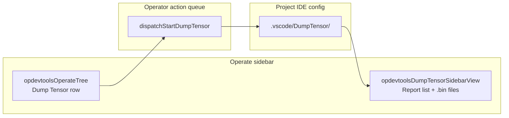
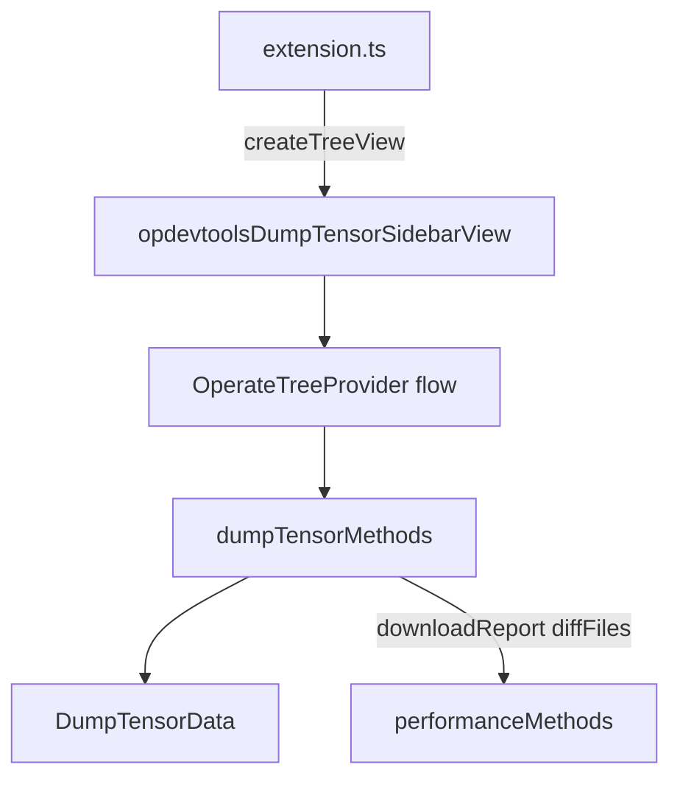

# Dump tensor — architecture

This document describes how **DumpTensor** is integrated in Huawei OP DevTools **as implemented today**: queued runs from the Actions tree, `.bin` import, output under the IDE config directory, and a **native VS Code tree** for browsing and comparing results.

For build/run orchestration (`startDumpTensor`, `show_kernel_debug_data`), see [`build-integration.md`](./build-integration.md) § DumpTensor Behavior Note. For sidebar tree patterns shared with sanitizer/performance, see [`operator-treeview.md`](./operator-treeview.md). For the shared download/diff helpers, see [`performance.md`](./performance.md).

---

## Overview

| Layer | Responsibility |
|-------|----------------|
| **CLI / tooling** | `build_op`, example build or run with `ASCEND_DUMP_PATH`, `show_kernel_debug_data` |
| **Plugin** | Queue dump-tensor runs, import `.bin`, scan output, native TreeView UI |
| **Storage** | `<project>/<ideDir>/DumpTensor/<report-key>/` (`.bin` leaves; companion `.txt` for diff/open) |
| **Results UI** | Native tree **`opdevtoolsDumpTensorSidebarView`** (reports → folders → `.bin` files) |
| **Compare** | Select two `.bin` files → `vscode.diff` on companion `.txt` files |

There is **no** dump tensor sidebar webview (the former `dump-tensor-data` panel view and its `open-dump-tensor-panel-view` command are gone) and **no** `webview/getDumpTensorData` / `ops/importDumpTensorBinFile` / `performance/diffFiles` RPC.

View ID is flavor-safe via `DUMP_TENSOR_SIDEBAR_VIEW_ID` in `shared/flavor/generated.ts` (e.g. `opdevtoolsDumpTensorSidebarView`).

---

## Workbench layout

- **`opdevtoolsOperateTree`**: **Dump Tensor** row (`nodeId === 'dumpTensor'`) **enqueues** a dump-tensor run. The click itself does not open or focus the results tree.
- **`opdevtoolsDumpTensorSidebarView`**: separate view (`%view.dumpTensorResultsTree.name%`) in the same `mindstudio-opssuite-vscode-plugin` container as the sanitizer/performance results trees, gated by `opDevtools.showOperateTree`. Report rows live here only.

---

## Data model

### On disk

- Root: `joinIdeConfigRelative('DumpTensor')` → typically `<project>/.vscode/DumpTensor/` (`.arts` in CodeArts IDE).
- Each **report** is a subdirectory (key = folder name; title = folder name, timestamp from directory `ctime`).
- Tree leaves are **`.bin` files** only (nested folders supported; empty folders are pruned). Opening or comparing uses the companion **`.txt`** file (`file.bin` → `file.txt`).

### In memory (`OperateTreeProvider.state.dumpTensor`)

| Field | Purpose |
|-------|---------|
| `reports` | Loaded execution records from `DumpTensorData` |
| `sortOrder` | `asc` / `desc` by timestamp (in-memory resort, no rescan) |
| `markedOnly` | Filter to marked reports |
| `selectedReportKey` | Expand/reveal target |
| `compareMode` | Two-file compare UI active |
| `compareSelectedFilePaths` | Up to two `.bin` paths (labels show `(1/2)`, `(2/2)`) |

Mark persistence: `PermanentStorage` key `marked_dump_tensor_records` in `DumpTensorData` (same pattern as performance marks).

---

## Architecture

One `OperateTreeProvider` instance (`kind: 'flow'`) owns dump tensor state, node builders, and `onDidChangeDumpTensorTreeData` — a change-event family separate from the flow tree and from the performance results tree, so a dump tensor refresh does not repaint the other views. `extension.ts` registers a thin adapter `TreeDataProvider` that delegates roots to `getDumpTensorResultsPanelNodes()` and children to shared `getChildren()` for `dumpTensorReportItem` / `dumpTensorFolder`.

| Piece | Path |
|-------|------|
| Data scan + marks | `plugin/src/service/dump-tensor-service.ts` |
| Controller | `plugin/src/controller/dump-tensor-controller.ts` |
| Tree state + nodes | `plugin/src/class/operate-tree-provider.ts` |
| Command wiring | `plugin/src/extension.ts` |
| Command arg decoding | `plugin/src/helpers/report-command-key.ts` |
| Zip download helper | `plugin/src/service/file-service.ts` (`saveFileToLocal`) via `performance-data-controller.ts` |
| Build / import | `plugin/src/service/build-service.ts` |
| Manifest | `package.json` → `views`, `menus` |

`dumpTensorMethods` delegates `downloadReport` and `diffFiles` to `performanceMethods` in `performance-data-controller.ts` (in-process).

---

## Entry points

### 1. Actions tree — enqueue run

| Action | Tree node | Queue type | Runner |
|--------|-----------|------------|--------|
| Dump tensor | `dumpTensor` | `dumpTensor` | `dispatchStartDumpTensor` → `taskMethods.startDumpTensor` → `BuildService.startDumpTensor` |

Command: `huawei-op-devtools.sidebar.dumpTensor`. Same queue rules as sanitizer/simulation/on-board (see [`operator-treeview.md`](./operator-treeview.md) § Operator action queue). Multi-operator selection disables the row (single-operator only).

On success, `BuildService.finalizeDumpTensorFlow` calls `refreshDumpTensorResults({ focusIfNew: true })` → `huawei-op-devtools.flashDumpTensorData` → `operateTreeProvider.refreshDumpTensorReports`.

### 2. Import `.bin` file

| Entry | Command |
|-------|---------|
| Title bar `+` on dump tensor view | `huawei-op-devtools.importDumpTensorBinFile` |
| Explorer context (`.bin`) | Same command |

Flow: explorer URI or file picker → `taskMethods.importDumpTensorBinFile` → `buildService.importDumpTensorBinFile` → `show_kernel_debug_data` → `flashDumpTensorData` with `{ focusIfNew: true }`.

Import is registered as `huawei-op-devtools.importDumpTensorBinFile` in `extension.ts`; invoked without a URI it opens a `.bin` file picker.

### 3. Post-activate bootstrap

`post-activate-bootstrap.ts` calls `refreshDumpTensorReports()` alongside sanitizer and performance when auto-opening a workspace project.

---

## Tree structure

| `nodeId` | Children | Notes |
|----------|----------|-------|
| `dumpTensorReportItem` | Folders / `.bin` files | Marked/unmarked `contextValue`; stable `id`: `dump-tensor-report:<encoded-key>` |
| `dumpTensorFolder` | Nested folders / files | `id`: `dump-tensor-folder:<reportKey>:<encoded-segments>` |
| `dumpTensorFile` | — | `.bin` only in UI; `contextValue` `dumpTensorFile.bin` |

Without visible reports the tree shows a single placeholder row (`web.dump.noData`) without inline actions.

**Open file** (`sidebar.dumpTensor.file.open`): in compare mode, toggles selection; otherwise opens companion `.txt` via `vscode.open` (error toast when the `.txt` is missing).

**Copy path** (`sidebar.dumpTensor.report.copyPath`): copies report `dirPath` to clipboard (not directory contents).

**Download** (`sidebar.dumpTensor.report.download`): zips report directory via `downloadReport`.

**Mark / unmark** (`sidebar.dumpTensor.report.mark` / `.unmark`): flips the row optimistically, persists through `DumpTensorData`, and reverts with an error toast (`web.dump.markFailed`) when persistence fails.

---

## Compare workflow

Two ways to enter compare mode:

1. **Title bar** `sidebar.dumpTensor.compare` → empty selection, pick two files in tree (click rows).
2. **Context menu** `sidebar.dumpTensor.file.compareWith` on a `.bin` row → `beginDumpTensorCompareWithFile(path)` pre-selects file as `(1/2)`.

Context key `opDevtools.dumpTensorComparing` toggles title-bar buttons (compare / start / cancel).

| Step | Command | Effect |
|------|---------|--------|
| Start compare | `sidebar.dumpTensor.compare` or `file.compareWith` | `compareMode = true` |
| Select files | Click `.bin` rows or second compare action | Up to 2 paths in `compareSelectedFilePaths` |
| Run diff | `sidebar.dumpTensor.compare.start` | `diffFiles` on `.txt` companions; exit compare mode |
| Cancel | `sidebar.dumpTensor.compare.cancel` | Clear selection and compare mode |

**Intended path after Compare with…:** Compare with on file A → click file B in tree → **Compare start**.

Using **Compare with…** twice in a row resets the selection to the second file only (does not auto-diff).

Starting with fewer than two selected files warns (`web.dump.selectTwoFiles`); selecting a third file warns (`web.dump.maxSelectCount`).

---

## Commands and menus

Primary wiring in `package.json`:

| Location | Examples |
|----------|----------|
| `view/title` | Import `+`, compare / start / cancel, sort time, marked filter |
| `view/item/context` | Copy path, download, mark/unmark (`inline@3`–`5`), open file (`navigation@1`), compare with (`navigation@2`, `.bin` only) |
| `explorer/context` | Import `.bin` |

All `sidebar.dumpTensor.*` commands are registered in `extension.ts` and call methods on `operateTreeProvider` / `dumpTensorMethods`.

---

## Refresh triggers

| Event | Effect |
|-------|--------|
| Dump-tensor queue run completes | `finalizeDumpTensorFlow` → `refreshDumpTensorReports({ focusIfNew: true })` |
| Import `.bin` succeeds | `flashDumpTensorData` with `focusIfNew` |
| Post-activate bootstrap | Initial `refreshDumpTensorReports()` |
| Workspace / project switch | `refreshState` carries the dump tensor slice forward (reset only when the devtool config disappears) and fires the results-tree change event |
| User sort / filter / mark | Mutate state + `onDidChangeDumpTensorTreeData` |

`focusIfNew` reveals the newest report when exactly one new key appears (or first load with a single report). First load with **multiple** existing reports does not auto-reveal (same rule as performance).

`revealDumpTensorReport` focuses `DUMP_TENSOR_SIDEBAR_VIEW_ID` and expands the report node.

**Failure and concurrency:** an unexpected scan error preserves the last valid inventory (it is not cleared), and an older overlapping refresh cannot overwrite the newest requested snapshot. Sort/filter/mark are in-memory only — there is no automatic watcher or polling, and no `postMessage` refresh.

---

## Key files

| Area | File |
|------|------|
| Tree model | `plugin/src/class/operate-tree-provider.ts` |
| Views + commands | `plugin/src/extension.ts` |
| Data service | `plugin/src/service/dump-tensor-service.ts` |
| Controller | `plugin/src/controller/dump-tensor-controller.ts` |
| Build / import | `plugin/src/service/build-service.ts` |
| Tests | `plugin/src/__tests__/unit/operate-tree-dump-tensor.spec.ts`, `dump-tensor-service.spec.ts`, `dump-tensor-controller.spec.ts` |

---

## Related documentation

| Topic | Document |
|-------|----------|
| Actions tree + operator queue | [`operator-treeview.md`](./operator-treeview.md) |
| Build / `show_kernel_debug_data` | [`build-integration.md`](./build-integration.md) |
| Shared download/diff helpers | [`performance.md`](./performance.md) |
