# 基于Tensor API的Matmul算子流水优化（多基本块搬运与Double Buffer）

> **来源**：本文集成自 [matmul_tensor_api_pipeline_opt.md](https://gitcode.com/hyolee/hyolee-docs/blob/main/matmul_tensor_api_pipeline_opt.md)（hyolee-docs 仓库），文中配套数据分析脚本（`npu_results/plot_pipetrace.py` 可视化、`scripts/npu_stats.py` 统计分析）可在原仓库获取。本插件已集成 npu-compute 作为上板分析工具，插件侧的采集与报告查看操作见《[使用操作文档](./user_guide.md)》性能分析章节；本文聚焦采集数据之后的性能分析方法与算子流水优化实践。
>
> **说明**：本文中 npu-compute 采集数据均为 **Ascend950PR&950DT系列产品真机实测数据**（CANN 9.3.0，Ascend950PR 芯片，16 个 Cube 核），算子实现已通过 npu/仿真两种模式编译，仿真与真机运行均通过精度验证（`test pass!`，误差率 0.0000）。受采集插桩（PMU 计数采样）影响，PipeTrace.json 中 MTE2/Fixpipe 单条忙碌区间的绝对时长相对 PMU 统计存在展宽，因此判断流水形态（串行/重叠、相对时序）以 PipeTrace 为准，比较绝对时长以 PipeUtilization.csv 的 PMU 统计为准；文中流水时间线图（图2、图4）基于真实 PipeTrace.json 数据绘制。文中操作截图（截图1~截图7）均为真机采集与对真实数据的实际运行输出，数据提取与计算命令由配套脚本 `npu_results/plot_pipetrace.py`（可视化）与 `scripts/npu_stats.py`（分析）提供，全部可复现。

## 1. 案例介绍

### 1.1 算子介绍

Tensor API 是 Ascend C 中以 Tensor 与 Layout 为一等公民的算子开发接口：开发者通过 `make_tensor`、`make_frame_layout` 描述各级存储上的张量及其布局后，`copy`、`mmad` 等接口即可依据 Layout 自动推导搬运块数、步长与计算规模，并随路完成 ND、NZ、ZN 等格式转换。数据流与同步的编排权完全交给开发者——基本块大小、缓冲区归属与搬运节奏均可深度定制，而各级搬运与计算流水能否时间重叠，也取决于开发者组织缓冲与同步的方式。

本案例使用 Tensor API 实现如下规格的多核 Matmul 算子，完整记录从基线实现、npu-compute 采集、瓶颈定位到流水优化与复测验证的全过程。优化手段严格限定为两项：**多基本块搬运**与 **Double Buffer（双缓冲）**；优化前后算子规格、Tiling 参数与多核切分方式完全一致，使性能差异可归因于流水编排本身。基线与优化版本的整体实现方案分别见图1与图3。

**表1** 算子规格

| 输入/输出 | Shape | Data type | Format |
|---|---|---|---|
| a | 512, 512 | float16 | ND |
| b | 512, 1024 | float16 | ND |
| c | 512, 1024 | float16 | ND |

输入输出均为 half（fp16）：L0C 中按 fp32 累加以保证精度，FIXPIPE 输出时随路转换回 fp16。

### 1.2 昇腾 Cube 核的存储层级与执行流水

分析之前，需要先理清矩阵乘数据在 Cube 核内的流转路径。昇腾 AI 核采用分级存储架构，各级存储容量、带宽差异显著，数据需逐级搬运后才能进入计算单元；每一段搬运与计算由独立的执行流水承担，彼此异步执行、通过事件机制同步：

**表2** Cube 核存储层级与执行流水

| 存储层级 | 作用 | 承载数据 | 主要通路 | 执行流水 |
|---|---|---|---|---|
| GM（Global Memory） | 片外全局内存 | 算子输入/输出 | — | — |
| L1 Buffer | 片上缓存 | 当前核的分块数据 | GM→L1、L1→L0 | MTE2、MTE1 |
| L0A / L0B | Cube 专用操作数缓存 | 单次 mmad 的左右矩阵 | L1→L0A/L0B | MTE1 |
| L0C | Cube 结果累加缓冲 | C 的部分和与最终结果 | L0C→GM | FIXPIPE |

配合上述搬运通路，共有五条流水参与本算子：**MTE2**（GM→L1）、**MTE1**（L1→L0A/L0B）、**M**（mmad 矩阵乘累加）、**FIXPIPE**（L0C→GM）与 **SCALAR**（负责指令下发、循环控制与事件同步）。理论上，只要数据依赖允许，它们可以时间重叠地执行；是否真的重叠，取决于开发者如何组织缓冲与同步。

分级存储同时决定了"必须分块"：L0A/L0B/L0C 的容量远小于整个矩阵，单次 mmad 能消费的操作数规模受 Cube 指令形态与缓存容量约束，矩阵乘因此总是以"基本块（base）"为单位组织——这也是"多基本块搬运"中"基本块"一词的由来。

### 1.3 多核切分与基本块划分

**多核切分**：输出矩阵按 singleCoreM=128、singleCoreN=256 划分为 4×4=16 个输出块，16 个 Cube 核一核一块。选择沿 M/N 而非 K 切分，是因为 M/N 切分下各核独立产出互不重叠的输出块，无需跨核归约通信；K 切分虽然也能提升并行度，但需要额外的加法归约步骤，更适合 M/N 维度无法再切的场景。

**基本块划分**：基本块取 baseM=128、baseN=256、baseK=64。每核的输出块（128×256）恰好为一个基本块大小，K 方向以 baseK 为粒度循环 8 次，L0C 中的部分和逐轮累加。由此可以精确核算单核的工作量与搬运量：

- 计算量：128×256×512 = 16.78M 次乘加（33.55 MFLOP）；
- GM→L1 搬运量：A 块 128×512×2B=128KB，B 块 512×256×2B=256KB，合计 384KB；
- L0C→GM 输出量：128×256×2B=64KB。

折算下来，每搬运 1 字节对应约 85 次 FLOP（33.55M/393KB），这个算术强度数值在 §3.5 的瓶颈定性中会再次用到。

### 1.4 基线版本：简单多核切分

基线版本按 §1.3 的切分方案直接实现，数据流如表3所示：

**表3** 基线版本数据流

| 步骤 | Tensor API 操作 | 功能 | 执行流水 |
|---|---|---|---|
| 1 | `make_tensor` + `slice` | 创建 GM 张量并切出当前核数据块 | SCALAR |
| 2 | `copy(copy_gm_to_l1)` | A/B 整块从 GM 搬入 L1（各搬运一次） | MTE2 |
| 3 | `copy(copy_l1_to_l0a/l0b)` | 按 baseK 分片从 L1 搬入 L0A/L0B | MTE1 |
| 4 | `mmad` | K 方向 8 轮矩阵乘累加 | M（Cube） |
| 5 | `copy(copy_l0c_to_gm)` | L0C 结果搬回 GM | FIXPIPE |

实现要点可以概括为"整块搬运 + 单缓冲串行"：

- **Layout 组织**：GM 张量使用 ND 扩展布局，L1 的 A/B 与 L0A、L0C 使用 NZ 分形布局，L0B 使用 ZN 分形布局，各级 `copy` 依据源/目的布局自动完成格式转换与搬运参数推导；
- **一次性全载**：MTE2 阶段将当前核的 A、B 两个分块（共 384KB）一次性搬入 L1 的单缓冲，之后 K 循环内不再访问 GM；
- **单缓冲交替**：K 循环内，MTE1 将一个 baseK 分片搬入 L0A/L0B 的单缓冲，mmad 消费后才允许下一轮 MTE1 启动；
- **事件所有权传递**：全部同步通过 `asc_lock`/`asc_unlock` 事件槽位传递缓冲所有权——MTE1 必须等待 MTE2 写完 L1，mmad 必须等待 MTE1 写完 L0，下一轮 MTE1 必须等待上一轮 mmad 释放 L0，FIXPIPE 必须等待全部 mmad 完成。

整体方案如图1所示：左图为各级存储间的数据通路与单缓冲组织（slot 0/1/2 为事件槽位），右图为对应的执行结构——五段流水串行接力。

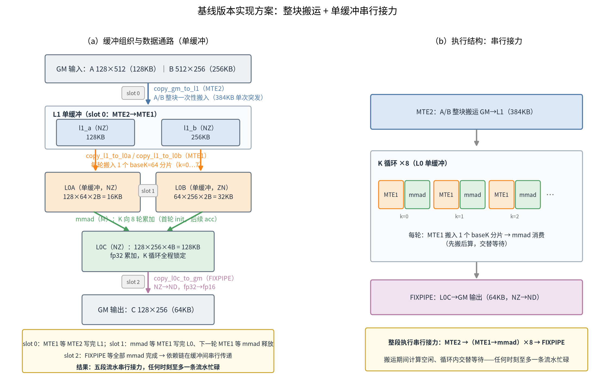

**图1** 基线版本实现方案：整块搬运 + 单缓冲串行接力（左：数据通路与缓冲组织，右：执行结构示意）

这个实现的逻辑正确性没有问题，但从流水视角看存在结构性代价：五段流水以"接力"方式执行，任何时刻基本只有一条流水在忙碌。§3 的实测数据会定量证实这个代价。

## 2. 获取性能数据

### 2.1 npu-compute 与 PMU 采集原理

npu-compute 是昇腾 NPU 的性能采集工具：它运行目标程序，通过硬件 PMU（Performance Monitoring Unit）计数器采集各执行流水的活跃周期、指令计数与存储访问统计，生成 `.npu-rep` 报告；报告经 `--import` 解包后，得到按 Section 组织的 CSV/JSON 结果文件。采集范围按 Set/Section 选择：Set 是按常见分析目标预组合的 Section 集合（如 `basic`、`full`），Section 是一类可独立采集的指标及其结果文件。

采集机制上有一点需要特别注意：PMU 计数器组数量有限，工具通过多次执行（replay）分别采集不同计数组，再合并为一份结果。这带来两个可观测的效应——PipeTrace 中部分流水（本案例中为 MTE2/Fixpipe）的单条忙碌区间时长相对真实值存在展宽；部分忙碌区间因缺少起止端点被跳过（终端出现 `skipped N incomplete intervals` 提示）。因此本文的读数约定为：**流水形态（串行/重叠、相对时序）以 PipeTrace 为准，绝对时长以 PipeUtilization 的 PMU 统计为准**，两者互相印证。

本案例选择默认的 `basic` 集合，其中三个 Section 各回答一个问题：

| Section | 回答的问题 |
|---|---|
| `PipeUtilization` | 各流水忙不忙？（活跃时长与占比、利用率瓶颈在哪条流水） |
| `Pipeline`（PipeTrace.json） | 流水之间怎么排布？（串行还是重叠、谁在等谁） |
| `Memory` | 搬运效率高不高？（数据量、平均带宽与带宽利用率） |

### 2.2 采集命令与成功判据

基线版本与优化版本分别执行采集。建议先执行 `npu-compute --list-sets` 确认当前安装版本支持的集合及其 Section 构成（截图1）：

```bash
# 确认可用集合（basic/full 及其 Section 构成）
npu-compute --list-sets

# 采集：basic 集合，<可执行程序> 为承载算子的目标程序（基线与优化版本各执行一次）
npu-compute --set basic <可执行程序>
# 采集成功时终端输出：
# npu-compute: report= ./report_1791927238444_c4eeba0b.npu-rep   （基线）
# npu-compute: report= ./report_1791927479908_8bb6ddec.npu-rep   （优化版本）

# 解包报告
npu-compute --import ./report_1791927238444_c4eeba0b.npu-rep
# 解包成功时终端输出实际解包目录：
# npu-compute: unpacked= ./npu-compute-import-1791927703147-1580539-EPXVDX
```

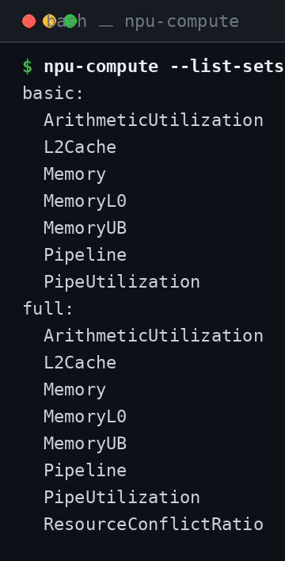

**截图1** `npu-compute --list-sets`：basic 集合含 PipeUtilization、Pipeline、Memory 等 7 个 Section，full 额外含 ResourceConflictRatio（Ascend950PR&950DT系列产品真机，CANN 9.3.0）

采集执行过程见截图2：工具先初始化插桩并按 Section 配置计数器，随后目标程序多次执行（replay）合并结果；`skipped N incomplete intervals` 提示即 §2.1 所述"部分忙碌区间因缺少起止端点被跳过"的现象，属预期行为。

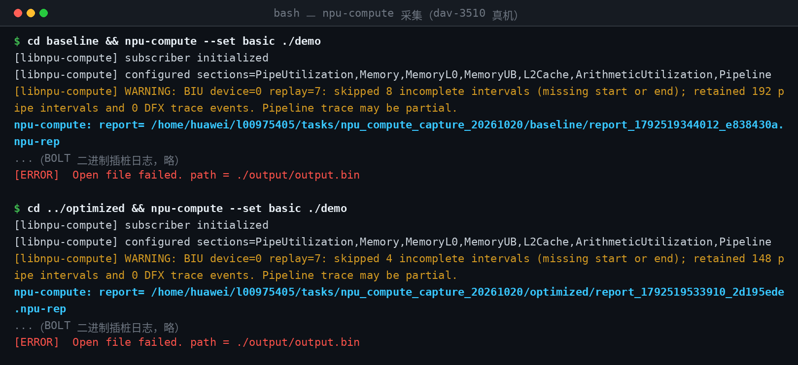

**截图2** 基线与优化版本各执行一次 `npu-compute --set basic ./demo`（Ascend950PR&950DT系列产品真机；BOLT 二进制插桩日志略，`report=` 行即采集产物路径）

报告解包与结果文件见截图3：`--import` 输出解包目录，目录内文件与表4 一一对应。

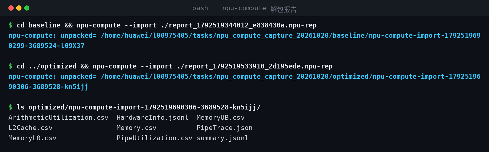

**截图3** `npu-compute --import` 解包两份报告，并 `ls` 查看解包目录：PipeUtilization.csv、PipeTrace.json、Memory.csv 等结果文件齐备

采集成功以退出码为 0、终端输出 `report=` 路径且报告文件存在为准；解包成功以终端输出 `unpacked=` 路径且目录包含结果文件为准。**不要**以目标程序自身打印的成功信息代替上述判据——截图2 中目标程序收尾时的 `Open file failed` 报错来自其结果比对逻辑（采集目录下无输出文件），并不影响采集报告的生成，这正是必须以 `report=`/`unpacked=` 为准的原因。

> 上述截图为撰写本文时在 Ascend950PR&950DT系列产品真机上的复采运行，与文中分析所用数据的采集流程完全一致；复采结果 16 核均值与文中各表吻合（如基线 `aic_time` 10.04us vs 表5 的 10.17us、占比之和同为 0.83，差异属采集波动），文中结论可复现。

**表4** 解包目录中的关键结果文件

| 文件 | 内容 | 本案例用途 |
|---|---|---|
| `PipeUtilization.csv` | AIC/AIV 各流水（Cube、Scalar、MTE1、MTE2、Fixpipe 等）的活跃时长、活跃周期占比 | 判断各流水利用率与瓶颈 |
| `PipeTrace.json` | 各流水忙碌区间时间线（`ts`/`dur`，单位微秒） | 观察流水串行/重叠情况 |
| `Memory.csv` | 主存/L1 访问数据量、平均带宽与带宽利用率 | 判断搬运是否集中、带宽是否打满 |
| `HardwareInfo.jsonl` | 主机与 Device 硬件信息 | 确认运行环境 |

### 2.3 从 PipeTrace.json 到流水时间线图

PipeTrace.json 采用 Chrome Trace Event 格式：每个忙碌区间为一个 `ph:"X"` 事件，`ts`/`dur` 为起点与时长（微秒），`name` 为流水名（MTE2/MTE1/CUBE/FIXP/SCALAR），`pid` 标识核轨道（`group0.cubecore` 等——如 §2.1 所述，各轨道对应一次 replay 采样）。据此有两种可视化途径：

- **零代码浏览**：将 PipeTrace.json 直接拖入 Chrome 的 `chrome://tracing` 页面或 [Perfetto](https://ui.perfetto.dev)，即可交互式查看各流水轨道的忙碌区间，适合快速确认流水形态；
- **精确出图**：本文图2、图4 由配套脚本 `npu_results/plot_pipetrace.py` 绘制，其核心逻辑只有三步——解析事件、选取轨道、按区间画甘特条：

```python
def load_events(path):
    """读取 PipeTrace.json，返回 {流水名: [(ts, dur), ...]}"""
    with open(path, encoding="utf-8") as f:
        data = json.load(f)
    events = {}
    for e in data["traceEvents"]:
        events.setdefault(e["name"], []).append((float(e["ts"]), float(e["dur"])))
    return events

def select(events, sel):
    """按目标 ts 最近邻匹配同名事件，从多次 replay 的交织事件中
    选取一条连贯采样轨道（与表6/表11 所选轨道一致）"""
    picked = {}
    for pipe, ts_list in sel.items():
        pool = events.get(pipe, [])
        chosen = [min(pool, key=lambda ev: abs(ev[0] - t)) for t in ts_list]
        picked[pipe] = sorted(chosen)
    return picked

def union_overlap(intervals_a, intervals_b):
    """两组忙碌区间的总重叠时长"""
    total = 0.0
    for ts1, dur1 in intervals_a:
        for ts2, dur2 in intervals_b:
            ov = min(ts1 + dur1, ts2 + dur2) - max(ts1, ts2)
            if ov > 0:
                total += ov
    return total

# 绘制：每条流水一行甘特条，(ts, dur) 即区间的起点与宽度
for pipe, bars in ev.items():
    for ts, dur in bars:
        ax.add_patch(Rectangle((ts, y - BAR_H / 2), dur, BAR_H, facecolor=COLORS[pipe]))
```

脚本运行时同步打印所选轨道的摘要与重叠合计（截图4），这些数值即 §3.3、§5.2 中"首条 MTE1 与 MTE2 区间的时序关系""MTE2∩CUBE 重叠 2.11us"等结论的直接来源：

```bash
python3 npu_results/plot_pipetrace.py
```

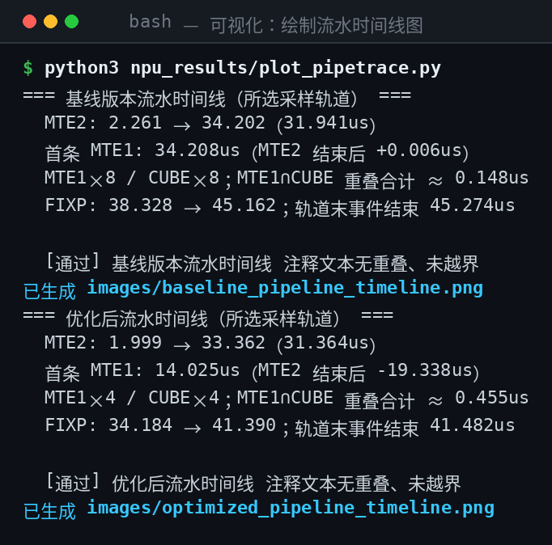

**截图4** `plot_pipetrace.py` 运行输出：基线轨道 MTE2∩CUBE 重叠为 0、首条 MTE1 紧跟 MTE2 区间结束；优化轨道首条 MTE1 提前 19.34us 启动、MTE2∩CUBE 重叠 2.11us

### 2.4 受控对比方法学

性能对比要能归因，关键在变量控制。本案例的做法有三条：

1. **同规格、同 Tiling、同切分**：优化只改流水编排，不改任何影响计算量与搬运总量的参数，使"搬运量/计算量不变"成为可验证的结论（§5.3 中两版本主存读取量逐字节一致即为佐证）；
2. **同插桩口径**：两版本使用相同的采集集合与插桩机制，PMU 统计的系统性偏差在对比中相互抵消；
3. **精度先行**：性能采集前，两版本均先通过精度验证（`test pass!`），避免"错误的快"污染结论。

## 3. 分析主要瓶颈点

### 3.1 分析框架：流水占比与时间分解

解读数据之前，先说明两个贯穿后文的判读方法。

**占比之和判据**。`PipeUtilization` 中每条流水的 `ratio` 定义为"该流水活跃周期数 / 所在核总周期数"。单个核在一个周期内可以有多条流水同时活跃，因此各流水占比之和存在三种典型形态：

- **远小于 1**：流水之间存在大量空闲间隙（如同步等待、流水线断流）；
- **接近 1 且互不重叠**：流水紧凑地串行接力，任何时刻至多一条流水活跃——单核时间近似等于各流水活跃时长之和；
- **大于 1**：必然存在多条流水的时间重叠，且数值越大重叠越充分——这是软件流水成功的直接证据。

**时间分解模型**。串行执行的核函数耗时近似为各阶段之和：`T_serial ≈ Σ T_stage`；理想软件流水下则收敛为"填充 + 稳态 + 排空"三段：`T_pipeline ≈ T_fill + max(T_stage) + T_drain`，稳态吞吐由最慢一段决定。优化的本质，就是把前者改造成后者，代价是引入缓冲空间与同步开销。

此外，`Memory` 中需区分**平均带宽**（以整核时长为分母）与**活跃带宽**（以流水活跃时长为分母）：平均带宽低而活跃带宽高，说明搬运能力没有问题、问题出在搬运时间上过于集中——这是"搬运串行"而非"带宽不足"的证据。

### 3.2 PipeUtilization：各流水利用率

PipeUtilization.csv 每核一行（本算子共 16 个 AIC 核），原始数据节选如下（仅保留 AIC 关键列，AIV 列与本算子的其他 Section 列从略）：

```csv
block_id,sub_block_id,aic_time(us),aic_cube_time(us),aic_cube_ratio,aic_scalar_time(us),aic_scalar_ratio,aic_mte1_time(us),aic_mte1_ratio,aic_mte2_time(us),aic_mte2_ratio,aic_fixpipe_time(us),aic_fixpipe_ratio
0,cube0,11.669697,2.482424,0.212724,0.304242,0.026071,1.064242,0.091197,3.526061,0.302155,2.322424,0.199013
1,cube0,10.491515,2.482424,0.236613,0.271515,0.025879,1.064242,0.101438,3.630303,0.346023,1.299394,0.123852
...（共 16 行，每行一个 AIC 核）
```

16 核均值与占比之和由配套脚本 `scripts/npu_stats.py` 一条命令得出（截图5），表5 即取自该输出：

```bash
python3 scripts/npu_stats.py summary npu_results/baseline/PipeUtilization.csv
```

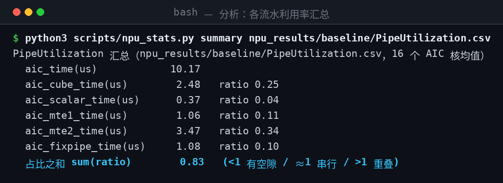

**截图5** `npu_stats.py summary`：基线版本 16 核均值与占比之和 0.83

**表5** 基线版本 PipeUtilization.csv 关键字段（16 核 AIC 数据行均值，真机实测）

| 指标 | 数值 | 说明 |
|---|---|---|
| `aic_time(us)` | 10.17（最小 8.55 / 最大 11.67） | 单核总执行时长 |
| `aic_cube_time(us)` / `aic_cube_ratio` | 2.48 / 0.25 | Cube（mmad）流水活跃时长与占比 |
| `aic_mte1_time(us)` / `aic_mte1_ratio` | 1.06 / 0.11 | MTE1（L1→L0）流水 |
| `aic_mte2_time(us)` / `aic_mte2_ratio` | 3.47 / 0.34 | MTE2（GM→L1）流水，占比最高 |
| `aic_fixpipe_time(us)` / `aic_fixpipe_ratio` | 1.08 / 0.10 | FIXPIPE（L0C→GM）流水 |
| `aic_scalar_time(us)` / `aic_scalar_ratio` | 0.37 / 0.04 | Scalar 流水 |

按 §3.1 的判据：五段流水占比之和约 **0.83**，接近 1 且互不重叠，各流水在紧凑地串行接力——单核 10.17us 恰好等于"搬运入 L1（3.47）+ 搬入 L0（1.06）+ 计算（2.48）+ 输出（1.08）+ 标量与间隙（约 2.1）"的逐段累加。MTE2 是占比最高的单一流水段，而真正产生价值的 Cube 计算仅占 0.25。按时间分解模型的说法：基线处于 `T_serial ≈ Σ T_stage` 形态，是典型的"流水未拉起"。

### 3.3 PipeTrace：流水时间线

PipeTrace.json 原始事件节选如下（group0.cubecore 轨道前 4 条，`ts`/`dur` 单位微秒，数值保持采集原值）：

```json
{"cname":"startup","dur":0.017575757575757578,"name":"SCALAR","ph":"X","pid":"group0.cubecore","tid":"SCALAR","ts":3.0024242424242424},
{"cname":"yellow","dur":31.941212121212121,"name":"MTE2","ph":"X","pid":"group0.cubecore","tid":"MTE2","ts":2.2606060606060607},
{"cname":"thread_state_iowait","dur":0.1327272727272728,"name":"MTE1","ph":"X","pid":"group0.cubecore","tid":"MTE1","ts":34.207878787878791},
{"cname":"rail_response","dur":0.39151515151515071,"name":"CUBE","ph":"X","pid":"group0.cubecore","tid":"CUBE","ts":34.353333333333332}
```

按轨道提取事件表、计算流水重叠与时序关系：

```bash
# 列出指定核轨道的全部忙碌区间（表6 即取自该输出的关键事件）
python3 scripts/npu_stats.py events npu_results/baseline/PipeTrace.json group0.cubecore

# 计算两条流水的重叠时长，并报告首条 MTE1 相对 MTE2 区间的时序关系
python3 scripts/npu_stats.py overlap npu_results/baseline/PipeTrace.json MTE2 CUBE group0.cubecore
python3 scripts/npu_stats.py overlap npu_results/optimized/PipeTrace.json MTE2 CUBE group0.cubecore
```

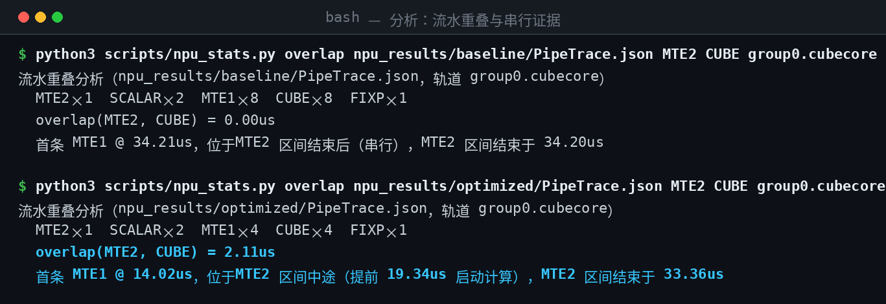

**截图6** `npu_stats.py overlap`：基线 MTE2∩CUBE 重叠为 0、首条 MTE1 位于 MTE2 区间结束后（串行）；优化后重叠 2.11us、首条 MTE1 在 MTE2 区间中途提前 19.34us 启动

**表6** 基线版本 PipeTrace.json 关键事件（group0.cubecore 采样轨道，真机实测）

| 流水 | ts(us) | dur(us) | 含义 |
|---|---|---|---|
| MTE2 | 2.26 | 31.94* | A/B 整块全载 GM→L1（384KB，单次长搬运） |
| SCALAR | 3.00 | 0.02 | 初始化、张量与 Layout 构造 |
| MTE1 | 34.21 | 0.13 | k=0：L1→L0A/L0B |
| CUBE | 34.35 | 0.39 | k=0：mmad |
| MTE1 | 34.72 | 0.13 | k=1 |
| CUBE | 34.87 | 0.39 | k=1 |
| ... | ... | ... | k=2~7：MTE1/CUBE 交替，共 8 对 |
| FIXP | 38.33 | 6.83* | L0C→GM（等待全部 mmad 完成） |
| SCALAR | 45.16 | 0.11 | 收尾同步 |

*注：受 §2.1 所述计数采样（replay）影响，MTE2/Fixpipe 单条忙碌区间的绝对时长相对 PMU 统计（3.47us/1.08us）存在展宽，本表以区间间的相对时序判断流水形态，时长以表5的 PMU 统计为准。

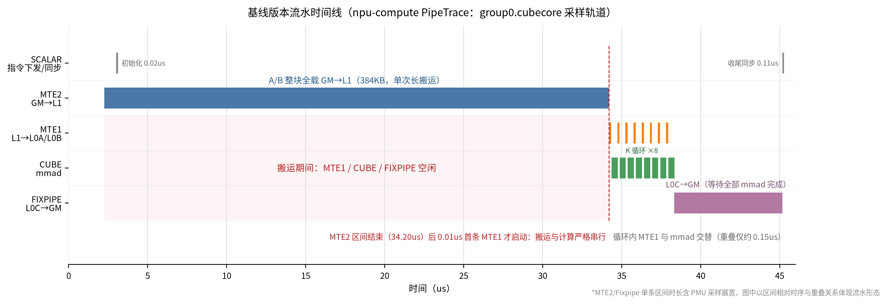

**图2** 基线版本流水时间线（npu-compute PipeTrace，group0.cubecore 采样轨道，事件与表6一致；MTE2/Fixpipe 区间时长含采样展宽）

图2 的时间线给出两条结构性证据：

- **MTE2 与计算完全串行**：唯一的 MTE2 忙碌区间结束于 34.20us，第一条 MTE1 事件始于 34.21us——计算严格等待整块搬运完成才开始，MTE2 期间 MTE1/CUBE 完全空闲，MTE2 与 CUBE 的重叠时长为 0。这正是"一次性全载 384KB"的直接后果：搬运期间没有任何可计算的数据；
- **K 循环内 MTE1 与 CUBE 交替**：8 对 MTE1/CUBE 区间首尾相接、重叠仅约 0.15us（相邻指令的硬件流水衔接）。这是 L0 单缓冲的必然结果——第 i+1 轮搬运必须等第 i 轮 mmad 释放 L0 后才能开始，"先搬后算"逐轮交替。

### 3.4 Memory：搬运带宽分布

**表7** 基线版本 Memory.csv 关键字段（16 核均值，真机实测）

| 指标 | 数值 | 说明 |
|---|---|---|
| `read_main_memory_datas(KB)` | 384.13 | 每核主存读取量（A+B，与理论值一致） |
| `aic_main_mem_read_bw(GB/s)` | 36.27 | 以整核时长为分母的平均读带宽 |
| `GM_to_L1_bw_usage_rate(%)` | 22.28 | GM→L1 平均带宽利用率 |
| `L0C_to_GM_bw_usage_rate(%)` | 4.64 | L0C→GM 平均带宽利用率 |

按 §3.1 的带宽口径解读：GM→L1 平均带宽利用率仅 22%，而由搬运量与 MTE2 活跃时长可以推出活跃期带宽约为 384KB / 3.47us ≈ 111GB/s（`npu_stats.py invariant` 亦直接输出该项，见截图7）——活跃期带宽不低，平均利用率却很低，说明搬运硬件能力并未饱和，问题在于 384KB 流量集中在开头一次突发里完成，其余时间 MTE2 闲置。这是"搬运串行"而非"带宽不足"的典型形态。

### 3.5 瓶颈结论与定性

综合三类数据，基线的瓶颈可以定性为三条：

1. **流水形态串行**：占比之和 0.83 且互不重叠，单核耗时等于各段之和，Cube 计算占比仅 0.25，计算资源大量空闲；
2. **搬运集中突发**：MTE2 单次搬运 384KB 形成唯一长忙碌区间，搬运期间计算无事可做，平均带宽利用率仅 22%；
3. **循环内交替等待**：L0 单缓冲使 MTE1 与 mmad 以基本块为粒度交替，无法重叠。

机器平衡角度还可以补一个定量视角：本算子每核的计算时间与 GM→L1 搬运时间之比约为 2.48/3.47 ≈ **0.71**——计算快于搬运。这意味着即使流水完全拉起，稳态节奏也将由搬运（MTE2）主导，属搬运受限（memory-bound）型负载；而每字节约 85 FLOP 的算术强度说明，问题不是"数据太少导致算不动"，而是"数据到达的节奏没跟上计算"。优化方向由此明确：**不是减少总搬运量，而是让搬运与计算在时间上重叠**。

## 4. 设计优化方案

§3.5 的三条瓶颈结论与本章优化手段一一对应：**L1 级双缓冲**解除 GM→L1 搬运对计算的阻塞（瓶颈 2 的依赖面），**L0 级双缓冲**消除 K 循环内 MTE1 与 mmad 的交替等待（瓶颈 3），**多基本块搬运**将 384KB 突发拆分为 4 组×96KB、缩短流水填充期（瓶颈 2 的搬运形态本身）；瓶颈 1 是整体串行的总症状，由两项手段合力解除。两者还存在硬性耦合：L1 双缓冲以基本块组为搬运单元，若不分块，两份整块缓冲共 768KB 将超出 L1 容量——分块既是重叠质量的调优，更是 L1 双缓冲可行的前提。

### 4.1 软件流水：双缓冲消除依赖等待

单缓冲模式下，同一个缓冲既是生产者的写入对象又是消费者的读取对象，必须"写完→读完→再写"地接力，缓冲成为流水间的同步点，这是串行的根源。双缓冲（Ping/Pong）将缓冲一分为二：生产者写 Ping 时消费者读 Pong，角色周期性互换——以两倍缓冲空间为代价，把"共享资源的互斥访问"转化为"独立资源的并行访问"。这就是经典的软件流水（software pipelining）思想：让不同迭代阶段的数据流在时间上错开重叠。

引入双缓冲后，核函数耗时从 `T_serial ≈ Σ T_stage` 转变为：

```text
T_pipeline ≈ T_fill + max(T_stage) + T_drain
```

其中 `T_fill` 是首块数据从 GM 到达 L0 前的流水填充期（此间只有搬运在忙），`T_drain` 是末块计算与输出排空期，稳态吞吐由最慢一段决定。对本算子，"最慢一段"按 §3.5 的平衡分析应是 MTE2——理想情况下，MTE1 与 mmad 的执行时间应被 MTE2 的搬运时间完全掩盖。

本案例在**两级**实施双缓冲，缺一不可：

- **L1 级（A/B 分块缓冲）**：解除"GM→L1 搬运"与"L1→L0 搬运+计算"的依赖，使下一组分块数据的搬入与当前组的消费并行——没有它，MTE2 的长搬运始终横亘在计算之前；
- **L0 级（L0A/L0B 缓冲）**：解除"K 循环内 MTE1 与 mmad"的交替等待——只有 L1 双缓冲时，MTE2 虽能与计算重叠，但循环内部仍是"搬一片、算一片"的交替；L0 双缓冲让第 i+1 片的搬入与第 i 片的 mmad 同时进行。

### 4.2 多基本块搬运：搬运流水的错峰与分摊

双缓冲解决"能不能重叠"，多基本块搬运决定"重叠得多好"。

基线把 384KB 作为一个搬运突发，带来两个直接后果：其一，MTE2 的忙碌高度集中，流水填充期（`T_fill`）被拉长——哪怕只需首个 baseK 分片即可开工，也必须等整块搬运完成，计算启动被推迟了全部搬运时间（图2 中首条 MTE1 紧跟 MTE2 区间结束即为此故）；其二，L1 必须驻留整块数据，既推高空间成本，也使 L1 级双缓冲无从实施——两份整块缓冲将超出 L1 容量。

多基本块搬运将 GM→L1 的整块搬运沿 K 方向拆分为多个**基本块组**：本案例取 `step_k=2`，每组包含 A（128×128）与 B（128×256）各一个基本块、共 96KB，K 方向共 4 组，乒乓交替搬入。收益来自三方面：

- **错峰**：搬运流量在时间上均匀分布，4 段较短的搬运与计算交错，而不是一段长搬运独占开头；
- **缩短填充期**：首组 96KB 到达后计算即可启动，`T_fill` 从"整块 384KB 的搬运时间"缩短为"单组 96KB 的搬运时间"，约为原来的 1/4；
- **降低 L1 驻留**：只需容纳"当前组 + 下一组"两份数据，L1 占用从 384KB 降至 192KB——分块反而节约了片上存储。

搬运粒度是一个需要权衡的参数：粒度越细，重叠机会越多、填充期越短，但搬运指令数与同步次数上升，单条指令的启动开销占比增大；粒度越粗则相反。`step_k` 的选择应以单组搬运时间与单组计算时间大体匹配为准（本例单组搬运约 0.87us、单组计算约 0.62us），过细会放大开销、过粗则浪费重叠窗口。

### 4.3 内存预算

**表8** 单核缓冲区预算（fp16，L0C 按 fp32 累加）

| 缓冲区 | 基线（单缓冲） | 优化后（双缓冲） |
|---|---|---|
| L1 A | 128×512×2B = 128KB | 2 × (128×128×2B) = 64KB |
| L1 B | 512×256×2B = 256KB | 2 × (128×256×2B) = 128KB |
| L1 合计 | 384KB | 192KB |
| L0A | 128×64×2B = 16KB | 2 × 16KB = 32KB |
| L0B | 64×256×2B = 32KB | 2 × 32KB = 64KB |
| L0C | 128×256×4B = 128KB | 128KB（不变） |

双缓冲并未增加 L1 占用，反而从 384KB 降至 192KB；L0A/L0B 翻倍后仍在容量范围内，L1 节余的空间为后续融合算子或更大 `step_k` 预留了余地。任何双缓冲改造前都应先完成这张预算表——这是流水优化的硬约束。

### 4.4 流水编排：事件槽位的所有权轮转

优化版核函数的编排规则，用"缓冲所有权"描述最为清晰：每级缓冲由一对事件槽位（Ping/Pong 各一）保护，生产者写入前加锁、写完即解锁，消费者读取前加锁、读毕解锁交还——槽位在此充当跨流水信号量的角色。两级缓冲的轮转规则如下：

**表9** 缓冲所有权轮转规则

| 缓冲 | 生产者 → 消费者 | 所有权传递规则 |
|---|---|---|
| L1 组缓冲（Ping/Pong） | MTE2 → MTE1 | 组首：MTE1 加锁等待 MTE2 写完该组；组内最后一个基本块的搬运下发后，MTE1 解锁交还，该缓冲此后可写入**隔一组**的数据 |
| L0A/L0B（Ping/Pong） | MTE1 → M | MTE1 写完即解锁供 mmad 使用；mmad 完成后解锁，该缓冲此后可写入**隔一块**的数据 |
| L0C | M → FIXPIPE | K 方向累加全程锁定，循环结束后交还 FIXPIPE 输出 |

"隔一组/隔一块"即乒乓间隔复用：第 i 组写入 Ping，第 i+1 组写入 Pong，第 i+2 组再次使用 Ping——写入方必须等待消费者释放，由此自然形成"搬运组 i+1 ∥ 消费组 i"与"搬入块 j+1 ∥ 计算块 j"的重叠。

预取时机有三处，共同保证流水从起点就滚动起来：

1. **循环前**预取第 0 组（写入 Ping）；
2. **第 0 个基本块计算下发时**，Pong 尚无任何消费者占用，直接预取第 1 组；
3. 此后**每当当前组最后一个基本块的 L1→L0 搬运下发后**，该组 L1 缓冲即将消费完毕，触发下一组的预取（写入另一侧缓冲）。

几个关键设计决策的依据：

- **`step_k=2` 而非更大**：单组 96KB 使 L1 双缓冲合计 192KB，预算宽松；更大的 `step_k` 可减少指令与同步次数，但抬高首组填充延迟并增加 L1 驻留，且单组搬运时间将超过单组计算时间更多、掩盖效果变差；
- **不修改 baseM/baseN/baseK 与核数**：控制变量，使收益可归因于流水编排；
- **不采用三缓冲**：两级双缓冲已使 MTE2/MTE1/M 两两具备重叠条件，三缓冲的边际收益主要是容忍搬运抖动，代价是 L1 驻留与槽位同步成本继续上升。

优化版本的整体实现方案如图3所示：左图为两级 Ping/Pong 缓冲组织与数据通路，右图为 K 向基本块组搬运与两级流水重叠的结构示意——缓冲规格与表8的预算一致，槽位轮转与预取节奏与表9的规则逐条对应。

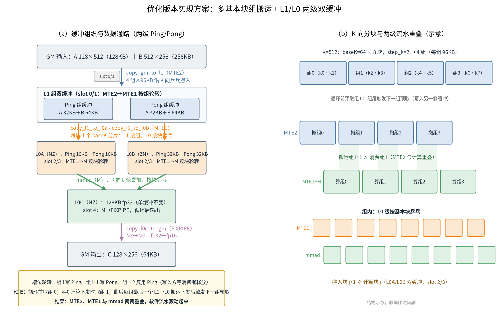

**图3** 优化版本实现方案：多基本块组搬运 + L1/L0 两级双缓冲（左：数据通路与缓冲组织，右：K 向分块与流水重叠示意，非等比时间轴）

### 4.5 理论收益预估

以 §3.2 的 PMU 统计为输入，代入 `T_pipeline ≈ T_fill + max(T_stage) + T_drain` 模型（忽略粒度与同步开销）：

- `T_fill` ≈ 首组搬运 ≈ 3.47/4 ≈ 0.87us；
- 稳态段 ≈ max(剩余 MTE2 ≈ 3×0.87 = 2.6us，计算链 ≈ CUBE 2.48 + 一次 MTE1 0.13 ≈ 2.6us) ≈ 2.6us——两段恰好相当，印证 §3.5 的平衡分析；
- `T_drain` ≈ FIXPIPE 1.08us，另有标量与固定开销约 1~2us。

估算理想耗时约 **5.5~6.5us**，相对基线 10.17us 的理论上限约为 **35%~45%**。实际收益必然低于该上限：分块后 MTE2 指令数从 2 条增至 8 条带来的启动开销、事件同步的标量开销、以及采集插桩在更细指令粒度上的开销放大，都会折损一部分。第 5 章用实测数据检验这一预估。

## 5. 验证优化方案性能收益

优化版本以相同方式执行采集并解包，与基线使用相同算子规格、相同 Tiling 参数对比。各流水均值与占比之和同样由 `npu_stats.py summary` 对优化版本数据执行一次得出（命令同截图5，路径换为 `npu_results/optimized/PipeUtilization.csv`）。

### 5.1 优化后各流水利用率

**表10** 优化后 PipeUtilization.csv 关键字段（16 核 AIC 数据行均值，真机实测）

| 指标 | 数值 | 说明 |
|---|---|---|
| `aic_time(us)` | 8.83（最小 6.98 / 最大 10.88） | 单核总执行时长，较基线下降 13.2% |
| `aic_cube_time(us)` / `aic_cube_ratio` | 2.48 / 0.29 | 计算量不变（与基线完全一致），占比提升 |
| `aic_mte1_time(us)` / `aic_mte1_ratio` | 1.29 / 0.15 | 指令数增多（搬运粒度变细），活跃时长略增 |
| `aic_mte2_time(us)` / `aic_mte2_ratio` | 5.41 / 0.63 | 4 组分块搬运（2→8 条指令）单段效率略降，但已被计算掩盖 |
| `aic_fixpipe_time(us)` / `aic_fixpipe_ratio` | 1.59 / 0.17 | 输出量不变，采集开销略增 |
| `aic_scalar_time(us)` / `aic_scalar_ratio` | 0.39 / 0.04 | 流水下发指令增多 |

按 §3.1 判据：各流水活跃占比之和从 0.83 升至 **1.28（大于 1）**——单核总时长（8.83us）已小于各流水活跃时长之和（约 11.2us），"下一组搬运、L1→L0 搬运与 mmad 计算"必然在时间上重叠，软件流水成立。

### 5.2 优化后流水时间线

**表11** 优化后 PipeTrace.json 关键事件（group0.cubecore 采样轨道，真机实测）

| 流水 | ts(us) | dur(us) | 含义 |
|---|---|---|---|
| MTE2 | 2.00 | 31.36* | 4 组×96KB 乒乓搬运（区间含采样展宽与组间间隙） |
| SCALAR | 2.75 | 0.01 | 初始化、流水下发 |
| MTE1 | 14.02 | 0.35 | k=0~1：L1→L0（**在 MTE2 区间中途即启动**） |
| CUBE | 14.26 | 0.70 | k=0~1：mmad，与 MTE1 区间重叠 0.11us |
| MTE1 | 19.30 | 0.33 | k=2~3 |
| CUBE | 19.51 | 0.70 | k=2~3 |
| MTE1 | 28.26 | 0.36 | k=4~5 |
| CUBE | 28.51 | 0.70 | k=4~5，仍处于 MTE2 区间内 |
| MTE1 | 33.37 | 0.25 | k=6~7：等待最后一组搬运完成 |
| CUBE | 33.50 | 0.70 | k=6~7 |
| FIXP | 34.18 | 7.21* | L0C→GM，与最后一个 CUBE 区间首尾衔接 |
| SCALAR | 41.39 | 0.09 | 收尾同步 |

*注：与表6相同，MTE2/Fixpipe 区间绝对时长含采样展宽；相邻的同类事件因连续忙碌被合并为单一区间（如 0.35us 区间含 2 次基本块搬运）。

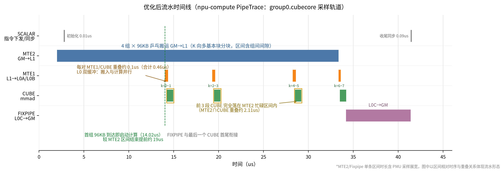

**图4** 优化后流水时间线（npu-compute PipeTrace，group0.cubecore 采样轨道，事件与表11一致；相邻同类忙碌区间已合并，MTE2/Fixpipe 区间时长含采样展宽）

图4 的时间线与表9的编排规则逐条对应：

- **计算不再等待整块搬运完成**：基线中第一条 MTE1 事件出现在 MTE2 区间结束后 0.01us（34.21 vs 34.20，严格串行）；优化后第一条 MTE1 事件（14.02us）在 MTE2 区间中途即启动，比该区间结束提前约 19us——首组 96KB 数据到位后计算立即开始，后续 3 组搬运与计算并行推进。这正是 `T_fill` 从"整块搬运时间"缩短为"单组搬运时间"的直观体现；
- **MTE2 与 CUBE 的重叠时长从 0 增至 2.11us**：4 段 CUBE 区间中前 3 段完全落在 MTE2 忙碌区间内，多基本块搬运的"错峰"效果可见；
- **MTE1 与 CUBE 借 L0 双缓冲相互重叠**：每对 MTE1/CUBE 区间重叠约 0.1us（如 MTE1 14.02-14.37 与 CUBE 14.26-14.96 重叠 0.11us），相邻基本块的"搬入 L0"与"mmad 计算"同时进行，总重叠时长从基线的 0.15us 增至 0.46us。

### 5.3 优化前后对比

**表12** 优化前后关键指标对比（16 核均值，真机实测）

| 指标 | 基线 | 优化后 | 变化 |
|---|---|---|---|
| `aic_time`（us） | 10.17 | 8.83 | **-13.2%** |
| `aic_time` 中位数（us） | 10.14 | 8.44 | -16.8% |
| `aic_cube_ratio` | 0.25 | 0.29 | 计算流水占比提升 |
| `aic_mte2_ratio` | 0.34 | 0.63 | 搬运被计算掩盖 |
| 各流水占比之和 | 0.83（串行） | 1.28（重叠） | 流水并行度显著提升 |
| `read_main_memory_datas(KB)` | 384.13 | 384.13 | 完全一致（搬运总量不变） |
| `aic_main_mem_read_bw(GB/s)` | 36.27 | 42.51 | +17.2%（同样数据量在更短时间内完成） |
| `GM_to_L1_bw_usage_rate(%)` | 22.28 | 26.12 | 搬运在时间上更均匀 |

三组"不变量"数据可由一条命令复核（截图7）：

```bash
python3 scripts/npu_stats.py invariant npu_results/baseline/Memory.csv npu_results/optimized/Memory.csv
```

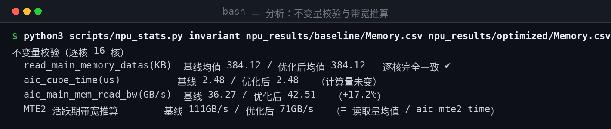

**截图7** `npu_stats.py invariant`：两版本主存读取量逐核完全一致、Cube 活跃时长相同，平均读带宽 +17.2%，MTE2 活跃期带宽推算亦见 §3.4

三组"不变量"数据为归因提供了硬证据：主存读取量逐字节一致（搬运总量未变）、Cube 活跃时长完全相同（计算量未变）、L1 占用反而下降——**收益全部来自流水重叠**，即把 `T_serial ≈ Σ T_stage` 改造成 `T_fill + max + T_drain`。

### 5.4 实测与理论模型的对照

实测 -13.2% 低于 §4.5 预估的 35%~45% 上限，但差距可以解释。核心折损项是 MTE2 活跃时长统计从 3.47us 升至 5.41us：分块使搬运指令从 2 条增至 8 条，单条指令启动开销与插桩计数开销叠加，且更细的搬运粒度使单段有效带宽下降。把这些代回模型：稳态段由 max(剩余 MTE2， 计算链) 决定，MTE2 侧升至约 4us 后重新成为明显短板，理想耗时估算相应上移至 8~9us——与实测 8.83us 吻合。可以说，**优化后的算子进入了更深的 MTE2-Bound 状态**（`aic_mte2_ratio` 达 0.63 亦为佐证），流水重叠的边际收益已基本释放完，继续优化必须转向压缩搬运本身，例如增大 `step_k` 或调整 `base_k`，减少搬运指令次数、提高单条搬运的有效带宽。

这也印证了 §3.5 平衡分析的预判：对计算/搬运时间比仅 0.71 的负载，流水优化"拉平"了时间轴，但天花板由搬运能力决定。

### 5.5 精度验证

优化版本在 Ascend950PR&950DT系列产品的仿真模式与真机（npu 模式）下均完成精度验证：输出与真值数据对比误差率 0.0000（`test pass!`）。双缓冲与槽位同步只改变数据的到达时序、不改变数值路径（L0C 仍按 fp32 逐轮累加），精度结果与预期一致。

## 6. 总结

本案例从简单多核切分的 Tensor API Matmul 基线出发，通过 npu-compute 的 PipeUtilization、PipeTrace、Memory 三类数据定位出"五段流水串行、MTE2 单次搬运数据量过大、Cube 利用率低"的瓶颈，采用**多基本块搬运**（K 向分块、错开搬运流水）与 **Double Buffer**（L1/L0 全级双缓冲、事件槽位同步）优化后，Ascend950PR&950DT系列产品真机实测单核 `aic_time` 均值从 10.17us 降至 8.83us（**-13.2%**），各流水占比之和从 0.83 升至 1.28（超过 1），MTE2 与 CUBE 重叠时长从 0 增至 2.11us。

过程中有三点做法被证明比较关键，值得单独记录：

- **判据先于数据**：占比之和（<1 有空隙 / ≈1 串行 / >1 重叠）与时间分解模型（`Σ T_stage` vs `T_fill + max + T_drain`）构成流水形态的快速判读入口；平均带宽与活跃带宽的分离，则用于区分"带宽不足"与"搬运串行"两类问题；
- **不变量锚定归因**：保持搬运总量、计算量、Tiling 参数不变，用"读取量逐字节一致、Cube 时长完全相同"等不变量证明收益来自流水重叠而非工作量削减；
- **先估上限再解释差距**：改造前用稳态模型预估收益上限（本例 35%~45%），实测（-13.2%）与上限的差距再由指令粒度、同步与插桩开销解释，避免"调了就测、测完就信"。

适用条件与权衡：

- K 方向需满足整除关系（本例 K/(baseK×stepK) 为整数；非整除时需按尾块处理）；
- 双缓冲使 L0A/L0B 占用翻倍、L1 需容纳两组基本块，动手前需按**表8**核算各级缓冲不超限——本例 L1 占用反而下降；
- 事件槽位同步引入少量 Scalar 开销，基本块组切得过细时会放大，建议对 `step_k` 做少量扫描取优；
- 对计算/搬运时间比显著大于 1 的计算受限负载，搬运可被完全掩盖，本方案收益更大；对比值接近或小于 1 的负载（如本例 0.71），流水优化后瓶颈将转移至搬运带宽，需配合带宽类手段继续优化。

进一步优化方向：

- 每核负责多个输出基本块（M/N 向多块），使前一块的 FIXPIPE 与后一块的 MTE2/M 计算重叠，摊薄 FIXPIPE 串行段；
- 针对优化后 MTE2-Bound 的稳态瓶颈，增大 `step_k` 或调整 `base_k`，压缩搬运指令数、提高单条搬运的有效带宽。
