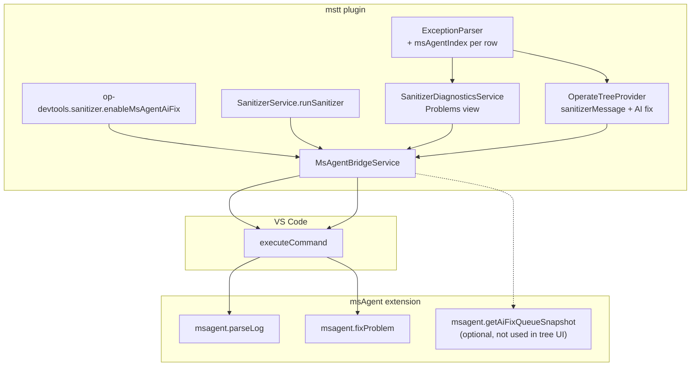

# msAgent integration (mstt)

This document describes how **Huawei OP DevTools** (`mstt`) integrates with the separate **msAgent** VS Code extension for sanitizer (anomaly detection) workflows. mstt does not ship msAgent and does not implement AI fix or log parsing itself — it bridges VS Code commands and keeps **finding order** aligned with msAgent’s `fixProblem(index)` contract.

For the full sanitizer run, results tree, and Problems view, see [`sanitizer.md`](./sanitizer.md).

---

## Scope in this repository

| In scope | Out of scope |
|---------------|--------------|
| Load sanitizer **`.log`** into msAgent after run / when opening a report | `fixWithPayload`, custom msAgent UI inside mstt |
| **AI fix** on a finding row in **`opdevtoolsSanitizerResultsTree`** | Operate tree, debug, performance, Quick Fix |
| Feature flag + presence detection | `extensionDependencies` on a marketplace msAgent id |
| **Index parity** between mstt `ExceptionParser` and msAgent log parser | Changing msAgent LLM / notification UX |

There is **no** `msSanitizer` ApiServer namespace, **no** sanitizer sidebar webview, and **no** `ms-sanitizer-panel-view.ts` in this codebase.

The msAgent bridge is command-based (`executeCommand`), not part of the extension's webview↔plugin RPC surface — `api-routes.ts` currently exposes **37 endpoints** (webview 9 / common 10 / ops 17 / performance 1), none of which is msAgent-specific. Extension version: **1.4.6**.

---

## Architecture

**Two parsers, one log file:** mstt parses the same absolute log path for **Problems** and tree rows (`ExceptionParser`). msAgent parses again when `parseLog` runs. **AI fix** uses msAgent’s index into *its* diagnostic list — mstt must assign the same **0-based order** when building tree messages (`msAgentIndex`).

---

## Enabling integration

Master switch: **`sanitizer.enableMsAgentAiFix`** (default `false`) — see [`workspace-settings.md`](./workspace-settings.md#sanitizer-op-devtoolssanitizer). Read in code via `SettingsLoader.isMsAgentAiFixEnabled()` inside `MsAgentBridgeService`.

### When integration is “available”

`msAgentBridgeService.isMsAgentIntegrationAvailable()` returns true only if:

1. Feature flag is **on**, and  
2. Either:
   - Some installed extension **contributes** both commands `msagent.parseLog` and `msagent.fixProblem` in `package.json` (scans `vscode.extensions.all` — **no fixed publisher/id**), or  
   - `vscode.commands.getCommands(true)` lists those command ids (runtime registration).

If false, mstt hides AI fix UI and skips auto `parseLog`.

At activation, `extension.ts` sets context **`opDevtools.sanitizerAiFixAvailable`** from this check (used in `package.json` menu `when` clauses).

msAgent is **not** listed in `extensionDependencies`; users install the msAgent VSIX separately until marketplace bundling is decided.

---

## Bridge API (`MsAgentBridgeService`)

**File:** `plugin/src/service/ms-agent-bridge.service.ts`  
**Export:** `msAgentBridgeService` singleton.

| Method | msAgent command / source | Used by |
|--------|--------------------------|---------|
| `isMsAgentIntegrationAvailable()` | (detection only) | `extension.ts`, before AI fix |
| `tryLoadLogWithIntegration(absoluteLogPath)` | `msagent.parseLog(uri, { suppressMessage: true })` | `SanitizerService` after successful run; `SanitizerDiagnosticsService.loadSanitizerPanelData` when user selects a report |
| `loadMsAgentLog(path, options?)` | `msagent.parseLog` | Direct call (always attempts if caller invokes) |
| `fixMsAgentProblem(index, options?)` | `msagent.fixProblem(index, options?)` | `sidebar.sanitizer.message.aiFix` command |
| `getAiFixQueueSnapshot()` | `__msAgentGetAiFixQueueSnapshot` global, or `msagent.getAiFixQueueSnapshot`, or `msagent.getAiFixQueueStates` | **Implemented on bridge; not wired to tree UI today** |
| `getAiFixQueueStates()` | via snapshot | Same |

All log paths passed to msAgent use **`vscode.Uri.file(absoluteLogPath)`** (absolute `fsPath`).

`fixMsAgentProblem` return shape: `{ status: 'completed' | 'failed' | 'unknown' | 'integration_unavailable' }` (also accepts boolean/object results from msAgent).

---

## User-visible flows

### 1. Auto-load log after sanitizer run

1. `SanitizerService.runSanitizer` succeeds.  
2. `getLatestSanitizerLogAbsPath(workspaceRoot)` picks newest `mssanitizer_*.log` / `npu-check_*.log` under `<workspaceRoot>/<ideConfig>/mindstudio_sanitizer_log`.  
3. `sanitizerDiagnosticsService.publishFromLogFile(logAbs, workspaceRoot)`.  
4. `msAgentBridgeService.tryLoadLogWithIntegration(logAbs)` if integration available.  
5. `flashMsSanitizerRunData` refreshes the results tree.

### 2. Open a report in the results tree

1. User selects a report → `OperateTreeProvider.selectSanitizerReport`.  
2. `sanitizerDiagnosticsService.loadSanitizerPanelData({ path, title, timestamp })`:  
   - `ExceptionParser.parseAll` → rows with **`msAgentIndex`** = `0..n-1` in parse order.  
   - Updates **Problems** (`publishFromLogFile`).  
   - `tryLoadLogWithIntegration(params.path)`.

### 3. AI fix on one finding

**UI:** Inline action on `sanitizerMessage` rows when `contextValue` is `opdevtools.sanitizerMessage.aiFix` (only if `msAgentIndex` is a non-negative integer).

**Command:** `huawei-op-devtools.sidebar.sanitizer.message.aiFix`  
**When:** `view == opdevtoolsSanitizerResultsTree && opDevtools.sanitizerAiFixAvailable && viewItem =~ /opdevtools\.sanitizerMessage\.aiFix/`

**Handler (`extension.ts`):**

1. `operateTreeProvider.getSanitizerMessageAiFixIndex(arg)` resolves index from:
   - `messageRef.msAgentIndex` on the tree item, or  
   - a string `sanitizer-msg:...` id → `selectedMessages[globalIndex].msAgentIndex`.  
2. `msAgentBridgeService.fixMsAgentProblem(aiFixIndex)`.

msAgent owns progress, LLM, and fix UX after that; mstt does not wrap or replace it.

### 4. Jump to source (independent of msAgent)

`huawei-op-devtools.sidebar.sanitizer.message.jump` uses `performanceDataMethods.jumpToFile` — works without msAgent.

---

## Index contract

| Rule | Detail |
|------|--------|
| **Index type** | 0-based integer |
| **Meaning** | Position in msAgent’s diagnostic list for the loaded log (same order as msAgent `logParser` output) |
| **mstt assignment** | `parser.parseAll(content).map((r, msAgentIndex) => ({ ...r, msAgentIndex }))` in `loadSanitizerPanelData` |
| **User action** | `fixProblem(msAgentIndex)` |

**Risk:** If mstt and msAgent parsers diverge in count or order, AI fix targets the wrong finding. Mitigation:

- Integration test: `plugin/src/__tests__/integration/sanitizer-exception-parser-msagent-parity.spec.ts`  
- Compares fingerprints (line, file basename, error kind) on shared fixtures under sibling repo **`../ms-agent/test/fixtures`**.  
- **Skips** when `ms-agent` is not checked out next to `mstt`.

---

## What mstt does not call

| msAgent surface | Status in mstt |
|-----------------|----------------|
| `msagent.parseLog` | Yes (auto + on report open) |
| `msagent.fixProblem` | Yes (AI fix command) |
| `msagent.getAiFixQueueSnapshot` / `getAiFixQueueStates` | Bridge only; no UI consumer |
| `fixWithPayload` | Not used |
| Install / marketplace prompts | Not implemented (controls hidden if missing) |

---

## Configuration summary

See [`workspace-settings.md`](./workspace-settings.md#sanitizer-op-devtoolssanitizer) (`sanitizer.enableMsAgentAiFix`, default `false`).

---

## Key source files

| Area | Path |
|------|------|
| Bridge | `plugin/src/service/ms-agent-bridge.service.ts` |
| Auto load after run | `plugin/src/service/sanitizer-service.ts` |
| Parse + index on report open | `plugin/src/service/sanitizer-diagnostics.service.ts` |
| Log parser | `plugin/src/class/exception-parser.ts` |
| Tree + `getSanitizerMessageAiFixIndex` | `plugin/src/class/operate-tree-provider.ts` |
| Commands + context | `plugin/src/extension.ts`, `plugin/src/constants.ts` |
| Latest log path | `plugin/src/helpers/sanitizer-log-path.ts` |
| Source path resolve | `plugin/src/helpers/sanitizer-source-path.ts` |
| Parity test | `plugin/src/__tests__/integration/sanitizer-exception-parser-msagent-parity.spec.ts` |
| Setting schema | `package.json`, `package.nls*.json` |

---

## Related documents

| Document | Use for |
|----------|---------|
| [`sanitizer.md`](./sanitizer.md) | Sanitizer run, results tree, Problems, logs |
| msAgent repo `MSTT_INTEGRATION_ARCHITECTURE.md` | Cross-extension product decisions (sibling checkout; not vendored in mstt) |
