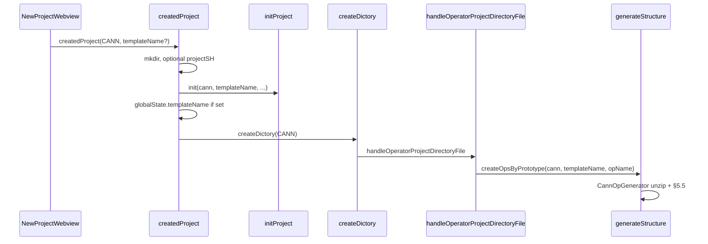

# New project generation — implementation specification

How the **New Project** webview creates an operator project: UI parameters, `createdProject`, `createDictory` → `handleOperatorProjectDirectoryFile`, `generateStructure`, template ZIPs, and post-extract renaming.

**Related:** [`operator-behavior-specification.md`](./operator-behavior-specification.md) (types and actions), [`workspace-settings.md`](./workspace-settings.md) (runtime `op-devtools.*` after scaffold), [`generated-files-specification.md`](./generated-files-specification.md) (persisted artifacts).

---

## 1. Terminology

| Term | Meaning |
|------|---------|
| **View ID** | `OperatorProjectViewId` in [`shared/project-type-view-id.ts`](../shared/project-type-view-id.ts): `CANN` = 1, `STANDARD_CUSTOM` = 2, `PYASC` = 3, `TRITON` = 4. |
| **`project_type` (stored)** | String on the project record from [`viewIdToProjectType`](../plugin/src/domain/utils/project-utils.ts): `cann`, `ascend`, `pyasc`, `triton`. **STANDARD_CUSTOM (2) stores `ascend`**, not `standard-custom`. |
| **`op_type` (generator)** | Passed to `generateStructure` / [`OpGeneratorFactory`](../plugin/src/domain/services/op-generator-factory.ts): `cann`, `ascend`, `pyasc`, `triton`. New Project uses `viewIdToProjectType` for init, except STANDARD_CUSTOM scaffolding uses **`opType: 'ascend'`** in `handleOperatorProjectDirectoryFile`. |
| **Feature-toggle key** | Used only in [`handleOperatorProjectDirectoryFile`](../plugin/src/class/webview-message-list.ts) via `normalizeViewIdToProjectType`: `cann`, `standard-custom`, `pyasc`, `triton`. Only **Triton** is gated today (`op-devtools.operatorSupport.triton`). |
| **`projectName` (UI)** | Form field → child folder name and, after init, `project_name` / canonical `op_name` when `opName` is passed through. |
| **`templateName` (API)** | Optional string from the webview; stored in `ExtensionContext.globalState` key `templateName` when set in `createdProject`, read by `createDictory` handler. |

---

## 2. Web UI

**Panel:** [`web/src/views/panels/new-project/`](../web/src/views/panels/new-project/) (`app.vue` → `new-project-ssh.vue` + [`use-new-project-ssh.ts`](../web/src/views/panels/new-project/composables/use-new-project-ssh.ts)).

### 2.1 Project type list

Default types shown: **CANN**, **PYASC**, **TRITON** (`items_type` in `new-project-ssh.vue`).

| Condition | UI change |
|-----------|-----------|
| `getProjectTypeSupportEnabled(TRITON)` is `false` | Triton card removed; selection falls back to CANN if needed. |
| Open workspace `getProjectType()` returns `projectType === 'ascend'` | List is **only STANDARD_CUSTOM** (Ascend standard-custom); selection forced to view ID 2. |

API: `common/getProjectTypeSupportEnabled` → [`common-controller.ts`](../plugin/src/controller/common-controller.ts) → `isOperatorSupportEnabled('triton')`.

### 2.2 Form payload

[`CreatedProjectParams`](../shared/api-types/webview.d.ts):

| Field | Role |
|-------|------|
| `projectPath` | Parent directory for the new folder. |
| `projectName` | New folder name and registered project name. |
| `projectSH` | Optional env script (`chmod +x` + source in `createdProject`; passed to init as `ascendEnvScript`). |
| `createOperatorProjectDictoryFileType` | View ID (1–4). |
| `templateName` | Optional; see §2.3. |

Defaults in composable: `projectPath` `/home/developer`, `projectSH` `/etc/profile`, generated `projectName`.

### 2.3 Template name resolution (web)

`resolveTemplateNameByProjectType()` in `use-new-project-ssh.ts`:

| View ID | `templateName` sent |
|---------|------------------------|
| **CANN (1)** | From selected CANN template radio, or `undefined` if none selected. |
| **PYASC (3)** | `undefined` (scaffold id is fixed in generator). |
| **STANDARD_CUSTOM (2)** | `undefined` (prototype + `add_custom.zip`). |
| **TRITON (4)** | Always `'triton_vector_add'`. |

**CANN UI radios** (only on CANN card): `helloworld`, `addn`, `torch_library_template` — not `triton_vector_add`.

**UI key → `templateName` string** (`getTemplateName`):

| UI `selectedTemplate` | `templateName` |
|----------------------|----------------|
| `helloworld` | `hello_world` |
| `addn` | `addn_custom` |
| `torch_library_template` | `torch_library_template` |
| `triton_vector_add` | `triton_vector_add` (used for TRITON view ID, not CANN radios) |

---

## 3. Extension entry: `createdProject`

[`welcome-controller.ts`](../plugin/src/controller/welcome-controller.ts) → `welcomeMethods.createdProject` (exposed to webview as `createdProject`).

### 3.1 Ordered steps (all view IDs)

1. `globalState.lastProjectPath` ← `projectPath`.
2. `fs.mkdirSync(projectPath/projectName, { recursive: true })`.
3. Optional `projectSH`: `chmod +x` + execute via `CommandExecutor` (failures logged only).
4. **Optional collection bookkeeping** when `viewIdToProjectType(viewId) === 'ascend'` (STANDARD_CUSTOM): if the **active workspace folder** path contains `experimental` or `math`, append a sub-operator entry to the **root** project's `experimental_ops_list` or `ops_list`; else `welcome.cannotCreateHere`. Does not skip standalone registration below.
5. **`projectService.init`** → `ProjectManager.initProject` → **`createProject`**: `project_name`, `project_path` = `join(projectPath, projectName)`, `template_name`, `project_type` from `viewIdToProjectType`, `ascend_env_script` from `projectSH`.
6. `revealInExplorer` on the new folder (best effort).
7. `welcome.projectCreated` notification.
8. `ensureLaunchJsonExists(fullProjectPath)`.
9. If `params.templateName` is set → `globalState.templateName` (for `createDictory`).
10. `huawei-op-devtools.createDictory` with `{ createOperatorProjectDirectoryFileType }` and progress → [`handleOperatorProjectDirectoryFile`](../plugin/src/class/webview-message-list.ts).
11. On scaffold failure → `welcome.createDirOkCreateFilesError` (directory remains).
12. Prompt open folder → `vscode.openFolder` (optional new window).

### 3.2 Canonical `op_name`

[`CreateOpsByPrototypeParams`](../shared/api-types/ops.d.ts) optional **`opName`**. [`ProjectService.createOpsByPrototype`](../plugin/src/service/project-service.ts) passes `op_name` into `generateStructure` (trimmed `opName` || `ProjectManager.getProjectName()`).

`handleOperatorProjectDirectoryFile` passes **`opName: pm.getProjectName()`** for CANN, PYASC, TRITON, and STANDARD_CUSTOM so the form **`projectName`** is the scaffold **`op_name`**.

### 3.3 Removed behavior (historical)

STANDARD_CUSTOM no longer returns early without `createDictory` / wrong generator. It uses the same init + `createDictory` path as other types (§4.2).

---

## 4. Command handler: `handleOperatorProjectDirectoryFile`

[`webview-message-list.ts`](../plugin/src/class/webview-message-list.ts), invoked by command [`COMMAND_CREATE_DIRECTORY`](../plugin/src/constants.ts) (`huawei-op-devtools.createDictory`).

### 4.1 Preconditions

- `normalizeViewIdToProjectType(viewId)` → `cann` | `standard-custom` | `pyasc` | `triton`.
- `isRequestedProjectTypeEnabled`: only **`triton`** can be disabled (`extension.unsupportedProjectTypeDisabled`).
- Reads **`globalState.templateName`** (set in §3.1 step 9 only when web sent `templateName`).
- Ensures `ProjectManager.projectId` via `ensureProjectId()` if missing.

### 4.2 Per view ID

| View ID | Action |
|---------|--------|
| **CANN (1)** | `createOpsByPrototype({ opsPrototypeFile: '', opType: 'cann', templateName, opName })`. Clears `globalState.templateName` if set. Closes active editor. |
| **PYASC (3)** | Same with `opType: 'pyasc'`. `templateName` from global state is usually unset. |
| **TRITON (4)** | Same with `opType: 'triton'`, `templateName: templateName \|\| 'triton_vector_add'`, `opName`. |
| **STANDARD_CUSTOM (2)** | `createOps({})` → prototype JSON path; then `createOpsByPrototype({ opsPrototypeFile: path, opType: 'ascend', opName })` **without** `templateName`. |

On success: progress 100%, `webview.opFileCreated`. On failure: error toast and rethrow.

Each path → `ProjectService.createOpsByPrototype` → **`generateStructure`** ([`plugin/src/domain/services/ops.ts`](../plugin/src/domain/services/ops.ts) → [`model.ts`](../plugin/src/domain/models/model.ts)).

After successful prototype generation: `configService.maybeMigrateLegacySettingsToWorkspace()` (one-time seed of `op-devtools.*` from legacy `configs.json` when applicable).

---

## 5. Core generation: `generateStructure` and generators

### 5.1 Orchestration

[`generateStructure`](../plugin/src/domain/models/model.ts) (wrapper: [`domain/services/ops.ts`](../plugin/src/domain/services/ops.ts)):

1. Load project by `data.project_id`.
2. Build generator params (`op_type`, `ops_prototype_file`, `op_name`, `template_name`, `op_path`, `skipExisting`, …).
3. Unless `skipVscodeFiles`: `ensureLaunchJsonExists(op_path)` (`.vscode` / `.arts` bootstrap).
4. **`OpGeneratorFactory.getGenerator`** → [`OperatorPluginRegistry.getProjectGenerator`](../plugin/src/domain/plugins/operator-plugin.registry.ts).
5. **`opName = generator.parseMeta()`**.
6. Unless `isSkipUnZip`: **`generator.executeGeneration()`** (unzip + rename + replace).
7. Upsert **`ops`** row; create default **`configs.json`** rows using `OperatorPluginRegistry.getOpPlugin(op_type).getInitialConfigScripts` and `getDefaultPath`.

New Project uses default `isSkipUnZip = false`, `skipVscodeFiles = false`.

### 5.2 Generator selection and ZIP paths

| `op_type` | Class | Runtime ZIP (`extensionPath`) |
|-----------|--------|----------------------------------|
| `ascend` | `AscendOpGenerator` | `out/templates/code_template/ascend_template/add_custom.zip` (fixed). |
| `cann` | `CannOpGenerator` | `out/templates/code_template/cann_template/${template_name}.zip`. |
| `pyasc` | `PyAscOpGenerator` | `out/templates/code_template/cann_template/pyasc_temple.zip` (fixed). |
| `triton` | `TritonOpGenerator` | `out/templates/code_template/triton_template/${template_name}.zip` (default `triton_vector_add`). |

Sources live under [`plugin/templates/code_template/`](../plugin/templates/code_template/). [`scripts/build-extension.ts`](../scripts/build-extension.ts) copies templates to `out/templates/` and packs each directory to `*.zip` for runtime.

[`TritonPlugin.createProjectGenerator`](../plugin/src/domain/plugins/triton.plugin.ts) defaults `params.template_name` to `triton_vector_add` before constructing `TritonOpGenerator`.

### 5.3 `parseMeta()` — `op_name` and `template_name`

| Generator | `op_name` | `template_name` |
|-----------|-----------|-----------------|
| **CannOpGenerator** | `params.op_name` \|\| `project.project_name` \|\| basename(`project_path`) | `params.template_name` \|\| `'hello_world'` |
| **PyAscOpGenerator** | Same as CANN | **Always** `'pyasc_temple'` (ignores web `templateName`). |
| **TritonOpGenerator** | Same as CANN | `params.template_name` \|\| `'triton_vector_add'` |
| **AscendOpGenerator** | Trimmed `params.op_name` if set; else if no prototype file → `project_name` / basename; else JSON prototype `op` field | `params.template_name` \|\| `'add_custom'` |

### 5.4 `executeGeneration()` — unzip

- **AdmZip** extracts into `op_path` (absolute operator project directory).
- **`skipExisting`**: per-entry skip if target exists (folder menu init; not default New Project).

### 5.5 Post-extract: rename and content substitution

[`BaseOpGenerator`](../plugin/src/domain/services/op-generator-factory.ts): `_renameFiles`, `_replaceContent`, `_replaceMsttPlaceholders`.

```text
if (template_name && op_name) {
  _renameFiles(template_name);
  _replaceContent(template_name);
}
if (op_name) {
  _replaceMsttPlaceholders();
}
```

#### `_renameFiles(templateName)`

Rename files whose basename contains `templateName` (regex global replace → `op_name`). Honors `skipExisting` for destination conflicts.

#### `_replaceContent(templateName)`

Keys: `TEMPLATE_UPPER`, PascalCase of segments, `template_snake` → corresponding forms of `op_name`. Substring replace in text files; with `skipExisting`, only files whose name or content matches a key.

#### `_replaceMsttPlaceholders()`

| Token | Value |
|-------|--------|
| `__MSTT_OP_NAME_PASCAL__` | PascalCase from `op_name` |
| `__MSTT_OP_NAME_UPPER__` | upper snake |
| `__MSTT_OP_NAME__` | `op_name` |

Used in **PYASC** / **TRITON** Python templates where symbols must track `op_name` but do not embed the template id. CANN/Ascend `.asc` trees typically rely on template-id replacement only (§5.5.4 in prior docs — rationale unchanged).

#### Design summary

| Situation | Mechanism |
|-----------|-----------|
| Paths/symbols contain `template_name` | `_renameFiles` + `_replaceContent` |
| Must track `op_name` without template id in text | `__MSTT_*` + `_replaceMsttPlaceholders` |
| Fixed toolchain/API strings | No automatic rewrite |

---

## 6. End-to-end flows (New Project)

### 6.1 CANN



- Default ZIP template: **`hello_world`** if `templateName` omitted.
- `torch_library_template` build_op may set `target_file` to `python ../run.py` in `generateStructure`.

### 6.2 PYASC

- Same orchestration; **`op_type`: `pyasc`**.
- ZIP: **`pyasc_temple.zip`**; substitution id **`pyasc_temple`**.

### 6.3 TRITON

- **`op_type`: `triton`**; requires **`op-devtools.operatorSupport.triton`**.
- ZIP: **`triton_template/triton_vector_add.zip`** (default if global state empty).

### 6.4 STANDARD_CUSTOM (view ID 2)

- **`project_type` stored:** `ascend`.
- **`createOps`** writes prototype JSON; **`createOpsByPrototype`** with **`op_type: 'ascend'`**, no `templateName`.
- ZIP: **`add_custom.zip`** via `AscendOpGenerator`.

---

## 7. Template inventory (source tree)

Under [`plugin/templates/code_template/`](../plugin/templates/code_template/):

| Directory / archive | Used by |
|---------------------|---------|
| `cann_template/hello_world` | CANN default |
| `cann_template/addn_custom` | CANN addn |
| `cann_template/torch_library_template` | CANN torch library |
| `cann_template/pyasc_temple` | PYASC |
| `cann_template/torch_library` | Alternate sample (not default New Project mapping) |
| `triton_template/triton_vector_add` | TRITON |
| `ascend_template/add_custom` | Ascend / STANDARD_CUSTOM |

---

## 8. Persistence summary

| Step | Storage |
|------|---------|
| `initProject` | Project store (`projects.json`): `project_name`, `project_path`, `template_name`, `project_type`, `ascend_env_script`. |
| `generateStructure` | **`ops`**: `op_name`, `op_type`, `op_path`, `template_name`. |
| Same | **`configs.json`**: `build_op`, `build_example`, `ut_test`, `sanitizer`, `simulate`, `on_board` from plugin `getInitialConfigScripts`. |
| After `createOpsByPrototype` | Optional **`maybeMigrateLegacySettingsToWorkspace`** → dotted `op-devtools.*` in workspace `settings.json` ([`workspace-settings.md`](./workspace-settings.md)). |

Runtime command fields are read from workspace settings after migration; row ids and `fileMapList` remain in `configs.json`.

**Regression (optional):** `node scripts/verify-template-entrypoints.cjs` — PYASC/TRITON `__MSTT_*` placeholder resolution.

---

## 9. Errors and edge cases

| Failure | Behavior |
|---------|----------|
| mkdir failure | Thrown; `welcome.createProjectDirFailed`. |
| `init` failure | Thrown; `welcome.initOperatorProjectFailed`. |
| Disabled Triton | Error in handler before generation. |
| `createDictory` / scaffold failure | Warning; folder kept; user may still open folder. |
| `createOps` empty path (STANDARD_CUSTOM) | `webview.createPrototypeFailedEmptyPath`. |

---

## 10. File reference index

| Concern | Primary file(s) |
|---------|------------------|
| Web payload + templates | [`use-new-project-ssh.ts`](../web/src/views/panels/new-project/composables/use-new-project-ssh.ts), [`new-project-ssh.vue`](../web/src/views/panels/new-project/components/new-project-ssh.vue) |
| `createdProject` | [`welcome-controller.ts`](../plugin/src/controller/welcome-controller.ts) |
| `createDictory` / scaffold | [`webview-message-list.ts`](../plugin/src/class/webview-message-list.ts) |
| Init + prototype | [`project-service.ts`](../plugin/src/service/project-service.ts), [`project-manager.ts`](../plugin/src/core/project/project-manager.ts) |
| `generateStructure` | [`domain/models/model.ts`](../plugin/src/domain/models/model.ts), [`domain/services/ops.ts`](../plugin/src/domain/services/ops.ts) |
| Generators | [`op-generator-factory.ts`](../plugin/src/domain/services/op-generator-factory.ts) |
| Plugins | [`domain/plugins/*.plugin.ts`](../plugin/src/domain/plugins/) |
| View ID → stored `project_type` | [`project-utils.ts`](../plugin/src/domain/utils/project-utils.ts) `viewIdToProjectType` |
| Triton feature toggle | [`feature-toggle.ts`](../plugin/src/helpers/feature-toggle.ts), [`common-controller.ts`](../plugin/src/controller/common-controller.ts) |
| Source templates | [`plugin/templates/code_template/`](../plugin/templates/code_template/) |

---

*Reflects `plugin/src` and `web/src/views/panels/new-project` as of 2026-06.*
