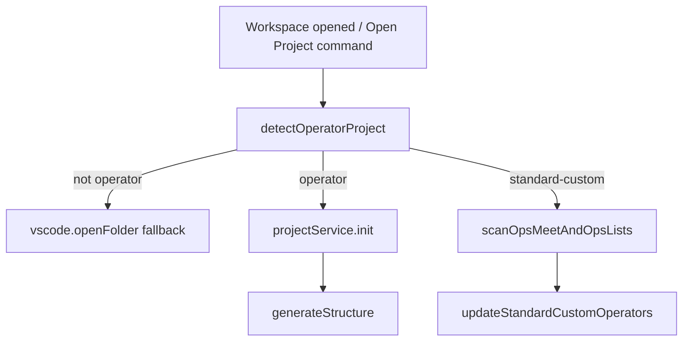
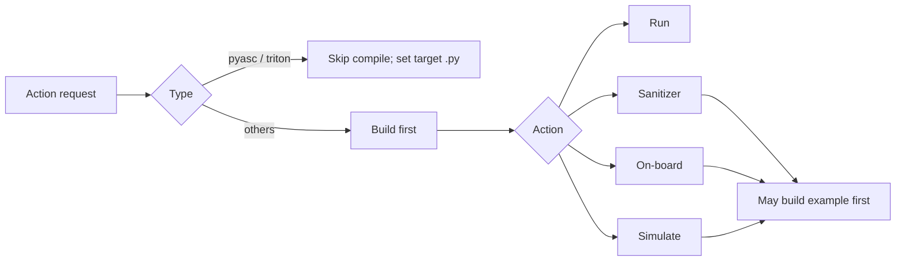

# Operator Plugin Behavior Specification (`plugin/src`)

## Scope and terminology

This document specifies current behavior implemented in `plugin/src` for operator project detection, registration, action execution, templates, and runtime/config dependencies.

The code uses two related type systems:

- **Detection types** (`OperatorProjectType`): `standard-custom`, `ascend-c`, `torch-library`, `pyasc`, `triton`, `multi-project`.
- **Runtime strategy types** (`op_type`): `ascend`, `cann`, `pyasc`, `triton` (used by command strategy and template generator). Triton is registered only when `op-devtools.operatorSupport.triton` is enabled.

## Operator types and project structures

### `standard-custom`
- Root contains `build.sh` with `--genop` (highest-priority rule).
- Typical structure: collection folders (`math`, `conv`, etc.), optional `experimental/<collection>`, and operator subfolders containing `CMakeLists.txt`.

### `ascend-c`
- `CMakeLists.txt` exists.
- `.asc` files exist (root or limited recursive search).
- No root `.py`.

### `torch-library`
- `CMakeLists.txt` exists.
- Root contains `.py` files.

### `pyasc`
- Root contains `.py` files.
- No `CMakeLists.txt`.

### `triton`
- Root contains `.py` files, no `CMakeLists.txt`.
- Heuristic detection: Triton Python markers in sources (`import triton`, `@triton.jit`, etc.) — see `TritonPlugin.detectProject` / `detection-utils.ts`.
- Default template: `triton_vector_add` (`TritonOpGenerator`).

## Detection and collection in workspace

Behavior details:
- On activation with workspace, plugin calls `welcomeMethods.openProject(..., isFromSystem=true)`.
- `openProject` detects type, records `op-devtools.projectType` in workspace settings and metadata in `.vscode/cache.json`, seeds default scripts (`ensureOpDevtoolsSettingsSeeded`), runs `generateStructure`, and for `standard-custom` scans and stores:
  - `ops_meet`
  - `ops_list`
  - `experimental_ops_list`
- Collection scanning uses whitelist-based collection names and detects operators by `CMakeLists.txt`.

## Supported actions and configuration

### Config model

**Canonical reference:** [`workspace-settings.md`](./workspace-settings.md) (keys, merge).

Config rows are **synthesized** per command: the per-section typed DAO factories on `ConfigService` (`getBuildOpConfig()` / `getBuildExampleConfig()` / `getUtTestConfig()` / `getSimulateConfig(projectPath)` / `getOnBoardConfig(projectPath)` / `getSanitizerConfig(projectPath, op)`) read workspace `op-devtools.*` settings directly and fold in `.vscode/cache.json` DB-only fields (`fileMapLists[configType]` → `fileMapList`, `sanitizerPythonTarget[op]` → `target_file`). Default script strings come from `OperatorPluginRegistry.getOpPlugin(op_type).getInitialConfigScripts()` and are seeded into settings by `ensureOpDevtoolsSettingsSeeded` (ascend compile scripts include `--ops={operatorNames}`; see [`build-integration.md`](./build-integration.md#operatornames-and---ops-compile-scripts)).

**At command time** (workspace-only runtime):

| Source | Holds |
|--------|--------|
| Workspace `settings.json` (`op-devtools.*`) | Compile/deploy scripts, sanitizer options, simulation/on-board options, env script path, SOC/simulator overrides |
| `.vscode/cache.json` | `project.{selectedOperatorPaths, compiledOpPaths}`, per-folder `opsMeet` / `opsList` / `experimentalOpsList`, **DB-only** fields (`fileMapList`, …), sanitizer Python target |
| `exampleBuildConfig.targetFile` | Profiler/msprof binary path (workspace setting; fallback `OperatorPluginRegistry.getDefaultPaths`) |

Runtime config objects for commands come from the per-section typed DAO factories on `ConfigService` (`getBuildOpConfig()` / `getBuildExampleConfig()` / `getUtTestConfig()` / `getSimulateConfig(projectPath)` / `getOnBoardConfig(projectPath)` / `getSanitizerConfig(projectPath, op)`), each reading its own dotted settings directly. Writes to settings use **`ConfigService.writeOpDevtoolsDottedSettings`** only.

## Ascend/CANN environment and SOC resolution

**Canonical spec:** [`ascend-env-spec.md`](./ascend-env-spec.md) (precedence, spawn env, placeholders, logging). **A5:** [`ascend-a5-support.md`](./ascend-a5-support.md). **Workspace keys:** [`workspace-settings.md`](./workspace-settings.md#environment-op-devtoolsenvironment).

Operator commands use `resolveAscendEnvForOperatorCommand` → `executeOperatorCommand` ([`build-integration.md`](./build-integration.md)). Strategies may prepend `. ${project.ascend_env_script} &&` when the workspace `environment.environmentScript` setting is set (the record's `ascend_env_script` is that setting, read via `getConfiguredEnvironmentScriptPath`).

### Action capability by type

| Type | Build | Run | Debug | Sanitizer | On-board/Simulate | Mark/Unmark |
|---|---|---|---|---|---|---|
| `standard-custom` | Yes | Yes | Yes | Yes (needs `--bisheng_flags`) | Blocked in context menu | Yes |
| `ascend-c` | Strategy exists, menu actions blocked | Blocked in folder menu | Blocked | Blocked | Blocked | Blocked |
| `torch-library` | Strategy/init exists, menu actions blocked | Blocked in folder menu | Blocked | Blocked | Blocked | Blocked |
| `pyasc` | Build/build_example unsupported in strategy | Yes | Yes | Unsupported in strategy | Yes | Blocked |
| `triton` | Python script via `build_op` / `build_example` (not CANN `build.sh`) | Yes | NPU only (`msdebug-triton-npu`; needs `debugMode` and `supportsNpuDebug`) | Yes (`supportsSanitizer: true`) | Yes (`supportsSimulate` / `supportsOnBoard: true`) | Blocked |

Notes:
- `pyasc` and `triton` run paths require/select a `.py` target and rewrite the deploy target (`compileAndDeploy.buildConfig.deployCommandOrRunCommand` via `ConfigService.writeBuildOpDeployTarget`) when needed.
- `triton` uses `TritonCommandStrategy` (shared Python-operator shell assembly with PyAsc); probe `torch` + `triton` imports via `probeTritonPythonDependencies()` before sanitizer, profiling, and NPU debug runs; debug pre-build uses Triton compile env vars then launches `msdebug-triton-npu`.

## Templates per operator type and rationale

Template mapping:
- `op_type=ascend` -> `ascend_template/add_custom.zip`
- `op_type=cann` -> `cann_template/<template>.zip` (default `hello_world`)
- `op_type=pyasc` -> `cann_template/pyasc_temple.zip`
- `op_type=triton` -> `triton_template/triton_vector_add.zip` (default template name)

Detection/init mapping:
- `ascend-c` -> template `hello_world`
- `torch-library` -> template `torch_library_template`
- `pyasc` -> template `pyasc_temple`
- `triton` -> template `triton_vector_add`
- `standard-custom` -> usually skip unzip, initialize configs only

Rationale in current code:
- Existing user projects should not be overwritten (`skipExisting`, skip unzip paths).
- Templates are used as minimal bootstrapping for generated projects.

## How users add new operators

- **Inside standard-custom**: create operator under valid collection; metadata updates into root project’s `ops_list` / `experimental_ops_list`.
- **Inside pyasc / triton**: add/select `.py` files and use run flows (debug/profile for pyasc; triton supports run, sanitizer, simulate/on-board profiling, and NPU msdebug when the Triton plugin is enabled (`supportsCpuDebug: false`)).

## Why separate Open Operator command exists

`Open Operator Project` performs operator-specific bootstrap that plain `Open Folder` does not:
- type detection
- project registration
- config generation (`build_*`, `sanitizer`, profiling configs)
- `.vscode/devtool_config.json` and launch setup
- standard-custom collection/operator scanning persistence

Without this, plugin state/config may be incomplete.

## Dependencies between actions and caching strategy

Persisted state (workspace):
- `.vscode/cache.json`: project metadata (`project.{selectedOperatorPaths, compiledOpPaths}`), per-folder operator lists (`folders[rootKey].{opsMeet, opsList, experimentalOpsList}`), `fileMapLists`
- Workspace `settings.json` (`op-devtools.*`): scripts, options, project type, env script

Incremental behavior:
- `skipExisting` avoids clobbering existing files on generation.
- Compiled status is preserved on rescans and updated after successful builds.
- No content-hash artifact cache is implemented; build avoidance is mostly script/toolchain-level plus persisted metadata.

## Additional behavior questions covered

- `multi-project` is present in enum but not a first-class runtime action pipeline.
- There is a mapping asymmetry between detection types and `op_type` conversion in some paths (`viewIdToProjectType` vs other init code).
- Context menu intentionally blocks some action/type combinations even when config scaffolding exists.
- Platform assumptions exist in command execution paths (e.g., shell/bash usage).

## Key source files

- `plugin/src/domain/plugins/` — registry ([`operator-plugin-registry.md`](./operator-plugin-registry.md))
- `plugin/src/domain/services/operator-project-detector.ts`
- `plugin/src/service/workspace-detector-service.ts`
- `plugin/src/controller/welcome-controller.ts`
- `plugin/src/extension.ts`
- `plugin/src/service/folder-context-menu-service.ts`
- `plugin/src/domain/models/model.ts`
- `plugin/src/domain/services/op-generator-factory.ts`
- `plugin/src/service/build-service.ts`
- `plugin/src/service/sanitizer-service.ts`
- `plugin/src/controller/task-controller.ts`
- `plugin/src/domain/services/command-strategy/*.ts`
- `plugin/src/domain/models/project-model.ts`
- `plugin/src/domain/utils/project-utils.ts`
- `plugin/src/helpers/operator-project-workspace-config.ts` (`getAscendEnvScriptWithWorkspaceOverride`, `getEnvironmentScriptPathFromWorkspace`)
