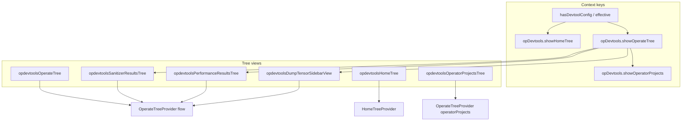

# Operator sidebar — native tree views (current state)

Canonical description of the plugin’s **activity-bar sidebar trees** (Home, Actions, Operators, Sanitizer results, Performance results, Dump tensor results). Feature-specific run/data flows are documented in [`sanitizer.md`](sanitizer.md), [`performance.md`](performance.md), and [`dump-tensor.md`](dump-tensor.md); build/run/debug entry points in [`build-integration.md`](build-integration.md), [`run-integration.md`](run-integration.md), [`debug-integration.md`](debug-integration.md).

All sidebar data is rendered in native VS Code `TreeView`s; no webview sidebar participates at runtime.

---

## Overview

The extension uses **native VS Code `TreeView`s** in container `mindstudio-opssuite-vscode-plugin` (activity bar). All operate/sanitizer/performance tree data and node rendering live in one class, `OperateTreeProvider`, registered in two **kinds** (`flow` | `operatorProjects`) plus thin adapter providers for the results panels.

---

## View IDs and visibility

| View ID | UI name (en) | `when` / rule |
|---------|----------------|---------------|
| `opdevtoolsHomeTree` | Home | `opDevtools.showHomeTree` |
| `opdevtoolsOperateTree` | Actions (ops operate) | `opDevtools.showOperateTree` |
| `opdevtoolsOperatorProjectsTree` | Operators | `opDevtools.showOperatorProjects` |
| `opdevtoolsSanitizerResultsTree` | Sanitizer results | `opDevtools.showOperateTree` |
| `opdevtoolsPerformanceResultsTree` | Performance results | `opDevtools.showOperateTree` |
| `opdevtoolsDumpTensorSidebarView` | Dump tensor results | `opDevtools.showOperateTree` |

### Context switching (`extension.ts` → `refreshSidebarContexts`)

Refreshed on workspace changes, project open/create, `devtool_config.json` watcher events, and coalesced via `requestSidebarContextsRefresh()`.

1. `hasDevtoolConfig` — workspace has usable `devtool_config.json` (via `configService.checkDevtoolConfig()`).
2. `projectType` — from `homeMethods.getProjectType()`; must be supported by `OperatorPluginRegistry.isProjectTypeSupported`.
3. **Effective config** = `hasDevtoolConfig && projectTypeSupported`.

| Context key | Value |
|-------------|--------|
| `hasDevtoolConfig` | effective config (see above) |
| `opDevtools.showHomeTree` | `!effective` |
| `opDevtools.showOperateTree` | `effective` |
| `opDevtools.showOperatorSearch` | `effective && (hasMultipleOperators \|\| isStandardCustom)` |
| `opDevtools.showOperatorProjects` | `effective && hasMultipleOperators && isStandardCustom` |

Additional contexts are updated from tree state (sanitizer group-by, marked-only filters, operator selection, action queue stop-all visibility, msAgent AI-fix availability).

**Home tree:** `HomeTreeProvider` returns **no children** on purpose; `package.json` `viewsWelcome` entries render intro links and command links (new/open project, help, welcome).

---

## Core implementation

| Piece | Path / role |
|-------|-------------|
| Flow + shared state | `plugin/src/class/operate-tree-provider.ts` (`kind: 'flow'`) |
| Operator list tree | Same class (`kind: 'operatorProjects'`) |
| Home empty state | `plugin/src/class/home-tree-provider.ts` |
| Registration | `plugin/src/extension.ts` (`createTreeView`, command wiring) |
| Visibility / project metadata | `refreshState()` → `homeMethods`, `OperatorPluginRegistry` |
| Flow actions from webviews | `OperateTreeProvider.runFlowActionFromWebview*` (registered flow instance) |
| Queued build-like actions | `plugin/src/helpers/operator-action-queue.ts` + `task-method-dispatch.ts` |
| Post-activate data load | `plugin/src/helpers/post-activate-bootstrap.ts` — `refreshSanitizerReports`, `refreshPerformanceReports`, `refreshDumpTensorReports`, focus `opdevtoolsOperateTree` |

`OperateTreeProvider` holds in-memory sidebar state: project type/template, operator list/selection, sanitizer report list + selection/grouping, performance report list + selection, dump tensor report list + compare/selection state. Sanitizer/performance/dump-tensor **results trees** reuse the same provider via delegated `getChildren` / `getSanitizerResultsPanelNodes` / `getPerformanceResultsPanelNodes` / `getDumpTensorResultsPanelNodes`.

Icons: themed SVG assets under extension `tree-icons/svg/` (`getAssetIcon`), refreshed on `onDidChangeActiveColorTheme`.

---

## Actions tree (`opdevtoolsOperateTree`)

Root nodes are built in `getFlowRootNodes()` when `hasDevtoolConfig` and project type is supported. Capabilities come from `OperatorPluginRegistry.getBuildBehaviorByProjectType(projectType)`.

| Node (`nodeId`) | Typical command | Notes |
|-----------------|-----------------|--------|
| `build` | `huawei-op-devtools.sidebar.build` | Hidden if build behavior does not require build |
| `run` | `huawei-op-devtools.sidebar.run` | Always shown; disabled icon if multiple operators selected |
| `debug` (group) | — | Collapsed; children CPU/NPU |
| `cpuDebug` | `huawei-op-devtools.sidebar.cpuDebug` | Hidden for `ascend`; hidden for `cann` + `torch_library_template` |
| `npuDebug` | `huawei-op-devtools.sidebar.npuDebug` | Requires `debugModeEnabled` and registry support |
| `sanitizer` | `huawei-op-devtools.sidebar.sanitizer` | Gear → filtered workspace settings ([`workspace-settings.md`](workspace-settings.md#opening-settings)) |
| `power` (group) | — | Performance tuning parent |
| `onboard` | `huawei-op-devtools.sidebar.onboard` | Gear → on-board settings / quick panel (see [`workspace-settings.md`](workspace-settings.md#opening-settings)) |
| `simulation` | `huawei-op-devtools.sidebar.simulation` | Gear → simulation settings / quick panel (see [`workspace-settings.md`](workspace-settings.md#opening-settings)) |
| `utTest` | `huawei-op-devtools.sidebar.utTest` | Standard-custom + build-capable projects |
| `dumpTensor` | `huawei-op-devtools.sidebar.dumpTensor` | Enqueues a dump-tensor run; results appear in `opdevtoolsDumpTensorSidebarView` (newest report revealed when the run completes) |

**Visibility rules (current):**

- Unsupported `projectType` → empty flow tree.
- **Standard custom** whose `build.sh --help` does not expose `--genop` (`supportsSanitizerAndTuning` is false) → hide Debug group and Performance tuning group.
- **Multi-operator selection** (`selectedOperatorIds.length > 1`) → run/debug/sanitizer/onboard/simulation/ut/dump rows show disabled icon and drop click command (tooltip: single-operator only); the **Debug** and **Performance tuning** section headers mirror the disabled icon.
- **No NPU on extension host** (`opDevtools.npuHardwareAvailable === false`) → NPU-only rows (`run`, `npuDebug`, `sanitizer`, `onboard`, `dumpTensor`) show disabled icon, drop click command, and tooltip `web.operate.npuHardwareRequired`. CPU-capable rows (`build`, `cpuDebug`, `simulation`, `utTest`) and inline gear/settings commands stay enabled. Hardware is probed once per session post-activate via `asys info -r=status` then `npu-smi info` ([`npu-hardware-probe.ts`](../plugin/src/domain/utils/npu-hardware-probe.ts)): NPU is **available** when either command responds (including driver errors such as a busy device); **unavailable** only when both commands are missing or produce no output. Context defaults to `true` until the probe completes (optimistic). See [plugin_release #50](https://gitcode.com/opdevtools/plugin_release/issues/50).
- **UT test:** UT is CPU-capable and runs the configured UT command locally. It does not probe NPU hardware or invoke `remote_tool.sh`.
- Sanitizer / on-board / simulation / build rows gated by `OperatorPluginRegistry` build behavior flags (`supportsSanitizer`, `supportsOnBoard`, `supportsSimulate`, etc.). **Triton** (`project_type` / `op_type` `triton`, when `op-devtools.operatorSupport.triton` is on) shows sanitizer, simulate, and on-board per `TritonPlugin.buildBehavior`; CPU debug stays hidden; NPU debug row follows `supportsNpuDebug` and `debugMode`. Run still requires an active `.py` (same pattern as PyAsc).

**Project config** is not a tree row; title-bar command `huawei-op-devtools.sidebar.projectConfig` opens extension settings ([`workspace-settings.md`](workspace-settings.md#opening-settings)).

**Execution UI:** `runFlowAction()` shows a spinning icon on the active row (`executingFlowNodeId`), inline **Stop** when `opdevtools.flowRunning` context matches, and reflects the **operator action queue** (see below) via `setQueuedFlowStates`. Environment script guard runs before actions unless skipped (e.g. settings-only gear actions use `skipFlowExecutionUi`).

**Not queued:** `build`, `run`, `cpuDebug`, `npuDebug` — they call `taskMethods` directly (no `OperatorActionQueueManager`).

---

## Operator action queue

Long-running flow actions share an **in-memory, strictly serial** queue per scope. Implemented in `plugin/src/helpers/operator-action-queue.ts`; enqueue/stop/status APIs in `plugin/src/helpers/task-method-dispatch.ts`.

### Queueable action types

| `QueueableActionType` | Actions tree `nodeId` | Typical runner |
|----------------------|----------------------|----------------|
| `sanitizer` | `sanitizer` | `dispatchRunSanitizer` → `taskMethods.runSanitizer` |
| `onboard` | `onboard` | `dispatchStartOnBoard` → `taskMethods.startOnBoard` |
| `simulation` | `simulation` | `dispatchStartSimulate` → `taskMethods.startSimulate` |
| `utTest` | `utTest` | `dispatchStartUtTest` |
| `dumpTensor` | `dumpTensor` | `dispatchStartDumpTensor` |
| `stTest` | `stTest` | `dispatchStTestFromWebview` → `taskMethods.startStTest` |
| `cpuDebug` | `cpuDebug` | `taskMethods.runCpuDebug` |
| `npuDebug` | `npuDebug` | `taskMethods.runDebug` |

Entry from the Actions tree or quick-options webviews: `dispatchEnqueueNativeOperatorAction` (tree) or `dispatchSimulator` / `dispatchOnBoard` / `dispatchSanitizer` (webview wrappers that also call enqueue).

### Scope and isolation

Queue key = **`{projectScope}::{selectedOperatorIds}`** (`getOperatorQueueScopeKey()`):

- **Project:** `id:<projectId>` from `getProjectByPath`, else normalized workspace path.
- **Operators:** sorted comma-separated IDs from `homeMethods.getSelectedOperatorIds()`, or `default` if none.

Switching workspace or selected operators uses a **different** queue; queues are never merged. **Every queueable action — st test included — lives in this same per-project queue** (st test previously used a separate global queue; it was unified so it serializes with dump tensor and the rest of the group).

### Rules

- **FIFO:** items run one at a time; the next `queued` item starts only after the current runner finishes (success or failure).
- **One active type per queue:** enqueue is rejected if the same `actionType` already exists in `queued`, `running`, or `cancel_failed` (warning toast with reason).
- **Failure:** a rejected runner still removes the item; processing continues with the next queued item (no automatic retry).
- **Persistence:** in-memory only; extension reload/window restart clears all scopes (no resume).

### Item states (in queue manager)

| State | Meaning |
|-------|---------|
| `queued` | Waiting for turn |
| `running` | Runner in progress (`isProcessAlive` true until runner completes) |
| `cancel_failed` | Stop was requested but process still alive after **10s** timeout (`stopTimeoutMs`) |

Completed items are **removed** from the list (there is no long-lived `success` / `failed` / `cancelled` row in the queue UI).

### Stop

| Target | Behavior |
|--------|----------|
| `queued` | Removed immediately; never runs |
| `running` / `cancel_failed` (process alive) | `taskMethods.stopTask()` via queue manager; 10s timer may set `cancel_failed`; queue does not start the next item while `isProcessAlive` |
| **Stop all** (`huawei-op-devtools.sidebar.stopAllOperatorActions`) | Clears all `queued` items; requests stop for alive runners; title-bar button when `opDevtools.operatorActionQueueStopAllVisible` (≥2 items in current scope) |
| **Per-row Stop** (`huawei-op-devtools.sidebar.stopFlowTask`) | `dispatchStopOperatorAction({ actionType })` when the row maps to a queueable type; otherwise `dispatchStopTask()` + `clearFlowExecutionState()` |

### Actions tree UI sync

`extension.ts` → `syncNativeQueueState()` (on activate and every **1s**):

1. `dispatchGetOperatorActionQueueStatus()` → items for current scope.
2. `operateTreeProvider.setQueuedFlowStates()` — per `nodeId`: `queued` | `running` | `cancel_failed`.
3. `setContext('opDevtools.operatorActionQueueStopAllVisible', items.length >= 2)`.

Tree rendering (`OperateTreeProvider`):

- `queued` → hourglass themed SVG on the flow row.
- `running` / `cancel_failed` / active `runFlowAction` → `loading~spin`.
- Cancellable rows get `opdevtools.flowRunning` (inline Stop in item context menu).

`getActions()` exposes `displayStatus: 'currently executed'` for every in-queue item (API field; tree uses icons rather than that string on labels).

### Post-run hooks

On-board and simulation enqueue paths may pass `onFinished` (e.g. `refreshPerformanceReports({ focusIfNew: true })`) after the runner completes.

---

## Operators tree (`opdevtoolsOperatorProjectsTree`)

Second `OperateTreeProvider` instance (`operatorProjects`). Visible only when `opDevtools.showOperatorProjects`.

- Operator rows come from the **cache scan state** of the collection root — `cache.folders[rootKey].opsList` / `.experimentalOpsList` (each entry: `name`, `path`, `isCompiled`; experimental operators render with an **ex** mark), exposed via `homeMethods.checkMultipleOperators()` with search/filter via `searchKeyword` (title-bar search command).
- Selection persists as **paths** in `cache.project.selectedOperatorPaths` (`homeMethods.setSelectedOperators` → `createProject` re-keys ids to paths; `getSelectedOperatorIds` resolves them back against the scan entries by normalized path).
- Default: the first operator **by name** is selected once per workspace session for standard-custom projects — applied on the first refresh once the operator list is actually known (`hasAppliedDefaultSelection` in `OperateTreeProvider.refreshState`), so a scan state that arrives late still triggers the default.
- Title-bar: select all, clear selection, clear search.
- Item context: toggle operator → `setSelectedOperators` → scan-state-backed path selection. Each row carries its own command id, `huawei-op-devtools.sidebar.toggleOperator.<hash>` (hash = first 16 hex chars of the SHA-256 of the normalized operator project path): `OperateTreeProvider.registerOperatorToggleCommands` registers one such command per rendered row and disposes it when the operator leaves the list. Row identity must live in the command id — a `TreeItem.command` carrying `arguments` is converted by VS Code into a synthetic `<command> /NN` id cached per tree node, which every refresh discards, so a click in flight fails with "command not found".

Flow tree reads `selectedOperatorIds` for multi-operator disable rules and dispatches build/run with `homeMethods.getSelectedOperators()`.

---

## Sanitizer results tree (`opdevtoolsSanitizerResultsTree`)

Adapter `TreeDataProvider` in `extension.ts` — roots from `getSanitizerResultsPanelNodes()`, children for `sanitizerReportItem` / `sanitizerClass` via shared `getChildren`.

- Reports loaded by `refreshSanitizerReports()` → `runDataService.getSanitizerRunData()` (flow instance only).
- Hierarchy: reports → optional grouping (`class` | `severity` | `type` | `file`) → messages.
- Title-bar: add report, sort time, hide/show duplicates, marked-only filter, group-by toggles.
- Inline: mark/unmark report, copy path, open group file, **AI fix** on message rows when `opDevtools.sanitizerAiFixAvailable`.

Details: [`sanitizer.md`](sanitizer.md), [`msagent.md`](msagent.md).

---

## Performance results tree (`opdevtoolsPerformanceResultsTree`)

Adapter with separate `onDidChangePerformanceTreeData` so flow-tree refreshes do not always repaint this view.

- `refreshPerformanceReports()` → `performanceMethods.getRunData` / execution records; sorted in memory (`sortOrder` asc/desc).
- Selection drives run-data preview and Insight open paths (`onDidChangeSelection` in `extension.ts`).
- Title-bar: visualization command, sort time, marked-only filter.
- Tree structure: reports → folders/files under report output (`performanceFolder`, `performanceFile`).

Details: [`performance.md`](performance.md).

---

## Dump tensor results tree (`opdevtoolsDumpTensorSidebarView`)

Adapter `TreeDataProvider` in `extension.ts` with a separate `onDidChangeDumpTensorTreeData` (same pattern as performance): roots from `getDumpTensorResultsPanelNodes()`, children for `dumpTensorReportItem` / `dumpTensorFolder` via shared `getChildren`.

- `refreshDumpTensorReports()` → `dumpTensorMethods.getDumpTensorData`; run after dump-tensor flows and `.bin` imports (`huawei-op-devtools.flashDumpTensorData`), sorted in memory (`sortOrder` asc/desc, default `desc`), no rescan on sort/filter.
- Empty state: a single placeholder row (`web.dump.noData`) without inline actions.

| Node (`nodeId`) | `contextValue` | Notes |
|-----------------|----------------|-------|
| `dumpTensorReportItem` | `dumpTensorReportItem.marked` / `.unmarked` | Report row; stable `id` `dump-tensor-report:<encoded-key>`; marked rows render the `flag-filled` product icon |
| `dumpTensorFolder` | `dumpTensorFolder` | Nested folder under a report; `id` `dump-tensor-folder:<reportKey>:<encoded-segments>` |
| `dumpTensorFile` | `dumpTensorFile.bin` | `.bin` leaf; click opens the companion `.txt`, or toggles compare selection while compare mode is on |

- Title-bar: import `.bin`, compare / start / cancel, sort time, marked-only filter.
- Report row inline: copy path, download (zip), mark/unmark. File leaf: open companion `.txt`, **Compare with…**.

State (`OperateSidebarState.dumpTensor`):

| Field | Purpose |
|-------|---------|
| `reports` | Loaded execution records from `DumpTensorData` |
| `sortOrder` | `asc` / `desc` by timestamp (in-memory resort) |
| `markedOnly` | Filter to marked reports (`opDevtools.dumpTensorMarkedOnly`) |
| `selectedReportKey` | Expand/reveal target |
| `compareMode` | Two-file compare active (`opDevtools.dumpTensorComparing`) |
| `compareSelectedFilePaths` | Up to two `.bin` paths; labels show `(1/2)`, `(2/2)` |

Storage: reports are the subdirectories of `<project>/.vscode/DumpTensor/<report-key>/`; leaves are `.bin` files and opening/comparing uses the companion `.txt` file. Marks persist in `PermanentStorage` under `marked_dump_tensor_records`.

Details: [`dump-tensor.md`](dump-tensor.md).

---

## Commands and menus

Primary wiring is in `package.json`:

- **`view/title`** — per-tree navigation (project config, new project, stop-all queue, sanitizer/performance/dump-tensor toolbars, operator search/select).
- **`view/item/context`** — inline gear (debug/sanitizer/onboard/simulation settings), stop running flow task, sanitizer/performance/dump-tensor report actions, dump-tensor file open/compare.

Sidebar commands are registered in `extension.ts` and call `operateTreeProvider.runFlowAction(...)` then `dispatchStartBuild`, `taskMethods`, etc.

Webview **quick options** panels (simulator/on-board/sanitizer) use `ops` only for config load/save; **Start now** uses `OperateTreeProvider.runFlowActionFromWebview` so the same loading/stop row behavior applies.

---

## Data refresh triggers (typical)

| Event | Effect |
|-------|--------|
| `refreshSidebarContexts()` | Project type, visibility contexts, `refreshState` on both provider instances |
| Build/sanitizer/performance/dump-tensor completion | `refreshSanitizerReports`, `refreshPerformanceReports`, `refreshDumpTensorReports`, compile flags on operators |
| User commands | Sort/filter/group-by mutate state + `fire` tree change |
| Post-activate bootstrap | Auto-open workspace project, initial sanitizer/performance/dump-tensor scan |

---

## Related documentation map

| Topic | Document |
|-------|----------|
| Sanitizer run + results UX | [`sanitizer.md`](sanitizer.md) |
| msAgent AI fix on findings | [`msagent.md`](msagent.md) |
| Profiling run + results + Insight | [`performance.md`](performance.md) |
| Dump tensor run + results + compare | [`dump-tensor.md`](dump-tensor.md) |
| Workspace `op-devtools.*` settings | [`workspace-settings.md`](workspace-settings.md), `package.json` |

---

## Key files (quick index)

| Area | File |
|------|------|
| Tree model + UI | `plugin/src/class/operate-tree-provider.ts` |
| Home welcome | `plugin/src/class/home-tree-provider.ts` |
| Views + commands | `plugin/src/extension.ts` |
| View contributions | `package.json` → `views`, `viewsWelcome`, `menus` |
| Action queue | `plugin/src/helpers/operator-action-queue.ts` |
| Plugin capabilities | `plugin/src/domain/plugins/operator-plugin.registry.ts` |
