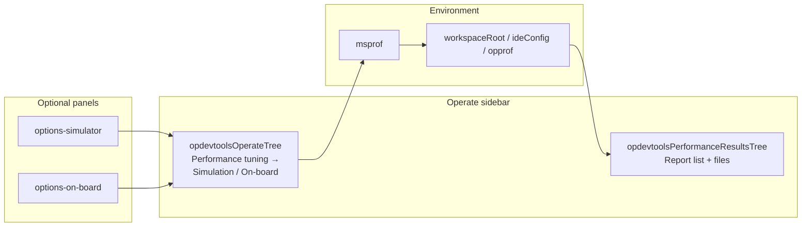
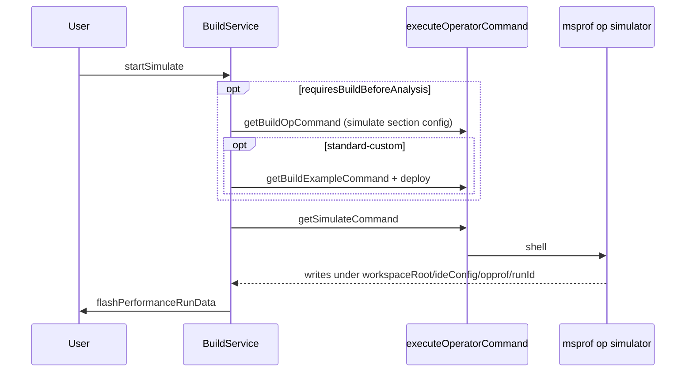

# Performance profiling — architecture

This document describes how **simulation** and **on-board** performance analysis (`msprof` CLI) are integrated in Huawei OP DevTools **as implemented today**: build/deploy pre-steps, profiler command generation, output under `opprof`, and a **native VS Code tree** for browsing results. The extension orchestrates tooling; **msprof** runs in the operator environment.

For CANN/Ascend spawn environment (`SOC_VERSION`, `NPU_ARCH`; simulator-class runs use simulator dir as spawn `SOC_VERSION`) and ACLNN cmake defaults at generation, see [`ascend-env-spec.md`](./ascend-env-spec.md). For A5 on-board metric matrices, see [`ascend-a5-support.md`](./ascend-a5-support.md). For `op-devtools.performanceTuning.*` keys and mapping, see [`workspace-settings.md`](./workspace-settings.md).

---

## Overview

| Layer | Responsibility |
|-------|----------------|
| **CLI** | `msprof op simulator` (simulation) or `msprof op` (on-board) |
| **Plugin** | Optional pre-build / example build / deploy (project-type dependent), command assembly, shell execution |
| **Config** | Workspace settings ([`workspace-settings.md`](./workspace-settings.md) § Performance tuning); `.vscode/cache.json` (`fileMapLists`) for external report paths |
| **Results UI** | Native tree **`opdevtoolsPerformanceResultsTree`** (reports → folder/file leaves) |
| **Viewers** | CSV editor, Insight viewer (`bin`/`json`), profiling-report viewer (`rep`/`ncrep`), optional `vscode.diff` via API |

There is **no** performance-tuning sidebar webview (`performancePanelView` / `performance-run-data` panel) and **no** `open-performance-panel-view` command.

---

## Workbench layout

- **`opdevtoolsOperateTree`**: when the project supports profiling, a **Performance tuning** group (`nodeId === 'power'`) exposes **Simulation analysis** (`simulation`) and **On-board analysis** (`onboard`). Gear icons open workspace settings or the quick-options webviews.
- **`opdevtoolsPerformanceResultsTree`**: separate view (`%view.performanceResultsTree.name%`). **Report rows live here only**, not under the `power` node.
- **Dump tensor** sidebar (`dump-tensor-data` webview) reuses shared performance APIs for folder trees and `performance/diffFiles`; it is not the performance-results browser.

---

## Entry points

### 1. Operate flow tree

| Action | Tree node | Queue type | Runner |
|--------|-----------|------------|--------|
| Simulation | `simulation` | `simulation` | `taskMethods.startSimulate` → `BuildService.startSimulate` |
| On-board | `onboard` | `onboard` | `taskMethods.startOnBoard` → `BuildService.startOnBoard` |

Dispatch: `dispatchSimulator` / `dispatchOnBoard` in `task-method-dispatch.ts` → `dispatchEnqueueNativeOperatorAction` (serial operator queue; see [`operator-treeview.md`](./operator-treeview.md) § Operator action queue).

**Quick options:** unless `simulation.showQuickOptions` / `onBoard.showQuickOptions` is `false`, the tree opens the options webview first (defaults and behavior: [`workspace-settings.md`](./workspace-settings.md#performance-tuning-op-devtoolsperformancetuning)).

Commands: `huawei-op-devtools.sidebar.simulation`, `huawei-op-devtools.sidebar.onboard` (and operate-tree inline actions). Before run, **PyAsc** projects call `homeMethods.validatePyascForAnalysis()` when not using quick panels.

After a queued run finishes, `extension.ts` may call `refreshPerformanceReports({ focusIfNew: true })` in addition to `BuildService` calling `flashPerformanceRunData`.

### 2. Options webviews

| Panel | Path | `ops` API |
|-------|------|-----------|
| Simulation | `web/src/views/panels/options-simulator/` | `getSimulateOptions` / `saveSimulateOptions`, `startSimulate` |
| On-board | `web/src/views/panels/options-on-board/` | `getOnBoardOptions` / `saveOnBoardOptions`, `startOnBoard` |

On confirm, webviews call `startSimulate` / `startOnBoard` then close the editor. Settings persist to workspace `op-devtools.*` via `ConfigService.writeOpDevtoolsDottedSettings`.

### 3. Explorer: add visualization

| Command | Adds to `fileMapList` on config type |
|---------|--------------------------------------|
| `huawei-op-devtools.reportVisualizationSimulation` | `simulate` |
| `huawei-op-devtools.reportVisualizationOnBoard` | `on_board` |
| `huawei-op-devtools.reportVisualizationPerformance` | `on_board` (folder picker or explorer folder) |

Implementation: `FolderContextMenuService.addReportToFileMapList(uri, configType)`.

---

## Simulation run pipeline

**Service:** `BuildService.startSimulate` (`plugin/src/service/build-service.ts`).

Notable behavior:

- Uses **`OperatorPluginRegistry.getOpPlugin(project.project_type).buildBehavior`** for active-file check (PyAsc: must have `.py` active; updates deploy target) and whether build/example/deploy run first.
- The **simulate section config** (`resolveSimulateBaseContext(projectPath, operatorNames)` → `ConfigService.getSimulateConfig(projectPath)`) drives pre-build when `requiresBuildBeforeAnalysis` (`getBuildOpCommand` over that base context).
- **Standard custom:** after example build, `deployStandardCustomRunPackage`.
- On success: `build.simulationSuccess` + `huawei-op-devtools.flashPerformanceRunData` with `{ focusIfNew: true }`.
- On failure: throws (simulate path) so the operator queue can surface errors.

---

## On-board run pipeline

**Service:** `BuildService.startOnBoard`.

Same structure as simulation, but:

- Pre-build uses the **on_board section config** (`resolveOnBoardBaseContext(projectPath, operatorNames)` → `ConfigService.getOnBoardConfig(projectPath)`) when `requiresBuildBeforeAnalysis`.
- Command: `getOnBoardCommand` → `ProfilerFactory.getStrategy('onboard')` with `onboardCannSoc` from `resolveAscendEnv({ isSimulator: false })`.
- PyAsc active-file failure **returns** early (does not throw) — asymmetry vs simulate.
- On success: `build.onBoardSuccess` + `flashPerformanceRunData({ focusIfNew: true })`.

---

## Command generation

### Facades

| Function | File | Strategy method |
|----------|------|-----------------|
| `getSimulateCommand(configId, exampleConfigId, operatorNames?)` | `domain/services/command.ts` | `buildSimulateCommand` |
| `getOnBoardCommand(configId, exampleConfigId, operatorNames?)` | same | `buildOnBoardCommand` |

`CommandStrategyFactory.getStrategy(op_type)` selects ascend / cann / pyasc / triton implementation. Commands are joined with CANN env sourcing + `cd` to build directory (`joinCommands`).

**Python operators (PyAsc / Triton):** profiler commands wrap the deploy target (`python3 ./<file>.py`) with `msprof op [simulator] …` — no compile step. Triton runs `probeTritonPythonDependencies()` before simulate/on-board; profiler target comes from `build_op.target_file` (updated when the user selects an active `.py` file).

### msprof assembly (`domain/services/profiler-service.ts`)

| Mode | Class | CLI shape |
|------|-------|-----------|
| Simulation | `SimulatorStrategy` | `msprof op simulator --soc-version=<SIMULATOR_DIR> --output=<workspaceRoot>/<ideConfig>/opprof --aic-metrics=...` |
| On-board | `OnBoardStrategy` | `msprof op --output=<workspaceRoot>/<ideConfig>/opprof --aic-metrics=...` |

**Simulation metrics** (read from the simulate section DAO `ConfigService.getSimulateConfig(projectPath)` — the strategy passes `config.resourceConflictRatio` / `config.memoryThroughputWaveform` into `getSimulationAicMetrics`; workspace keys in [`workspace-settings.md`](./workspace-settings.md#performance-tuning-op-devtoolsperformancetuning)):

| Workspace setting | CLI metric | Gating |
|-------------------|------------|--------|
| (mandatory base) | `PipeUtilization` | always emitted |
| `simulation.resourceConflictRatio` | `ResourceConflictRatio` | only if SOC allow-listed |
| `simulation.memoryThroughputWaveform` | `PMSampling` | only if SOC allow-listed |

**SOC gating (GC-22 / plugin_release #32):** the simulator (CANN msopprof) validates `--aic-metrics` against the platform selected by `--soc-version` and accepts only a narrow, platform-dependent set; unknown metrics fail with `[ERROR] Unexpected argument … maybe in wrong soc platform` (this broke A3 / `ascend910_93`). Optional metrics are emitted only when the resolved CANN SOC slug is in `SIMULATOR_OPTIONAL_METRIC_SOCS` ([`shared/msprof-simulator-metrics.ts`](../shared/msprof-simulator-metrics.ts)). **A5 (`ascend950`):** `ResourceConflictRatio` and `PMSampling` are allow-listed after §8 CLI verification — see **[`simulator-options-spec.md`](./simulator-options-spec.md)**. Other SOCs remain on `PipeUtilization` only until verified. msprof **mutual exclusion:** `ResourceConflictRatio` (when allow-listed and enabled) replaces `PipeUtilization`; `PMSampling` may append.

**`--soc-version`:** must be the **simulator directory** (`resolveAscendEnv({ isSimulator: true }).simulatorType`), e.g. `Ascend910B3` / `Ascend910C` / `Ascend950PR_9589` — not the CANN slug. Full contract (defaults, precedence, verification, contrast with `{soc_version}` / spawn env): **[`ascend-env-spec.md` §8.1](./ascend-env-spec.md#81-msprof-op-simulator---soc-version-canonical)**.

**On-board metrics** depend on SOC: `isAscendA5ProfilerCannSoc(cannSoc)` chooses A5 vs A3-style base sets; workspace checkboxes are folded into the on_board section DAO (`ConfigService.getOnBoardConfig(projectPath)`); workspace keys: [`workspace-settings.md`](./workspace-settings.md#performance-tuning-op-devtoolsperformancetuning). A5 matrix: [`ascend-a5-support.md`](./ascend-a5-support.md).

**Profiler target binary:** `strategy.getProfilerTargetFile` — the **ascend** strategy reads **`exampleBuildConfig.targetFile`** (workspace setting; falls back to `OperatorPluginRegistry.getDefaultPaths`); the **cann** / **pyasc** / **triton** strategies read the `build_op` deploy key (`deployCommandOrRunCommand`, fallback `targetOpFile`) — see [`workspace-settings.md`](./workspace-settings.md#what-is-not-in-workspace-settings). Optional `operatorNames` rewrites the `test_aclnn_*` path segment for standard custom (first selected name).

**Output directory:** the workspace root — `joinIdeConfigRelative('opprof')` joined with the first workspace folder (fallback: `operator.op_path`), i.e. **`<workspaceRoot>/<ideDir>/opprof`**. Every operator writes its runs there; each run creates a subdirectory (`<runId>`), and the scan reads only this single root (never per-operator trees).

**Output channel:** the on-board run writes to its own `Op Dev Tools: onboard` channel (`toolOutputLabel: 'onboard'`); simulator runs use the `simulate` channel. **Every command in the action's chain writes to the action's channel** — the internal compile/example pre-steps of simulate/on-board go to `simulate`/`onboard`, never to `compile`. Both channels append across runs (GC-73) — see [`build-integration.md`](./build-integration.md) for the channel contract.

---

## Configuration

Profiling keys, compile scripts, and runtime merge: **[`workspace-settings.md`](./workspace-settings.md)** (§ Performance tuning, § Compile & deploy, § Runtime model).

### `.vscode/cache.json` (this feature)

| Field | Role |
|-------|------|
| `fileMapLists.simulate` | External report paths added via “add visualization” (simulation) |
| `fileMapLists.on_board` | External report paths for on-board visualizations (folder picker / explorer folder) |

Section configs are synthesized per run by the DAO factories (`getSimulateConfig(projectPath)` / `getOnBoardConfig(projectPath)` over workspace settings + cache) — nothing is stored on disk besides the workspace settings and `cache.json` fields above.

### Options panels (webviews)

Simulate / on-board options panels read and persist state through workspace settings (`op-devtools.*` via `getSimulateOptions` / `saveSimulateOptions` / `getOnBoardOptions` / `saveOnBoardOptions`) and the workspace cache (`fileMapLists`); there is no config RPC.

Profiler runs are **not** started from the results tree; only from operate flow / options panels / explorer hooks.

### `performance` API (host)

Registered in `api-routes.ts` as `performanceMethods` (`performance-data-controller.ts`). Used **in-process** by `OperateTreeProvider` and from webviews:

| Method | Used by |
|--------|---------|
| `performance/getRunData` | Host tree refresh (via `runDataService`) |
| `performance/toggleRecordMark` | Mark/unmark reports |
| `performance/copyReport` | Concatenate all file contents under report dir → clipboard |
| `performance/downloadReport` | Zip report directory |
| `performance/diffFiles` | `vscode.diff` — **Dump tensor** file tree (`web/.../dump-tensor-data`) |

There is **no** webview panel that calls `getRunData` for the performance results tree.

---

## Discovering reports (`PerformanceRunData`)

**Implementation:** `plugin/src/core/performance/performance-run-data.ts`  
**Bridge:** `RunDataService.getPerformanceRunData` → `performanceMethods.getRunData` → `OperateTreeProvider.refreshPerformanceReports`.

1. **`opprof` subdirectories**  
   Scan the single workspace-root folder **`<workspaceRoot>/<ideConfig>/opprof/`** (joined with the project path). Each **subdirectory** (`<runId>`) = one report (`key` = folder name, `timestamp` = ctime, `children` = scanned files).

2. **`fileMapList`**  
   From all `simulate` and `on_board` configs: `{ filePath, reportTime }` entries that still exist on disk. Keys: `simulate_<path>` or `onboard_<path>`. Directories get scanned children; single files have empty `children`.

3. **Marks**  
   `PermanentStorage` key `marked_performance_records` → `marked` on each record.

4. **Sort in UI**  
   `queryExecutionRecords` returns scan order; **`OperateTreeProvider`** sorts `state.performance.reports` in memory (`sortOrder` asc/desc). Title-bar sort toggles **do not** rescan disk.

### File tree under a report

`scanSubFiles` includes only **`csv`**, **`bin`**, **`json`**, **`rep`**, **`ncrep`** (lowercase). Empty directory branches are pruned. Tree nodes: `performanceFolder`, `performanceFile`.

---

## Results tree behavior

**Registration:** `extension.ts` — adapter `TreeDataProvider` delegating to `operateTreeProvider.getPerformanceResultsPanelNodes()` and `getChildren` for `performanceReportItem` / `performanceFolder`.

**State:** `OperateSidebarState.performance` — `reports`, `sortOrder` (default `desc`), `markedOnly`, `selectedReportKey`.

**Root rows:** real reports or a single empty placeholder (`web.perf.noData`) without inline actions.

**Selection:** `onDidChangeSelection` on `performanceResultsTreeView` → `selectPerformanceReport` / context keys `opDevtools.performanceReportSelected`, `opDevtools.performanceSelectedReportMarked`.

**Reveal:** `refreshPerformanceReports({ focusIfNew: true })` can focus and expand the newest report (`revealPerformanceReport`).

### Title bar vs row actions

| Location | Actions |
|----------|---------|
| `view/title` | Add visualization, sort by time, marked-only filter, refresh results |
| Report row inline | Copy (file **contents**), download (zip), mark/unmark |
| File leaf | Open (`sidebar.performance.file.open`) |

### Open file behavior

| Extension | Handler |
|-----------|---------|
| `csv` | `viewService.openCsvFile` |
| `bin`, `json` | `viewService.openInsight` → Insight data viewer panel (`INSIGHT_HOME_PATH` / `.arts/.env`) |
| `rep`, `ncrep` | `viewService.openProfilingReport` → profiling-report panel (see [`profiling-report-integration.md`](./profiling-report-integration.md)) |

See [`user-issues/profiling-and-insight.md`](./user-issues/profiling-and-insight.md) for known Insight viewer issues (not plugin msprof orchestration).

### Refresh

- **Command:** `huawei-op-devtools.flashPerformanceRunData`
- **Filesystem reconciliation:** each manual refresh replaces the visible inventory with one completed filesystem/config snapshot. Reports, supported child files, and nested folders deleted on disk disappear from the tree; surviving entries remain visible. If the selected report disappeared, selection-dependent context is cleared.
- **Failure and concurrency:** a path confirmed as deleted is omitted without affecting unrelated reports. An unexpected scan error preserves the last valid inventory, and an older overlapping refresh cannot overwrite the newest requested snapshot.
- **Persistence:** reconciliation does not mutate `fileMapList`, stored report mappings, or mark metadata. There is no automatic watcher or polling.
- **Implementation:** `operateTreeProvider.refreshPerformanceReports(args)` only — **no** `postMessage` / iframe refresh.

---

## Commands reference (performance results tree)

| Command id | Role |
|------------|------|
| `huawei-op-devtools.sidebar.performance.report.select` | Update selection context |
| `huawei-op-devtools.sidebar.performance.report.copyPath` | Copy concatenated report file contents |
| `huawei-op-devtools.sidebar.performance.report.download` | Zip download |
| `huawei-op-devtools.sidebar.performance.report.mark` / `.unmark` | Toggle mark |
| `huawei-op-devtools.sidebar.performance.report.sortTime` | Toggle timestamp sort (in-memory) |
| `huawei-op-devtools.sidebar.performance.report.filterMarked` / `.showAll` | Marked-only filter |
| `huawei-op-devtools.sidebar.performance.file.open` | Open csv / bin / json / rep / ncrep |
| `huawei-op-devtools.flashPerformanceRunData` | Rescan disk + config lists |
| `huawei-op-devtools.reportVisualizationPerformance` | Add folder to on_board `fileMapList` |

---

## Key source files

| Area | Path |
|------|------|
| Simulate / on-board orchestration | `plugin/src/service/build-service.ts` |
| Task entry | `plugin/src/controller/task-controller.ts` |
| Queue / ops dispatch | `plugin/src/helpers/task-method-dispatch.ts` |
| Command facades | `plugin/src/domain/services/command.ts` |
| msprof strategies | `plugin/src/domain/services/profiler-service.ts` |
| Per-op-type wrappers | `plugin/src/domain/services/command-strategy/*-strategy.ts` |
| Settings merge | `plugin/src/service/config-service.ts` |
| Disk scan | `plugin/src/core/performance/performance-run-data.ts` |
| Tree UI + state | `plugin/src/class/operate-tree-provider.ts` |
| Clipboard / zip / diff | `plugin/src/controller/performance-data-controller.ts` |
| CSV / Insight | `plugin/src/service/view-service.ts`, `plugin/src/class/insight-data-viewer-panel.ts` |
| profiling-report | `plugin/src/class/profiling-report-panel.ts`, `web/src/views/panels/profiling-report/` |
| Registration | `plugin/src/extension.ts`, `package.json` |
| Options webviews | `web/src/views/panels/options-simulator/`, `options-on-board/` |
| A5 metric matrix | `shared/msprof-onboard-env.ts`, `ascend-util.ts` |

---

## Related documents

| Document | Use for |
|----------|---------|
| [`build-integration.md`](./build-integration.md) | Shared build / executor / `executeOperatorCommand` |
| [`ascend-env-spec.md`](./ascend-env-spec.md) | Spawn env for compile + msprof |
| [`ascend-a5-support.md`](./ascend-a5-support.md) | A5 on-board metrics and defaults |
| [`workspace-settings.md`](./workspace-settings.md) | All `op-devtools.*` keys and runtime merge |
| [`sanitizer.md`](./sanitizer.md) | Parallel native-tree pattern for sanitizer results |
