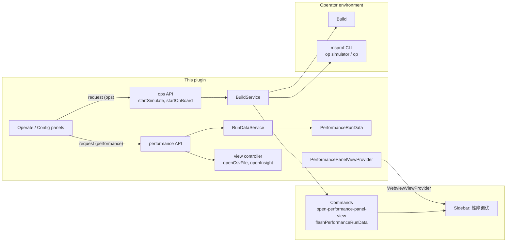
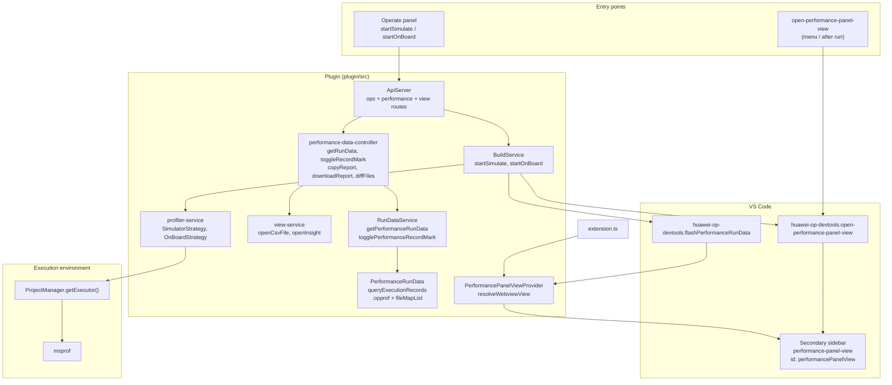
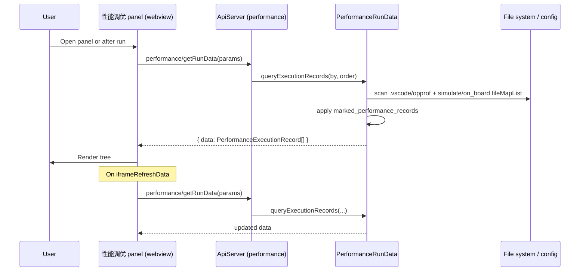
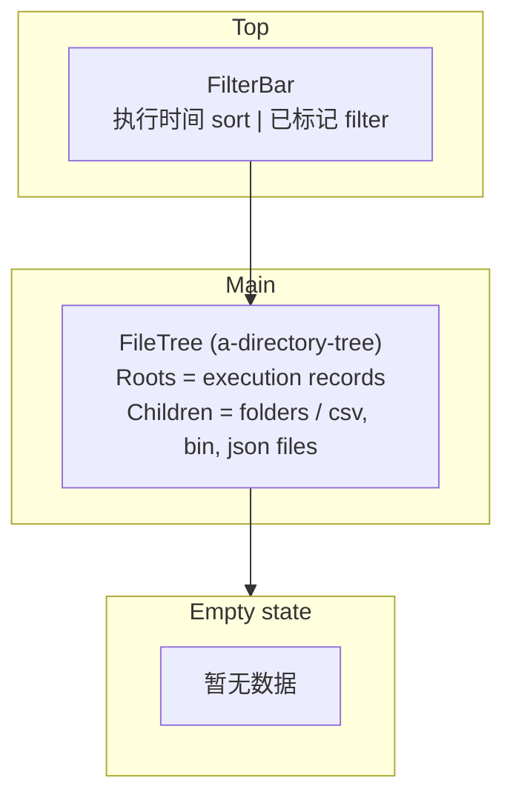
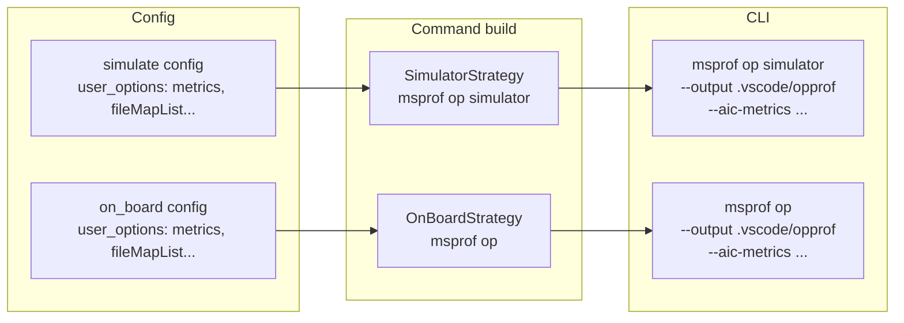
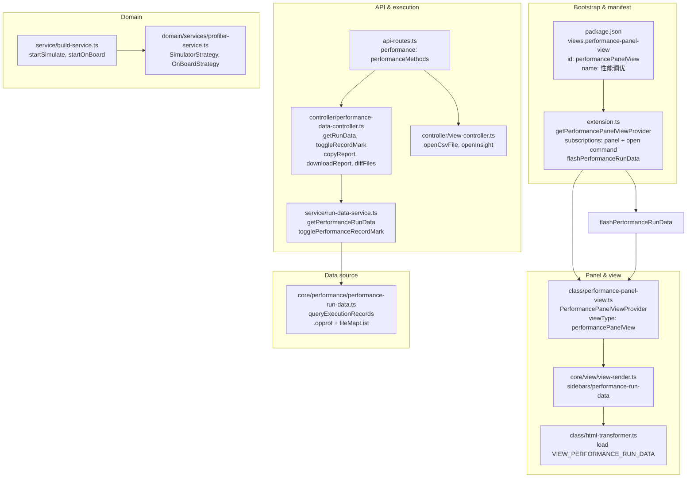

# Profiler Integration Architecture

This document describes how **performance profiling** (性能调优) is integrated in the Huawei OP DevTools VS Code extension: protocols, panel UI, run flow, and the full architecture from entry points to the `msprof` CLI and the 性能调优 (Performance) sidebar panel.

---

## Overview

The plugin integrates **MindStudio Profiler** (`msprof` CLI) for operator performance analysis. It:

- **Runs** profiling via two task types: **仿真分析** (simulate) and **上板分析** (on-board). Each uses a profiler command strategy (`SimulatorStrategy` / `OnBoardStrategy`) that builds an `msprof` command; output is written to `.vscode/opprof` under the operator path or to paths recorded in the simulate/on_board config `fileMapList`.
- **Presents** results in a dedicated **sidebar panel** (“性能调优”): a tree of execution records (from `.vscode/opprof` and from `fileMapList`), with per-record copy, download, and mark; clicking CSV files opens a CSV preview, clicking bin/json files opens the Insight data viewer.
- **Exposes** run data, mark toggle, copy/download report, and diff via the `performance` API namespace; the panel loads the `performance-run-data` web app and refreshes on `iframeRefreshData`.

The actual profiling engine is the **msprof** binary (invoked by the plugin’s command strategy); the plugin provides orchestration, config, and UI.

### A3 vs A5 on-board metrics

On-board (`msprof op`) aic-metrics differ by CANN SOC slug. The plugin uses
`isAscendA5ProfilerCannSoc()` (`ascend950` only) in `profiler-service.ts`
`OnBoardStrategy`: A3-class targets use **Cache heatmap** (`MemoryDetail`);
A5-class use **PC sampling** (`PCSampling`) and a different “collect all
operators by default” rule when Roofline is enabled. Simulate profiling passes
the resolved **simulator directory** to `msprof op simulator --soc-version`
via `resolveAscendEnv({ isSimulator: true })`. Details: **`docs/ascend-a5-support.md`** §4.

---

## Protocols



| Layer | Protocol | Role |
|-------|----------|------|
| **Webview → Plugin** | Custom request/response over ApiServer | Operate calls `ops/startSimulate`, `ops/startOnBoard`; panel calls `performance/getRunData`, `performance/toggleRecordMark`, `view/openCsvFile`, `view/openInsight`, etc. |
| **Plugin → VS Code** | VS Code Extension API (`vscode.commands`, `registerWebviewViewProvider`) | Register “性能调优” panel; open/focus panel; post refresh message to webview |
| **Plugin → msprof** | CLI invocation (stdio) | Build `msprof op simulator` or `msprof op` command (output to `.vscode/opprof`); run via `ProjectManager.getExecutor().execute()` |
| **Panel ↔ Plugin** | Webview `postMessage` / API | Panel calls `performance/getRunData`; plugin posts `iframeRefreshData` to refresh list; `updateTheme` for theme |

---

## High-Level Architecture



---

## Profiler Run Flow

Profiling is triggered by **仿真分析** (simulate) or **上板分析** (on-board), not by a single “run profiler” task. Both flows build, run the corresponding msprof command, then open the performance panel and refresh the run data list.

```mermaid
sequenceDiagram
  participant User
  participant Webview as Operate panel
  participant Api as ApiServer (ops)
  participant Build as BuildService
  participant Exec as Executor
  participant Msprof as msprof CLI
  participant VSCode as VS Code
  participant Panel as 性能调优 panel

  User->>Webview: 仿真分析 or 上板分析
  Webview->>Api: ops/startSimulate or ops/startOnBoard
  Api->>Build: startSimulate() or startOnBoard()

  Build->>Build: getSimulateConfigId() or getOnBoardConfigId()
  Build->>Exec: execute(buildCommand)  // if needed
  Exec-->>Build: build result

  Build->>Exec: execute(simulateCommand or onBoardCommand)
  Note over Build,Msprof: msprof op simulator / msprof op
  Exec->>Msprof: run msprof
  Msprof-->>Exec: output under .vscode/opprof or fileMapList path
  Exec-->>Build: res

  alt res.code === 0
    Build->>VSCode: executeCommand(open-performance-panel-view)
    Build->>VSCode: executeCommand(flashPerformanceRunData)
    VSCode->>Panel: focus + postMessage(iframeRefreshData)
    Panel->>User: Tree refreshed; panel visible
  else failure
    Build->>User: showErrorMessage
  end
```

---

## Panel Data and Refresh

The performance panel does not load “report content” via postMessage like the sanitizer panel. It only:

1. **Load run data** — call `performance/getRunData` with sort params; backend uses `PerformanceRunData.getInstance().queryExecutionRecords(sort.by, sort.order)`.
2. **Refresh list** — on `iframeRefreshData` (from `flashPerformanceRunData`), the webview calls `getPerformanceRunData` again.



---

## Data Format Specification

### Run data (API: `performance/getRunData`)

**Request:** `GetPerformanceRunDataParams` — `{ sort: { by: 'timestamp', order: 'asc' | 'desc' } }`.

**Response:** `GetPerformanceRunDataResult` — `{ data: PerformanceExecutionRecord[] }`.

#### PerformanceExecutionRecord (root / run record)

| Field       | Type     | Description |
|------------|----------|-------------|
| `key`      | string   | Unique key (e.g. directory name under opprof, or `simulate_${filePath}`, `onboard_${filePath}`) |
| `title`    | string   | Display title (e.g. dir name or file base name) |
| `timestamp`| number   | Execution time (ms or from file stat / fileMapList.reportTime) |
| `dirPath`  | string   | Absolute path to the report directory (or file for fileMapList entries) |
| `marked`   | boolean  | Whether the record is marked (stored in `marked_performance_records`) |
| `children`| array    | Tree of folders and files (see below) |

#### Children: PerformanceRunDataFolder | PerformanceRunDataFile

**PerformanceRunDataFolder:**

| Field      | Type  | Description |
|------------|-------|-------------|
| `title`   | string | Folder name |
| `children`| array  | Recursive (folders and files) |

**PerformanceRunDataFile:** Only files with extension `csv`, `bin`, or `json` are included.

| Field     | Type   | Description |
|-----------|--------|-------------|
| `key`     | string | Same as `filePath` |
| `title`   | string | File name |
| `filePath`| string | Absolute path |
| `fileType`| string | `'csv'` \| `'bin'` \| `'json'` |

**Source of records:**

- **.vscode/opprof:** Directories under `{operator_path}/.vscode/opprof`; each subdirectory is one execution record; `children` are built by scanning subdirectories and files (csv/bin/json only).
- **fileMapList:** From simulate and on_board configs (`user_options.fileMapList`): array of `{ filePath, reportTime }`; each entry becomes a record with `key` prefixed by `simulate_` or `onboard_`.

### postMessage commands (panel ↔ plugin)

| Command            | Direction   | Payload / effect |
|--------------------|------------|-------------------|
| `iframeRefreshData`| Plugin → Webview | No payload. Webview reloads run data via `performance/getRunData`. |
| `updateTheme`      | Plugin → Webview | `themeName`: `"dark"` \| `"light"`. Webview applies theme. |

---

## Presentation Details

The **性能调优** panel is implemented in `web/src/views/sidebars/performance-run-data/` (main entry: `performance-run-data.vue`). It shows a filter bar and a directory tree of execution records; clicking a file opens CSV preview or Insight view.

### Layout overview



- **Filter bar:** Sort by execution time (asc/desc); filter “已标记” only.
- **Tree:** Each root node is a `PerformanceExecutionRecord` (title, timestamp on hover, copy / download / mark actions). Expanding shows folders and files; only `.csv`, `.bin`, `.json` appear as file nodes.
- **Click file:** CSV → `view/openCsvFile(filePath)` (CSV preview); bin/json → `view/openInsight(filePath)` (Insight data viewer).
- **Empty state:** “暂无数据” when there are no records.

### Report list (tree roots)

- **Data source:** `getPerformanceRunData({ sort: { by: 'timestamp', order } })` on mount and on `iframeRefreshData`.
- **Display:** Directory tree with custom title slot: root nodes show title and (on hover) copy, download, mark; timestamp can be shown in a secondary line.
- **Mark:** `toggleRecordMark({ key, marked })` then update local state; marks persisted in `marked_performance_records`.

### File actions

- **Copy path:** Copy `record.dirPath` to clipboard (root nodes).
- **Download:** `saveFileToLocal` (or `performance/downloadReport`) to zip the report directory.
- **Open CSV:** `openCsvView(filePath)` → `view/openCsvFile` → `ViewOpener.openCsvPreview`.
- **Open Insight:** `openInsightView(filePath)` → `view/openInsight` → `ViewOpener.openInsight` (for .bin / .json).

### Other behaviors

- **Diff:** `performance/diffFiles({ filePath1, filePath2 })` runs `vscode.diff` with the two file URIs.
- **Theme:** Panel listens for `updateTheme` and uses `useTheme` for dark/light styling.

---

## Profiler Config and Command Build

Profiling uses **simulate** and **on_board** config types (not a single “profiler” config). Each has its own command strategy that builds an `msprof` command.



| Concept | Location | Role |
|--------|----------|------|
| **Simulate config** | `ops/startSimulate`, getSimulateConfigId | Config type `simulate`; options include metrics (e.g. PipeUtilization, ResourceConflictRatio, PMSampling), simulatorType, advance_param; output dir `.vscode/opprof`. |
| **On-board config** | `ops/startOnBoard`, getOnBoardConfigId | Config type `on_board`; options include metrics and advance_param; output dir `.vscode/opprof`. |
| **SimulatorStrategy** | `domain/services/profiler-service.ts` | Builds `msprof op simulator` with `--output`, `--aic-metrics`, etc. |
| **OnBoardStrategy** | Same file | Builds `msprof op` with `--output`, `--aic-metrics`, etc. |
| **fileMapList** | simulate/on_board `user_options` | List of `{ filePath, reportTime }`; after a run, paths can be added (e.g. from context menu); `PerformanceRunData` merges these into the run list with keys `simulate_${filePath}` / `onboard_${filePath}`. |

---

## Component Map (plugin/src)



| File | Role |
|------|------|
| `extension.ts` | Registers `PerformancePanelViewProvider` and `open-performance-panel-view`; registers `flashPerformanceRunData` and posts `iframeRefreshData` to panel webview |
| `class/performance-panel-view.ts` | `WebviewViewProvider` for “性能调优”; loads HTML from `sidebars/performance-run-data`; registers webview with ApiServer as `VIEW_PERFORMANCE_RUN_DATA`; theme postMessage |
| `controller/performance-data-controller.ts` | `performanceMethods`: getRunData, toggleRecordMark, copyReport (directory content to clipboard), downloadReport (zip dir), diffFiles (vscode.diff) |
| `service/run-data-service.ts` | `getPerformanceRunData()` → `PerformanceRunData.getInstance().queryExecutionRecords()`; `togglePerformanceRecordMark()` |
| `core/performance/performance-run-data.ts` | Scans `{op_path}/.vscode/opprof`; merges simulate/on_board configs’ `fileMapList`; returns tree with `marked_performance_records`; builds children (csv/bin/json only) |
| `api-routes.ts` | Mounts `performance` namespace to `performanceMethods` |
| `controller/view-controller.ts` | `openCsvFile`, `openInsight` → viewService |
| `service/view-service.ts` | `openCsvFile` → ViewOpener.openCsvPreview; `openInsight` → ViewOpener.openInsight |
| `domain/services/profiler-service.ts` | `SimulatorStrategy`, `OnBoardStrategy` for msprof command generation |
| `service/build-service.ts` | `startSimulate`, `startOnBoard`: build + run msprof; on success call open-performance-panel-view and flashPerformanceRunData |
| `constants.ts` | `COMMAND_OPEN_PERFORMANCE_PANEL_VIEW`, `COMMAND_FLASH_PERFORMANCE_RUN_DATA`, `VIEW_PERFORMANCE_RUN_DATA` |
| Root `package.json` | `contributes.views["performance-panel-view"]`: webview id `performancePanelView`, name “性能调优”; commands for open and flash |

---

## VS Code Panel Integration

The plugin contributes a **single sidebar webview** for performance:

1. **View contribution**  
   `package.json` → `views["performance-panel-view"]`: type `webview`, id `performancePanelView`, name “性能调优”. This places the view in the secondary sidebar.

2. **Webview content**  
   When the view is resolved, `PerformancePanelViewProvider.resolveWebviewView()` loads HTML from the built web app: `sidebars/performance-run-data` (see `view-render.ts` and `VIEW_PERFORMANCE_RUN_DATA`). The webview is registered with `ApiServer` under `VIEW_PERFORMANCE_RUN_DATA` so the frontend can call `performance/*` and `view/*`.

3. **Opening**  
   `open-performance-panel-view` toggles the panel and focuses `performancePanelView`. No initial data payload; the webview loads run data via `performance/getRunData` on mount.

4. **Refreshing after run**  
   After a successful simulate or on-board run, the plugin runs `open-performance-panel-view` and `flashPerformanceRunData`. The latter posts `iframeRefreshData` to the panel webview so it can call `getPerformanceRunData` again and refresh the tree.

So all performance “windows” are this one sidebar webview; the plugin provides the view provider, commands to open and refresh, and the backend APIs for run data and file opening (CSV/Insight).

---

## Summary

- **Protocols:** Webview ↔ plugin via `ops` (startSimulate, startOnBoard) and `performance` (getRunData, toggleRecordMark, copyReport, downloadReport, diffFiles) and `view` (openCsvFile, openInsight); plugin ↔ VS Code via WebviewViewProvider and commands; plugin ↔ environment via executor running `msprof`.
- **Panel:** Single sidebar view “性能调优” (id `performancePanelView`), backed by `PerformancePanelViewProvider`, loading `sidebars/performance-run-data`; run data from `.vscode/opprof` and simulate/on_board `fileMapList`; marks from `marked_performance_records`; no per-report “content” message — tree only; CSV/Insight opened via view API.
- **Architecture:** Entry points (Operate startSimulate/startOnBoard + open-performance-panel-view) → BuildService (msprof) and performance panel; PerformanceRunData aggregates opprof dirs and fileMapList; panel shows tree and opens files through view controller. This repo provides orchestration, config, and UI; the profiling engine is the external `msprof` tool.
