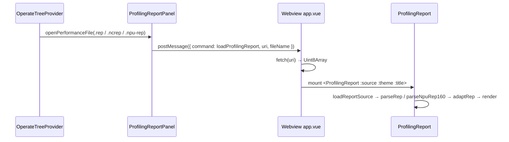
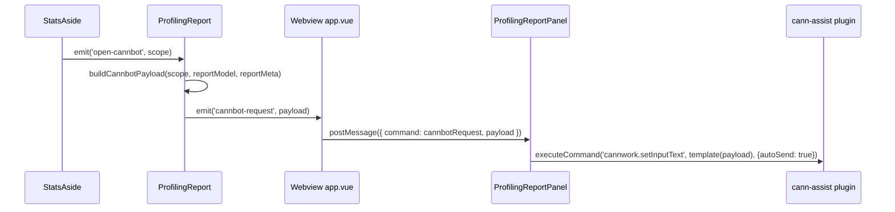

# Profiling report integration

How the **`@huawei/profiling-report`** Vue library is integrated into Huawei OP DevTools as a new `.rep` / `.ncrep` / `.npu-rep` viewer panel, alongside the existing CSV editor and MindStudio Insight viewer. This documents the **as-implemented** wiring; the library's consumer contract lives in the profiling-report repo (`docs/usage/USAGE.md`).

## Viewer boundary

| File type | Viewer |
|-----------|--------|
| `.csv` | `CsvEditorProvider` (custom text editor) |
| `.bin`, `.json` | MindStudio Insight (`InsightDataViewerPanel` + `profiler_server`) |
| `.rep`, `.ncrep`, `.npu-rep` | **profiling-report** panel (this doc) |

The profiling-report library is never injected into Insight iframes — Insight remains a sealed third-party shell.

## Submodule linking

`profiling-report` is a git submodule at the repo root, tracking `IdeFrontend/profiling-report` `master`:

```text
mstt/
  profiling-report/          # git submodule (IdeFrontend/profiling-report)
  web/                       # Vue 3 webviews
  plugin/                    # VS Code extension host
  shared/                    # shared types/constants/i18n
```

No npm dependency is declared for the library. The `web` workspace compiles the submodule's `src/` directly at build time.

## Web workspace wiring

### Build-time alias

[`web/vite.config.ts`](../../web/vite.config.ts) maps the package name to the submodule source:

```ts
alias: {
  '@': path.resolve(__dirname, './src'),
  '@web': path.resolve(__dirname, './src'),
  '@shared': path.resolve(__dirname, '../shared'),
  '@huawei/profiling-report': path.resolve(__dirname, '../profiling-report/src'),
},
```

### Type-check path

[`web/tsconfig.json`](../../web/tsconfig.json) maps the same name to the submodule's **built** declarations so `vue-tsc` resolves full prop/emit types:

```json
"paths": {
  "@/*": ["./src/*"],
  "@web/*": ["./src/*"],
  "@shared/*": ["../shared/*"],
  "@huawei/profiling-report": ["../profiling-report/dist/index.d.ts"]
}
```

> The runtime build needs only the Vite alias (compiles source). The type-check needs `profiling-report/dist/index.d.ts`, which is a gitignored build output — build the submodule first with `cd profiling-report && npm install && npm run build`. This mirrors the existing `shared` package, which must also be built before the web type-check passes.

## Webview panel

Located under [`web/src/views/panels/profiling-report/`](../../web/src/views/panels/profiling-report/):

| File | Role |
|------|------|
| `profiling-report.html` | Vite multi-entry HTML (auto-discovered by `scanDir`) |
| `main.ts` | i18next init + Vue app bootstrap |
| `app.vue` | Mounts `<ProfilingReport :source :theme :title>`; fetches the file via webview URI; loading/error states |
| `composables/useProfilingReportTheme.ts` | Bridges MSTT `updateTheme` → `data-theme` |

The shell gives the host element `height: 100vh` (the `ProfilingReport` component root uses `height: 100%`).

## Extension panel

[`plugin/src/class/profiling-report-panel.ts`](../../plugin/src/class/profiling-report-panel.ts) — `ProfilingReportPanel`, following the `StTestResultsPanel` lifecycle:

- `createOrShow(context, filePath)` — singleton per file (re-uses an open panel and re-loads). Registers the file directory in `localResourceRoots` so the webview can `fetch` it. Only inserts into `openedFiles` after `initializeHtml()` succeeds (failed HTML transform disposes the panel).
- `initializeHtml()` — `HtmlTransformer.transformDistHtml` + `registerWebviewThemeBridge`.
- `loadFile(filePath)` — posts an `asWebviewUri` for the file (no base64 shuttle) plus `filePath` (absolute path) and `collectedAt` (file mtime, ISO) for the cannbot payload meta; failures also post `loadProfilingReportFailed` to the webview.
- `cannbotRequest` handling — when the webview posts `{ command: 'cannbotRequest', payload }`, the panel fills the payload fields into a multi-line template (first line is the built-in prompt `buildInPrompt`, replaceable via the hidden `cannbotPromptOverride` setting) and forwards it to the cannbot plugin via `vscode.commands.executeCommand('cannwork.setInputText', inputText, {autoSend: true})`; success/failure is surfaced with an info/error message.
- `dispose()` — tears down theme/message/dispose disposables and removes itself from `openedFiles`.

## Data flow

A `.rep` / `.ncrep` / `.npu-rep` archive is exposed to the webview as a **local resource URI**; the webview `fetch`es the bytes and the library unpacks the container client-side.



- The extension host does **not** read the whole archive into a JSON message; large reports stay on disk and transfer through the webview resource protocol.
- `parseRep` slices the `cann-rep` container's embedded files by offset/length (no decompression); `parseNpuRep160` parses the product `.npu-rep` 160-byte layout; `adaptRep` maps them to `SwimlaneModel` + `ReportViewModel`.

### CANNBot 分析 (cannbot request)

Clicking a CANNBot icon in the report-analysis aside (summary / compute / memory scope) assembles a read-only snapshot payload inside the library (`buildCannbotPayload`: view-model sections + `reportMeta` + fixed prompt) and relays it to the cannbot plugin:



- `reportMeta` (report_name / report_path / collected_at) comes from the `loadProfilingReport` message fields (`fileName` / `filePath` / `collectedAt`), so the payload never re-parses the `.rep`.
- Payload data reuses the already-parsed view model — no CSV re-parse (submodule contract: `specs/core/cannbot-payload.spec.md`).

## Theme support

The panel registers the standard MSTT theme bridge (`registerWebviewThemeBridge`), which pushes `{ command: 'updateTheme', isDark }` on theme changes. `useProfilingReportTheme` converts that to a `theme` ref (`'dark'` / `'light'`) passed as the component's `theme` prop, which drives `data-theme` on `.pr-root`. The component also requests the current theme on mount (`{ command: 'getTheme' }`, handled by `handleThemeRequest`).

## File discovery

[`plugin/src/core/performance/performance-run-data.ts`](../../plugin/src/core/performance/performance-run-data.ts) — `scanSubFiles` now includes `rep`, `ncrep`, and `npu-rep` in the accepted extensions list (alongside `csv`, `bin`, `json`).

## Open dispatch

1. [`plugin/src/class/operate-tree-provider.ts`](../../plugin/src/class/operate-tree-provider.ts) — `openPerformanceFile` routes `rep`/`ncrep`/`npu-rep` to `viewService.openProfilingReport`.
2. [`plugin/src/service/view-service.ts`](../../plugin/src/service/view-service.ts) — `openProfilingReport` → `ViewOpener.openProfilingReport`.
3. [`plugin/src/core/view/view-opener.ts`](../../plugin/src/core/view/view-opener.ts) — `openProfilingReport(uri)` → `ProfilingReportPanel.createOrShow(context, filePath)`.

Constants: `VIEW_PROFILING_REPORT` and `PROFILING_REPORT_PANEL_TYPE` in [`plugin/src/constants.ts`](../../plugin/src/constants.ts).

## Context menu

The `huawei-op-devtools.openProfilingReport` command is surfaced on report files via the `editor/title` toolbar button and the `explorer/context` right-click menu. Both `when` clauses gate on `resourceExtname == '.rep' || '.ncrep' || '.npu-rep'` (in [`package.json`](../../package.json)). The toolbar entry also requires `activeCustomEditorId != 'opdevtoolsNpuRepViewer'`, so it appears when a report is open as text (including “Open With… Text Editor”) but not when the `.npu-rep` custom editor is already showing the report. Right-clicking a `.npu-rep` file in the Explorer offers **Open Profiling Report**.

## i18n

`profilingReport.*` keys added to [`shared/i18n/en.ts`](../../shared/i18n/en.ts) and [`shared/i18n/zh-cn.ts`](../../shared/i18n/zh-cn.ts): panel title, loading/empty/fetch-failed webview strings, file-not-found, load-failed, empty-path.

Host shell strings follow `vscode.env.language` via HTML `lang` injection (`ProfilingReportPanel` → i18next in `main.ts`). Library chrome (toolbar, aside, detail, tooltips) is separate: map the same resolved language to `:locale` on `<ProfilingReport>` in `app.vue`. The library accepts `en*` / `zh*` prefixes and defaults to `zh-CN` when `locale` is omitted.

## Key source files

| Area | Path |
|------|------|
| Webview shell | `web/src/views/panels/profiling-report/` |
| Extension panel | `plugin/src/class/profiling-report-panel.ts` |
| Vite alias | `web/vite.config.ts` |
| Type-check path | `web/tsconfig.json` |
| Discovery | `plugin/src/core/performance/performance-run-data.ts` |
| Dispatch | `plugin/src/class/operate-tree-provider.ts`, `plugin/src/service/view-service.ts`, `plugin/src/core/view/view-opener.ts` |
| Constants | `plugin/src/constants.ts` |
| i18n | `shared/i18n/en.ts`, `shared/i18n/zh-cn.ts` |

## Related documents

| Document | Use for |
|----------|---------|
| [`performance.md`](./performance.md) | msprof pipeline + results tree (updated for `.rep`/`.ncrep`/`.npu-rep`) |
| `profiling-report/docs/usage/USAGE.md` (submodule) | Library consumer contract |
| `profiling-report/docs/architecture/MSTT_INTEGRATION.md` (submodule) | Design-level integration |
