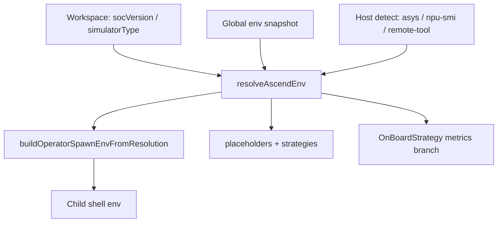

# A2 / A3 / A5 environment support — current implementation

This document describes **how the plugin handles Ascend A2-class, A3-class and A5-class targets today**: one resolver, shared spawn contract, and the places where behavior diverges.

**Canonical contracts (all platforms):**

- [`ascend-env-spec.md`](./ascend-env-spec.md) — precedence, spawn env, placeholders, logging  
- [`ascend-a5-support.md`](./ascend-a5-support.md) — A5 verification checklist and operational caveats  
- [`workspace-settings.md`](./workspace-settings.md) — `environment.socVersion`, `performanceTuning.simulation.simulatorType`, on-board UI keys  

**Code:** [`plugin/src/domain/utils/ascend-util.ts`](../plugin/src/domain/utils/ascend-util.ts), [`shared/cann-env-constants.ts`](../shared/cann-env-constants.ts), [`shared/msprof-onboard-env.ts`](../shared/msprof-onboard-env.ts), [`shared/cann-aclnn-build-defaults.ts`](../shared/cann-aclnn-build-defaults.ts).

There is **no separate “A3 mode” or “A5 mode”** in the product. The extension resolves a **CANN SOC slug** (`socVersion`) and derives simulator directory, `NPU_ARCH`, ACLNN cmake inputs, and on-board profiler metrics from that slug (plus workspace overrides).

**Terminology in this repo** (series names follow [`ascend-env-spec.md`](./ascend-env-spec.md) §1):

| User / hardware label | Series | Primary CANN slug | `isAscendA5ProfilerCannSoc` |
|----------------------|--------|-------------------|-----------------------------|
| Atlas A2 — Ascend 910B, 910B3, 910A, 310P | **A2** | `ascend910b` (and `ascend910`, `ascend310p`) | `false` |
| Atlas A3 — Ascend 910_93xx / 910C | **A3** | `ascend910_93` | `false` |
| Atlas A5 — Ascend 950 | **A5** | `ascend950` | `true` **only** for normalized `ascend950` |

---

## Shared pipeline (same for A2, A3 and A5)

All series use the same entry points:

1. **`resolveAscendEnv({ isSimulator })`** — picks `socVersion`, `simulatorType` (simulate only), `npuArch`, and `source.*` ([`ascend-env-spec.md`](./ascend-env-spec.md) §7).
2. **`resolveAscendEnvForOperatorCommand(ctx)`** — one resolution per operator command (build, run, simulate, on-board, sanitizer, …).
3. **`buildOperatorSpawnEnvFromResolution`** — child-process spawn env only; the extension host **does not** write `SOC_VERSION` / `NPU_ARCH` back to `process.env`.
4. **`operator-script-placeholders`** — `{soc_version}` always the **CANN slug**; `{simulator_type}` the simulator **directory name** under `tools/simulator/`.
5. **Templates** — CANN cmake reads `$ENV{SOC_VERSION}`, `$ENV{NPU_ARCH}` when the cache is unset/empty (build.sh forwards `-DCMAKE_ASC_ARCHITECTURES=${NPU_ARCH}`); Ascend `add_custom` bakes `SUPPORT_*` at generation (see `plugin/templates/code_template/`).

**Resolution inputs:** workspace `environment.socVersion` and `performanceTuning.simulation.simulatorType` (explicit only), the OS-env snapshot (`SOC_VERSION`, `SIMULATOR_TYPE`, `NPU_ARCH`), and host detection — see [`ascend-env-spec.md`](./ascend-env-spec.md) §7. The resolver never consults the project record.

**Activation:** `global-env-snapshot.ts` freezes host `process.env` once at load; the plugin never sources `set_env.sh` into the extension host.

---

## A2 / A3 vs A5 — detailed differences

This block is the **authoritative split** for product and support. Everything else in the tree is shared infrastructure with different **constant values** or **profiler/UI branches**.

### 1. Canonical strings

| Concept | A2-class (910B typical) | A3-class (910_93 typical) | A5-class (950 typical) | Constants |
|---------|-------------------------|---------------------------|------------------------|-----------|
| CANN SOC slug (`SOC_VERSION` on non-sim runs; `{soc_version}`) | `ascend910b` | `ascend910_93` | `ascend950` | `CANN_SOC_ASCEND_910B`, `CANN_SOC_ASCEND_910_93`, `CANN_SOC_ASCEND_950` |
| Default simulator directory (`tools/simulator/<dir>/lib`) | `Ascend910B3` | `Ascend910_9362` | `Ascend950PR_9589` | `SIMULATOR_ASCEND_910B3`, `SIMULATOR_ASCEND_910C`, `SIMULATOR_ASCEND_950PR_9589` |
| AscendC `--npu-arch` (`NPU_ARCH`) | `dav-2201` | `dav-2201` | `dav-3510` | `NPU_ARCH_DAV_2201`, `NPU_ARCH_DAV_3510` |
| ACLNN `SUPPORT_COMPUTE_UNIT` (generation → ascend standard-custom cmake) | `ascend910_95` | `ascend910_95` | `ascend950` | `cann-aclnn-build-defaults.ts` |
| ACLNN `SUPPORT_TILING_DIR` | `arch22` | `arch22` | `arch35` | same file |

**Do not conflate:** `SOC_VERSION=ascend950` (packaging / `build.sh --soc=`) vs `SUPPORT_COMPUTE_UNIT=ascend950` (ACLNN `SocVersion` in op_host) vs `NPU_ARCH=dav-3510` (AscendC). On A5, spawn env sets `SOC_VERSION` + `NPU_ARCH`; `SUPPORT_*` are fixed in cmake when the operator is created.

### 2. Host detection (chip rules)

Detection runs at most once per extension session (`asys info -r=status`, then `npu-smi info`, then the remote-tool series mapping), matching on normalized probe text: exact chip rules first, then ordered prefixes (`Ascend950` → `Ascend910_` → `Ascend910A` → `Ascend910B`).

| Probe text examples (non-exhaustive) | Resolved slug | Series |
|--------------------------------------|---------------|--------|
| `Ascend901A/B`, `Ascend910ProA/ProB`, `Ascend910PremiumA` (exact) | `ascend910b` (+ `npuArch=dav-1001`) | A2 |
| `Ascend910A…`, `Ascend910B…`, e.g. `Ascend910B3` | `ascend910b` | A2 |
| `Ascend910_…`, e.g. `Ascend910_9362`, `Ascend 910_9362 V1` | `ascend910_93` | A3 |
| `Ascend950…`, e.g. `Ascend950PR_9589`, `Ascend 950PR_9589` | `ascend950` | A5 |

Non-`Ascend*` labels (e.g. `Atlas A5` alone, without a chip name) do not match — set **`environment.socVersion`** explicitly. Heterogeneous multi-NPU hosts also need an explicit workspace SOC or simulator setting.

### 3. Spawn environment per command

| Variable | A2-class behavior | A3-class behavior | A5-class behavior |
|----------|-------------------|-------------------|-------------------|
| **`SOC_VERSION`** (non-simulator) | CANN slug, e.g. `ascend910b` | `ascend910_93` | `ascend950` |
| **`SOC_VERSION`** (simulator-class run) | Simulator **directory** name, e.g. `Ascend910B3` (cmake links `tools/simulator/${SOC_VERSION}/lib`) | `Ascend910_9362` | `Ascend950PR_9589` when SOC/simulator resolved to 950 |
| **`NPU_ARCH`** | `dav-2201` (or `dav-1001` for exact 901/Pro/Premium chips) | `dav-2201` | `dav-3510` |
| **`SUPPORT_COMPUTE_UNIT`** | `ascend910_95` | `ascend910_95` | `ascend950` |
| **`SUPPORT_TILING_DIR`** | `arch22` | `arch22` | `arch35` |

`NPU_ARCH` precedence: workspace `environment.npuArch` (explicit) → `NPU_ARCH` env snapshot → derived from the resolved SOC ([`ascend-env-spec.md`](./ascend-env-spec.md) §6). Branching function: `isAscendA5ProfilerCannSoc(normalizeCannSoc(slug))` — **exact** slug `ascend950` only.

**Simulator-driven SOC:** If the user explicitly sets workspace `performanceTuning.simulation.simulatorType` (e.g. `Ascend950PR_9589`), `simulatorTypeToCannSoc` derives the CANN slug (e.g. `ascend950`) and its `NPU_ARCH` for that run so SOC and simulator cannot disagree ([`ascend-env-spec.md`](./ascend-env-spec.md) §4.4, §7).

### 4. On-board profiler (`msprof op` aic-metrics)

Controlled in `profiler-service.ts` → `OnBoardStrategy.getOnBoardMetrics` using `onboardCannSoc` from `resolveAscendEnv({ isSimulator: false })` in command strategies.

| Aspect | A2/A3-class (`ascend910b`, `ascend910_93`, …) | A5-class (`ascend950` only) |
|--------|------------------------------------------------|------------------------------|
| Base metric set includes **cache / memory detail** | Yes — `MemoryDetail` | No — `MemoryDetail` not in base list |
| Base metric set includes **PC sampling** | No — `PCSampling` not in base list | Yes — `PCSampling` in base list |
| “Collect all operators by default” (`Default` bundle) when | `Roofline` **or** `MemoryDetail` enabled | `Roofline` **or** `PCSampling` enabled |
| Shared base metrics | `Occupancy`, `Roofline`, `Source`, `KernelScale` | same |

**Workspace → runtime config** (the on-board DAO `ConfigService.getOnBoardConfig(projectPath)`):

| Workspace key | Applied when | On-board metric |
|---------------|--------------|-----------------|
| `performanceTuning.onBoard.cacheHeatmap` | **Not** A5 (`!isAscendA5ProfilerCannSoc`) | `MemoryDetail` |
| `performanceTuning.onBoard.pcSampling` | A5 only | `PCSampling` |

The gate is applied **at read time** from the effective SOC (`resolveEffectiveCannSoc()`); the stored setting for the other generation is ignored. **New operator defaults** (project creation seed in `config-service.ts`): `MemoryDetail: false`, `PCSampling: true` when the effective SOC is A5; inverse for A2/A3-class.

**UI:** On-board options webview shows cache heatmap vs PC sampling tooltips per series (`web/src/views/panels/options-on-board/`); i18n in `shared/i18n` / `package.nls*.json`.

#### 4.1 Simulation profiler (`msprof op simulator`)

**Same rule for every series:** `--soc-version` is always the **simulator directory** from `resolveAscendEnv({ isSimulator: true }).simulatorType`, never the CANN slug. Full contract: [`ascend-env-spec.md`](./ascend-env-spec.md) §8.1.

| Series | Typical `--soc-version` | Typical CANN slug (not for `--soc-version`) |
|--------|-------------------------|---------------------------------------------|
| A2 / 910B-class | `Ascend910B3` | `ascend910b` |
| A3 / `910_93` | `Ascend910_9362` | `ascend910_93` |
| A5 / 950-class | `Ascend950PR_9589` | `ascend950` |

**Metrics:** `SimulatorStrategy` / `getSimulationAicMetrics(...)` — **SOC-gated** (GC-22 / plugin_release #32): optional metrics are allow-listed in `SIMULATOR_OPTIONAL_METRIC_SOCS`. **A5 (`ascend950`):** `ResourceConflictRatio` and `PMSampling` confirmed via §8 CLI — see [`simulator-options-spec.md`](./simulator-options-spec.md). A3 (`ascend910_93`) rejects `ResourceConflictRatio`. Mutual exclusion and PMSampling append rules: [`performance.md`](./performance.md).

### 5. Standard-custom `.run` deploy

`getExecutableCommand(..., { execute: true })` in `command-utils.ts` builds the install command for `.run` packages: `chmod +x`, then **probe the installer's own `--help` output at runtime** and append ` --force` only when the installer advertises it. The check is per-installer, not per-SOC — there is no series-based gating. The deploy path is the same for A2, A3 and A5; post-`build_example` deploy for standard-custom uses the same helper via `getStandardCustomDeployCommand` in `command.ts`.

### 6. On-board config persistence

On-board options live in workspace settings (`performanceTuning.onBoard.*`); `pcSampling` vs `cacheHeatmap` are read through `ConfigService.getOnBoardConfig`, SOC-gated by `isAscendA5ProfilerCannSoc(resolveEffectiveCannSoc())`. If settings were written for different hardware, update `performanceTuning.onBoard.*` / `performanceTuning.simulation.*` / `environment.socVersion` manually ([`ascend-a5-support.md`](./ascend-a5-support.md) §2.3).

### 7. What is intentionally the same

| Area | Notes |
|------|--------|
| Resolver precedence | Same rules; only outputs change ([`ascend-env-spec.md`](./ascend-env-spec.md)) |
| Placeholder mechanism | `{soc_version}`, `{simulator_type}` in all op plugins |
| Simulate profiler | `SimulatorStrategy` uses resolved **simulator directory** for `msprof op simulator --soc-version` (all series); spec: [`ascend-env-spec.md`](./ascend-env-spec.md) §8.1 |
| PyAsc / Triton | Python entrypoints; no A2/A3/A5 cmake split; profiler still calls `resolveAscendEnv` for SOC passed into strategies |
| CANN template `build.sh` / cmake | Env-driven (`$ENV{SOC_VERSION}` / `$ENV{NPU_ARCH}`); no hardcoded series literals in current templates |
| Fallback when nothing resolves | `DEFAULT_FALLBACK_CANN_SOC` = `''` (empty — no silent default to `ascend910b`) |

### 8. Quick reference matrix

| Concern | A2-class | A3-class | A5-class |
|---------|----------|----------|----------|
| Profiler SOC gate | any slug except `ascend950` | any slug except `ascend950` | `ascend950` only |
| Simulate `msprof --soc-version` | `Ascend910B3` (simulator dir) | `Ascend910_9362` (simulator dir) | `Ascend950PR_9589` (simulator dir) |
| Default sim dir from SOC map | `Ascend910B3` | `Ascend910_9362` | `Ascend950PR_9589` |
| NPU arch | `dav-2201` (`dav-1001` on exact Pro/Premium/901 chips) | `dav-2201` | `dav-3510` |
| ACLNN spawn pair | `ascend910_95` + `arch22` | `ascend910_95` + `arch22` | `ascend950` + `arch35` |
| On-board “memory” UX | Cache heatmap → `MemoryDetail` | Cache heatmap → `MemoryDetail` | PC sampling → `PCSampling` |
| `.run` deploy `--force` | discovered from installer `--help` | same | same |

---

## Resolution flow (all series)

---

## Primary code locations

| Area | Path |
|------|------|
| SOC rules, NPU arch, spawn env, SUPPORT_* | `plugin/src/domain/utils/ascend-util.ts` |
| A5 profiler SOC check | `shared/msprof-onboard-env.ts` |
| Shared slugs / sim dirs | `shared/cann-env-constants.ts` |
| ACLNN compute unit / tiling | `shared/cann-aclnn-build-defaults.ts` |
| On-board metric matrix | `plugin/src/domain/services/profiler-service.ts` |
| On-board SOC passed into profiler | `command-strategy/ascend-strategy.ts`, `cann-strategy.ts`, `python-operator-strategy-shared.ts` |
| On-board config DAO + new-op defaults | `plugin/src/service/config-service.ts` |
| `.run` deploy command | `plugin/src/domain/utils/command-utils.ts` |
| Tests | `plugin/src/__tests__/unit/operator-spawn-env.spec.ts`, `operator-project-workspace-config-a5.spec.ts`, `command-utils.spec.ts`, `profiler-simulator-resolution.spec.ts` |

---

*Last aligned with `plugin/src` and `shared` (2026-08). Validate CANN simulator directory names and SOC slugs against your installed toolkit on target hardware.*
