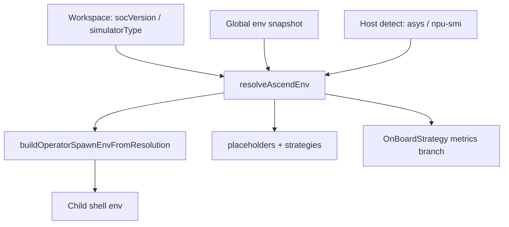

# A3 / A5 environment support — current implementation

This document describes **how the plugin handles Ascend A3-class vs A5-class targets today**: one resolver, shared spawn contract, and the places where behavior diverges.

**Canonical contracts (all platforms):**

- [`ascend-env-spec.md`](./ascend-env-spec.md) — precedence, spawn env, placeholders, logging  
- [`ascend-a5-support.md`](./ascend-a5-support.md) — A5 verification checklist and operational caveats  
- [`workspace-settings.md`](./workspace-settings.md) — `environment.socVersion`, `performanceTuning.simulation.simulatorType`, on-board UI keys  

**Code:** [`plugin/src/domain/utils/ascend-util.ts`](../plugin/src/domain/utils/ascend-util.ts), [`shared/cann-env-constants.ts`](../shared/cann-env-constants.ts), [`shared/msprof-onboard-env.ts`](../shared/msprof-onboard-env.ts), [`shared/cann-aclnn-build-defaults.ts`](../shared/cann-aclnn-build-defaults.ts).

There is **no separate “A3 mode” or “A5 mode”** in the product. The extension resolves a **CANN SOC slug** (`socVersion`) and derives simulator directory, `NPU_ARCH`, ACLNN cmake inputs, and on-board profiler metrics from that slug (plus workspace overrides).

**Terminology in this repo:**

| User / hardware label | Plugin “generation” | Primary CANN slug | `isAscendA5ProfilerCannSoc` |
|----------------------|---------------------|-------------------|-----------------------------|
| Atlas A3, Ascend 910B, 910B3, … | **A3-class** (also A2 in ACLNN comments) | `ascend910b` (and related 910/910C/310P slugs) | `false` |
| Atlas A5, Ascend 950, … | **A5-class** | `ascend950` | `true` **only** for normalized `ascend950` |

---

## Shared pipeline (same for A3 and A5)

Both generations use the same entry points:

1. **`resolveAscendEnv({ isSimulator })`** — picks `socVersion`, `simulatorType` (simulate only), `npuArch`, and `source.*` ([`ascend-env-spec.md`](./ascend-env-spec.md) §3).
2. **`resolveAscendEnvForOperatorCommand(ctx)`** — one resolution per operator command (build, run, simulate, on-board, sanitizer, …).
3. **`buildOperatorSpawnEnvFromResolution`** — child-process `env` only; the extension host **does not** write `SOC_VERSION` / `NPU_ARCH` back to `process.env`.
4. **`operator-script-placeholders`** — `{soc_version}` always the **CANN slug**; `{simulator_type}` the simulator **directory name** under `tools/simulator/`.
5. **Templates** — CANN cmake reads `$ENV{SOC_VERSION}`, `$ENV{NPU_ARCH}` when cache is empty; Ascend `add_custom` bakes `SUPPORT_*` at generation (see `plugin/templates/code_template/`).

**Not used for resolution:** `projects.json` `soc_version` (display / legacy APIs only). Prefer workspace `environment.socVersion` or explicit `performanceTuning.simulation.simulatorType`.

**Activation:** `global-env-snapshot.ts` freezes host `process.env` once at load; no `refreshAscendEnv()` merge of `set_env.sh` into the extension host.

---

## A3 vs A5 — detailed differences

This block is the **authoritative split** for product and support. Everything else in the tree is shared infrastructure with different **constant values** or **profiler/UI branches**.

### 1. Canonical strings

| Concept | A3-class (910B typical) | A5-class (950 typical) | Constants |
|---------|-------------------------|------------------------|-----------|
| CANN SOC slug (`SOC_VERSION` on non-sim runs; `{soc_version}`) | `ascend910b` | `ascend950` | `CANN_SOC_ASCEND_910B`, `CANN_SOC_ASCEND_950` |
| Default simulator directory (`tools/simulator/<dir>/lib`) | `Ascend910B3` | `Ascend950PR_9589` | `SIMULATOR_ASCEND_910B3`, `SIMULATOR_ASCEND_950PR_9589` |
| AscendC `--npu-arch` (`NPU_ARCH`) | `dav-2201` | `dav-3510` | `NPU_ARCH_DAV_2201`, `NPU_ARCH_DAV_3510` |
| ACLNN `SUPPORT_COMPUTE_UNIT` (generation → ascend standard-custom cmake) | `ascend910_95` | `ascend950` | `cann-aclnn-build-defaults.ts` |
| ACLNN `SUPPORT_TILING_DIR` | `arch22` | `arch35` | same file |

**Do not conflate:** `SOC_VERSION=ascend950` (packaging / `build.sh --soc=`) vs `SUPPORT_COMPUTE_UNIT=ascend950` (ACLNN `SocVersion` in op_host) vs `NPU_ARCH=dav-3510` (AscendC). On A5, spawn env sets `SOC_VERSION` + `NPU_ARCH`; `SUPPORT_*` are fixed in cmake when the operator is created.

### 2. Host detection (`ASCEND_SOC_RULES`)

Detection runs once per extension session (`asys info -r=status`, then `npu-smi info`), substring match on normalized probe text.

| Probe text examples (non-exhaustive) | Resolved slug | Generation |
|--------------------------------------|---------------|------------|
| `910b`, … | `ascend910b` | A3-class |
| `910c`, `910_93` | `ascend910_93` | Other (not A5) |
| `atlas a5 series`, `atlas a5`, `atlasa5`, `ascend 950`, `ascend950`, `950` | `ascend950` | A5-class |

**Order matters:** more specific keys (e.g. `atlas a5 series`) are listed before generic `950`, so A5 strings win over accidental partial matches where possible. Heterogeneous multi-NPU hosts still need an explicit workspace SOC or simulator setting.

### 3. Spawn environment per command

| Variable | A3-class behavior | A5-class behavior |
|----------|-------------------|-------------------|
| **`SOC_VERSION`** (non-simulator) | CANN slug, e.g. `ascend910b` | `ascend950` |
| **`SOC_VERSION`** (simulator-class run) | Simulator **directory** name, e.g. `Ascend910B3` (cmake links `tools/simulator/${SOC_VERSION}/lib`) | `Ascend950PR_9589` when SOC/simulator resolved to 950 |
| **`NPU_ARCH`** | `dav-2201` from `getNpuArchForCannSoc` | `dav-3510` (slug contains `ascend950` / `atlas a5` / compact `atlasa5`) |
| **`SUPPORT_COMPUTE_UNIT`** | `ascend910_95` | `ascend950` |
| **`SUPPORT_TILING_DIR`** | `arch22` | `arch35` |

Branching function: `isAscendA5ProfilerCannSoc(normalizeCannSoc(slug))` — **exact** slug `ascend950` only (not `910b`, not fuzzy “950 series” labels unless detection mapped them to `ascend950`).

**Simulator-driven SOC:** If the user explicitly sets workspace `performanceTuning.simulation.simulatorType` to `Ascend950PR_9589`, `simulatorTypeToCannSoc` derives `ascend950` and `NPU_ARCH=dav-3510` for that run so SOC and simulator cannot disagree ([`ascend-env-spec.md`](./ascend-env-spec.md) §3.2).

### 4. On-board profiler (`msprof op` aic-metrics)

Controlled in `profiler-service.ts` → `OnBoardStrategy.getOnBoardMetrics` using `onboardCannSoc` from `resolveAscendEnv({ isSimulator: false })` in command strategies.

| Aspect | A3-class (`ascend910b`, …) | A5-class (`ascend950` only) |
|--------|----------------------------|------------------------------|
| Base metric set includes **cache / memory detail** | Yes — `MemoryDetail` | No — `MemoryDetail` not in base list |
| Base metric set includes **PC sampling** | No — `PCSampling` not in base list | Yes — `PCSampling` in base list |
| “Collect all operators by default” (`Default` bundle) when | `Roofline` **or** `MemoryDetail` enabled | `Roofline` **or** `PCSampling` enabled |
| Shared base metrics | `Occupancy`, `Roofline`, `Source`, `KernelScale` | same |

**Workspace → runtime config** (`ConfigService.buildUserOptionsFromWorkspaceSettings` for `on_board`):

| Workspace key | Applied when | Maps to legacy flag |
|---------------|--------------|---------------------|
| `performanceTuning.onBoard.cacheHeatmap` | **Not** A5 (`!isAscendA5ProfilerCannSoc`) | `MemoryDetail` |
| `performanceTuning.onBoard.pcSampling` | A5 only | `PCSampling` |

**New operator defaults** (`model.ts` / `generateStructure`): `MemoryDetail: false`, `PCSampling: true` when effective SOC is A5; inverse for A3-class.

**UI:** On-board options webview shows cache heatmap vs PC sampling tooltips per generation (`web/src/views/panels/options-on-board/`); i18n in `shared/i18n` / `package.nls*.json`.

#### 4.1 Simulation profiler (`msprof op simulator`)

**Same rule for A3-class and A5-class:** `--soc-version` is always the **simulator directory** from `resolveAscendEnv({ isSimulator: true }).simulatorType`, never the CANN slug. Full contract: [`ascend-env-spec.md`](./ascend-env-spec.md) §8.1.

| Generation | Typical `--soc-version` | Typical CANN slug (not for `--soc-version`) |
|------------|-------------------------|---------------------------------------------|
| A2 / 910B-class | `Ascend910B3` | `ascend910b` |
| A3 / `910_93` | `Ascend910C` | `ascend910_93` |
| A5 / 950-class | `Ascend950PR_9589` | `ascend950` |

**Metrics:** `SimulatorStrategy` / `getSimulationAicMetrics(userOptions, cannSoc)` — **SOC-gated** (GC-22 / plugin_release #32): optional metrics are allow-listed in `SIMULATOR_OPTIONAL_METRIC_SOCS`. **A5 (`ascend950`):** `ResourceConflictRatio` and `PMSampling` confirmed via §8 CLI — see [`simulator-options-spec.md`](./simulator-options-spec.md). A3 (`ascend910_93`) still rejects `ResourceConflictRatio`. Mutual exclusion and PMSampling append rules: [`performance.md`](./performance.md).

### 5. Standard-custom `.run` deploy

`getExecutableCommand(..., { mode: 'deploy' })` in `command-utils.ts` appends **` --force`** when re-installing a `.run` package on **A2** (`ascend910`, `ascend910b`, `ascend310p`) and **A5** (`ascend950`) SOCs; **A3** (`ascend910_93xx`) installs the package without it. Gated by `runPackageForceSuffix` → `cannSocNeedsRunPackageForce` (series set `{a2, a5}` via `cannSocToSeries`).

| | A3-class | A2 / A5-class |
|---|----------|----------|
| `.run` package deploy | chmod + execute package path | same + append **` --force`** (`runPackageForceSuffix`) |

Uses **effective** SOC from `resolveEffectiveCannSoc()` at command-build time. Post–`build_example` deploy for standard-custom uses the same helper via `getStandardCustomDeployCommand` in `command.ts`.

### 6. Workspace settings sync

On project open / migration, `extension.ts` and `config-service.ts` align workspace on-board keys with detected generation (cache heatmap vs PC sampling). Stale projects may still have `Ascend910B3` in simulate settings after moving hardware — update `simulation.simulatorType` or `environment.socVersion` manually ([`ascend-a5-support.md`](./ascend-a5-support.md) §2.3).

### 7. What is intentionally the same

| Area | Notes |
|------|--------|
| Resolver precedence | Same rules; only outputs change ([`ascend-env-spec.md`](./ascend-env-spec.md)) |
| Placeholder mechanism | `{soc_version}`, `{simulator_type}` in all op plugins |
| Simulate profiler | `SimulatorStrategy` uses resolved **simulator directory** for `msprof op simulator --soc-version` (both generations); spec: [`ascend-env-spec.md`](./ascend-env-spec.md) §8.1 |
| PyAsc / Triton | Python entrypoints; no A3/A5 cmake split; profiler still calls `resolveAscendEnv` for SOC passed into strategies |
| CANN template `build.sh` / cmake | Env-driven; no hardcoded `Ascend910B3` in current templates |
| Fallback when nothing resolves | `DEFAULT_FALLBACK_CANN_SOC` = `''` (empty — no silent default to `ascend910b`) |

### 8. Quick reference matrix

| Concern | A3-class | A5-class |
|---------|----------|----------|
| Profiler SOC gate | any slug except `ascend950` | `ascend950` only |
| Simulate `msprof --soc-version` | `Ascend910C` (simulator dir) | `Ascend950PR_9589` (simulator dir) |
| Default sim dir from SOC map | `Ascend910C` | `Ascend950PR_9589` |
| NPU arch | `dav-2201` | `dav-3510` |
| ACLNN spawn pair | `ascend910_95` + `arch22` | `ascend950` + `arch35` |
| On-board “memory” UX | Cache heatmap → `MemoryDetail` | PC sampling → `PCSampling` |
| `.run` deploy `--force` | A2 on, A3 off | on |

---

## Resolution flow (both generations)

---

## Primary code locations

| Area | Path |
|------|------|
| SOC rules, NPU arch, spawn env, SUPPORT_* | `plugin/src/domain/utils/ascend-util.ts` |
| A5 profiler SOC check | `shared/msprof-onboard-env.ts` |
| Shared slugs / sim dirs | `shared/cann-env-constants.ts` |
| ACLNN compute unit / tiling | `shared/cann-aclnn-build-defaults.ts` |
| On-board metric matrix | `plugin/src/domain/services/profiler-service.ts` |
| On-board SOC passed into profiler | `command-strategy/ascend-strategy.ts`, `cann-strategy.ts`, `python-operator-strategy-shared.ts` |
| Workspace on_board merge | `plugin/src/service/config-service.ts` |
| New-op on_board defaults | `plugin/src/domain/models/model.ts` |
| `.run` deploy `--force` | `plugin/src/domain/utils/command-utils.ts` |
| Tests | `plugin/src/__tests__/unit/operator-spawn-env.spec.ts`, `operator-project-workspace-config-a5.spec.ts`, `command-utils.spec.ts`, `profiler-simulator-resolution.spec.ts` |

---

## Historical note

This file **replaced** the long pre-refactor review (~500 lines: bug list, `refreshAscendEnv` proposal, spec-vs-code gaps). That narrative is **implemented**; do not treat old bug items as open work without re-verifying the tree.

- Compressed index: commit `4aba8c9fd` (and earlier).  
- Full original review: commit `b0a3a7557` (`feat: Ascend A5 support with unified env resolution`) — `git show b0a3a7557:docs/review-a3-a5-environment-support.md`.

For day-to-day debugging on A5 hardware, prefer [`ascend-a5-support.md`](./ascend-a5-support.md) §5 verification checklist.

---

*Last aligned with `plugin/src` and `shared` (2026-06). Validate CANN simulator directory names and SOC slugs against your installed toolkit on target hardware.*
