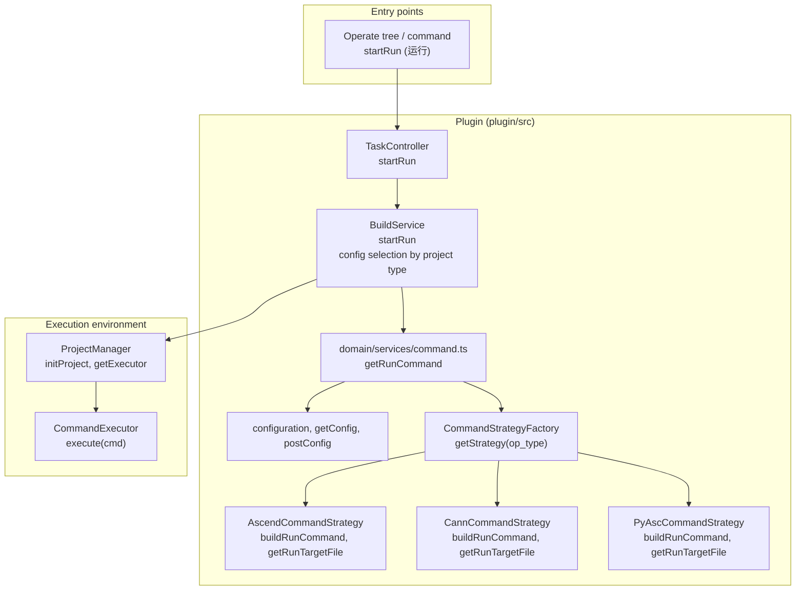
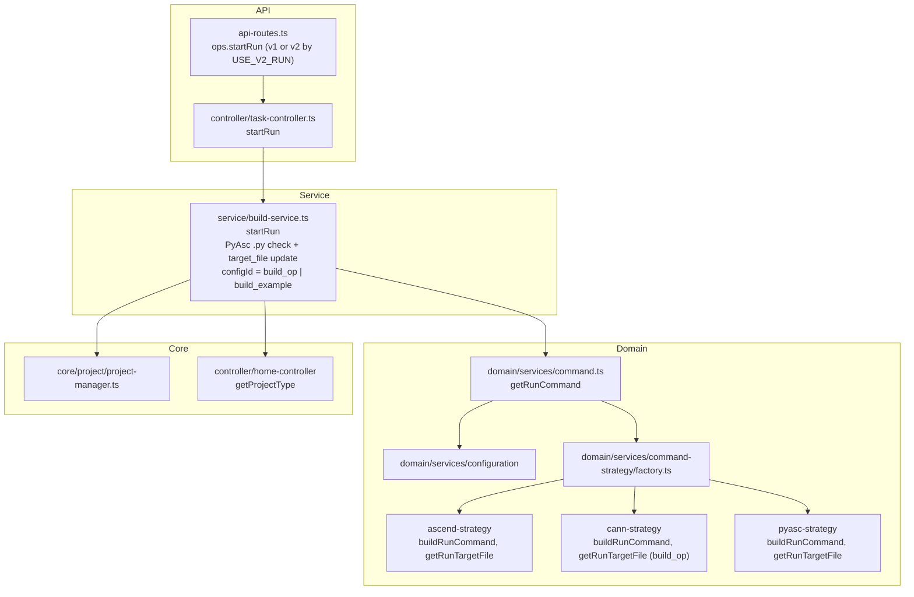

# Run Integration Architecture

This document describes how **operator run** (运行算子) is integrated in the Huawei OP DevTools VS Code extension: protocols, config selection, run command generation, and the full architecture from entry points to the execution environment.

---

## Overview

The plugin does **not** ship a runtime. It:

- **Orchestrates** running the operator (or example binary / Python script) using the same **command strategy** and **config** model as build. The run command is generated by **getRunCommand(config_id)**; the strategy supplies **target_file** via **getRunTargetFile** and builds the shell command via **buildRunCommand**.
- **Selects config** by project type: **PyAsc** uses **build_op** config (and may update `target_file` to the active `.py` file as `python3 <relativePath>`); **non-PyAsc** (Ascend/CANN) uses **build_example** config so the run target is the compiled example binary.
- **Runs** the generated command via **ProjectManager.getExecutor()** (same executor as build, simulate, on-board, sanitizer); success/failure is reported with a notification.

The actual execution is the **target_file** (binary or `python3` script) invoked in the workspace environment; the plugin provides config resolution, strategy-based command generation, and execution.

---

## Protocols

```mermaid
flowchart LR
  subgraph Plugin["This plugin"]
    Commands[VS Code command\n/ Operate tree]
    TaskCtrl[Task controller]
    BuildSvc[BuildService\nstartRun]
    DomainCmd[domain/services/command\ngetRunCommand]
    Strategy[Command strategy\nascend / cann / pyasc]
  end

  subgraph VSCode["VS Code"]
    Notifications[Notifications\nshowMessage]
  end

  subgraph Env["Execution environment"]
    Executor[ProjectManager.getExecutor()]
    Shell[Shell / target binary or python]
  end

  Commands --> TaskCtrl --> BuildSvc
  BuildSvc --> DomainCmd --> Strategy
  BuildSvc --> Executor
  Executor --> Shell
  BuildSvc --> Notifications
```

| Layer | Protocol | Role |
|-------|----------|------|
| **Webview → Plugin** | — | Run is **not** on the `ops` namespace. Trigger via VS Code command / Operate tree → `taskMethods.startRun`. |
| **Plugin → VS Code** | VS Code Extension API | Show success/error messages; project/workspace and active editor (for PyAsc). |
| **Plugin → Environment** | Shell command (stdio) | Executor runs the generated run command (source env, `cd`, then target_file); exit code and output are reported back. |

---

## High-Level Architecture



---

## Run Flow

```mermaid
sequenceDiagram
  participant User
  participant Cmd as VS Code command
  participant Task as TaskController
  participant Build as BuildService
  participant Home as homeMethods
  participant Domain as domain/command
  participant Strategy as Command strategy
  participant PM as ProjectManager
  participant Exec as CommandExecutor

  User->>Cmd: 运行 (startRun)
  Cmd->>Task: startRun(params)

  Task->>PM: initProject()
  Task->>Build: startRun(params)

  Build->>Home: getProjectType()
  Home-->>Build: { projectType: ascend | cann | pyasc }

  alt PyAsc and no params.filePath
    Build->>Build: Check active editor is .py file
    alt No .py open
      Build->>User: showWarningMessage(请先打开一个 .py 文件)
      return
    end
    Build->>Build: Update build_op config target_file = python3 &lt;relativePath&gt;
    Build->>Build: configId = getBuildConfigId() (build_op)
  else Non-PyAsc or params.filePath
    Build->>Build: configId = getBuildExampleConfigId() (build_example)
  end

  Build->>Domain: getRunCommand(configId)
  Domain->>Domain: getBaseContext(configId) → config, project, operator
  Domain->>Strategy: CommandStrategyFactory.getStrategy(operator.op_type)
  Domain->>Strategy: buildCommandContext(baseContext)
  Domain->>Strategy: getRunTargetFile(config, operator)
  Strategy-->>Domain: targetFile
  Domain->>Domain: context.config.target_file = targetFile
  Domain->>Strategy: buildRunCommand(context)
  Strategy-->>Domain: command string
  Domain-->>Build: runCommand

  Build->>Exec: execute(runCommand, [], [], {}, true)
  Exec-->>Build: { code, output }

  alt code !== 0
    Build->>User: showErrorMessage(运行失败)
  else code === 0
    Build->>User: showInformationMessage(运行成功)
  end

  Task->>PM: clearExecutor()
```

---

## Config Selection and target_file

### Which config is used for run

| Project type | Config used | configId source |
|--------------|-------------|------------------|
| **PyAsc** | build_op | `params.configId` or `getBuildConfigId()` |
| **Ascend / CANN** | build_example | `params.configId` or `getBuildExampleConfigId()` |

So: **PyAsc** runs via the **build_op** config (run target is typically a Python command); **Ascend/CANN** run via the **build_example** config (run target is the compiled example binary).

### PyAsc: active .py and target_file

For PyAsc, when **no** `filePath` is passed (e.g. user clicks “运行” from the panel):

1. The plugin checks that the **active editor** is a `.py` file; otherwise it shows “请先打开一个 .py 文件” and returns.
2. It computes the **relative path** of that file from the workspace root.
3. It updates the **build_op** config’s `target_file` to `python3 <relativePath>` and saves it via `postConfig('build_op', [updatedConfig])`.

So the “run” command for PyAsc is effectively `source env; cd path; python3 <relativePath>` (or `config.target_file` as stored). When `filePath` is passed (e.g. context menu “运行” on a file), the same update can be done using that path so the run target is explicit.

### getRunTargetFile and buildRunCommand

- **getRunCommand(config_id)** gets base context from that config, builds command context, then:
  - Calls **strategy.getRunTargetFile(config, operator)** and sets **context.config.target_file** to that value.
  - Returns **strategy.buildRunCommand(context)**.

So the **run target** (binary path or command) is strategy-defined; the **working directory and env** come from **buildCommandContext** (same as build).

| Strategy | getRunTargetFile | buildRunCommand |
|----------|------------------|------------------|
| **ascend** | `config.target_file` (from the config passed in, i.e. build_example’s target_file) | `sourceCannCmd`, `cdCmd`, `getExecutableCommand(config.target_file)` |
| **cann** | Resolves **build_op** config for same project/op; returns `buildOpConfig?.target_file \|\| config.target_file` | `sourceCannCmd`, `cdBuildCmd`, `getExecutableCommand(config.target_file)` (so run from **build** dir) |
| **pyasc** | `config.target_file` (build_op; often `python3 <path>`) | `sourceCannCmd`, `cdCmd`, `config.target_file` (no getExecutableCommand wrapper) |

CANN run uses **build** directory (`cdBuildCmd`) and build_op’s target_file; Ascend run uses operator run path (`cdCmd`) and the config’s target_file (build_example); PyAsc uses run path and config.target_file (build_op) as the command string.

---

## Data Format (API)

### startRun params (StartRunParams)

| Field | Type | Description |
|-------|------|-------------|
| `configId` | string | Optional. Config ID to use for run. If omitted, plugin chooses build_op (PyAsc) or build_example (Ascend/CANN). |
| `filePath` | string | Optional. File path (e.g. when invoking “运行” from context menu). Used for PyAsc to set run target without relying on active editor. |

---

## Component Map (plugin/src)



| File | Role |
|------|------|
| `controller/task-controller.ts` | Entry for `startRun`; initProject, set executor ref, task type `runExample`; call BuildService.startRun; clear executor in finally. |
| `service/build-service.ts` | startRun: getProjectType; PyAsc path (optional .py check + update build_op target_file); resolve configId (build_op or build_example); getRunCommand(configId); execute; show message. |
| `domain/services/command.ts` | getRunCommand(config_id): getBaseContext, get strategy, buildCommandContext, getRunTargetFile → set context.config.target_file, buildRunCommand(context). |
| `domain/services/command-strategy/*` | buildRunCommand(context): source + cd + target; getRunTargetFile(config, operator): ascend/pyasc use config.target_file; cann uses build_op target_file. |
| `controller/home-controller.ts` | getProjectType(): used to decide PyAsc vs non-PyAsc and thus which config to use for run. |
| `api-routes.ts` | Run is **not** on `ops`; `taskMethods.startRun` (or v2) from commands / Operate tree. |

---

## V2 Run Path

When feature flag **USE_V2_RUN** is enabled, run is handled by **BuildControllerV2.startRun** (same entry: in-plugin `taskMethods.startRun`, not web `ops`). The flow is the same in spirit: initProject, PyAsc `.py` check and optional `writeBuildOpDeployTarget`, then `BuildApplicationService.startRun`.

---

## Summary

- **Protocols:** Command / tree → `taskMethods.startRun`; plugin runs the generated run command via `ProjectManager.getExecutor()`; notifications for success/failure.
- **Config:** Run uses **build_op** for PyAsc (with optional target_file update from active .py or filePath) and **build_example** for Ascend/CANN. target_file is resolved by strategy (getRunTargetFile).
- **Command:** getRunCommand(configId) → strategy.buildCommandContext, strategy.getRunTargetFile (→ context.config.target_file), strategy.buildRunCommand → one shell string (source env, cd, then run target).
- **Architecture:** Operate tree / command → TaskController → BuildService.startRun → getRunCommand → strategy → CommandExecutor.

---

## Troubleshooting

### `qemu: uncaught target signal 11 (Segmentation fault) - core dumped`

This error appears when you press **Run** and the executed binary crashes under **QEMU user-mode emulation**. It usually means an **architecture mismatch**:

- The **run environment** (e.g. the devcontainer or your host) is **x86_64**.
- The **binary** (e.g. `ascend_addn` in `build/`) was **built for a different architecture**, typically **aarch64** (ARM), which is common for Ascend NPU host environments.
- On x86_64, Linux may run the non-native binary via QEMU; the binary then hits a segmentation fault (signal 11) under emulation.

**What to do:**

1. **Run on the correct environment**  
   Run the operator on a machine or container that matches the build architecture (e.g. aarch64 Ascend host). Do not run the same binary inside an x86_64-only devcontainer if it was built for aarch64.

2. **Build and run in the same environment**  
   If you want to run inside the current devcontainer, build the sample **in that same environment** so the resulting binary is native (e.g. x86_64). This may not be supported for all CANN/Ascend samples; check your CANN docs for supported build/run hosts.

3. **Use simulator / profiling**  
   For analysis without real hardware, use the plugin’s **仿真分析** (simulate) or other tooling that runs on the current architecture instead of the built example binary.

### PyAsc: `cannot find -lruntime_camodel` / `RuntimeError: Runtime library must be available!`

This error appears when you **run a PyAsc sample** (e.g. from the pyasc template) and the **ASC Python runtime** cannot load the Ascend runtime library:

- **Linker:** `/usr/bin/ld: cannot find -lruntime_camodel: No such file or directory`
- **Python:** `RuntimeError: Runtime library must be available!` from `asc.runtime.config.set_platform`

**Cause:** The run command uses an **environment script** (the project’s **Ascend env script**) to set `LD_LIBRARY_PATH` and other variables. If that script is only `/etc/profile`, the CANN/Ascend runtime is not on the library path and `libruntime_camodel.so` cannot be found.

**What to do:**

1. **Set the project’s Ascend environment script**  
   In the plugin, set the **Ascend env script** (项目环境脚本 / projectSH) to the **CANN environment script** that exports the Ascend toolkit paths, for example:
   - `source /usr/local/Ascend/ascend-toolkit/set_env.sh`, or  
   - The path provided by your CANN/Ascend installation (e.g. under `/usr/local/Ascend/` or the path shown in CANN docs).  
   Do **not** use only `/etc/profile` for PyAsc runs if it does not set up CANN.

2. **Install CANN with the runtime for your platform**  
   Ensure the machine or container where you run has CANN (and the Ascend Python `asc` package) installed, including the runtime that provides `libruntime_camodel` (e.g. for camodel/simulation or the target NPU). If you run in a container, the image must include the required CANN runtime libraries.

3. **Re-run**  
   After updating the env script (and ensuring CANN is installed), run the PyAsc sample again. The run command will source your script before `cd` and `python3 pyasc_sample.py`.
