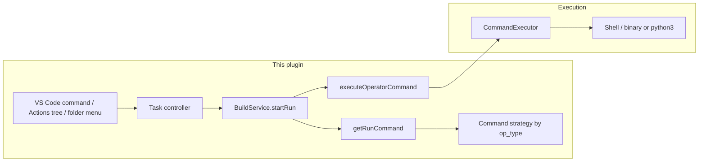
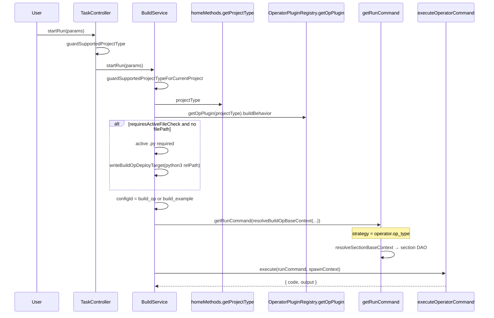

# Run Integration Architecture

How **operator run** (运行算子) is integrated: entry points, config selection, command generation, and execution — for every supported **project type** and **`op_type`**.

**Related:** [`build-integration.md`](./build-integration.md) (shared strategies, `executeOperatorCommand`), [`workspace-settings.md`](./workspace-settings.md) (`deployCommandOrRunCommand`), [`operator-treeview.md`](./operator-treeview.md) (Run row — **not** queued), [`operator-plugin-registry.md`](./operator-plugin-registry.md) (registry axes), [`new-project-generation-specification.md`](./new-project-generation-specification.md) (stored `project_type` vs `op_type`).

---

## Overview

The plugin does **not** ship a runtime. It:

- **Builds** a run command with **`getRunCommand(configId)`** → command strategy (`getRunTargetFile`, `buildRunCommand`).
- **Selects the config row** in `BuildService.startRun` from **`OperatorPluginRegistry.getOpPlugin(projectType).buildBehavior`** (where `projectType` comes from `homeMethods.getProjectType()` — workspace `op-devtools.projectType` or live detection).
- **Selects the shell strategy** from the operator row’s **`op_type`** (`CommandStrategyFactory.getStrategy(operator?.op_type)` inside `getRunCommand`).
- **Runs** through **`executeOperatorCommand`** with `outputLabel: 'run'` (ascend env + placeholders + per-run output channel).
- **Exposes** run via VS Code commands → `taskMethods.startRun` (Actions tree **Run**, folder context menu for PyAsc). **Not** on `ops` RPC.

**Two axes (do not conflate):**

| Axis | Examples | Used in run for |
|------|----------|-----------------|
| **`project_type`** | `ascend`, `cann`, `pyasc`, `triton`, or detection strings `standard-custom`, `ascend-c`, `torch-library` | `build_op` vs `build_example` config id, active-`.py` gate, unsupported-project guard |
| **`op_type`** (on the operator record) | `ascend`, `cann`, `pyasc`, `triton` | `cdCmd` / `cdBuildCmd`, `getRunTargetFile`, `buildRunCommand` |

After **New Project** or **Open Project** init, stored `project_type` usually matches an **`op_type`** string (`cann`, `ascend`, `pyasc`, `triton`). Detection-only workspaces can still report `standard-custom`, `ascend-c`, or `torch-library` — see [Registry resolution](#registry-resolution-startrun-vs-sidebar).

---

## Protocols

| Layer | Role |
|-------|------|
| **Entry** | `huawei-op-devtools.sidebar.run` → `taskMethods.startRun`; PyAsc folder **Run** → `folder-context-menu-service` then `startRun({ filePath })` |
| **Plugin → shell** | `executeOperatorCommand` → `ProjectManager.getExecutor().execute(runnableCommand, …, { toolOutputLabel: 'run' })` — Ascend vars are embedded as `export … &&` in `runnableCommand`, not `options.env` |

---

## Run flow

---

## Project types and run behavior

### Summary table

| Project context | `project_type` after init ([`viewIdToProjectType`](../plugin/src/domain/utils/project-utils.ts)) | Typical `op_type` on operators | `startRun` config row | Command strategy | Run target (`getRunTargetFile`) | Working directory in `buildRunCommand` |
|-----------------|--------------------------------------------------------------------------------------------------|-------------------------------|----------------------|------------------|--------------------------------|----------------------------------------|
| **CANN** (New Project view 1) | `cann` | `cann` | `build_example` | **cann** | Workspace `compileAndDeploy.buildConfig.deployCommandOrRunCommand` | `sourceCannCmd` + **`cdBuildCmd`** + `getExecutableCommand(target)` |
| **Standard custom** (view 2; detection `standard-custom`) | `ascend` | `cann` (scanned collection ops) / `ascend` (plugin-created) | `build_example` | **cann** / **ascend** | Same workspace deploy key | `sourceCannCmd` + **`cdBuildCmd`** (cann) or **`cdCmd`** (ascend) + `getExecutableCommand(target)` |
| **Ascend C** (detection `ascend-c`) | `cann` | `cann` (init uses `viewIdToProjectType`) | `build_example` | **cann** | Workspace deploy key | `cdBuildCmd` + executable |
| **Torch library** (detection `torch-library`) | `cann` | `cann` | `build_example` | **cann** | Workspace deploy key | `cdBuildCmd` + executable |
| **PyAsc** | `pyasc` | `pyasc` | **`build_op`** | **pyasc** | Workspace deploy (`python3 …`) via `getPythonRunTargetFile` | `sourceCannCmd` + **`cdCmd`** + normalized python command (no chmod) |
| **Triton** (`op-devtools.operatorSupport.triton`) | `triton` | `triton` | **`build_op`** | **triton** | Same as PyAsc (workspace deploy) | Same as PyAsc |

**Compiled run (CANN / Ascend / Ascend C / Torch / Standard custom):** user sets **`deployCommandOrRunCommand`** to the built binary or `.run` package (often updated after **编译示例**). `startRun` passes **`build_example`** config id, but the **executable path** still comes from the **`build_op`** workspace key through `getRunTargetFile` — not from `exampleBuildConfig.targetFile` — falling back to the operator-plugin default `targetOpFile` (`build_out/*.run` for standard-custom / ascend-c projects) when the setting is empty. `exampleBuildConfig.targetFile` feeds the **ascend** profiler / msprof flow ([`workspace-settings.md`](./workspace-settings.md)); the cann profiler flow reads the same deploy key (see [Strategy run assembly](#strategy-run-assembly)).

**Python run (PyAsc / Triton):** deploy target is `python3 <path>` in the same workspace key; `startRun` uses **`build_op`** config id because `requiresBuildBeforeAnalysis: false`.

### Per-type notes

#### CANN (`project_type` / `op_type` = `cann`)

- Plugin: `CannPlugin` → `requiresBuildBeforeAnalysis: true`, no active-file check.
- Run after example build: set **`deployCommandOrRunCommand`** to the runnable artifact (or rely on post-build helpers that refresh it for standard-custom `.run` flows — see `getStandardCustomDeployCommand` in `command.ts`).
- Strategy **`cdBuildCmd`**: `mkdir -p  <op>/build && cd <op>/build` — double space after `-p`, exactly as in source — (operator run path from the operator record's `op_path`).

#### Standard custom (stored `ascend`; per-op `op_type` `cann` or `ascend`)

- Operator rows in scanned collections carry **`op_type: cann`** (cann command forms — run from `cdBuildCmd`, no ascend deploy tail); plugin-created rows carry **`ascend`** (run from `cdCmd` with the deploy tail). `startRun` follows the operator record's `op_type`.
- The `.run` deploy package is executed via `RUN_FILE=$(find build_out/*.run)` plus `chmod +x` and a `--force` probe (`getExecutableCommand`); run verification runs from `mkdir -p <op>/build && cd <op>/build` with the `RUN_FILE` fragment (cann form).
- Multi-operator selection: Actions **Run** is disabled when multiple operators are selected ([`operator-treeview.md`](./operator-treeview.md)).
- Collection operators share one project; run uses the configured example / deploy target for the active config row.

#### Ascend C and Torch library

- **Detection** types: `ascend-c`, `torch-library` ([`operator-behavior-specification.md`](./operator-behavior-specification.md)).
- **After Open Project init:** `project_type` is stored as **`cann`** (`viewIdToProjectType`), so `startRun` uses **CannPlugin** behavior and **`build_example`**.
- Operators created by `generateStructure` use **`op_type: cann`** for these opens unless later changed by mark-as-operator / templates.
- Torch library may set `template_name` / `torch_library_template` at init; run pipeline is still CANN strategy + `build_example`.

#### PyAsc (`pyasc`)

- `requiresActiveFileCheck: true`, `activeFileExtension: '.py'`.
- Without `params.filePath`: active editor must be `.py`; plugin writes **`python3 <path relative to workspace root>`** via `writeBuildOpDeployTarget`.
- **Folder menu (PyAsc root):** updates deploy target relative to **operator `op_path`**, then `startRun({ filePath: basename })` only to **skip** the active-editor check (`filePath` is not read for command assembly).
- `buildOpCommand` / `buildExampleCommand` **throw** — run is the primary “execute” path.
- Special error: missing `runtime_camodel` → `build.runFailedPyascRuntime`.

#### Triton (`triton`)

- Same Python run model as PyAsc (`build_op`, workspace deploy, active `.py` gate).
- Registered only when **`op-devtools.operatorSupport.triton`** is true.
- `buildBehavior`: no sanitizer / simulate / on-board in plugin flags (Actions tree hides those capabilities).
- Default deploy in generator often `python3 ./<op_name>.py`; user may override in settings.

#### Unsupported / disabled

- **`guardSupportedProjectTypeForCurrentProject`:** `OperatorPluginRegistry.isProjectTypeSupported(detectedType)` — unknown or empty `project_type` → error toast, run aborted.
- **`multi-project`:** reserved detection label; not a normal single-operator run target.
- Actions **Run** hidden or disabled when project type unsupported or multiple operators selected (tree rules).

---

## Registry resolution (`startRun` vs sidebar)

| API | Used by | Resolution |
|-----|---------|------------|
| **`getOpPlugin(projectType)`** | **`BuildService.startRun`** | Treats `projectType` as an **`op_type`** key; unknown strings fall back to **`cann`** plugin |
| **`getBuildBehaviorByProjectType(projectType)`** | **Actions tree** (`OperateTreeProvider`) | Matches **`projectTypeMappings`** first (`standard-custom` → CannPlugin, `ascend-c` / `torch-library` → AscendPlugin, …) |

**Practical impact:**

- Registered **standard-custom** projects store **`ascend`** → `startRun` and sidebar agree (Ascend plugin, `build_example`).
- **Unregistered** workspace with detection **`ascend-c`** or **`torch-library`**: sidebar may show **Ascend** capabilities while **`startRun`** still uses **cann** fallback until `projectService.init` stores `cann` via `viewIdToProjectType`.
- Prefer **`getProjectTypePlugin` / `getBuildBehaviorByProjectType`** semantics when documenting expected behavior; implementation of `startRun` still uses **`getOpPlugin`** today.

Command generation always follows **`operator.op_type`**, not `project_type`, so a mismatch between stored project type and operator rows is visible only in config-id / UI gates, not in the shell strategy class.

---

## Config selection and runtime merge

| `buildBehavior.requiresBuildBeforeAnalysis` | Config row | Default `configId` when omitted |
|---------------------------------------------|------------|--------------------------------|
| `false` (PyAsc, Triton) | `build_op` | `getBuildConfigId()` |
| `true` (Cann, Ascend, defaults) | `build_example` | `getBuildExampleConfigId()` |

Runtime merge: the per-section typed DAO factories on `ConfigService` (`getBuildOpConfig()` / `getBuildExampleConfig()` / `getUtTestConfig()` / `getSimulateConfig(projectPath)` / `getOnBoardConfig(projectPath)` / `getSanitizerConfig(projectPath, op)`), resolved via `resolveSectionBaseContext` — each DAO reads its own dotted `op-devtools.*` settings and folds in the cache-only fields ([`workspace-settings.md`](./workspace-settings.md)).

For **`build_op`**, `getBuildOpConfig().targetFile` comes from **`compileAndDeploy.buildConfig.deployCommandOrRunCommand`**. For **`build_example`**, `targetFile` is read from `exampleBuildConfig.targetFile` (null when unset); strategies read deploy via **`getRunTargetFile`** → workspace key anyway.

### Strategy run assembly

| Strategy | `getRunTargetFile` | `buildRunCommand` |
|----------|-------------------|-------------------|
| **ascend** | `readBuildOpDeployTargetFromWorkspace()` (fallback: plugin default `targetOpFile` → `build_out/*.run`) | `sourceCannCmd`, **`cdCmd`**, `getExecutableCommand(target, { execute: true, mode: 'run' })` |
| **cann** | Same workspace deploy key (fallback: default `targetOpFile` — `build_out/*.run` for standard-custom / ascend-c projects) | `sourceCannCmd`, **`cdBuildCmd`** (`mkdir -p  <op>/build && cd <op>/build`), `getExecutableCommand(target, { execute: true })` |
| **pyasc** / **triton** | `getPythonRunTargetFile` → workspace deploy | `sourceCannCmd`, **`cdCmd`**, `normalizePythonCommandInterpreter(target)` (interpreter from workspace / venv / `python.defaultInterpreterPath`) |

Profiler / msprof / sanitizer **binary** paths come from strategy-specific `getProfilerTargetFile`: **ascend** reads `exampleBuildConfig.targetFile` (fallback `OperatorPluginRegistry.getDefaultPaths`.targetExampleFile → `build/test_aclnn_<op>`); **cann** reads the deploy workspace key (fallback `.targetOpFile` — `build_out/*.run` for standard-custom / ascend-c projects).

---

## `startRun` params (`StartRunParams`)

| Field | Description |
|-------|-------------|
| `configId` | Optional; else plugin picks `build_op` vs `build_example` from plugin **`buildBehavior`** |
| `filePath` | Optional; **only** skips `requiresActiveFileCheck` (PyAsc folder menu). Does not select the script by itself — folder menu writes deploy target first |

---

## Component map

| File | Role |
|------|------|
| `controller/task-controller.ts` | `startRun`, `initProject`, registry guard, `clearExecutor` |
| `service/build-service.ts` | `startRun`, `writeBuildOpDeployTarget`, `getRunCommand`, `executeOperatorCommand` |
| `service/folder-context-menu-service.ts` | PyAsc folder run → deploy target + `startRun({ filePath })` |
| `service/operator-command-executor.ts` | Env + execute |
| `service/config-service.ts` | section DAO factories, deploy target writes |
| `domain/services/command.ts` | `getRunCommand` |
| `controller/home-controller.ts` | `getProjectType` |
| `domain/plugins/*.plugin.ts` | `buildBehavior`, `projectTypeMappings` |
| `domain/services/command-strategy/*.ts` | Per-`op_type` run command shape |

---

## Summary

- **Entry:** Actions **Run** / command palette / PyAsc folder menu → `taskMethods.startRun` (not action queue).
- **Config row:** from **`getOpPlugin(projectType).buildBehavior`**; **shell strategy:** from **`operator.op_type`**.
- **Run target:** workspace **`deployCommandOrRunCommand`** for all strategies at run time; `exampleBuildConfig.targetFile` is for profiler-related flows.
- **Execution:** `getRunCommand` → **`executeOperatorCommand`** (same stack as build).

---

## Troubleshooting

### `qemu: uncaught target signal 11 (Segmentation fault)`

Usually **architecture mismatch** (x86_64 host running aarch64-built binary). Run on matching hardware or rebuild in the same environment.

### PyAsc: `cannot find -lruntime_camodel`

Set **`environment.environmentScript`** to your CANN `set_env.sh` ([`workspace-settings.md`](./workspace-settings.md)), not only `/etc/profile`. Ensure CANN runtime libraries are installed in the run environment.

### Run does nothing / “unsupported project type”

Check the workspace **`op-devtools.projectType`** setting and live detection via **Open Project**. Triton requires **`op-devtools.operatorSupport.triton`**. Empty or unknown `project_type` fails `isProjectTypeSupported`.

### Wrong binary or `python3` path

Update **`compileAndDeploy.buildConfig.deployCommandOrRunCommand`** in workspace settings. For PyAsc sidebar run, ensure a **`.py`** editor is active or use the folder menu on a `.py` file (menu updates deploy before `startRun`).
