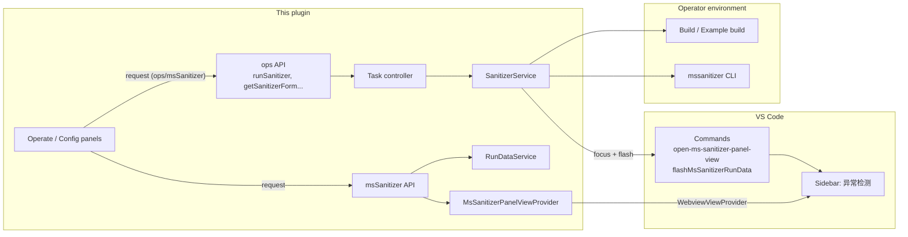
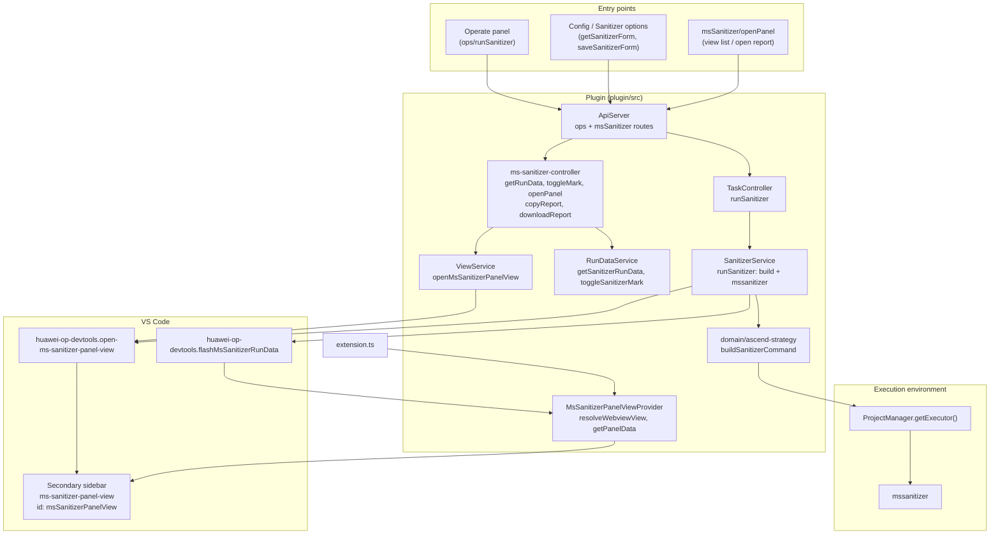
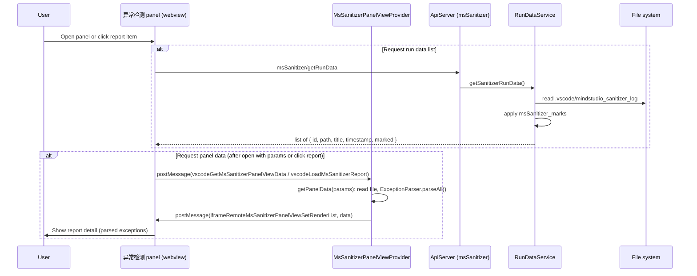
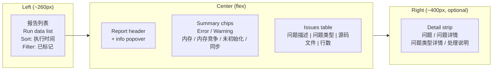
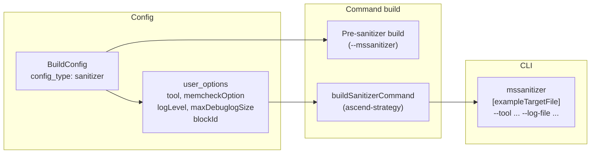
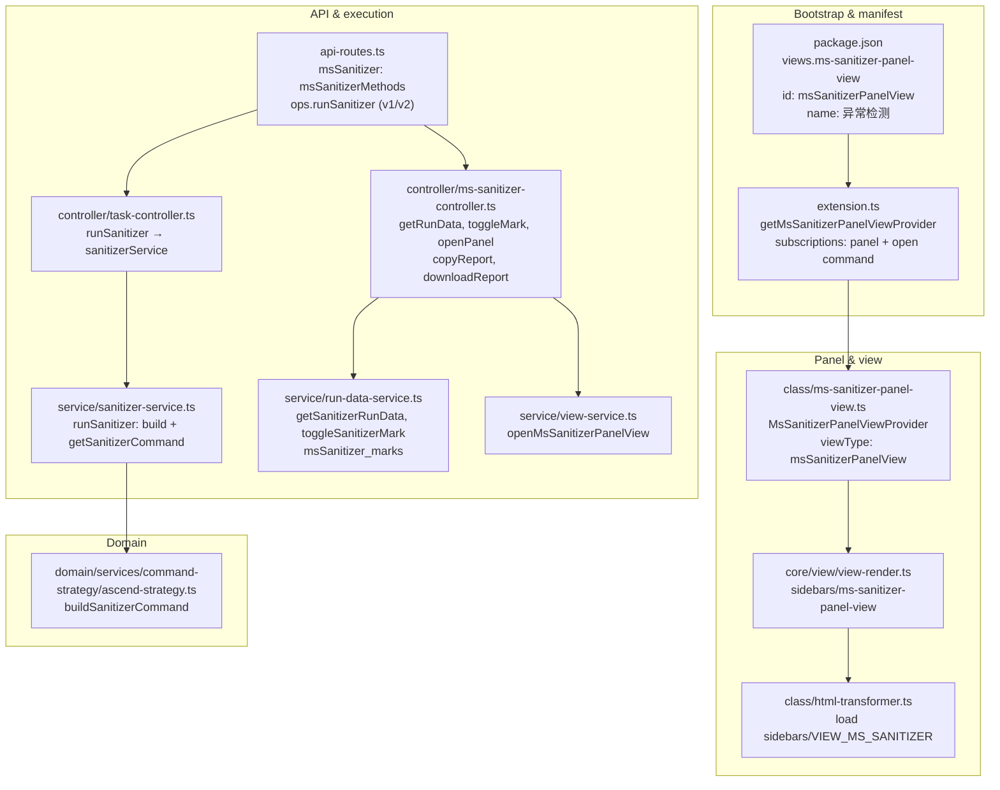

# Sanitizer Integration Architecture

This document describes how **msSanitizer** (anomaly detection) is integrated in the Huawei OP DevTools VS Code extension: protocols, panel UI, run flow, and the full architecture from entry points to the `mssanitizer` CLI and the 异常检测 (Anomaly Detection) sidebar panel.

---

## Overview

The plugin integrates the **MindStudio Sanitizer** tool (`mssanitizer` CLI) for operator correctness checking. It:

- **Runs** sanitizer via a configurable flow: pre-build (and optionally example build for standard custom operators), then executes the `mssanitizer` command with options (e.g. memcheck, race detection, uninitialized detection).
- **Presents** results in a dedicated **sidebar panel** (“异常检测”): run data list from `.vscode/mindstudio_sanitizer_log`, report detail view with parsed exceptions, and actions (copy report, download, toggle mark).
- **Exposes** sanitizer config (get/save form), run trigger, and panel/data APIs to the webview (Operate panel, config views) via the `ops` and `msSanitizer` API namespaces.

The actual detection engine is the **mssanitizer** binary (invoked by the plugin’s command strategy, e.g. Ascend); the plugin provides orchestration, config, and UI.

---

## Protocols



| Layer | Protocol | Role |
|-------|----------|------|
| **Webview → Plugin** | Custom request/response over ApiServer | Operate/config call `ops/runSanitizer`, `ops/getSanitizerConfigs`, `msSanitizer/getRunData`, `msSanitizer/openPanel`, etc. |
| **Plugin → VS Code** | VS Code Extension API (`vscode.commands`, `registerWebviewViewProvider`) | Register “异常检测” panel; open/focus panel; post refresh message to webview |
| **Plugin → mssanitizer** | CLI invocation (stdio) | Build `mssanitizer` command (options: tool, log-level, log-file, etc.) and run via `ProjectManager.getExecutor().execute()` |
| **Panel ↔ Plugin** | Webview `postMessage` / `onDidReceiveMessage` | Panel requests data (`vscodeGetMsSanitizerPanelViewData`, `vscodeLoadMsSanitizerReport`); plugin sends `iframeRemoteMsSanitizerPanelViewSetRenderList`, `iframeFlashMsSanitizerRunData` |

---

## High-Level Architecture



---

## Sanitizer Run Flow

```mermaid
sequenceDiagram
  participant User
  participant Webview as Operate / Config panel
  participant Api as ApiServer (ops)
  participant Task as TaskController
  participant Svc as SanitizerService
  participant Build as Build / Example build
  participant Exec as Executor
  participant Mssanitizer as mssanitizer CLI
  participant VSCode as VS Code
  participant Panel as 异常检测 panel

  User->>Webview: Run 异常检测 (runSanitizer)
  Webview->>Api: ops/runSanitizer
  Api->>Task: runSanitizer(params)
  Task->>Svc: runSanitizer(params)

  Svc->>Svc: getSanitizerConfigIdInternal()
  Svc->>Exec: execute(buildCommand)  // pre-build
  Exec-->>Svc: build result
  alt Standard custom operator
    Svc->>Exec: execute(exampleBuildCommand)
    Exec-->>Svc: example build result
  end

  Svc->>Exec: execute(sanitizerCommand)  // getSanitizerCommand()
  Exec->>Mssanitizer: run mssanitizer
  Mssanitizer-->>Exec: exit code + log under .vscode/mindstudio_sanitizer_log
  Exec-->>Svc: res

  alt res.code === 0
    Svc->>VSCode: executeCommand(msSanitizerPanelView.focus)
    Svc->>VSCode: executeCommand(flashMsSanitizerRunData)
    VSCode->>Panel: focus + postMessage(iframeFlashMsSanitizerRunData)
    Panel->>User: List refreshed; panel visible
  else failure
    Svc->>User: showErrorMessage(异常检测失败)
  end
```

---

## Panel Data and Report Loading



---

## Data Format Specification

This section defines the shapes of data exchanged between the plugin and the sanitizer panel webview.

### Run data list (API: `msSanitizer/getRunData`)

Returned by `RunDataService.getSanitizerRunData()`. The plugin scans `.vscode/mindstudio_sanitizer_log` and merges with persisted marks.

| Field       | Type    | Description |
|------------|---------|-------------|
| `id`       | string  | Log filename (e.g. `mssanitizer_1234567890.log`) |
| `path`     | string  | Absolute path to the log file |
| `title`    | string  | Display title (derived from filename and date, e.g. `mssanitizer-20250317`) |
| `timestamp`| number  | Unix timestamp (ms) from filename |
| `marked`   | boolean | Whether the report is marked (stored in `msSanitizer_marks`) |

**Source of truth:** Files under workspace `.vscode/mindstudio_sanitizer_log`; filename pattern used to derive `title` and `timestamp` (e.g. `title_timestamp.log`).

### Panel payload (postMessage: `iframeRemoteMsSanitizerPanelViewSetRenderList`)

Sent from the plugin to the webview when report content is loaded (after `vscodeGetMsSanitizerPanelViewData` or `vscodeLoadMsSanitizerReport`). The webview assigns `event.data.data` to this shape.

| Field      | Type   | Description |
|------------|--------|-------------|
| `path`     | string | (optional) Absolute path of the report file |
| `title`    | string | (optional) Report title for header |
| `timestamp`| number | (optional) Report timestamp for header |
| `data`     | array  | Parsed issue list (see **Parsed issue record** below). Empty array or omitted when no report or parse fails. |

### Parsed issue record (report detail)

Each element of the `data` array is produced by `ExceptionParser.parseAll()` (plugin: `class/exception-parser.ts`) from the raw log file. The webview uses this shape for the table and detail strip (see `web/src/views/sidebars/ms-sanitizer-panel-view/constant.ts` → `QuestionData`).

| Field         | Type   | Description |
|---------------|--------|-------------|
| `title`       | string | Short issue label (e.g. exception name) |
| `type`        | string | `"error"` \| `"warning"` — severity for icon and filter |
| `questionType`| string | `"memory"` \| `"memoryContention"` \| `"uninitialized"` \| `"synchronize"` — category for chips and filters |
| `question`    | string | Canonical issue key (e.g. `illegal read of size`, `LeakCheck: detected memory leaks`) — used for `questionMap` / `questionHandlerMap` labels |
| `originData`  | string | Full raw text block for the issue (detail strip) |
| `fileLink`    | string | (optional) Source file path for “jump to file” |
| `row`         | number | (optional) 1-based line number |
| `col`         | number | (optional) Column (if available) |

**Plugin:** `ExceptionParser` maps log patterns to `questionType` and `question` via `exceptionTpyeMap` and similar; the webview uses `questionMap` and `questionHandlerMap` in `constant.ts` to show Chinese labels and handling advice.

### postMessage commands (panel ↔ plugin)

| Command | Direction | Payload / effect |
|---------|-----------|-------------------|
| `vscodeGetMsSanitizerPanelViewData` | Webview → Plugin | No payload. Plugin uses `getMsSanitizerPanelViewDataParams` if set (e.g. from open-panel command) and replies with `iframeRemoteMsSanitizerPanelViewSetRenderList`. |
| `vscodeLoadMsSanitizerReport` | Webview → Plugin | `data.path` (required). Plugin reads file, runs `ExceptionParser.parseAll()`, sends `iframeRemoteMsSanitizerPanelViewSetRenderList` with `{ path, title, timestamp, data }`. |
| `iframeRemoteMsSanitizerPanelViewSetRenderList` | Plugin → Webview | `data`: panel payload object (path, title, timestamp, data). Webview sets report header and table data. |
| `iframeFlashMsSanitizerRunData` | Plugin → Webview | No payload. Webview refreshes the run data list (e.g. calls `msSanitizer/getRunData`). |
| `updateTheme` | Plugin → Webview | `themeName`: `"dark"` \| `"light"`. Webview applies theme. |

---

## Presentation Details

The **异常检测** panel is implemented in `web/src/views/sidebars/ms-sanitizer-panel-view/app.vue`. It uses a three-column layout: report list, report detail (table + filters), and an optional detail strip.

### Layout overview



- **Left:** Fixed-width report list; sort by execution time (asc/desc), filter by “已标记”; per-item copy path and mark/unmark.
- **Center:** Report title and timestamp; summary chips (counts, clickable filters); scrollable table of parsed issues.
- **Right:** Shown when a table row is selected; shows full issue text and handling advice; toggled with arrow icons.

### Report list (left)

- **Data source:** `getMsSanitizerRunData()` on mount and on `iframeFlashMsSanitizerRunData`.
- **Display:** Each item shows `title` and formatted `timestamp`; hover reveals copy and flag actions.
- **Selection:** Clicking an item sets the selected report and sends `vscodeLoadMsSanitizerReport` with that item; the plugin returns parsed data and the center/right areas show that report.
- **Empty state:** “暂无报告” when the list is empty.

### Report detail — header and chips (center)

- **Header:** `msScantinizerInfo.title` and `msScantinizerInfo.timestamp`; info popover describes 检测时间, 检测内容, 检测范围.
- **Summary chips:** Counts from `tableData`: error / warning (by `type`), 内存 / 内存竞争 / 未初始化 / 同步 (by `questionType`). Clicking a chip applies the corresponding table filter (e.g. `filterTableData('memory')`).

### Report detail — table (center)

- **Columns:** 问题描述 (type icon + `title`), 问题类型 (from `questionMap`), 源码文件 (`fileLink` as link or “HOST侧” text), 行数 (`row`).
- **Filtering:** Table supports filters on type, question type, and file; chips sync with `filteredInfo`.
- **Row click:** Sets `questionDetails` and `showDetail = true`; optionally calls `jumpToFileWebview` when `fileLink`, `row`, and `col` are present.
- **Empty state:** “请选择左侧报告查看检测结果” when no report is selected.

### Detail strip (right)

- **Visibility:** Toggle via LeftSquareOutlined / RightSquareOutlined when `showDetail` is true.
- **Content:** For the selected row (`questionDetails`): 问题 (`title`), 问题详情 (`originData`), 问题类型详情 (`questionMap.get(question)`), and 处理说明 (`questionHandlerMap.get(question)`).
- **Theme:** All sections respect `updateTheme` (dark/light) via `useTheme` and the shared theme classes (`getTextClass`, `getBgLightClass`, etc.).

### Other behaviors

- **Jump to file:** `jumpToFileWebview({ fileLink, row, col, errorTitle, errorMessage })` — implemented by the plugin to open the file and highlight the location.
- **Copy report path:** From list item (clipboard); “复制报告” in controller copies full report content via `msSanitizer/copyReport`.
- **Mark toggle:** `toggleMsSanitizerMark` then refresh list; marks are persisted under `msSanitizer_marks`.

---

## Sanitizer Config and Command Build

Sanitizer uses a dedicated **config type** (`sanitizer`). The run flow uses that config for both the pre-build and the `mssanitizer` command options (tools, memcheck options, log-level, log-file, etc.).



| Concept | Location | Role |
|--------|----------|------|
| **Sanitizer config** | `ops/getSanitizerConfigs`, `ops/getSanitizerConfigId`, `ops/saveSanitizerForm` | Single config of type `sanitizer`; form saved via `saveSanitizerForm` |
| **Pre-build** | SanitizerService (v1) / BuildForSanitizerStep (v2) | Build with sanitizer-related options so the example binary is ready for `mssanitizer` |
| **mssanitizer command** | `plugin/src/domain/services/command-strategy/ascend-strategy.ts` → `buildSanitizerCommand` | Builds `mssanitizer` CLI with `--tool`, `--log-file` (under `.vscode/mindstudio_sanitizer_log/`), and other options from config |

V2 path (when `USE_V2_SANITIZER` is enabled): `runSanitizer` is handled by `taskMethodsV2.runSanitizer` → BuildOrchestrator with `StandardSanitizerStrategy` (BuildForSanitizerStep → SanitizerStep). The same config type and command-generation concepts apply.

---

## Component Map (plugin/src)



| File | Role |
|------|------|
| `extension.ts` | Registers `MsSanitizerPanelViewProvider` and `open-ms-sanitizer-panel-view`; registers `flashMsSanitizerRunData` and wires it to panel webview |
| `class/ms-sanitizer-panel-view.ts` | `WebviewViewProvider` for “异常检测”; resolves HTML from `sidebars/ms-sanitizer-panel-view`; handles `vscodeGetMsSanitizerPanelViewData`, `vscodeLoadMsSanitizerReport`; `getPanelData` uses `ExceptionParser` |
| `controller/ms-sanitizer-controller.ts` | `msSanitizerMethods`: getRunData, toggleMark, openPanel, copyReport, downloadReport |
| `controller/task-controller.ts` | Exposes `runSanitizer` (v1) to API; maps task type `sanitizer` to `sanitizerService.runSanitizer` |
| `service/sanitizer-service.ts` | Runs pre-build and optional example build; runs `mssanitizer` via executor; on success focuses panel and triggers `flashMsSanitizerRunData` |
| `service/run-data-service.ts` | `getSanitizerRunData()`: scans `.vscode/mindstudio_sanitizer_log`, returns list with `msSanitizer_marks`; `toggleSanitizerMark` |
| `service/view-service.ts` | `openMsSanitizerPanelView(params)` runs `open-ms-sanitizer-panel-view` with params |
| `api-routes.ts` | Mounts `msSanitizer` and `ops.runSanitizer` (v1 or v2 by feature flag) |
| `domain/.../ascend-strategy.ts` | `buildSanitizerCommand()`: builds `mssanitizer` CLI string with options from config |
| `constants.ts` | `COMMAND_OPEN_MS_SANITIZER_PANEL_VIEW`, `VIEW_MS_SANITIZER`, `COMMAND_FLASH_MS_SANITIZER_RUN_DATA` |
| Root `package.json` | `contributes.views["ms-sanitizer-panel-view"]`: webview id `msSanitizerPanelView`, name “异常检测” |

---

## VS Code Panel Integration

The plugin contributes a **single sidebar webview** for sanitizer:

1. **View contribution**  
   `package.json` → `views["ms-sanitizer-panel-view"]`: type `webview`, id `msSanitizerPanelView`, name “异常检测”. This places the view in the secondary sidebar (with other panel views).

2. **Webview content**  
   When the view is resolved, `MsSanitizerPanelViewProvider.resolveWebviewView()` loads HTML from the built web app: `sidebars/ms-sanitizer-panel-view` (see `view-render.ts` and `VIEW_MS_SANITIZER`). The webview is registered with `ApiServer` as `MsSanitizerPanelView` so the frontend can call `msSanitizer/*` and receive `postMessage` events.

3. **Opening with data**  
   `open-ms-sanitizer-panel-view` toggles the panel, focuses `msSanitizerPanelView`, and sets `getMsSanitizerPanelViewDataParams` so the webview’s request for data gets the correct report/params. Loading a report from the list sends `vscodeLoadMsSanitizerReport` with `path`; the provider answers with parsed panel data.

4. **Refreshing after run**  
   After a successful sanitizer run, the plugin runs `msSanitizerPanelView.focus` and `flashMsSanitizerRunData`. The latter posts `iframeFlashMsSanitizerRunData` to the panel webview so it can refresh the run data list (e.g. from `msSanitizer/getRunData`).

So all sanitizer “windows” are this one sidebar webview; the plugin provides the view provider, commands to open/focus and refresh, and the backend APIs for run data and report content.

---

## Summary

- **Tree view solution (implemented):**
  - Sanitizer results are shown in a unified native tree view with three levels: report -> group -> message.
  - Report-level controls are in the title bar: import report (`+`), time sort toggle (asc/desc), and marked-only filter.
  - Grouping controls are in the same title bar and support `class`, `severity`, `type`, and `file`.
  - Title controls (left to right):
    - `+` (import report): opens file picker, validates the selected path, adds the report to the runtime list, and immediately selects it for parsing/display.
    - `sort by time`: toggles report ordering between newest-first (`desc`) and oldest-first (`asc`), with deterministic tie-breakers by title then path.
    - `marked filter`: toggles between all reports and marked-only reports; if a mark toggle would make the list empty, the filter is auto-reset to keep content visible.
    - `group by class`: groups messages into class buckets (`memory`, `memory race`, `uninitialized`, `sync`, `other`) for the selected report.
    - `group by severity`: creates two groups and enforces stable order `Errors` first, `Warnings` second.
    - `group by type`: groups by normalized problem type label; group ordering is `error-only` first, then mixed, then `warning-only`.
    - `group by file`: groups by message file path; labels are normalized and workspace prefix is stripped when possible.
  - Group-node controls:
    - In `file` mode, each file-group row exposes inline open-file action (`go-to-file`) that opens the underlying file directly.
  - Report-row controls:
    - `copy path`: copies absolute report path to clipboard.
    - `mark/unmark`: toggles persistent mark state for that report and updates icon/tooltip by state (`Mark` vs `Unmark`).
    - Marked report rows show a filled flag icon on the left.
  - Message-row controls and behavior:
    - Clicking a message with location data (`fileLink`, `row`, `col`) jumps to source file position.
    - Warning/error rows use VS Code severity icons for quick visual scanning.
    - Tooltip content is resolved lazily via `resolveTreeItem` to avoid eager markdown rendering cost during group expansion.
  - Grouping is applied per selected report. Severity groups are ordered `Errors` then `Warnings`; type groups are prioritized as error-only, mixed, warning-only.
  - File grouping strips workspace prefix from labels when possible and exposes inline open-file action on file-group nodes.
  - Report rows keep inline copy-path and mark/unmark actions, and marked rows show a filled flag icon.
  - Message rows use severity icons, preserve jump-to-file behavior when location exists, and provide lazy-resolved rich tooltips.
  - Data and rendering performance are optimized with layered caches: report list nodes, per-report parsed messages/derived fields, per-report-per-mode groups, and per-group message nodes, with targeted invalidation on sort/filter/group/mark changes.
  - Toolbar and grouping icons are provided through contributed product icons backed by local SVG-to-WOFF assets.

- **Protocols:** Webview ↔ plugin via `ops` and `msSanitizer` APIs; plugin ↔ VS Code via WebviewViewProvider and commands; plugin ↔ environment via executor running the `mssanitizer` CLI.
- **Panel:** Single sidebar view “异常检测” (id `msSanitizerPanelView`), backed by `MsSanitizerPanelViewProvider`, loading `sidebars/ms-sanitizer-panel-view`; run data from `.vscode/mindstudio_sanitizer_log` and marks from `msSanitizer_marks`; report detail via `getPanelData` + `ExceptionParser`.
- **Architecture:** Entry points (Operate/config + msSanitizer API) → task controller and ms-sanitizer controller → SanitizerService (build + mssanitizer) and RunDataService / ViewService; panel provider resolves webview and handles data/refresh messages. This repo provides orchestration, config, and UI; the detection engine is the external `mssanitizer` tool.
