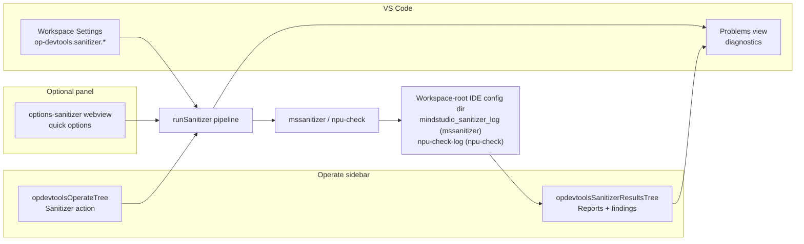
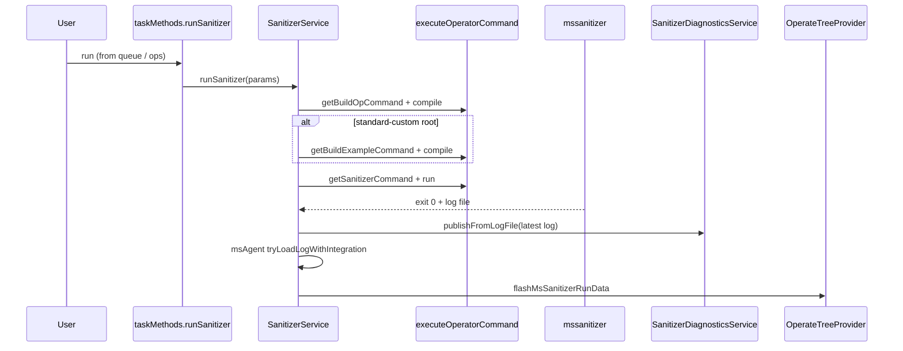

# Sanitizer (anomaly detection) — architecture

This document describes how **MindStudio Sanitizer** (`mssanitizer` CLI) is integrated in Huawei OP DevTools **as implemented today**. The extension orchestrates build steps, runs the CLI, discovers log files, and shows findings in a **native VS Code tree** plus the **Problems** view. It does **not** embed the detection engine.

For CANN/Ascend spawn environment (`SOC_VERSION`, `NPU_ARCH`, env script sourcing), see [`ascend-env-spec.md`](./ascend-env-spec.md). For workspace file artifacts, see [`generated-files-specification.md`](./generated-files-specification.md) (sanitizer log directory). For `op-devtools.sanitizer.*` keys and how they fold into the sanitizer runtime config, see [`workspace-settings.md`](./workspace-settings.md).

---

## Overview

| Layer | Responsibility |
|-------|----------------|
| **CLI** | `mssanitizer` (external binary) performs memcheck / race / init checks |
| **Plugin** | Pre-build, optional example build, command assembly, shell execution, log path setup |
| **Config** | Workspace settings ([`workspace-settings.md`](./workspace-settings.md) § Sanitizer); `.vscode/cache.json` for `fileMapLists.sanitizer` and `sanitizerPythonTarget` |
| **Results UI** | Tree view `opdevtoolsSanitizerResultsTree` (report list → grouped messages) |
| **Problems** | `SanitizerDiagnosticsService` → `DiagnosticCollection` `op-devtools-sanitizer` |
| **msAgent (optional)** | See [`msagent.md`](./msagent.md) — `parseLog` / `fixProblem` bridge when enabled |

There is **no** sanitizer sidebar webview and **no** `msSanitizer` ApiServer namespace.

---

## Workbench layout

- **`opdevtoolsOperateTree`**: primary **Sanitizer** action under the operate flow (same tree as build/run/debug). Gear on the sanitizer row opens workspace settings filtered to `op-devtools.sanitizer` (not the options webview).
- **`opdevtoolsSanitizerResultsTree`**: dedicated view in the Operate container (`%view.sanitizerResultsTree.name%`). Root rows are **reports** (log files); expanding a report shows **grouped findings** (class / severity / type / file — user-selectable).

---

## Entry points

### 1. Operate flow tree (default run path)

1. User runs **Sanitizer** on `opdevtoolsOperateTree`.
2. Unless [`sanitizer.showQuickOptions`](./workspace-settings.md#sanitizer-op-devtoolssanitizer) is `false`, opens **`options-sanitizer`** webview (`huawei-op-devtools.sanitizerOptions`); otherwise runs immediately via `operateTreeProvider.runFlowAction('sanitizer', …)` → **operator action queue** → `taskMethods.runSanitizer`.
3. Queue: `dispatchEnqueueNativeOperatorAction('sanitizer', …)` in `task-method-dispatch.ts` (serial operator queue; see [`operator-treeview.md`](./operator-treeview.md) § Operator action queue).

### 2. Options webview (`web/src/views/panels/options-sanitizer/`)

- Loads/saves form via **`ops`** API: `getSanitizerOptions`, `saveSanitizerOptions`, `runSanitizer` (see `plugin/src/api-routes.ts` → `configMethods`).
- On confirm: `runSanitizer({ operatorNames })` then closes the editor; does **not** use a separate `msSanitizer` API.
- Can set **“do not show again”** → `sanitizer.showQuickOptions = false` (see [`workspace-settings.md`](./workspace-settings.md#sanitizer-op-devtoolssanitizer)).

### 3. Results tree commands

Registered in `plugin/src/extension.ts` (prefix `huawei-op-devtools.sidebar.sanitizer.*`), including:

| Command | Role |
|---------|------|
| `sidebar.sanitizer.report.select` | Select report → parse log → populate finding children |
| `sidebar.sanitizer.report.add` | Pick external `.log` file → `addSanitizerReportFromPath` |
| `sidebar.sanitizer.report.copyPath` | Copy log path to clipboard |
| `sidebar.sanitizer.report.toggleMark` / `mark` / `unmark` | `RunDataService.toggleSanitizerMark` |
| `sidebar.sanitizer.report.sortTime` | Toggle asc/desc on report list (in-memory) |
| `sidebar.sanitizer.report.filterMarked` / `showAll` | Marked-only filter |
| `sidebar.sanitizer.results.groupBy*` | Group findings: class, severity, type, file |
| `sidebar.sanitizer.results.hideDuplicates` / `showDuplicates` | Dedupe findings in tree |
| `sidebar.sanitizer.message.jump` | Open source location (`performanceDataMethods.jumpToFile`) |
| `sidebar.sanitizer.message.aiFix` | `msAgentBridgeService.fixMsAgentProblem(index)` when available |
| `sidebar.sanitizer.results.openGroupFile` | Open file for file-group nodes |

Context keys (examples): `opDevtools.sanitizerMarkedOnly`, `opDevtools.sanitizerDuplicatesHidden`, `opDevtools.sanitizerResultsGroupBy`, `opDevtools.sanitizerAiFixAvailable`.

### 4. Refresh after run

- Command: `huawei-op-devtools.flashMsSanitizerRunData`
- Implementation: `operateTreeProvider.refreshSanitizerReports(revealLatest)` — **no** webview `postMessage`.
- Called from `SanitizerService.runSanitizer` on success and from `post-activate-bootstrap` after auto-open project.

---

## Run pipeline (`SanitizerService.runSanitizer`)

Implementation: `plugin/src/service/sanitizer-service.ts`. Entry: `taskMethods.runSanitizer` → `ProjectManager.initProject()` + executor lifecycle in `task-controller.ts`.

Steps in detail:

1. **Resolve** the sanitizer config — `resolveSanitizerBaseContext(projectPath, operatorNames)` → `ConfigService.getSanitizerConfig(projectPath, op)` (cache-only `fileMapLists.sanitizer` comes from `.vscode/cache.json`).
2. **Build operator** — `getBuildOpCommand(resolveBuildOpBaseContext(projectPath, operatorNames), …)` via `executeOperatorCommand` (spawn env from [`operator-command-executor`](../../plugin/src/service/operator-command-executor.ts) / `resolveAscendEnv`).
3. **Standard-custom only** — if workspace root detects `OperatorProjectType.STANDARD_CUSTOM`, also **build example** (`getBuildExampleCommand`).
4. **`notifyBuildSucceededForSidebar`** — updates compile state for operate tree when applicable.
5. **Ensure log directory** — `joinIdeConfigPath(workspaceRoot, getSanitizerLogDirName(tool))` → `mindstudio_sanitizer_log` (mssanitizer) or `npu-check-log` (npu-check) (see [Log files](#log-files)).
6. **Run sanitizer** — `getSanitizerCommand(sanitizerConfigId, exampleConfigId, operatorNames)` then `executeOperatorCommand`.
7. **On success**:
   - Notification `sanitizer.detectionSuccess`
   - Newest `mssanitizer_*.log` / `npu-check_*.log` via `getLatestSanitizerLogAbsPath`
   - `sanitizerDiagnosticsService.publishFromLogFile`
   - `msAgentBridgeService.tryLoadLogWithIntegration` (if enabled)
   - `flashMsSanitizerRunData` (refresh results tree; optional auto-select newest report when none selected)

**PyAsc:** `PyAscCommandStrategy.buildSanitizerCommand` throws — sanitizer run is not supported for pyasc projects (operate tree should hide sanitizer when project type does not support it; see `OperatorPluginRegistry` / flow visibility).

---

## Command generation

- **Facade:** `getSanitizerCommand` in `plugin/src/domain/services/command.ts`.
- **Strategy:** `CommandStrategyFactory.getStrategy(operator.op_type)` → `buildSanitizerCommand` on ascend / cann / triton (not pyasc).
- **Target binary:** `strategy.getProfilerTargetFile` — the **ascend** strategy reads `exampleBuildConfig.targetFile` (workspace setting, fallback `OperatorPluginRegistry.getDefaultPaths`); **cann** / **pyasc** / **triton** read the `build_op` deploy key — [`workspace-settings.md`](./workspace-settings.md#what-is-not-in-workspace-settings)); optional `operatorNames` rewrites `test_aclnn_*` segment for standard custom.
- **cann strategy** (`cann-strategy.ts`): builds `mssanitizer` with `tool` (`memcheck` / `racecheck` / `initcheck`), memcheck options (`leak-check` / `check-unused-memory`), `log-level`, `max-debuglog-size`, `block-id`, `--log-file` under `<workspaceRoot>/<ideConfig>/mindstudio_sanitizer_log/mssanitizer_<ts>.log`, prefixed with CANN env sourcing + `cdBuildCmd` (`mkdir -p <op>/build && cd <op>/build`).
- **ascend strategy** (`ascend-strategy.ts`): same option set, with `--log-file` under the **same workspace-root** `<workspaceRoot>/<ideConfig>/mindstudio_sanitizer_log/mssanitizer_<ts>.log` (the reader only looks there; `operator.op_path` is used only when no workspace folder is known), prefixed with CANN env sourcing + `cd` to the operator path (`cdCmd`).

Runtime config for the sanitizer row: the sanitizer section DAO `ConfigService.getSanitizerConfig(projectPath, op)` — keys and mapping in [`workspace-settings.md`](./workspace-settings.md#sanitizer-op-devtoolssanitizer). Cache-only fields such as **`fileMapLists.sanitizer`** and **`sanitizerPythonTarget`** stay in `.vscode/cache.json`.

---

## Configuration

Sanitizer and compile keys: **[`workspace-settings.md`](./workspace-settings.md)** (§ Sanitizer, § Compile & deploy).

### `.vscode/cache.json`

- **`sanitizerPythonTarget`** — per-operator Python target keyed by operator name (pyasc / triton: seeded as `python3 ./<op>.py` at project creation; torch_library: `python ../run.py`); merged into the sanitizer config as the target file.
- **`fileMapLists.sanitizer`** — `{ filePath, reportTime }` entries for extra report files (merged in `RunDataService.getSanitizerRunData`).

### `ops` API (webview only)

| Method | Handler |
|--------|---------|
| `ops/getSanitizerOptions` | `configMethods.getSanitizerOptions` (dotted `sanitizer.*` settings) |
| `ops/saveSanitizerOptions` | `configMethods.saveSanitizerOptions` → `ConfigService.writeOpDevtoolsDottedSettings` |
| `ops/runSanitizer` | `dispatchSanitizer` → queued `taskMethods.runSanitizer` |

Build/run for sanitizer are **not** exposed on `ops`; they go through the task controller / operate tree.

---

## Log files

| Item | Location |
|------|----------|
| Directory | `<workspaceRoot>/<ideConfigDir>/mindstudio_sanitizer_log/` — the cann, ascend and triton strategies all write under the **workspace root**; the ascend strategy falls back to `operator.op_path` only when no workspace folder is known. `ideConfigDir` is `.vscode` or `.arts` (`getIdeConfigDirName()`) |
| New runs | `mssanitizer_<timestamp>.log` (mssanitizer) / `npu-check_<timestamp>.log` (npu-check); the report list title is the file name itself |
| Latest after run | `getLatestSanitizerLogAbsPath(workspaceRoot)` — newest by mtime |

**Report list sources** (`RunDataService.getSanitizerRunData`):

1. All `mssanitizer_<ts>.log` / `npu-check_<ts>.log` files in `mindstudio_sanitizer_log` (marks in `PermanentStorage` key `msSanitizer_marks`).
2. Existing paths from sanitizer cache **`fileMapLists.sanitizer`** (ids `sanitizer_<filePath>`).
3. **Manual add** via results tree → stored in `OperateSidebarState.sanitizer.manualReports`.

Marks persist in extension global storage (`msSanitizer_marks`), not in the log file.

---

## Results tree behavior (`OperateTreeProvider`)

State: `OperateSidebarState.sanitizer` on the **flow** tree provider instance (`reports`, `selectedReportPath`, `selectedMessages`, `sortOrder`, `markedOnly`, `resultsGroupBy`, `hideDuplicates`, `manualReports`).

**Selecting a report** (`selectSanitizerReport`):

1. `sanitizerDiagnosticsService.loadSanitizerPanelData({ path, title, timestamp })`
2. `ExceptionParser.parseAll` → `selectedMessages` (each row gets `msAgentIndex` for AI fix ordering)
3. Same call updates **Problems** and triggers msAgent `parseLog` when integration is on
4. Tree children: groups (`sanitizerClass`) → messages (`sanitizerMessage`) with tooltips / inline AI fix when `opDevtools.sanitizerAiFixAvailable`

**Grouping modes:** `class` (error vs warning), `severity`, `type` (question text / i18n label), `file` (path groups). **Hide duplicates** uses cached dedupe keys per report.

**Copy report** copies the **file path** (not full log contents — unlike performance report copy).

---

## Problems view

- **Collection:** `op-devtools-sanitizer` (`sanitizer-diagnostics.service.ts`).
- **When updated:** After successful run (`publishFromLogFile`) and when user selects a report in the tree (`loadSanitizerPanelData` also publishes).
- **Mapping:** `ExceptionParser` + `resolveSanitizerSourceFsPath` → `vscode.Diagnostic` per source line; severity from finding `type`; `source: 'sanitizer'`.

---

## msAgent (optional)

Sanitizer-only integration with the separate **msAgent** extension: auto `parseLog`, **AI fix** on finding rows, and `msAgentIndex` ordering. Full detail: **[`msagent.md`](./msagent.md)**.

---

## Key source files

| Area | Path |
|------|------|
| Run orchestration | `plugin/src/service/sanitizer-service.ts` |
| Task entry | `plugin/src/controller/task-controller.ts` (`runSanitizer`) |
| Queue / ops dispatch | `plugin/src/helpers/task-method-dispatch.ts` |
| Command line | `plugin/src/domain/services/command.ts`, `command-strategy/*-strategy.ts` |
| Config / settings merge | `plugin/src/service/config-service.ts` |
| Report list | `plugin/src/service/run-data-service.ts` |
| Tree UI | `plugin/src/class/operate-tree-provider.ts` |
| Diagnostics | `plugin/src/service/sanitizer-diagnostics.service.ts` |
| Log parsing | `plugin/src/class/exception-parser.ts` |
| Registration | `plugin/src/extension.ts`, `package.json` (`opdevtoolsSanitizerResultsTree`, commands) |
| Options webview | `web/src/views/panels/options-sanitizer/app.vue`, `web/src/apis/ops.ts` |
---

## Related documents

| Document | Use for |
|----------|---------|
| [`msagent.md`](./msagent.md) | msAgent bridge, AI fix, index parity |
| [`build-integration.md`](./build-integration.md) | Shared build / executor model (sanitizer pre-build) |
| [`ascend-env-spec.md`](./ascend-env-spec.md) | Spawn env for compile + sanitizer commands |
| [`workspace-settings.md`](./workspace-settings.md) | All `op-devtools.*` keys and runtime merge |
| [`generated-files-specification.md`](./generated-files-specification.md) | Log directory lifecycle |
| [`performance.md`](./performance.md) | Simulation / on-board profiling and results tree |
