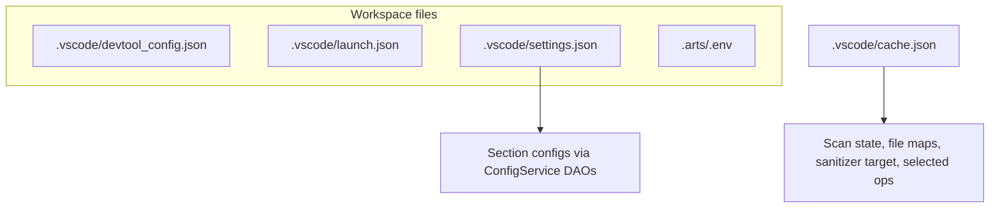

# Config reset (regenerate project config)

**Priority:** P1  
**Issue:** [#11 — need to support reset config info](https://gitcode.com/opdevtools/plugin_release/issues/11)  
**Reporter:** `虎啸山村`

---

## Overview

Users need to **regenerate project configuration** after a plugin upgrade or when configuration becomes wrong. The plugin provides a **reset command** that clears the plugin's configuration for the current workspace and reloads the window, so the project is reinitialized from scratch on next open.

---

## Reported symptoms

> When plugin is updated, or configuration is wrong, user need to regenerate project's config.

---

## Current codebase behavior

### Reset command

`huawei-op-devtools.resetProjectConfiguration` (also available from the sidebar: `huawei-op-devtools.sidebar.resetProjectConfiguration`) → `resetCurrentProjectConfiguration()` in `plugin/src/service/config-reset-service.ts`:

1. Resolves the workspace root and the project it belongs to (workspace root, or the project path recorded in the project manager).
2. Shows a modal confirmation dialog with the project name.
3. Clears the runtime state in `.vscode/cache.json` (`project`, `folders`, `fileMapLists`, `sanitizerPythonTarget`).
4. Deletes `.vscode/devtool_config.json`.
5. Clears all `op-devtools.*` keys from `.vscode/settings.json` (`ConfigService.clearOpDevtoolsWorkspaceSettings`).
6. Reloads the window (`workbench.action.reloadWindow`).

Result: the workspace is treated as a fresh project on next launch — default settings are re-seeded and the cache is rebuilt by scans.

### What exists today

| Mechanism | Behavior |
|-----------|----------|
| `devtool_config.json` | Workspace operator-project marker (created at project creation by `ensureLaunchJsonExists()` in `project-utils.ts`); deleted by reset |
| `.vscode/cache.json` | Workspace runtime cache (`schemaVersion: 1`): folders scan state, `fileMapLists`, `sanitizerPythonTarget`, `project.{selectedOperatorPaths, compiledOpPaths}` — updated via scans and options panels; cleared by reset |
| `.vscode/settings.json` | Dotted `op-devtools.*` keys — the runtime config source; section DAO factories read their own keys; cleared by reset |
| `COMMAND_CLEAR_WELCOME_COUNT` | Clears the welcome-screen show counter |

### What does not exist

- Per-operator (partial) reset — reset covers the whole workspace.
- Automatic config refresh on plugin version upgrade — reset is user-initiated only.

### Key files

| File | Role |
|------|------|
| `plugin/src/service/config-reset-service.ts` | Reset implementation |
| `plugin/src/domain/utils/project-utils.ts` | Creates `devtool_config.json`, launch.json |
| `plugin/src/helpers/workspace-cache.ts` | `.vscode/cache.json` read/update/clear |
| `plugin/src/service/config-service.ts` | Section DAO factories, settings writes |
| `plugin/src/controller/welcome-controller.ts` | Project open, config seeding (`ensureOpDevtoolsSettingsSeeded`) |
| `plugin/src/extension.ts` | Command registration |
| `docs/generated-files-specification.md` | Spec for generated files |

### Config layers (what reset touches)

Reset clears `VS` (all `op-devtools.*`) and `CA` (all fields) and deletes `DC`; `LJ` and `.arts/.env` are not touched.

---

## Open questions

1. What triggered the need — plugin upgrade, SOC/hardware change, wrong profiler options, broken scripts?
2. Scope — entire workspace vs single operator in multi-operator repo (today reset covers the whole workspace)?
3. Should user custom edits to scripts be preserved? (reset is a full clear today)
4. Plugin version before/after; sample of wrong vs expected config?

---

## Possible improvements (not implemented)

1. **Partial reset** — preserve user script edits (reset only derived state, re-seed defaults for missing keys).
2. **Prompt on plugin upgrade** — one-time notification linking to the reset command.
3. **SOC refresh on reset** — re-resolve `resolveAscendEnv()` so simulate/on_board metric defaults match the chip class of the current host.

### Safety rules

- Reset requires an explicit confirmation dialog.
- Reset is a full clear — no partial options today.

---

## Acceptance criteria (shipped)

- User can reset/regenerate project config from Command Palette and the sidebar without manual JSON editing.
- After reset + reload, the workspace is re-seeded as a fresh project: default settings are written and the cache is rebuilt by scans.

---

## Related issues

- [#6 A5 env](./a5-environment.md) — stale A3 profiler settings on A5 hardware; reset clears them for a fresh start.
