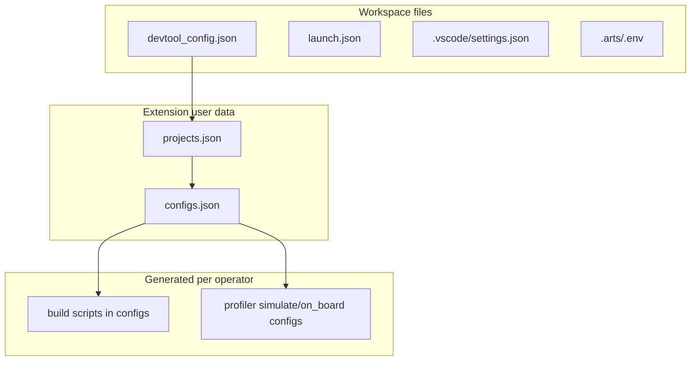

# Config lifecycle and reset

**Priority:** P1  
**Issue:** [#11 — need to support reset config info](https://gitcode.com/opdevtools/plugin_release/issues/11)  
**Reporter:** `虎啸山村` (~10 hours ago — newest open issue)

---

## Overview

Users need a way to **regenerate project configuration** after a plugin upgrade or when configuration becomes wrong. Today there is no user-facing reset command; marker and config files are write-once or manually edited.

---

## Reported symptoms

> When plugin is updated, or configuration is wrong, user need to regenerate project's config.

No attachment or specific file names in the issue body yet.

---

## Current codebase behavior

### What exists today

| Mechanism | Behavior |
|-----------|----------|
| `devtool_config.json` | Created once by `ensureLaunchJsonExists()` in `project-utils.ts`; marks workspace as operator project; **never rewritten** by plugin after creation |
| User-data stores | `configs.json`, `projects.json` in extension global storage — updated via UI/API |
| `completeProjectConfigs()` | Fills missing config entries for a project (`model.ts`, called from `welcome-controller.ts` on open) |
| Config file migration | Old→new config path migration in `config-model.ts` (internal, automatic) |
| Partial clears | `COMMAND_CLEAR_WELCOME_COUNT`, `RemoteConfig.clear()` — welcome count / last project path only |
| Test-only resets | `_resetConfigsForTest()`, `_resetProjectsForTest()` — not exposed to users |

### What does not exist

- Command palette / sidebar action to reset or regenerate config
- Automatic config refresh on plugin version upgrade
- Migration checker exposed to users (no `project-migration-checker.ts` in current tree — may be planned)

### Key files

| File | Role |
|------|------|
| `plugin/src/domain/utils/project-utils.ts` | Creates `devtool_config.json`, launch.json |
| `plugin/src/domain/models/model.ts` | `generateStructure`, `completeProjectConfigs` |
| `plugin/src/domain/models/config-model.ts` | Config persistence and migration |
| `plugin/src/controller/welcome-controller.ts` | Project open, `completeProjectConfigs` |
| `plugin/src/service/config-service.ts` | Config checks |
| `docs/generated-files-specification.md` | Spec for generated files |

### Config layers (what "reset" might mean)

---

## Open questions

1. What triggered the need — plugin upgrade, SOC/hardware change, wrong profiler options, broken scripts?
2. Which layers should reset — workspace files, user-data stores, generated scripts, workspace settings, or all?
3. Scope — entire workspace or single operator in multi-operator repo?
4. Should user custom edits to scripts be **preserved** or overwritten?
5. Automatic on plugin upgrade vs explicit user command only?
6. Plugin version before/after; sample of wrong vs expected config?

---

## Implementation plan

### Phase 1 — Explicit "Regenerate project config" command

1. **Register command** in `package.json` — e.g. `huawei-op-devtools.regenerateProjectConfig`.
2. **Entry point** in `extension.ts` or `config-service.ts`:
   - Confirm workspace has `devtool_config.json`.
   - Show confirmation dialog listing what will be refreshed.
3. **Regeneration logic** (reuse existing primitives):
   - Call `completeProjectConfigs(projectId)` for all operators in workspace.
   - Re-run `generateStructure`-equivalent for missing config types only (do not wipe user edits unless opted in).
   - Re-run `maybeMigrateLegacySettingsToWorkspace()` if migration flag was reset, 
   - Env script / SOC in `projects.json` update when the user changes `environment.*` workspace settings ([`workspace-settings.md`](../workspace-settings.md); not during one-time migrate).
4. **Optional SOC refresh** — re-resolve `resolveAscendEnv()` and update simulate/on_board metric defaults when chip class changed.

### Phase 2 — Migration checker (if added)

1. Implement `project-migration-checker.ts` to detect stale configs:
   - A3 simulator type on A5 host
   - Wrong profiler metrics (`MemoryDetail` on A5)
   - Outdated script placeholders
2. **Prompt on workspace open** when migrations detected — "Update configs for plugin vX?" with diff preview.
3. **Log migrations** to Output channel.

### Phase 3 — Plugin upgrade hook

1. Compare stored `extensionVersion` in workspace or global state vs current.
2. On version bump, show one-time notification linking to regenerate command (avoid silent auto-wipe).

### Phase 4 — Documentation

1. Add section to `generated-files-specification.md` — manual reset procedure (delete which files).
2. Link from README troubleshooting to config-lifecycle doc.

### Safety rules

- Never delete `devtool_config.json` without explicit "full reset" sub-command.
- Default regenerate = **fill gaps + fix known stale patterns**, not full overwrite.
- Full reset (advanced) = separate command with strong confirmation.

---

## Acceptance criteria

- User can regenerate configs from Command Palette without manual JSON editing.
- After plugin upgrade on A3→A5 migrated project, profiler defaults match resolved SOC.
- Custom user script edits preserved unless user chooses "reset all generated scripts".
- Operation logged with summary of changed config keys.

---

## Related issues

- [#6 A5 env](./a5-environment.md) — stale A3 configs on A5 hardware overlap with migration checker scope.
