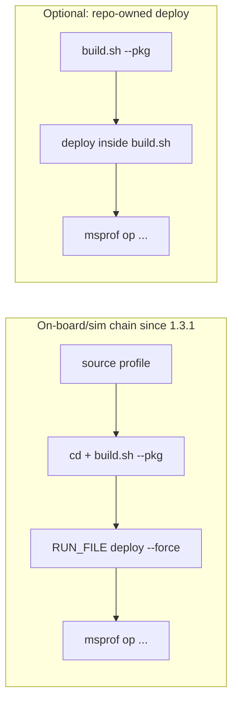

# Standard-custom operator workflow (ops-math / 一站式)

**Priority:** P0  
**Reporter cluster:** `devin-cwd` (v1.2.9 / v1.3.0)  
**Issues:** [#8](https://gitcode.com/opdevtools/plugin_release/issues/8), [#9](https://gitcode.com/opdevtools/plugin_release/issues/9), [#10](https://gitcode.com/opdevtools/plugin_release/issues/10)  
**PR:** [IdeFrontend/mstt#114](https://github.com/IdeFrontend/mstt/pull/114)

---

## Overview

Three related reports describe broken or incomplete command chains for **standard-custom** operator projects (typical layout: ops-math repo with `build.sh --pkg`, `.run` deploy packages, and `experimental/` operator collections). The plugin generates build and profiler commands but omits deploy steps, `--force`, and `--experimental` flags that the CANN toolchain now requires.



### Design decision (deploy)

**Default plugin flow (1.3.1+):** After a successful standard-custom `build_example`, the plugin runs **`RUN_FILE=$(find …) && … "$RUN_FILE" --force`** before on-board/simulation `msprof` — same helper as Ascend Build deploy ([`getStandardCustomDeployCommand`](../../plugin/src/domain/services/command.ts) in [`build-service.ts`](../../plugin/src/service/build-service.ts)).

| Layer | Responsibility |
|-------|------------------|
| **Plugin (standard-custom onboard/sim)** | Auto-deploy `.run` from `build_op.target_file` or default `build_out/*.run` after pre-profiling build |
| **New projects (plugin templates)** | Template `build.sh` may still include deploy-after-`--pkg` for standalone terminal use |
| **[ops-math `build.sh`](https://gitcode.com/cann/ops-math/blob/master/build.sh)** | **Not auto-migrated** — users may add deploy in-repo (Option A) or rely on plugin auto-deploy |
| **Plugin command generation** | Pass through flags (`--ops`, `--experimental`, …); deploy is a separate orchestration step in `build-service` |
| **Workspace settings** | Escape hatch: override full compile script per flow (`onBoardCompileCommand`, etc.) — still valid for custom deploy paths |

Historical note: `RUN_FILE` in [`command-utils.ts`](../../plugin/src/domain/utils/command-utils.ts) was first wired for **Ascend Build** (2026-03-30); standard-custom onboard/sim gained the same deploy step in 1.3.1.

---

## Shipped in PR #114

| Issue | Shipped | Not auto-fixed |
|-------|---------|----------------|
| **#8** | `--force` after `"$RUN_FILE"` on **Ascend Build** deploy; NPU debug passes **selected operator** | ops-math without `build.sh` / settings override when users disable plugin deploy |
| **#9** | `--experimental` on Build, Run (incl. single-op standard-custom), On-board, Simulation, Dump tensor, NPU debug, **UT test** | — |
| **#10** | Auto `.run` deploy before onboard/sim `msprof`; user guidance + [deploy_run_package.sh](../../plugin/templates/snippets/deploy_run_package.sh) snippet | Upstream ops-math `build.sh` not auto-patched |

### Key code changes

| Area | Files |
|------|-------|
| Deploy `--force` (Ascend Build + standard-custom profiling) | `command-utils.ts`, `ascend-strategy.ts`, `command.ts`, `build-service.ts`, `command-utils.spec.ts`, `standard-custom-deploy-command.spec.ts` |
| `--experimental` threading | `compile-options.ts`, `extension.ts`, `task-controller.ts`, `build-service.ts`, `command.ts`, `ut-test-compile-option.spec.ts` |
| NPU debug operator selection | `extension.ts`, `build-service.ts` |
| Deploy snippet for repos | `plugin/templates/snippets/deploy_run_package.sh` |

---

## User guidance

Use when closing or commenting on ops-math / 一站式 deploy issues. **Automatic migration of upstream ops-math `build.sh` is out of scope.**

### Why the plugin may still stop at `build.sh --pkg` (settings override)

For standard-custom repos (e.g. ops-math), the default plugin flow is: **`build.sh --pkg` → `build_example` → `.run` deploy (`--force`) → `msprof`**. If you override `onBoardCompileCommand` / `simulationCompileCommand` with a script that omits deploy, profiling may fail until you install the `.run` manually.

You can also fix deploy in-repo (Option A) so terminal builds and older plugin versions behave the same:

### Option A — Modify `build.sh` in your ops-math repo (recommended)

Add a deploy helper and call it after a successful `--pkg` build when you need installation (on-board, simulation, or explicit deploy). Adapt paths to your CANN version.

```bash
# Add near the top or in your pkg completion path:
deploy_run_package() {
  local build_out="${BUILD_OUT_DIR:-build_out}"
  local run_file
  run_file=$(find "$build_out" -maxdepth 1 -name '*.run' | head -1)
  if [[ -z "$run_file" ]]; then
    echo "error: no .run package under $build_out" >&2
    return 1
  fi
  chmod +x "$run_file"
  if [[ "${DEPLOY_FORCE:-0}" == "1" ]] || [[ " $* " == *" --force "* ]]; then
    "$run_file" --force
  else
    "$run_file"
  fi
}

# After your existing --pkg logic produces build_out/*.run, e.g.:
#   deploy_run_package "$@"
```

Then run from the plugin or terminal as usual; optionally pass `--force` through your script’s argument parser so the `.run` installer gets it (required on some 一站式 versions per [#8](https://gitcode.com/opdevtools/plugin_release/issues/8)).

**Pros:** Same command in IDE and terminal; no plugin-specific overrides.  
**Cons:** You maintain the fork/patch until CANN upstream merges the same behavior.

Copy-paste helper: [`plugin/templates/snippets/deploy_run_package.sh`](../../plugin/templates/snippets/deploy_run_package.sh).

### Option B — Override compile commands in VS Code settings

If you cannot change `build.sh` immediately, set the **full** build script for the on-board (or simulation) pre-profiling step in workspace settings ([`workspace-settings.md`](../workspace-settings.md) — `onBoardCompileCommand` / `simulationCompileCommand`).

**Settings → Extensions → Huawei OP DevTools → Compile & Deploy**, or edit `.vscode/settings.json`:

```json
{
  "op-devtools.compileAndDeploy.buildConfig.onBoardCompileCommand": "bash build.sh --pkg --soc=ascend910b --vendor_name=custom --bisheng_flags=ccec_g --ops=add && RUN_FILE=$(find build_out -maxdepth 1 -name '*.run' | head -1) && chmod +x \"$RUN_FILE\" && \"$RUN_FILE\" --force"
}
```

For **simulation**, use `simulationCompileCommand` instead. Replace `ascend910b`, `add`, and flags with your SOC and selected operator. For operators under `experimental/`, add `--experimental` to the `bash build.sh …` portion.

**Pros:** No repo `build.sh` change; per-workspace.  
**Cons:** Must keep settings in sync with CANN/ops-math updates; duplicated logic if teammates use different machines.

### Related settings

Key list and `user_options` mapping: [`workspace-settings.md`](../workspace-settings.md). For standard-custom deploy, **`deployCommandOrRunCommand`** is a path/glob (e.g. `build_out/*.run`); on **Ascend Build** the plugin appends `"$RUN_FILE" --force` after resolve — not a full shell with flags. There is **no** separate “deploy only” setting for cann — override the whole compile command string, or fix `build.sh`.

---

## Issue details

### #8 — Cannot deploy standard-custom operator

**Link:** https://gitcode.com/opdevtools/plugin_release/issues/8

**Reported:** NPU debug missing selected operator; deploy requires `--force` on 一站式.

**Shipped:** Ascend Build appends `"$RUN_FILE" --force` via `getExecutableCommand` deploy mode; NPU debug pre-build receives selected `operatorNames`.

**Remaining:** None for default plugin flow. Settings override (`onBoardCompileCommand` / `simulationCompileCommand`) remains valid when deploy paths differ from `build_out/*.run`.

**Key files:** `build-service.ts`, `command.ts`, `command-utils.ts`, `cann-strategy.ts`, `extension.ts`

### #9 — Missing `--experimental` for experimental operators

**Link:** https://gitcode.com/opdevtools/plugin_release/issues/9

**Reported:** Operators under `experimental/` in ops-math do not get `--experimental` on `build.sh`.

**Shipped:** `getCompileOptionForSelectedOperators()` adds `--experimental` when selected operators have `isExperimental: true` — wired to sidebar **Build**, **Run** (multi-op and single-op standard-custom), **On-board**, **Simulation**, **Dump tensor**, **NPU debug** pre-build, and **UT test**. `workspace-detector-service.ts` marks `experimental/` operators.

**Remaining:** None for documented sidebar flows.

**Key files:** `compile-options.ts`, `extension.ts`, `task-controller.ts`, `cann-strategy.ts`, `ascend-strategy.ts`, `command.ts`, `ut-test-compile-option.spec.ts`, `workspace-detector-service.ts`

### #10 — Performance tuning missing deploy command

**Link:** https://gitcode.com/opdevtools/plugin_release/issues/10

**Reported:** On-board/simulation runs only `build.sh --pkg …` without installing `.run` before msprof.

**Shipped:** After successful pre-profiling `build_example`, `build-service` runs `getStandardCustomDeployCommand()` → `RUN_FILE=$(find …) && … "$RUN_FILE" --force` before `msprof`. Deploy target: `build_op.target_file` when it references a `.run` package, else `build_out/*.run`. Documentation and [deploy_run_package.sh](../../plugin/templates/snippets/deploy_run_package.sh) snippet remain for in-repo Option A.

**Remaining:** Template `build.sh` in-repo deploy for **new** plugin-generated projects (optional). Upstream ops-math `build.sh` not auto-patched.

**Key files:** `build-service.ts`, `command.ts`, `command-utils.ts`, `standard-custom-deploy-command.spec.ts`

---

## Verification

### Automated tests

```bash
cd plugin && npm test -- --testPathPattern="command-utils|compile-options|standard-custom-deploy|ut-test-compile-option|operator-project-workspace-config-a5"
```

| File | Covers |
|------|--------|
| `command-utils.spec.ts` | #8 deploy/run modes, `--force` on `.run` |
| `compile-options.spec.ts` | #9 experimental flag helper |
| `ut-test-compile-option.spec.ts` | #9 `--experimental` on UT command |
| `standard-custom-deploy-command.spec.ts` | #10 deploy command before profiling |
| `operator-project-workspace-config-a5.spec.ts` | A5 SOC merge for onboard UI config |

### Manual QA prerequisites

- [ ] Standard-custom workspace (e.g. ops-math) with regular + `experimental/` operators
- [ ] Ascend project for #8 Ascend Build check (optional)
- [ ] CANN + msprof on Linux host
- [ ] Inspect commands in **Huawei OP Devtools** output channel

### Manual checklist

**#8 — Deploy `--force` + NPU debug**

- [ ] **Build** (Ascend): command ends with `"$RUN_FILE" --force` (not `--force` inside `deployCommandOrRunCommand` setting)
- [ ] **Run** (cann): test binary path; **no** `--force`
- [ ] **NPU debug** pre-build includes `--ops=<selected>`; changing selection updates operator
- [ ] `deployCommandOrRunCommand` = `build_out/*.run` only still works on Ascend Build

**#9 — `--experimental`**

- [ ] Experimental op → **Build**, **On-board**, **Simulation**, **Run**, **UT test**, **NPU debug**: compile step includes `--experimental`
- [ ] Regular op → same actions: **no** `--experimental`
- [ ] Single-op standard-custom **Run** uses `build_example` path with `--experimental` when applicable

**#10 — Onboard deploy**

- [ ] **Default On-board / Simulation:** after `build_example`, output shows `RUN_FILE=$(find build_out/*.run)` deploy with `--force`, then `msprof`
- [ ] **Option B:** `onBoardCompileCommand` override still works for custom deploy paths
- [ ] **Option A:** `deploy_run_package` in repo `build.sh` remains valid for terminal / legacy workflows

### Sign-off template

```
Branch: nikitin/issues-fixes
CANN version: ___
Hardware: A3 / A5

#8: automated PASS / manual: ___
#9: automated PASS / manual: ___
#10: automated PASS / manual: ___ (Option A / B / baseline)

Blockers: ___
```

---

## Out of scope

Automatic analysis or patching of upstream [ops-math `build.sh`](https://gitcode.com/cann/ops-math/blob/master/build.sh).
