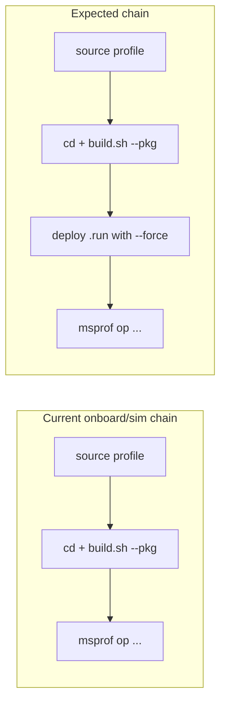

# Standard-custom operator workflow (ops-math / 一站式)

**Priority:** P0  
**Reporter cluster:** `devin-cwd` (v1.2.9 / v1.3.0)  
**Issues:** [#8](https://gitcode.com/opdevtools/plugin_release/issues/8), [#9](https://gitcode.com/opdevtools/plugin_release/issues/9), [#10](https://gitcode.com/opdevtools/plugin_release/issues/10)

---

## Overview

Three related reports describe broken or incomplete command chains for **standard-custom** operator projects (typical layout: ops-math repo with `build.sh --pkg`, `.run` deploy packages, and `experimental/` operator collections). The plugin generates build and profiler commands but omits deploy steps, `--force`, and `--experimental` flags that the CANN toolchain now requires.



---

## Issue #8 — Cannot deploy standard-custom operator (1.2.9)

**State:** Open (created ~6 days ago, updated ~3 days ago)  
**Link:** https://gitcode.com/opdevtools/plugin_release/issues/8

### Reported symptoms

1. **NPU debug:** command does not specify the currently selected operator.
2. **Deploy:** new platform validation requires `--force` on the deploy step; deploy fails without it.

### Current codebase behavior

- Deploy with `getExecutableCommand()` exists in `ascend-strategy.ts` for Ascend deploy flows but is **not** wired the same way for standard-custom CANN deploy/debug paths.
- Standard-custom operator selection flows through `extension.ts` (`getOperatorNamesFromSelection`, `operateTreeProvider`) and `welcome-controller.ts` / `workspace-detector-service.ts` for `ops_list` / `experimental_ops_list`.
- No `--force` flag is appended anywhere in command generation today.

### Key files

| File | Role |
|------|------|
| `plugin/src/domain/services/command-strategy/cann-strategy.ts` | CANN build/run/profiler commands |
| `plugin/src/domain/services/command-strategy/ascend-strategy.ts` | Reference deploy pattern via `getExecutableCommand` |
| `plugin/src/domain/utils/command-utils.ts` | `getExecutableCommand` with `find *.run` wildcard |
| `plugin/src/extension.ts` | Sidebar commands, operator selection |
| `plugin/src/service/workspace-detector-service.ts` | Scans ops-math layout |

### Open questions

1. Plugin version — 1.2.9 only, or also 1.3.0? Exact 一站式 / ops-math platform version?
2. Paste exact **deploy command** from UI and full error without `--force`.
3. Where should `--force` apply — `.run` installer only, `build.sh`, or both?
4. For NPU debug: which operator was selected, and what command was generated (missing `--ops=` / operator name)?
5. Which UI path — sidebar Deploy, Run, or Debug configuration?
6. Does manual deploy from terminal with `--force` succeed?

### Implementation plan

1. **Audit standard-custom command entry points** — build, run example, deploy, debug, onboard, simulation — in `cann-strategy.ts`, build service, and debug integration.
2. **Add deploy step** for standard-custom when `target_file` or `build_out/*.run` pattern is configured; reuse `getExecutableCommand('.../build_out/*.run')` from `command-utils.ts`.
3. **Append `--force`** to `.run` deploy invocations (confirm exact flag with CANN docs / reporter).
4. **Pass selected operator** into debug commands — ensure `operatorNames` from selection reaches debug command builder (same pattern as `buildOpCommand` in `cann-strategy.ts` lines 97–100).
5. **Unit tests** — command string fixtures for standard-custom deploy/debug with `--force`, `--experimental`, and operator name.
6. **Verify** against ops-math repo layout with reporter's environment.

---

## Issue #9 — Missing `--experimental` for experimental operators

**State:** Open (v1.3.0)  
**Link:** https://gitcode.com/opdevtools/plugin_release/issues/9

### Reported symptoms

Building operators under the `experimental/` directory in ops-math does not pass `--experimental` to `build.sh`.

### Current codebase behavior

- `extension.ts` (`getCompileOptionFromSelection`, ~lines 985–996) adds `--experimental` when selected operators have `isExperimental: true` — but **only for sidebar build/run** via `dispatchStartBuild` / `dispatchStartBuildExample`.
- `workspace-detector-service.ts` marks operators under `experimental/` collections as experimental and stores them in `experimental_ops_list`.
- Profiler paths (onboard/simulation) and other build entry points may **not** propagate `compileOption`.

### Key files

| File | Role |
|------|------|
| `plugin/src/extension.ts` | `getCompileOptionFromSelection` |
| `plugin/src/service/workspace-detector-service.ts` | Experimental operator detection |
| `plugin/src/domain/services/command-strategy/cann-strategy.ts` | `buildOpCommand` accepts `compileOption` |
| `plugin/src/controller/welcome-controller.ts` | Updates `experimental_ops_list` on new operators |

### Open questions

1. Which action fails — Build, Run example, On-board, Simulation, or Deploy?
2. Exact operator path under `experimental/` (e.g. `experimental/image/...`)?
3. Does the UI show the operator as experimental?
4. Generated command vs command that works with manual `--experimental`?
5. Same ops-math workspace as #8/#10?
6. Single operator selected, or mixed regular + experimental?

### Implementation plan

1. **Centralize experimental flag resolution** — extract `getCompileOptionForOperators(operatorIds)` used by all command dispatchers (build, run, onboard, sim, deploy).
2. **Ensure `isExperimental` is set** on all code paths that create or refresh operator records from disk scan.
3. **Thread `compileOption`** through onboard/simulation command builders (currently only build/run example in sidebar).
4. **Tests** — workspace fixture with `experimental/` operator; assert `--experimental` in build, onboard, and sim command strings.

---

## Issue #10 — Performance tuning missing deploy command

**State:** Open (v1.2.9 / v1.3.0)  
**Link:** https://gitcode.com/opdevtools/plugin_release/issues/10

### Reported symptoms

On-board and simulation performance commands run only:

```bash
. /etc/profile && cd ... && bash .../build.sh --pkg --soc=... --vendor_name=custom --bisheng_flags=ccec_g --ops=add
```

Expected (includes deploy):

```bash
... build.sh --pkg ... && RUN_FILE=$(find .../build_out/*.run) && chmod +x $RUN_FILE && $RUN_FILE
```

Comment on issue: should also add `--force`.

### Current codebase behavior

- `CannCommandStrategy.buildOnBoardCommand` and simulate equivalent chain: `sourceCannCmd + cdBuildCmd + opprofCmd` — **no deploy** between build and msprof.
- `buildOnBoardCommand` is in `cann-strategy.ts` (~lines 239–276).

### Key files

| File | Role |
|------|------|
| `plugin/src/domain/services/command-strategy/cann-strategy.ts` | `buildOnBoardCommand`, simulate builder |
| `plugin/src/domain/utils/command-utils.ts` | `getExecutableCommand` for `.run` files |
| `plugin/src/extension.ts` | Sidebar onboard/sim dispatch with post-run `refreshPerformanceReports` |

### Open questions

1. On-board only, simulation only, or both?
2. Standard-custom ops-math only, or all project types?
3. Actual vs expected command (confirm `find` path for `build_out/*.run`)?
4. Should `--force` apply to `.run` only or also `build.sh --pkg`?
5. After manual deploy, does profiling succeed?
6. Same workspace as #8/#9 for single repro?

### Implementation plan

1. **Shared helper** — `buildStandardCustomDeployCommand(projectPath: string, options?: { force?: boolean })` returning deploy shell fragment.
2. **Insert deploy** between build and profiler in `buildOnBoardCommand` and simulate builder when project type is `standard-custom` (or when config indicates `build.sh --pkg` flow).
3. **Add `--force`** to deploy invocation per reporter feedback and #8.
4. **Combine with #9** — pass `--experimental` when operator is experimental.
5. **Integration test** — full command string assertion for ops-math-style onboard/sim.
6. **Ask reporter** to validate on 一站式 v1.2.9 and v1.3.0.

---

## Recommended delivery

| Phase | Scope | Issues |
|-------|-------|--------|
| 1 | Deploy + `--force` in onboard/sim + deploy/debug paths | #8, #10 |
| 2 | `--experimental` propagation to all command paths | #9 |
| 3 | NPU debug operator selection fix | #8 |
| 4 | End-to-end validation with ops-math fixture | All |

Single PR is acceptable if changes stay in command-strategy layer and shared helpers; split if debug integration requires separate review.
