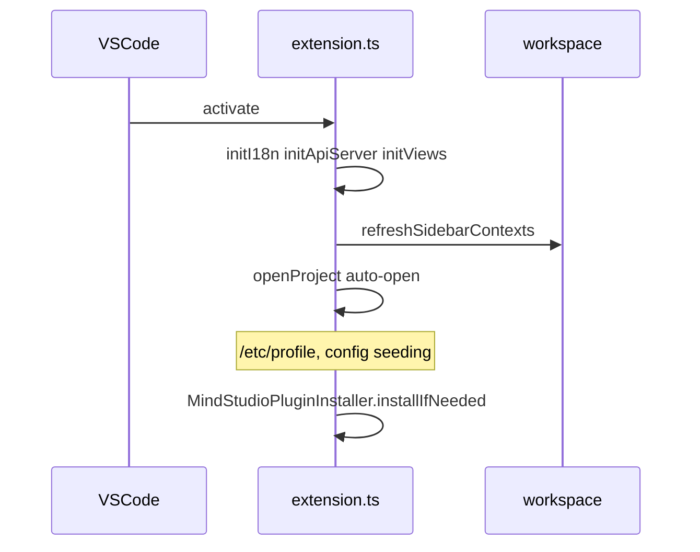

# Startup and distribution performance

**Priority:** P2  
**Issues:** [#4](https://gitcode.com/opdevtools/plugin_release/issues/4), [#7](https://gitcode.com/opdevtools/plugin_release/issues/7)  
**Reporters:** `虎啸山村` (#4), `memorecool` (#7)

---

## Overview

Two reports describe slow plugin loading. They may be related or separate:

| Issue | Focus |
|-------|-------|
| #4 | Extension **activation** slow when opening a VS Code project (first time) |
| #7 | Plugin **download timeout** when installing from marketplace / 一站式 platform |

---

## Issue #4 — Plugin load too long on first open

**State:** Open (~7 days ago)  
**Link:** https://gitcode.com/opdevtools/plugin_release/issues/4

### Reported symptoms

> When open the vscode project at the first time, it takes too long time to load our plugin and report.

No timing data or environment details attached.

### Current codebase behavior — `activate()` in `extension.ts`

Sequential / blocking work during activation:

| Step | Function | Risk |
|------|----------|------|
| Plugin registry | `registerOperatorPlugins()` | Low |
| i18n | `await initI18n()` | Medium (async) |
| Env snapshot log | `logGlobalEnvSnapshot()` | Low |
| API + views | `initApiServer()`, `initViews()` | Medium |
| Sidebar contexts | `await refreshSidebarContexts()` | **High** — FS checks, project detection |
| Auto-open project | `welcomeMethods.openProject(..., true)` when folders exist | **High** — `/etc/profile`, config seeding, report scans |
| MindStudio VSIX | `MindStudioPluginInstaller.installIfNeeded()` | **High** — may install sibling extension |
| Queue polling | `setInterval(syncNativeQueueState, 1000)` | Ongoing |

Deferred to first command (not activation):

- `detectSocOnce()` — `asys` / `npu-smi` via `execSync` in `ascend-util.ts`

Instrumentation exists: `[op-devtools][activate]` logs with `elapsedMs` for key steps.

### Key files

| File | Role |
|------|------|
| `plugin/src/extension.ts` | `activate()` orchestration |
| `plugin/src/controller/welcome-controller.ts` | Auto-open, `/etc/profile` execution |
| `plugin/src/helpers/operator-project-workspace-config.ts` | Canonical env/SOC/simulator reads |
| `plugin/src/service/config-service.ts` | Runtime config reads/writes (`op-devtools.*` dotted settings) |
| `plugin/src/class/operate-tree-provider.ts` | Sidebar refresh triggers |

### Open questions

1. Rough load time in seconds — what is acceptable?
2. First open after install only, or every workspace open?
3. Plugin version, workspace size (operator count), local vs remote?
4. Does sidebar eventually appear, or hang indefinitely?
5. Can reporter share `[op-devtools][activate]` timing logs from Output channel?
6. Is `devtool_config.json` at workspace root on first open?

### Implementation plan

1. **Profile activation** — ensure all major steps log `elapsedMs`; add summary line at end of `activate()`.
2. **Defer non-critical work** (implemented in `post-activate-bootstrap.ts`):
   - After `activate()` returns, run auto-`openProject`, `MindStudioPluginInstaller.installIfNeeded()`, and post-open sidebar refresh in a single-flight background task.
   - Operator commands and user-initiated `openProject` call `whenPostActivateBootstrapReady()` so they do not race deferred startup (e.g. NPU debug before debug VSIX install).
3. **Cache sidebar context** — avoid redundant `refreshSidebarContexts` work on every activation when project unchanged.
4. **Skip `/etc/profile` exec** on auto-open when `ascend_env_script` or `.arts/.env` suffices.
5. **Document** expected first-open time and remote-SSH overhead.
6. **Measure** before/after with large ops-math workspace fixture.

**Key files (defer + await):**

| File | Role |
|------|------|
| `plugin/src/helpers/post-activate-bootstrap.ts` | Deferred bootstrap + `whenPostActivateBootstrapReady()` |
| `plugin/src/extension.ts` | `startPostActivateBootstrap()` at end of `activate()` |
| `plugin/src/controller/task-controller.ts` | Awaits bootstrap before build/run/debug/sanitizer flows |
| `plugin/src/controller/welcome-controller.ts` | User `openProject` awaits bootstrap (not system auto-open) |

---

## Issue #7 — VS Code load slow, download timeout

**State:** Open (~6 days ago)  
**Link:** https://gitcode.com/opdevtools/plugin_release/issues/7

### Reported symptoms

> 一站式算子开发插件在vscode上加载慢，下载超时

(One-stop operator dev plugin slow to load on VS Code, download timeout.)

Title suggests **marketplace / registry download** failure rather than in-process activation — but description is minimal.

### Current codebase behavior

- Distribution is via `.vsix` on GitCode / internal 一站式 platform, not only VS Code Marketplace.
- Large bundled assets (webview bundles, Insight zips, templates) increase download size and activation parse time.
- No client-side retry logic for marketplace download (VS Code handles install).

### Open questions

1. Timeout during **download/install** or **after** install during activation?
2. Install source — VS Code Marketplace, GitCode, internal mirror? Corporate proxy?
3. Exact error message and VS Code version?
4. Same as #4 or separate download failure?
5. Can same version install from local `.vsix`?

### Implementation plan

#### If download timeout (infra / packaging)

1. **Measure `.vsix` size** and compare to platform timeout limits.
2. **Split optional assets** — lazy-download Insight server zip on first use vs bundling in VSIX.
3. **Document** offline install via local `.vsix` for restricted networks.
4. **Work with 一站式 platform** on CDN timeout / mirror configuration (outside plugin repo).

#### If post-install activation (overlap with #4)

1. Apply #4 deferral plan.
2. Ask reporter to clarify failure phase.

---

## Recommended delivery

| Phase | Scope |
|-------|-------|
| 1 | Activation timing logs + defer auto-open and MindStudio install (#4) |
| 2 | Cache workspace sync (#4) |
| 3 | VSIX size audit + lazy Insight assets (#7) |
| 4 | Platform/CDN escalation with reporter (#7) |

Treat #4 and #7 as one investigation thread until reporter confirms whether failure is download vs activation.

---

## Related issues

- [#1 profiling env](./profiling-and-insight.md) — sourcing `/etc/profile` on auto-open adds latency and env side effects.
