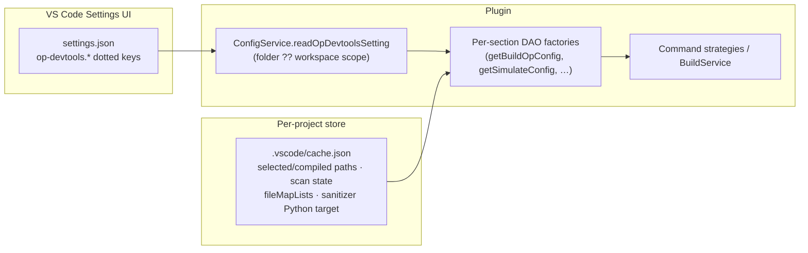

# Workspace settings (`op-devtools.*`)

Canonical reference for operator project configuration in VS Code workspace settings.

**Related:** [`operator-treeview.md`](./operator-treeview.md) (sidebar gear → filtered settings), [`sanitizer.md`](./sanitizer.md), [`performance.md`](./performance.md), [`ascend-env-spec.md`](./ascend-env-spec.md) (SOC / spawn env).

---

## What these settings control

Workspace settings drive:

- Build, run, and debug **compile scripts** (`build_op`, `build_example`, flow-specific script fields)
- **Deploy / run target** for `build_op` (`deployCommandOrRunCommand`)
- Sanitizer detection options and compile script
- Simulation and on-board profiling options and pre-profile compile scripts
- ST test selected modes and ordered per-mode TTK argument tokens
- Environment script path and optional SOC override
- Optional **Triton** operator support (extension registration)

Quick-options webviews (`options-sanitizer`, `options-simulator`, `options-on-board`) remain available when the corresponding `showQuickOptions` setting is `true` (default). Set it to `false` to run directly from the Actions tree using workspace values only. ST always opens its run configuration panel because mode availability and ordered arguments are reviewed for each run.

---

## Runtime model

| Concern | Implementation |
|---------|----------------|
| Schema + labels | `package.json` (`contributes.configuration` — 57 `op-devtools.*` properties), `package.nls.json`, `package.nls.zh-cn.json`, `package.nls.en.json` |
| Read / merge | [`plugin/src/service/config-service.ts`](../plugin/src/service/config-service.ts) — per-section DAO factories `getBuildOpConfig`, `getBuildExampleConfig`, `getUtTestConfig`, `getSimulateConfig`, `getOnBoardConfig`, `getSanitizerConfig`, resolved through `resolveSectionBaseContext` in [`plugin/src/domain/services/command.ts`](../plugin/src/domain/services/command.ts) |
| Env / simulator helpers | [`plugin/src/helpers/operator-project-workspace-config.ts`](../plugin/src/helpers/operator-project-workspace-config.ts) |
| Build / run / profile | [`plugin/src/service/build-service.ts`](../plugin/src/service/build-service.ts) |
| Project env script | [`plugin/src/service/project-service.ts`](../plugin/src/service/project-service.ts) — `syncAscendEnvScriptFromWorkspaceSettings` |
| Writes to `settings.json` | `ConfigService.writeOpDevtoolsDottedSettings` (batch dotted keys; JSONC-tolerant read; an unparseable file is never overwritten; atomic temp+rename; per-path serialized queue; content-diff guard) |
| `cache.json` | [`plugin/src/helpers/workspace-cache.ts`](../plugin/src/helpers/workspace-cache.ts) — `readWorkspaceCache` / `updateWorkspaceCache` |
| Change watch | [`plugin/src/helpers/main-config-watch.ts`](../plugin/src/helpers/main-config-watch.ts) — single `onDidChangeConfiguration` handler |

### Reading settings

Every read goes through `getConfiguredValue()` ([`operator-project-workspace-config.ts`](../plugin/src/helpers/operator-project-workspace-config.ts)): a key is used only when it is explicitly set in the workspace scope — **workspace-folder scope wins over workspace scope** (`workspaceFolderValue ?? workspaceValue`); user/global scope is ignored, and `null` counts as unset. Script keys with empty/whitespace values are ignored (`readNonEmptyOpDevtoolsSetting`).

### Writing settings

`ConfigService.writeOpDevtoolsDottedSettings` is the only writer of `op-devtools.*` in `settings.json`:

- **JSONC-tolerant read** — a BOM, `//` comments and trailing commas are legal in hand-edited settings files;
- a file that fails every parse pass is **never overwritten** (rebuilding it from `{}` would silently destroy the user's other keys; recovery is a manual fix of the file);
- **atomic write** — the new content is staged in a sibling temp file, then renamed over the target;
- **per-path serialized queue** — concurrent writers cannot interleave "last writer wins" states;
- **content-diff guard** — a byte-identical write is a no-op, which breaks `write → event → write` loops;
- a nested `"op-devtools": { … }` object present in the file is flattened to dotted keys on write (existing dotted keys win).

`.vscode/cache.json` is written only via `updateWorkspaceCache` (atomic read-modify-write, serialized per cache file). Reads never create the file; a writer always does — a missing cache is created, never skipped. A corrupt or unparseable `cache.json` is renamed to `cache.json.bak` on read, and the next writer starts from a fresh object.

### Change watch

The single `onDidChangeConfiguration` handler ([`main-config-watch.ts`](../plugin/src/helpers/main-config-watch.ts)) reacts to `op-devtools.*` changes:

- toggling `performanceTuning.onBoard.operatorMetrics` writes its child metric keys;
- changing `operatorSupport.triton` prompts **Reload Window**;
- `environment.*` / `operatorSupport` changes re-sync the ascend env script and refresh the sidebar trees;
- any `op-devtools.*` change runs `writeOpDevtoolsDottedSettings({})` to normalize the dotted layout.

### Project recognition

A path is treated as an operator project when **at least one** marker is present:

1. an explicit `op-devtools.projectType` workspace setting,
2. scan state under `folders[<normalized-root>]` in `.vscode/cache.json`,
3. a `devtool_config.json` marker in the project's IDE config directory.

The project type comes from the setting when it is a recognized value, otherwise from synchronous structural re-detection (`getProjectByPath`, [`project-model.ts`](../plugin/src/domain/models/project-model.ts)).

### Effective config at command time

Runtime configs are **synthesized**, not stored: each flow's per-section DAO factory on `ConfigService` builds a typed config object on demand directly from:

1. **Workspace settings** — the section's dotted `op-devtools.*` keys only.
2. **`.vscode/cache.json`** — DB-only fields: `fileMapLists[configType]` → `fileMapList` (simulate / on_board / sanitizer), and `sanitizerPythonTarget[op]` → `target_file` for sanitizer.
3. **Deploy/run target** (`build_op.target_file` at runtime) comes from `compileAndDeploy.buildConfig.deployCommandOrRunCommand` (also writable via `ConfigService.writeBuildOpDeployTarget` when the user picks an active `.py`).
4. **Profiler / msprof binary path** (`build_example.target_file` for on-board/simulate) comes from `compileAndDeploy.exampleBuildConfig.targetFile`, falling back to `OperatorPluginRegistry.getDefaultPaths` — not from `deployCommandOrRunCommand`.

Per-flow compile keys (`compileCommand`, `sanitizerCompileCommand`, `onBoardCompileCommand`, `simulationCompileCommand`, `utTestCompileCommand`, …) map **1:1** to the matching `config_type`; there is **no** fallback from sanitizer/simulation/on-board keys to `compileCommand`.

### Defaults for fresh projects

`ConfigService.ensureOpDevtoolsSettingsSeeded(projectPath, …)` seeds the default script strings and default paths for a fresh project directly from `OperatorPluginRegistry.getOpPlugin(op_type).getInitialConfigScripts()` / `getDefaultPaths()`, persisted as dotted workspace keys. The seed is **per-key create-if-missing** (idempotent): keys already present in `settings.json` or explicitly set in the configuration layer are left untouched, so user values always win. Workspace-level target keys are seeded only for single-operator projects; in a multi-operator workspace they stay empty and the runtime per-op `getDefaultPaths(op)` fallback applies for every sub-operator.

---

## Opening settings

| Entry | Behavior |
|-------|----------|
| Title bar **Project config** | `huawei-op-devtools.sidebar.projectConfig` — opens Settings filtered to this extension |
| Sanitizer gear (Actions tree) | `@ext:huawei.huawei-op-devtools-vscode-plugin op-devtools.sanitizer` |
| On-board gear | `… op-devtools.performanceTuning.onBoard` |
| Simulation gear | `… op-devtools.performanceTuning.simulation` |

---

## Setting categories

All keys use the prefix `op-devtools.` and are contributed as **separate** configuration categories in `package.json` (not one merged object) — 57 properties in total.

One key is **not declared** in `package.json`: `op-devtools.projectType` (string) — the internal workspace key that records the project type. It is written by project create/open and by workspace detection, and is one of the project-recognition markers (see [Project recognition](#project-recognition)).

### Operator support (`op-devtools.operatorSupport`)

| Key | Type | Default | Effect |
|-----|------|---------|--------|
| `operatorSupport.triton` | boolean | `false` | When enabled, registers `TritonPlugin` at activate; changing it prompts **Reload Window**. |

### Compile & deploy (`op-devtools.compileAndDeploy`)

Also includes extension-wide **`op-devtools.debugMode`** (boolean, default `true`) in this category — gates NPU debug row visibility with registry capabilities.

#### `buildConfig` — maps to `build_op` and flow script fields

| Setting key | Runtime field | Used by |
|-------------|---------------|---------|
| `buildConfig.operatorNameToCompile` | `build_op.op` | Operator resolution: sidebar selection wins, this key is the fallback (`operatorNames?.first \|\| config.op`) |
| `buildConfig.deployCommandOrRunCommand` | `build_op.target_file` | Run / deploy (not msprof profiler binary) |
| `buildConfig.compileCommand` | `build_op.script` | Operator build |
| `buildConfig.utTestCompileCommand` | `ut_test.script` | UT test action |
| `buildConfig.cpuDebugCompileCommand` | `build_op.cpu_debug_script` | CPU debug pre-build |
| `buildConfig.npuDebugCompileCommand` | `build_op.npu_debug_script` | NPU debug pre-build |
| `buildConfig.sanitizerCompileCommand` | `sanitizer.script` | Sanitizer pre-build |
| `buildConfig.onBoardCompileCommand` | `on_board.script` | On-board pre-build |
| `buildConfig.simulationCompileCommand` | `simulate.script` | Simulation pre-build |
| `buildConfig.genOpCommand` | — | Command template for generating an operator in a standard-custom project; workspace-overridable (default `bash build.sh --genop={path}/{operatorname}`) |

CPU/NPU debug script settings apply only when the project type and `OperatorPluginRegistry` support the corresponding debug mode (see [`debug-integration.md`](./debug-integration.md)).

**Ascend standard-custom compile scripts** seeded from `AscendPlugin.getInitialConfigScripts()` include `--ops={operatorNames}` in `compileCommand`, debug scripts, UT, on-board, simulation, and sanitizer compile fields. At run time, `applyOperatorNamesPlaceholder()` ([`build-integration.md`](./build-integration.md#operatornames-and---ops-compile-scripts)) substitutes selected operator names or removes the token when none are selected. When operator names are selected but the script carries no literal `--ops` flag, `--ops={names}` is appended — for standard-custom ascend-style compile lines only (scripts containing `--vendor_name=custom`, `--pkg`, or `--soc=… -u`).

#### `exampleBuildConfig` — maps to `build_example`

| Setting key | Runtime field | Notes |
|-------------|---------------|--------|
| `exampleBuildConfig.executionMode` | `execution_mode` | Enum: `eager` \| `graph` |
| `exampleBuildConfig.runCommand` | `script` | Base example build script; strategy appends operator name, mode, package mode |

Relevant for Ascend/CANN **run** and example build flows (not PyAsc/Triton `build_op` run path).

### ST test (`op-devtools.stTest`)

These resource-scoped values are persisted in the selected operator's workspace folder. The run panel filters saved modes against the CSV files currently available under `tests/st/arch35`.

| Setting key | Type | Default | Effect |
|-------------|------|---------|--------|
| `stTest.selectedModes` | `string[]` | `['kernel']` | Modes selected when the panel opens; stale unavailable modes are ignored. |
| `stTest.kernel.arguments` | `string[]` | `['-d=false', '-b=release', '--pc=8']` | Ordered tokens appended to `python -m ttk kernel`. |
| `stTest.aclnn.arguments` | `string[]` | `[]` | Ordered tokens appended to `python -m ttk aclnn`. |
| `stTest.e2e.arguments` | `string[]` | `[]` | Ordered tokens appended to `python -m ttk e2e`. |

Each array element is one argument token, not a shell fragment. Empty, control-character, excessive, and extension-managed `-i`/`--input`, `-o`/`--output`, or `--plugin` tokens (including attached/assignment forms) are rejected before settings are changed or an action is queued. The extension owns those paths and shell-quotes every accepted token at the final command boundary. The exact command is printed to the `st test` output channel before its process output.

### Sanitizer (`op-devtools.sanitizer`)

| Setting key | Runtime option | Notes |
|-------------|----------------|--------|
| `sanitizer.showQuickOptions` | — | `true` (default): Actions **Sanitizer** opens quick-options webview; `false`: enqueue run immediately |
| `sanitizer.memory` | `tool.memcheck` | |
| `sanitizer.memCheck` | `tool.npumemcheck` | npu-check |
| `sanitizer.sync` | `tool.synccheck` | npu-check |
| `sanitizer.raceCheck` | `tool.npuracecheck` | npu-check |
| `sanitizer.initCheck` | `tool.npuinitcheck` | npu-check |
| `sanitizer.memoryLeak` | `memcheckOption['leak-check']` | Meaningful when memory check enabled |
| `sanitizer.allocUnused` | `memcheckOption['check-unused-memory']` | |
| `sanitizer.race` | `tool.racecheck` | |
| `sanitizer.uninitialized` | `tool.initcheck` | |
| `sanitizer.reportLogLevel` | `logLevel` | `info` \| `warn` \| `error` |
| `sanitizer.maxSingleLogFileSize` | `maxDebuglogSize` | MB, 1–10240 |
| `sanitizer.detectionScope` | `useBlock` | `global` → `false`; `singleBlock` → `true` |
| `sanitizer.blockId` | `blockId` | 0–200 when single-block scope |
| `sanitizer.enableMsAgentAiFix` | — | msAgent AI fix on sanitizer result rows ([`msagent.md`](./msagent.md)) |

Compile script: `compileAndDeploy.buildConfig.sanitizerCompileCommand` → `sanitizer.script`.

### Performance tuning (`op-devtools.performanceTuning`)

#### Simulation (`performanceTuning.simulation.*`)

| Setting key | Runtime option | Notes |
|-------------|----------------|--------|
| `simulation.showQuickOptions` | — | Default `true`; `false` → direct simulation run from Actions tree |
| `simulation.simulatorType` | `simulatorType` | CANN simulator **directory name** under `tools/simulator/`; drives `msprof op simulator --soc-version` and `getWorkspaceSimulatorType()` ([`ascend-env-spec.md`](./ascend-env-spec.md) §8.1) |
| `simulation.memoryThroughputWaveform` | `PMSampling` | |
| `simulation.resourceConflictRatio` | `ResourceConflictRatio` | |
| `simulation.parameters` | `advance_param` | Object map → `[{ name, value }]` |

Pre-build script: `compileAndDeploy.buildConfig.simulationCompileCommand`.

#### On-board (`performanceTuning.onBoard.*`)

| Setting key | Runtime option | Notes |
|-------------|----------------|--------|
| `onBoard.showQuickOptions` | — | Default `true`; `false` → direct on-board run |
| `onBoard.interCoreLoad` | `Occupancy` | |
| `onBoard.roofline` | `Roofline` | |
| `onBoard.operatorCodeHotspot` | `Source` | |
| `onBoard.cacheHeatmap` | `MemoryDetail` | Non–A5 profiler SOC only |
| `onBoard.pcSampling` | `PCSampling` | **A5** profiler SOC only (`isAscendA5ProfilerCannSoc`) |
| `onBoard.operatorMetrics` | `operatorMetrics` (bulk toggle) | Toggling writes all metric child keys via `writeOpDevtoolsDottedSettings` |
| `onBoard.cubeAndVectorInstructionTimeAndRatio` | `ArithmeticUtilization` | Child of bulk toggle |
| `onBoard.l2CacheHitRate` | `L2Cache` | |
| `onBoard.memoryReadWriteBandwidth` | `Memory` | |
| `onBoard.l0ReadWriteBandwidth` | `MemoryL0` | |
| `onBoard.ubReadWriteBandwidth` | `MemoryUB` | |
| `onBoard.computeAndMoveUnitTimeRatio` | `PipeUtilization` | |
| `onBoard.resourceConflictRatio` | `ResourceConflictRatio` | |
| `onBoard.enableKernelCodeSegmentProfiling` | `KernelScale` | Requires MetricsProfStart/Stop in kernel when enabled |
| `onBoard.parameters` | `advance_param` | Object map → `[{ name, value }]` |

Pre-build script: `compileAndDeploy.buildConfig.onBoardCompileCommand`.

A5 metric matrix details: [`ascend-a5-support.md`](./ascend-a5-support.md).

### Environment (`op-devtools.environment`)

| Setting key | Runtime use |
|-------------|-------------|
| `environment.environmentScript` | Project `ascend_env_script`; default in schema `/etc/profile`. Explicit empty vs unset handled in `getConfiguredEnvironmentScriptPath` / `getAscendEnvScriptWithWorkspaceOverride`. |
| `environment.socVersion` | Overrides stored project SOC when set; fed into `resolveAscendEnv` / spawn env ([`ascend-env-spec.md`](./ascend-env-spec.md)). |
| `environment.npuArch` | Overrides the SOC-derived `NPU_ARCH` (e.g. `dav-2201`, `dav-3510`); reaches spawn exports, terminal env and `cmake -DCMAKE_ASC_ARCHITECTURES=` ([`ascend-env-spec.md`](./ascend-env-spec.md) §6). |
| `environment.insightPath` | Insight data-viewer installation path used by the insight service; written to the workspace on first activation when unset. |

### Execution (`op-devtools.execution`)

| Setting key | Type | Default | Effect |
|-------------|------|---------|--------|
| `execution.commandTimeoutSeconds` | number | `1800` | Timeout for spawned operator commands; an exceeding run is terminated (the error message points at this key). |

### Companion (`op-devtools.companion`)

| Setting key | Type | Default | Effect |
|-------------|------|---------|--------|
| `companion.cannworkAutoInstall` | boolean | `true` | Silent background install of the CANNWork companion extension (`cann-pub.cannbot-toolkit`) on activation when missing or older than 2.0.0; `false` stops future installs/upgrades, already-installed versions are unaffected. |

---

## What is not in workspace settings

| Item | Where it lives |
|------|----------------|
| Per-operator JSON override editor | Not exposed (no editable override map in Settings UI) |
| Profiler binary path (default) | `compileAndDeploy.exampleBuildConfig.targetFile` workspace setting; fallback `OperatorPluginRegistry.getDefaultPaths` |
| Selected / compiled operator paths, per-folder scan state, `fileMapList`, sanitizer Python target | `.vscode/cache.json` |
| `op-devtools.debugMode` | Extension setting (same category block as compile in UI) |
| Sanitizer log paths / report list | Workspace artifacts + in-memory tree state ([`sanitizer.md`](./sanitizer.md)) |

---

## Source files

- `package.json` — `contributes.configuration`
- `plugin/src/service/config-service.ts` — per-section DAO factories, reads, writes, seeding
- `plugin/src/helpers/operator-project-workspace-config.ts` — env / simulator / scope helpers, `getConfiguredValue`
- `plugin/src/helpers/ide-settings-persist.ts` — guarded `settings.json` writes (JSONC tolerance, atomicity, content-diff)
- `plugin/src/helpers/workspace-cache.ts` — `.vscode/cache.json` read/update
- `plugin/src/helpers/main-config-watch.ts` — single `onDidChangeConfiguration` handler
- `plugin/src/domain/services/command.ts` — `resolveSectionBaseContext` / base-context resolution
- `plugin/src/domain/utils/operator-script-placeholders.ts` — `applyOperatorNamesPlaceholder`
- `plugin/src/domain/models/project-model.ts` — `getProjectByPath` project recognition
- `plugin/src/service/build-service.ts`, `project-service.ts`
- `web/src/views/panels/options-sanitizer/`, `options-simulator/`, `options-on-board/` — optional quick-options UI
