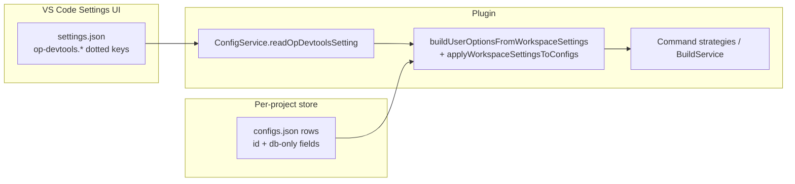

# Workspace settings (`op-devtools.*`)

Canonical reference for operator project configuration in VS Code workspace settings. Replaces the removed **Operator project config** webview.

**Related:** [`operator-treeview.md`](./operator-treeview.md) (sidebar gear → filtered settings), [`sanitizer.md`](./sanitizer.md), [`performance.md`](./performance.md), [`ascend-env-spec.md`](./ascend-env-spec.md) (SOC / spawn env).

---

## What these settings control

Workspace settings drive:

- Build, run, and debug **compile scripts** (`build_op`, `build_example`, flow-specific script fields)
- **Deploy / run target** for `build_op` (`deployCommandOrRunCommand`)
- Sanitizer detection options and compile script
- Simulation and on-board profiling options and pre-profile compile scripts
- Environment script path and optional SOC override
- Optional **Triton** operator support (extension registration)

Quick-options webviews (`options-sanitizer`, `options-simulator`, `options-on-board`) remain available when the corresponding `showQuickOptions` setting is `true` (default). Set it to `false` to run directly from the Actions tree using workspace values only.

---

## Runtime model



| Concern | Implementation |
|---------|----------------|
| Schema + labels | `package.json` (`contributes.configuration`), `package.nls.json`, `package.nls.zh-cn.json`, `package.nls.en.json` |
| Read / merge | [`plugin/src/service/config-service.ts`](../plugin/src/service/config-service.ts) — `buildUserOptionsFromWorkspaceSettings`, `applyWorkspaceSettingsToConfigs`, `getRuntimeConfigById` |
| Env / simulator helpers | [`plugin/src/helpers/operator-project-workspace-config.ts`](../plugin/src/helpers/operator-project-workspace-config.ts) |
| Build / run / profile | [`plugin/src/service/build-service.ts`](../plugin/src/service/build-service.ts) |
| Project env script | [`plugin/src/service/project-service.ts`](../plugin/src/service/project-service.ts) — `syncAscendEnvScriptFromWorkspaceSettings` |
| Writes to `settings.json` | `ConfigService.writeOpDevtoolsDottedSettings` only (batch dotted keys; migrates legacy nested `"op-devtools": { }` object when present) |

### Effective config at command time

When migration has completed (see [Migration conditions](#c-migration-conditions) and [Migration to workspace settings](#b-migration-to-workspace-settings)):

1. Each `configs.json` row keeps **identity** (`config_id`, `config_type`, operator linkage) and **DB-only** `user_options` keys: `fileMapList`, `config_name`, `target_dir`, `downloadToLocal`, `renderInPlatform`, `dataStoragePath`, `enableDump`.
2. All **script and option fields** used for command generation come from workspace settings via `applyWorkspaceSettingsToConfigs`.
3. **Deploy/run target** (`build_op.target_file` at runtime) comes from `compileAndDeploy.buildConfig.deployCommandOrRunCommand` (also writable via `ConfigService.writeBuildOpDeployTarget` when the user picks an active `.py`).
4. **Profiler / msprof binary path** (`build_example.target_file` for on-board/simulate) is still read from the DB row where applicable — not from `deployCommandOrRunCommand`.

Per-flow compile keys (`compileCommand`, `sanitizerCompileCommand`, `onBoardCompileCommand`, `simulationCompileCommand`, `utTestCompileCommand`, …) map **1:1** to the matching `config_type`; there is **no** fallback from sanitizer/simulation/on-board keys to `compileCommand`.

Empty strings for script keys are ignored (`readNonEmptyOpDevtoolsSetting`).

**Scopes:** User / workspace / workspace folder (VS Code configuration). Changing `op-devtools.*` triggers `writeOpDevtoolsDottedSettings({})` to normalize dotted layout; env / operator-support changes refresh sidebar and may prompt reload when Triton support toggles.

---

## Opening settings

| Entry | Behavior |
|-------|----------|
| Title bar **Project config** | `huawei-op-devtools.sidebar.projectConfig` — opens Settings filtered to this extension |
| Sanitizer gear (Actions tree) | `@ext:huawei.huawei-op-devtools-vscode-plugin op-devtools.sanitizer` |
| On-board gear | `… op-devtools.performanceTuning.onBoard` |
| Simulation gear | `… op-devtools.performanceTuning.simulation` |

---

## Setting categories

All keys use the prefix `op-devtools.` and are contributed as **separate** configuration categories in `package.json` (not one merged object).

### Operator support (`op-devtools.operatorSupport`)

| Key | Type | Default | Effect |
|-----|------|---------|--------|
| `operatorSupport.triton` | boolean | `false` | When enabled, registers `TritonPlugin` at activate; changing it prompts **Reload Window**. |

### Compile & deploy (`op-devtools.compileAndDeploy`)

Also includes extension-wide **`op-devtools.debugMode`** (boolean, default `true`) in this category — gates NPU debug row visibility with registry capabilities.

#### `buildConfig` — maps to `build_op` and flow script fields

| Setting key | `user_options` / runtime field | Used by |
|-------------|-------------------------------|---------|
| `buildConfig.operatorNameToCompile` | `build_op.op` | Build (`--ops`), standard-custom flows |
| `buildConfig.deployCommandOrRunCommand` | `build_op.target_file` | Run / deploy (not msprof profiler binary) |
| `buildConfig.compileCommand` | `build_op.script` | Operator build |
| `buildConfig.utTestCompileCommand` | `ut_test.script` | UT test action |
| `buildConfig.cpuDebugCompileCommand` | `build_op.cpu_debug_script` | CPU debug pre-build |
| `buildConfig.npuDebugCompileCommand` | `build_op.npu_debug_script` | NPU debug pre-build |
| `buildConfig.sanitizerCompileCommand` | `sanitizer.script` | Sanitizer pre-build |
| `buildConfig.onBoardCompileCommand` | `on_board.script` | On-board pre-build |
| `buildConfig.simulationCompileCommand` | `simulate.script` | Simulation pre-build |

CPU/NPU debug script settings apply only when the project type and `OperatorPluginRegistry` support the corresponding debug mode (see [`debug-integration.md`](./debug-integration.md)).

**Ascend standard-custom compile scripts** seeded from `AscendPlugin.getInitialConfigScripts()` include `--ops={operatorNames}` in `compileCommand`, debug scripts, UT, on-board, simulation, and sanitizer compile fields. At run time, `applyOperatorNamesPlaceholder()` ([`build-integration.md`](./build-integration.md#operatornames-and---ops-compile-scripts)) substitutes selected operator names or removes the token when none are selected. Legacy migrated rows without the placeholder still get a temporary `--ops` append for ascend pkg/custom/UT-style scripts only.

#### `exampleBuildConfig` — maps to `build_example`

| Setting key | `user_options` field | Notes |
|-------------|---------------------|--------|
| `exampleBuildConfig.executionMode` | `execution_mode` | Enum: `eager` \| `graph` |
| `exampleBuildConfig.runCommand` | `script` | Base example build script; strategy appends operator name, mode, package mode |

Relevant for Ascend/CANN **run** and example build flows (not PyAsc/Triton `build_op` run path).

### Sanitizer (`op-devtools.sanitizer`)

| Setting key | `sanitizer.user_options` | Notes |
|-------------|--------------------------|--------|
| `sanitizer.showQuickOptions` | — | `true` (default): Actions **Sanitizer** opens quick-options webview; `false`: enqueue run immediately |
| `sanitizer.memory` | `tool.memcheck` | |
| `sanitizer.memoryLeak` | `memcheckOption['leak-check']` | Meaningful when memory check enabled |
| `sanitizer.allocUnused` | `memcheckOption['check-unused-memory']` | |
| `sanitizer.race` | `tool.racecheck` | |
| `sanitizer.uninitialized` | `tool.initcheck` | |
| `sanitizer.reportLogLevel` | `logLevel` | `info` \| `warn` \| `error` |
| `sanitizer.maxSingleLogFileSize` | `maxDebuglogSize` | MB, 1–10240 |
| `sanitizer.detectionScope` | `useBlock` | `global` → `false`; `singleBlock` → `true` |
| `sanitizer.blockId` | `blockId` | 0–200 when single-block scope |
| `sanitizer.enableMsAgentAiFix` | — | msAgent AI fix on sanitizer result rows ([`msagent.md`](./msagent.md)) |

Compile script: `compileAndDeploy.buildConfig.sanitizerCompileCommand` → `sanitizer.script`.

### Performance tuning (`op-devtools.performanceTuning`)

#### Simulation (`performanceTuning.simulation.*`) → `simulate.user_options`

| Setting key | Legacy field | Notes |
|-------------|--------------|--------|
| `simulation.showQuickOptions` | — | Default `true`; `false` → direct simulation run from Actions tree |
| `simulation.simulatorType` | `simulatorType` | CANN simulator dir name; also `getWorkspaceSimulatorType()` |
| `simulation.memoryThroughputWaveform` | `PMSampling` | |
| `simulation.resourceConflictRatio` | `ResourceConflictRatio` | |
| `simulation.parameters` | `advance_param` | Object map → `[{ name, value }]` |

Pre-build script: `compileAndDeploy.buildConfig.simulationCompileCommand`.

#### On-board (`performanceTuning.onBoard.*`) → `on_board.user_options`

| Setting key | Legacy field | Notes |
|-------------|--------------|--------|
| `onBoard.showQuickOptions` | — | Default `true`; `false` → direct on-board run |
| `onBoard.interCoreLoad` | `Occupancy` | |
| `onBoard.roofline` | `Roofline` | |
| `onBoard.operatorCodeHotspot` | `Source` | |
| `onBoard.cacheHeatmap` | `MemoryDetail` | Non–A5 profiler SOC only |
| `onBoard.pcSampling` | `PCSampling` | **A5** profiler SOC only (`isAscendA5ProfilerCannSoc`) |
| `onBoard.operatorMetrics` | `operatorMetrics` (bulk UI) | Toggling writes all metric child keys via `writeOpDevtoolsDottedSettings` |
| `onBoard.cubeAndVectorInstructionTimeAndRatio` | `ArithmeticUtilization` | Child of bulk toggle |
| `onBoard.l2CacheHitRate` | `L2Cache` | |
| `onBoard.memoryReadWriteBandwidth` | `Memory` | |
| `onBoard.l0ReadWriteBandwidth` | `MemoryL0` | |
| `onBoard.ubReadWriteBandwidth` | `MemoryUB` | |
| `onBoard.computeAndMoveUnitTimeRatio` | `PipeUtilization` | |
| `onBoard.resourceConflictRatio` | `ResourceConflictRatio` | |
| `onBoard.enableKernelCodeSegmentProfiling` | `KernelScale` | Requires MetricsProfStart/Stop in kernel when enabled |
| `onBoard.parameters` | `advance_param` | Object map → `[{ name, value }]` |

Pre-build script: `compileAndDeploy.buildConfig.onBoardCompileCommand`.

A5 metric matrix details: [`ascend-a5-support.md`](./ascend-a5-support.md).

### Environment (`op-devtools.environment`)

| Setting key | Runtime use |
|-------------|-------------|
| `environment.environmentScript` | Project `ascend_env_script`; default in schema `/etc/profile`. Explicit empty vs unset handled in `getConfiguredEnvironmentScriptPath` / `getAscendEnvScriptWithWorkspaceOverride`. |
| `environment.socVersion` | Overrides stored project SOC when set; fed into `resolveAscendEnv` / spawn env ([`ascend-env-spec.md`](./ascend-env-spec.md)). |

---

## Legacy settings and workspace migration

Three stages: legacy rows are **created** in extension storage, **copied once** into workspace `settings.json`, then runtime reads **workspace only** for script/option fields (see [Runtime model](#runtime-model)).

**Contract (implemented):** one-time `maybeMigrateLegacySettingsToWorkspace` (with `AsyncSingleFlight`); flag `op-devtools.internal.settingsMigratedFromLegacy` set only in the same successful batch as ≥1 seeded key; no recurring DB→settings backfill; no DB script fallback when a workspace key is empty. Replaced the old per-refresh `syncOperatorProjectWorkspaceSettings` on `puer-master`.

| Area | State |
|------|--------|
| One-time migrate + single-flight | Done |
| Settings-only runtime (`getRuntimeConfigById`, strategies) | Done |
| Deploy/run from settings; profiler binary from DB | Done |
| Webview / `ops` `saveConfig` → workspace only | Done |
| `postConfig` does not mirror script / deploy to DB | Done |
| No `operatorProject.*` reads; no `syncAscend` at end of migrate | Done |

### a) Legacy settings creation

**Where:** per-project store under extension `user_data_dir` — primarily [`configs.json`](./generated-files-specification.md) (and [`projects.json`](./generated-files-specification.md) for project metadata). Workspace file: `.vscode/settings.json` or `.arts/settings.json` via `getIdeSettingsFilePath` (not created by `generateStructure`).

**When rows appear:**

| Event | What is written |
|-------|-----------------|
| `generateStructure` (new operator / open project) | Default rows: `build_op`, `build_example`, `ut_test`, `sanitizer`, `on_board`, `simulate` with `user_options` from `OperatorPluginRegistry.getOpPlugin(op_type).getInitialConfigScripts()` (scripts, debug scripts, example script, sanitizer script, etc.) |
| `completeProjectConfigs` | Missing config **types** only (same model) |
| `createOpsByPrototype` / folder mark-as-operator | Same as `generateStructure` path |
| `ensureSanitizerConfigExists` (folder menu) | Skeleton `sanitizer` row only — migrate needs other hooks if that is the only change |
| Sanitizer / performance quick-options (pre-migration era) | Could update `user_options` on rows via `postConfig` |
| PyAsc / Triton run (post-migrate) | `ConfigService.writeBuildOpDeployTarget` → workspace `deployCommandOrRunCommand` |
| Sanitizer reports | `fileMapList` and related DB-only fields on the sanitizer row |

**What “legacy” means here:** `user_options` on `configs.json` rows held compile scripts, deploy target, sanitizer/profiler options, and debug script fields before workspace settings became the runtime source. Those values are still on disk after migration; they are **not** read back for command generation once the migration flag is set.

**Not created as legacy `user_options`:** dotted `op-devtools.*` in `settings.json` (except user/manual edits and post-migration writes). Nested `"op-devtools": { }` objects in settings, if present, are flattened on the next `writeOpDevtoolsDottedSettings`.

### b) Migration to workspace settings

**Entry point:** `ConfigService.maybeMigrateLegacySettingsToWorkspace()` → single-flight → `migrateLegacySettingsToWorkspace()`.

**Call sites (retry until [§c](#c-migration-conditions) allow a write):**

| Hook | When |
|------|------|
| After `completeProjectConfigs` | `welcome-controller.openProject` |
| After `generateStructure` | welcome (new project), `createOpsByPrototype`, folder menu |
| `refreshSidebarContexts` | `extension.ts` (activation fallback when bootstrap has not opened project yet) |
| `project-service` | After project operations that need settings |

`getConfigData` / sanitizer-only paths do **not** call migrate inline — they rely on the hooks above.

**Algorithm (`migrateLegacySettingsToWorkspace`):**

1. Exit if `internal.settingsMigratedFromLegacy` is already `true`.
2. Exit if no `projectId` or no `build_op` row ([MIG-02](#mig-02)).
3. Build pending writes from DB (`buildLegacySettingsMigrationWrites` + `getProjectSH()` for env script).
4. `filterPendingWritesByCurrentFile` — per-key skip rules in §c.
5. If no seed keys remain (only the flag would be written), exit without write ([MIG-01](#mig-01)).
6. Batch `writeOpDevtoolsDottedSettings` including the flag; on `false` or throw, flag is **not** set ([MIG-03](#mig-03)).

On each `refreshSidebarContexts`, the extension runs `writeOpDevtoolsDottedSettings({})` **before** `maybeMigrate` to normalize nested `"op-devtools": { }` into dotted keys (empty-object flatten only).

**Steps (seed content):**

1. Read legacy `user_options` from `configs.json` (`buildLegacySettingsMigrationWrites`): `build_op`, `build_example`, `ut_test`, `simulate`, `on_board`, sanitizer row, plus `projects.json` env script via `getProjectSH()` → `environment.environmentScript`.
2. Map fields to dotted keys (see [Setting categories](#setting-categories); sanitizer/sim/on-board metrics via `workspace-user-options-dotted-map.ts`). Non-empty scripts use `queueNonEmptyString`.
3. `filterPendingWritesByCurrentFile` — drop keys that already exist in the on-disk settings file or are explicitly set at workspace / workspace-folder scope ([§c](#c-migration-conditions)).
4. If at least one seed key remains, batch-write via `writeOpDevtoolsDottedSettings` and set `op-devtools.internal.settingsMigratedFromLegacy` = `true` in the **same** write.
5. If the write fails, the flag is **not** set (migration can retry).

**After success:** `buildUserOptionsFromWorkspaceSettings` + `applyWorkspaceSettingsToConfigs` supply runtime `user_options`; `getRuntimeConfigById` does not fall back to DB script fields. New saves from webviews (`saveConfig`, sanitizer form) go to workspace only (`writeOpDevtoolsDottedSettings`), not back into legacy script columns.

**By design:** no recurring sync from `configs.json` into settings when new DB rows appear later; one-time seed only.

**Seeded from legacy (typical):**

| Legacy source | Workspace key(s) |
|---------------|------------------|
| `build_op.op` | `compileAndDeploy.buildConfig.operatorNameToCompile` |
| `build_op.target_file` | `compileAndDeploy.buildConfig.deployCommandOrRunCommand` |
| `build_op.script`, `cpu_debug_script`, `npu_debug_script` | `compileCommand`, `cpuDebugCompileCommand`, `npuDebugCompileCommand` |
| `build_example.script`, `execution_mode` | `exampleBuildConfig.runCommand`, `executionMode` |
| `ut_test.script` | `utTestCompileCommand` |
| `on_board.script`, metric flags | `onBoardCompileCommand`, `performanceTuning.onBoard.*` |
| `simulate.script`, metric flags | `simulationCompileCommand`, `performanceTuning.simulation.*` |
| `sanitizer` row `user_options` | `sanitizer.*`, `sanitizerCompileCommand` (non-empty `script` only) |
| Project env script path | `environment.environmentScript` |
| — | Defaults: `sanitizer.showQuickOptions`, `performanceTuning.simulation.showQuickOptions`, `performanceTuning.onBoard.showQuickOptions` = `true` when not inferred |

### c) Migration conditions

**Skip entirely (no write, flag unchanged):**

| Condition | Reason |
|-----------|--------|
| `op-devtools.internal.settingsMigratedFromLegacy` === `true` | Already migrated |
| No active `projectId` in `ProjectManager` | Nothing to read |
| No `build_op` row for project | Legacy structure not ready yet (retry after `generateStructure` / open project) |
| After filter: zero seed keys (only flag would be written) | Avoid marking migrated with nothing copied |
| `writeOpDevtoolsDottedSettings` returns false | Disk/API failure; retry later |

**Per-key skip (`queueSettingIfMissingInFile`):** do not seed a dotted key if:

- the key already exists in the workspace `settings.json` file on disk, or
- `cfg.inspect(relativeKey)` has `workspaceValue` or `workspaceFolderValue` set (user already chose a value in Settings UI).

**Out of scope for seed** (stay DB-only or unset until user sets workspace):

| Item | Stays on / behavior |
|------|---------------------|
| `build_example.target_file` | `configs.json` — profiler/msprof binary path |
| `environment.socVersion` | Not copied from legacy; user sets workspace or uses resolver defaults |
| `performanceTuning.simulation.simulatorType` | Not copied when absent in legacy row |
| `fileMapList`, `config_name`, `target_dir`, … | DB-only; see [What is not in workspace settings](#what-is-not-in-workspace-settings) |
| `custom_options` on old rows | Ignored by plugin (historical column) |

**Flag semantics:** `internal.settingsMigratedFromLegacy` is internal (not in Settings UI). Runtime command paths do **not** check the flag on every read — empty workspace script keys mean empty commands, not DB fallback.

**Resetting migration (unsupported in UI):** clearing the flag and re-running `maybeMigrate` may re-seed missing keys only (still subject to per-key skip rules). Deleting `settings.json` keys manually does not restore DB script fallback after the flag is true.

#### Migration semantics (MIG-01–03)

<a id="mig-01"></a>

**MIG-01 — nothing to seed:** If every key is already in `settings.json` or set in the Settings UI, step 5 exits without writing the flag. Runtime already uses workspace values; fix empty/wrong values in Settings, do not treat this as a stuck migration.

<a id="mig-02"></a>

**MIG-02 — no `build_op` yet:** Migrate reads existing `configs.json` rows. Missing `build_op` → retry after `generateStructure` / project open.

<a id="mig-03"></a>

**MIG-03 — write failure:** The flag is only written in a successful batch that includes ≥1 new seed key. `writeOpDevtoolsDottedSettings` returning `false` or throwing leaves the flag unset; `maybeMigrate` logs a warning and does not rethrow.

### Post-migration reads and writes

| Read / write | Source |
|--------------|--------|
| Scripts and flow options | Workspace dotted keys (`buildUserOptionsFromWorkspaceSettings`) |
| Deploy / run target | `readBuildOpDeployTargetFromWorkspace` / `writeBuildOpDeployTarget` |
| Profiler / msprof binary | `getProfilerTargetFile` → DB `build_example.target_file` |
| Row id, `fileMapList`, etc. | DB |
| `ops` `getConfigData` | `getBuildConfigsList` (overlay); no inline migrate |
| `ops` `saveConfig`, sanitizer form | `writeOpDevtoolsDottedSettings` only |

Runtime does **not** consult the migration flag on each command; empty workspace script keys yield empty commands (no DB fallback). Per-flow compile keys do not fall back across flows (sanitizer key ≠ `compileCommand`).

### Do not regress

1. Poll DB for migrate.  
2. Re-run migrate when the flag is set.  
3. Mirror workspace script/deploy fields back into legacy DB from webview after migrate.  
4. DB or cross-flow script fallback when a flow-specific workspace key is empty.  
5. Recurring `syncOperatorProjectWorkspaceSettings`-style backfill.  
6. Set the migration flag without a successful seed batch write.  
7. On-board pre-build via `build_op` / `compileCommand` only (use `onBoardCompileCommand`).  
8. `syncAscendEnvScriptFromWorkspaceSettings` at the end of migrate.

### Migration tests

```bash
pnpm run verify
```

Focused:

```bash
cd plugin && pnpm test -- --testPathPattern="config-service-settings|config-service-webview|op-devtools-workspace|standard-custom-deploy|command-strategy-deploy-target|operator-script-placeholders|ut-test-compile-option|ascend-plugin-config-scripts"
```

---

## What is not in workspace settings

| Item | Where it lives |
|------|----------------|
| Per-operator JSON override editor | Not exposed (no editable override map in Settings UI) |
| `build_example.target_file` (profiler binary) | `configs.json` DB row |
| Config row IDs / operator linkage | `configs.json` |
| `op-devtools.debugMode` | Extension setting (same category block as compile in UI) |
| Sanitizer log paths / report list | Workspace artifacts + in-memory tree state ([`sanitizer.md`](./sanitizer.md)) |

---

## Source files

- `package.json` — `contributes.configuration`
- `plugin/src/service/config-service.ts` — merge, migration, writes
- `plugin/src/helpers/operator-project-workspace-config.ts` — env / simulator / scope helpers
- `plugin/src/helpers/workspace-user-options-dotted-map.ts` — on-board/simulate legacy ↔ dotted pairs
- `plugin/src/service/build-service.ts`, `project-service.ts`
- `web/src/views/panels/options-sanitizer/`, `options-simulator/`, `options-on-board/` — optional quick-options UI
