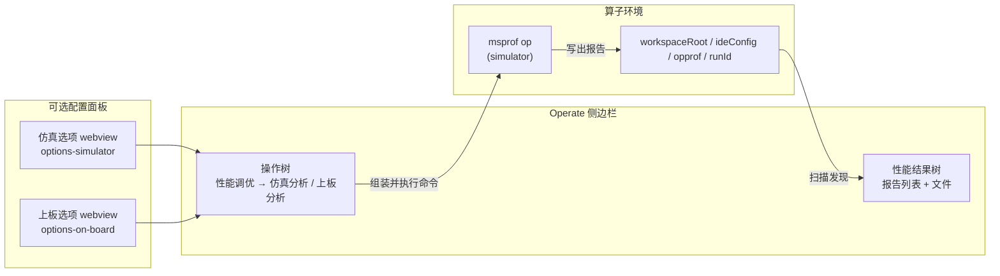
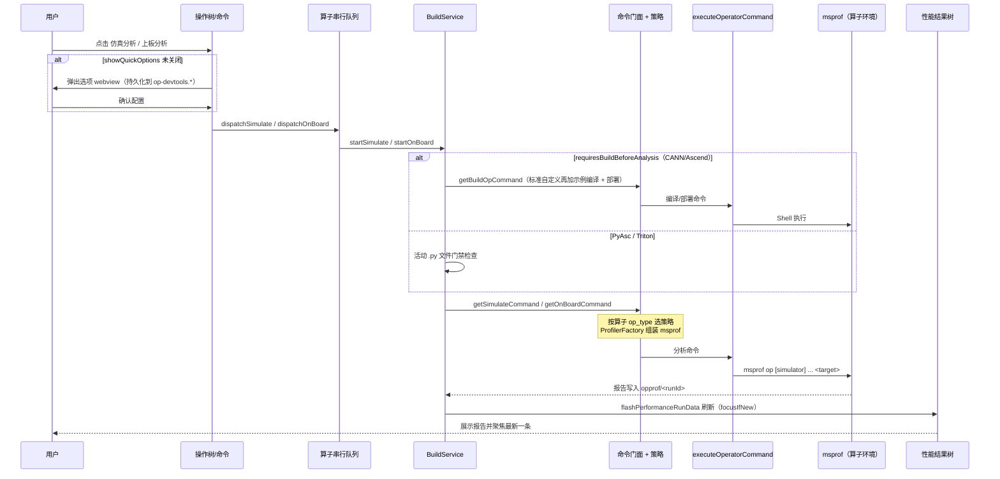
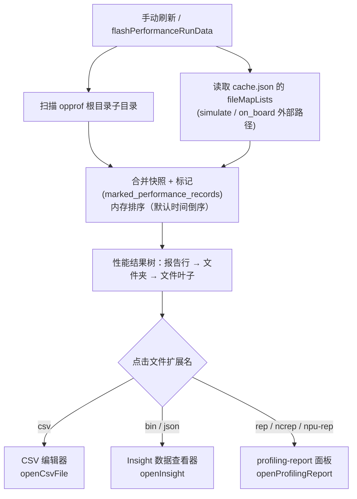
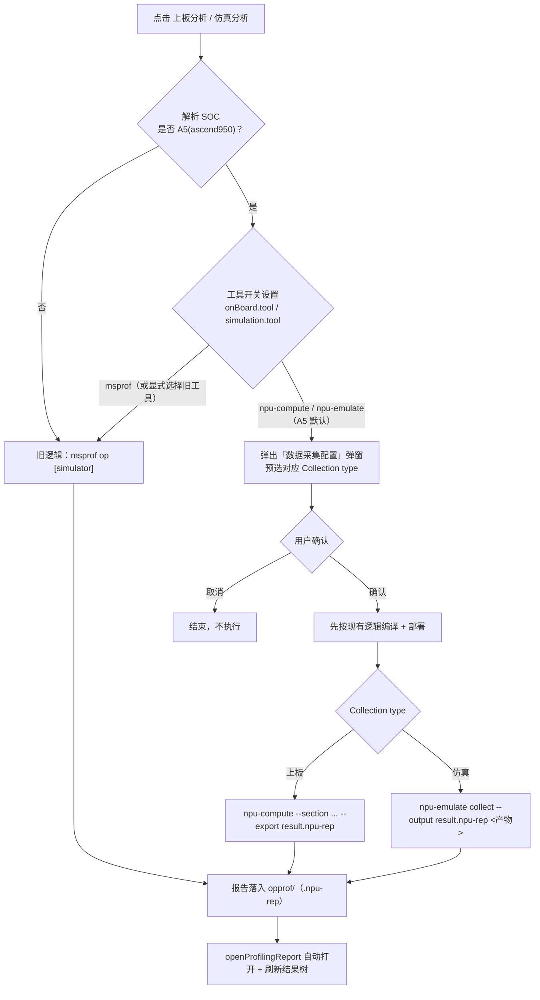

# 插件「上板分析 / 仿真分析」交互说明

> 适用范围：OP DevTools 插件 Operate 侧边栏的**性能调优**功能——仿真分析（simulation）与上板分析（onboard）。
> 内容依据当前分支代码与仓库内既有文档整理；A5 新工具（npu-compute / npu-emulate）替换方案见第五节。注意：新仿真工具已由 `npusim` 更名为 `npu-emulate`，其 `collect` 子命令已在 A5 环境启用并作为默认仿真工具，可通过设置切回 msprof 旧流程。

**相关文档：**

- [performance.md](./performance.md)：上板/仿真交互架构主文档（英文）
- [simulator-options-spec.md](./simulator-options-spec.md)：仿真快捷选项与指标 SOC 准入契约（英文）
- [run-integration.md](./run-integration.md)：普通"运行算子"链路，与性能分析共用执行栈
- [ascend-env-spec.md](./ascend-env-spec.md)：SOC 解析与 spawn 环境
- [workspace-settings.md](./workspace-settings.md)：`op-devtools.performanceTuning.*` 全部配置项
- A5 新工具（npu-compute / npu-emulate）的替换设计与工具手册目前未随仓库分发（《npu-compute 使用文档》《NPUSim 使用文档》仅在内部分发），本文第五、六节已收录其关键命令与参数口径

---

## 一、功能概览

插件本身不携带运行时，只负责**编排**：按工程类型完成前置编译/部署 → 组装分析命令 → 在算子环境中执行 → 在原生 VS Code 树中展示报告。

| 分层 | 职责 |
|------|------|
| CLI 工具 | 仿真用 `msprof op simulator`；上板用 `msprof op`（均在算子环境中运行） |
| 插件 | 可选的前置编译/示例编译/部署（依工程类型）、命令组装、Shell 执行 |
| 配置 | workspace 设置（`op-devtools.performanceTuning.*`）；`.vscode/cache.json` 的 `fileMapLists` 记录外部报告路径 |
| 结果 UI | 原生树 `opdevtoolsPerformanceResultsTree`（报告 → 文件夹/文件叶子节点） |
| 查看器 | CSV 编辑器、Insight 查看器（bin/json）、profiling-report 查看器（rep/ncrep/npu-rep） |

### 工作台布局与数据流

---

## 二、入口与标准交互链路（msprof 路径）

### 1. 入口

Operate 侧边栏 → **性能调优（Performance tuning）** 分组（`nodeId === 'power'`）下两个节点：

| 操作 | 树节点 | 队列类型 | 入口方法 |
|------|--------|----------|----------|
| 仿真分析 | `simulation` | `simulation` | `taskMethods.startSimulate` → `BuildService.startSimulate` |
| 上板分析 | `onboard` | `onboard` | `taskMethods.startOnBoard` → `BuildService.startOnBoard` |

- 经 `dispatchSimulator` / `dispatchOnBoard`（`task-method-dispatch.ts`）派发到**算子串行队列**。
- 对应命令：`sidebar.simulation`、`sidebar.onboard`（命令前缀以 flavor.json 的 `commandPrefix` 为准）。
- 齿轮图标可打开 workspace 设置或快捷选项面板。

### 2. 标准流程

1. **点击节点**：若 `simulation.showQuickOptions` / `onBoard.showQuickOptions` 未设为 `false`，先弹出**选项 webview**（仿真 `options-simulator`、上板 `options-on-board`），配置通过 `getSimulateOptions/saveSimulateOptions`（上板同理）读写，持久化到 workspace 设置 `op-devtools.*`，确认后调用 `startSimulate`/`startOnBoard` 并关闭编辑器。
2. **前置编译/部署**（依工程插件的 `buildBehavior.requiresBuildBeforeAnalysis`）：
   - CANN / Ascend 类工程：先编译算子工程（标准自定义算子还要编译示例并部署 `.run` 包）；
   - PyAsc / Triton：无编译步骤，但要求当前活动编辑器为 `.py` 文件（PyAsc 会把 `python3 <相对路径>` 写入 deploy 目标）。仿真活动文件检查失败会**抛错**，上板则**提前返回**（二者行为不对称）。
3. **命令生成**：命令门面 `getSimulateCommand` / `getOnBoardCommand` → `CommandStrategyFactory.getStrategy(op_type)`（ascend / cann / pyasc / triton）→ `ProfilerFactory` 生成 msprof 命令，拼接 CANN 环境 source 与 `cd` 命令。
4. **执行**：仿真 `msprof op simulator`、上板 `msprof op`，输出统一落到 **`<workspaceRoot>/<ideDir>/opprof/<runId>`**（所有算子共用这一个根目录，每次运行建一个子目录）。
5. **输出通道**：仿真写 `Op Dev Tools: simulate`，上板写 `Op Dev Tools: onboard`；**前置编译步骤的全部输出也写入同一通道**（不写 `compile` 通道），通道内容跨运行追加。
6. **成功后**：成功提示 + `flashPerformanceRunData`（`refreshPerformanceReports({ focusIfNew: true })`）刷新性能结果树，可自动聚焦并展开最新报告。

### 交互时序图

### 3. 结果树浏览

- 性能结果树是**独立视图** `opdevtoolsPerformanceResultsTree`，报告行只出现在这里，不在 `power` 节点下。
- 数据来源：扫描 opprof 根目录的子目录 + `cache.json` 中"添加可视化"的外部路径（键为 `simulate_<path>` / `onboard_<path>`）。
- 无报告时显示单个空占位行。
- **标题栏操作**：添加可视化、按时间排序、仅看标记、刷新结果（排序仅在内存中进行，不重新扫描磁盘）。
- **报告行操作**：复制（拼接报告下所有文件内容到剪贴板）、下载（打 zip）、标记/取消标记。
- 无文件系统 watcher/轮询，手动刷新以一次完整快照替换当前列表，磁盘上已删除的报告/文件会从树中消失。

### 4. 文件打开路由

| 扩展名 | 处理 |
|--------|------|
| `csv` | `viewService.openCsvFile`（CSV 编辑器） |
| `bin` / `json` | `viewService.openInsight`（Insight 数据查看器面板） |
| `rep` / `ncrep` | `viewService.openProfilingReport`（profiling-report 面板） |

扫描仅纳入小写扩展名：`csv`、`bin`、`json`、`rep`、`ncrep`、`npu-rep`；空目录分支会被裁剪。

### 报告发现与打开路由

---

## 三、仿真与上板的关键差异

| 维度 | 仿真分析 | 上板分析 |
|------|----------|----------|
| CLI | `msprof op simulator --soc-version=<仿真器目录> --output=.../opprof --aic-metrics=... <target>` | `msprof op --output=.../opprof --aic-metrics=... <target>`（不带 `--soc-version`） |
| 环境 | 必须传**仿真器目录名**（A5 为 `Ascend950PR_9589`、A3 为 `Ascend910C`、A2 为 `Ascend910B3`），**不是** CANN slug | 真实 NPU 硬件；SOC 取自 `resolveAscendEnv({ isSimulator: false })`；需通过 NPU 环境检查 |
| 基础指标 | `PipeUtilization`（默认始终采集） | 依 SOC 矩阵选择；A5 用 `PCSampling`（替代 A3 的 `MemoryDetail`） |
| 可选指标 | `ResourceConflictRatio`（默认开，与基础项**互斥**，开启后替换 `PipeUtilization`）；`PMSampling`（可追加，如 `ResourceConflictRatio,PMSampling`） | 见上板指标矩阵（`isAscendA5ProfilerCannSoc()` 区分 A5/A3） |
| SOC 准入 | 可选指标必须经真机 CLI 验证后加入 `SIMULATOR_OPTIONAL_METRIC_SOCS` 白名单才在 UI 放行；陈旧 workspace 值在非白名单 SOC 上不会产生该指标 | 上板指标随 SOC 矩阵切换 |
| 配置 DAO | `ConfigService.getSimulateConfig(projectPath)` | `ConfigService.getOnBoardConfig(projectPath)` |
| 目标二进制 | ascend 策略取 `exampleBuildConfig.targetFile`（回退默认 `build/test_aclnn_<op>`）；cann/pyasc/triton 取 deploy 键 `deployCommandOrRunCommand`（回退 `build_out/*.run` 等） | 同左（统一走 `strategy.getProfilerTargetFile`） |

### SOC 白名单机制（GC-22）

msopprof 会按 `--soc-version` 校验 `--aic-metrics`，平台不支持的指标直接报错 `Unexpected argument … maybe in wrong soc platform`。因此：

| 环境 | CANN slug | 仿真器目录 | PipeUtilization | ResourceConflictRatio | PMSampling |
|------|-----------|------------|-----------------|-----------------------|------------|
| A5 | `ascend950` | `Ascend950PR_9589` | 支持（基础） | **已验证支持** | **已验证支持** |
| A3 | `ascend910_93` | `Ascend910C` | 支持（基础） | **明确禁用** | 未验证 |
| A2 | `ascend910b` | `Ascend910B3` | 支持（基础） | 未验证 | 未验证 |

指标从"未验证"升级为"支持"必须有真实 `msprof op simulator` 跑通记录（退出码 0）并随 PR 留存 CANN 版本、目标算子等信息。

---

## 四、目标二进制与工程类型

| 工程上下文 | 存储的 `project_type` | 算子行 `op_type` | 说明 |
|------------|----------------------|------------------|------|
| CANN | `cann` | `cann` | 示例编译后，将 `deployCommandOrRunCommand` 设为可执行产物；从 `<op>/build` 目录运行 |
| 标准自定义 | `ascend` | `cann`（集合扫描算子）/ `ascend`（插件创建） | 需示例编译 + `.run` 包部署；多选算子时 Run/分析受限 |
| Ascend C / Torch library（检测型） | 打开工程后存为 `cann` | 多为 `cann` | 走 CANN 策略 |
| PyAsc | `pyasc` | `pyasc` | 活动 `.py` 门禁；`python3 <file>` 包裹 msprof |
| Triton | `triton`（需 `op-devtools.operatorSupport.triton`） | `triton` | 同 PyAsc 模型；执行前探测 Python 依赖；插件能力位不含仿真/上板时树中隐藏 |

两个不要混淆的轴：**`project_type`** 决定配置行（`build_op` / `build_example`）与 UI 门禁；**`op_type`** 决定 Shell 命令策略。命令生成始终以算子记录的 `op_type` 为准。

---

## 五、A5 新工具替换方案（上板 npu-compute、仿真 npu-emulate 均已落地）

> 基准：`ascend-c-toolkit` 分支。上板新工具 `npu-compute` 与仿真新工具 `npu-emulate` 的工具开关、「数据采集配置」弹窗、命令拼装与报告链路均已落地，并在 A5（ascend950）默认生效；可通过对应工具开关切回 msprof 旧流程。

### 规划的新旧工具分支

**方案内容**（上板、仿真两侧均已落地）：

1. **两个工具开关**：`op-devtools.performanceTuning.onBoard.tool`（`npu-compute`/`msprof`）、`simulation.tool`（`npu-emulate`/`msprof`）；未配置时 A5 默认新工具、非 A5 默认 msprof；非 A5 一律走旧逻辑。
2. **统一「数据采集配置」弹窗**：
   - 顶部 Collection type 切换（仿真/上板），从哪个入口打开就预选对应项；
   - Common 面板：Output File 文件选择、Force Overwrite、Target Processes（固定 All）、Replay Mode（固定 Application）、Application Replay Buffer（固定 File）、Application Replay Mode（固定 Balanced）、command Line 文本域；
   - Metrics 面板：section/set 下拉选择（非 radio）、过滤输入、Name/Description 表格；section 与 set 选择做联动一致性校验；该面板仅在选择上板（npu-compute）时显示——仿真 collect 暂不支持任何指标参数。
   - **command Line 文本域为最终执行命令的唯一依据**（结构化选择只用于自动同步文本，用户可再手改，插件不反解析用户 shell 文本）。
   - 约束：所有 section 均可选（A5 npu-compute 已全部支持）；detailed、hccl、roofline 三个 set 仍可见不可选（无展开定义）。
3. **执行流程**：确认后**先按现有逻辑编译**，再交新工具执行；npu-compute 把所选 set 展开为多个 `--section <id>`（不用逗号/空格拼接，不加 `--set`）；npu-emulate 以 `collect --output <opprofRunDir>/result.npu-rep <产物路径>` 一步完成仿真与报告导出；报告仍输出到同层 opprof 目录，**保留 `.npu-rep` 扩展名**；成功后用 `openProfilingReport` 自动打开，并刷新结果树（不重复自动打开）。
4. **新/旧报告区分**：以报告目录是否含 `.rep`/`.npu-rep` 文件天然区分——有则走 ProfilingReportPanel，旧报告（仅 bin/json/csv）走 Insight/CSV，无需额外判断工具来源。

**当前分支状态（以 `ascend-c-toolkit` 分支为准）**：

- 上板新工具链路**已落地**：`package.json` 已提供 `performanceTuning.onBoard.tool` / `performanceTuning.simulation.tool` 两个开关；A5（ascend950）默认使用 `npu-compute`，点击上板分析会弹出「数据采集配置」面板（`web/src/views/panels/data-collection-config/`），对应实现见 `ConfigService.shouldUseNewOnBoardTool()`、`buildNpuComputeCommand()`。
- 仿真新工具链路**已落地**：A5（ascend950）默认使用 `npu-emulate`，点击仿真分析弹出同一个「数据采集配置」面板（Metrics 面板隐藏）；确认后先编译，再执行 `npu-emulate collect --output <opprofRunDir>/result.npu-rep <产物路径>`，报告自动打开；对应实现见 `ConfigService.shouldUseNewSimulationTool()`、`buildNpuEmulateCommand()`。设置 `simulation.tool=msprof` 可切回第二、三节描述的旧路径。

---

## 六、A5 两个新工具简介

### npu-compute（规划用于替换上板）

- **原理**：经 `libnpu-compute.so` 注入（环境变量 `ACL_API_INJECTION`）目标进程，基于 ACLPTI 做 Kernel 重放，多轮采集不同 PMU 计数事件，退出后打包为 `.npu-rep`。定位类似 msprof，偏底层 PMU/Kernel 重放。
- **前置条件**：CPU 架构与包一致；glibc ≥ 2.34；libstdc++ 含 `GLIBCXX_3.4.29`（约 gcc 11+）；已 source 匹配版本 CANN。**切勿升级系统 glibc**。
- **命令格式**：`npu-compute [选项] 目标程序 [程序参数]`
- **常用参数**：
  - `--section <id>`：采集指标，**多个必须重复写**（逗号/空格均不合法）；当前 A5 版本支持 8 个，且弹窗中全部可选（与 `shared/data-collection-config.ts` 的 `DATA_COLLECTION_SECTIONS` 一致）：`PipeUtilization`、`Pipeline`、`L2Cache`、`Memory`、`MemoryL0`、`MemoryUB`、`ArithmeticUtilization`、`ResourceConflictRatio`；
  - `--list-sections`：列出支持的 section；
  - `--replay-mode kernel`：kernel 重放模式；
  - `-o/--export`：报告输出路径（`.npu-rep` 结尾视为文件，已存在目录则自动命名，不给则当前目录生成 `report_<时间戳>_<随机>.npu-rep`）；
  - `-i/--import`：解包 `.npu-rep`。
- **注意**：`HardwareInfo` 默认自动采集，不能作为 section；不支持嵌套采集；信号会转发给目标程序；属实验原型，每进程只重放一次 Kernel 启动。

### npu-emulate / cannsim（用于替换仿真；原名 npusim）

- **定位**：SoC 级芯片仿真，与板上二进制兼容；同一 kernel 可在仿真器与真实芯片运行。支持**精度仿真**（bit 级结果）与**性能仿真**（指令流水图/IPC/roofline）。
- **限制**：仅 Linux + CANN（Windows 无法运行仿真）；处理器 `Ascend950`；aarch64 / x86_64。
- **插件使用的命令**：`npu-emulate collect --output <报告文件路径> <编译产物路径>`——运行编译产物进行 SoC 仿真并一步导出 `.npu-rep` 报告；当前不支持指标/section 类附加参数。
- **旧版 CLI 备注**：[NPUSim_使用文档.md](../npu-simulator-analysis/NPUSim_使用文档.md) 记录的是旧版 Python CLI（`record` / `report` 子命令），当前随 CANN 分发的新版以 `collect` 为准。
- **安装要点**：随 CANN 分发；用仓库代码时须打 wheel 并 `pip install dist/*.whl --upgrade -t ${install_path}/python/site-packages/` **覆盖安装**，否则被 CANN 自带版本遮蔽。

---

## 七、关键代码文件

| 模块 | 路径 |
|------|------|
| 仿真/上板编排 | `plugin/src/service/build-service.ts`（`startSimulate` / `startOnBoard`） |
| 任务入口 | `plugin/src/controller/task-controller.ts` |
| 队列派发 | `plugin/src/helpers/task-method-dispatch.ts` |
| 命令门面 | `plugin/src/domain/services/command.ts`（`getSimulateCommand` / `getOnBoardCommand`） |
| msprof 策略 | `plugin/src/domain/services/profiler-service.ts`（`SimulatorStrategy` / `OnBoardStrategy`） |
| 按 op_type 命令策略 | `plugin/src/domain/services/command-strategy/*-strategy.ts` |
| 设置合并 / 各 section DAO | `plugin/src/service/config-service.ts` |
| 报告磁盘扫描 | `plugin/src/core/performance/performance-run-data.ts` |
| 结果树 UI 与状态 | `plugin/src/class/operate-tree-provider.ts` |
| 复制/打包/diff | `plugin/src/controller/performance-data-controller.ts` |
| CSV / Insight / profiling 打开 | `plugin/src/service/view-service.ts`、`plugin/src/class/profiling-report-panel.ts` |
| 选项 webview | `web/src/views/panels/options-simulator/`、`web/src/views/panels/options-on-board/` |
| A5/仿真指标矩阵 | `shared/msprof-onboard-env.ts`、`shared/msprof-simulator-metrics.ts`、`plugin/src/domain/utils/ascend-util.ts` |

---

## 八、常见问题排查

- **仿真报 `maybe in wrong soc platform`**：`--aic-metrics` 与 `--soc-version` 平台不匹配。确认未在 A3 上启用 `ResourceConflictRatio`；确认 `--soc-version` 传的是仿真器目录名而非 slug。
- **上板操作被环境拦截/提示切换 NPU 环境**：上板属于 NPU 必需操作，非 NPU 环境点击会弹"请切换至NPU环境"模态框；请在环境列表切换 NPU 环境后再执行。
- **运行后侧边栏没有报告**：确认命令成功退出且报告落在扫描根 `<workspaceRoot>/<ideDir>/opprof/`；点击结果树标题栏刷新；注意覆盖同名 runId 不会被识别为"新报告"。
- **PyAsc 分析直接返回/报活动文件错误**：打开一个 `.py` 文件再执行，或使用文件夹右键菜单（会先更新 deploy 目标）。
- **找不到分析目标二进制**：检查 workspace 设置 `compileAndDeploy.buildConfig.deployCommandOrRunCommand`（运行/cann 系）或 `exampleBuildConfig.targetFile`（ascend 系性能分析）。
- **qemu 段错误（signal 11）**：通常是 x86_64 主机运行 aarch64 二进制的架构不匹配，需在匹配硬件上运行或同环境重新编译。
